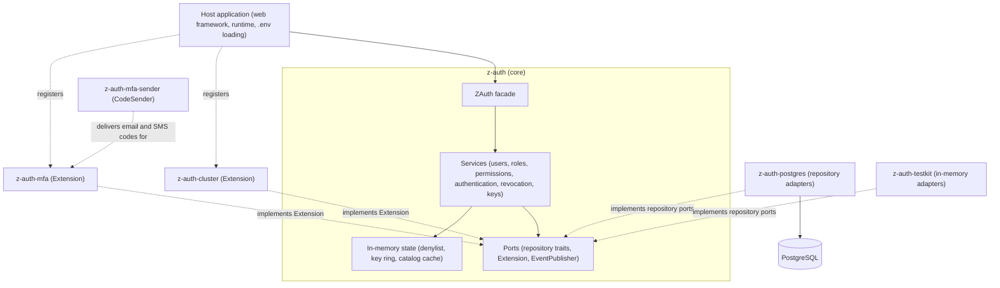

# z-auth

[](https://github.com/eugenezimin/z-auth/actions/workflows/ci.yml) [](https://github.com/eugenezimin/z-auth/actions/workflows/release.yml) [](https://github.com/eugenezimin/z-auth/releases/latest)

z-auth is a storage- and transport-agnostic authentication library for Rust. It defines the authentication domain (users, roles, permissions, sessions, access and refresh tokens, revocation) together with the ports, written as traits, that it needs from the outside world. The host application supplies the adapters for those ports, which means the database repositories, the HTTP routing and, when it runs more than one instance, the cluster transport. The library itself ships no database driver and no web server, so it fits any async runtime, any web framework and any store that can honour the repository contracts.

The core is built around a single facade, `ZAuth`, which wires every service from the repositories you hand it. Access tokens are Ed25519-signed JWTs that are verified entirely in memory, refresh tokens are HMAC-bound to a session generation and rotate on every use, and revocations are kept in an in-memory denylist that is seeded from storage at startup. Authorization data (role codes, an encoded permission bitset, the authentication methods of the session) travels inside the access token, so request-time checks never touch the store.

## Crates

The repository is a Cargo workspace. The root crate is the core, and the optional crates under `adapters/` build on it without the core knowing about them.

| Crate | Path | Role |
|---|---|---|
| `z-auth` | `.` | The core. Registration, login, sessions, Ed25519 access tokens, HMAC refresh tokens, revocation, roles and permissions, the `ZAuth` facade and the `Extension` port |
| `z-auth-cluster` | [`adapters/cluster`](adapters/cluster/README.md) | Optional clustering as an `Extension`, in shared mode (one database) or federation mode (one database per service) |
| `z-auth-mfa` | [`adapters/mfa`](adapters/mfa/README.md) | Optional two-factor authentication as an `Extension`, with TOTP, email and SMS codes and recovery codes, configured through `AUTH_MFA_*` |
| `z-auth-mfa-sender` | [`adapters/mfa/delivery`](adapters/mfa/delivery/README.md) | Ready-made `CodeSender` implementations for z-auth-mfa's email and SMS codes, over SMTP, SendGrid, Postmark, Mailgun, Twilio or a signed webhook, chosen through `AUTH_MFA_EMAIL_PROVIDER` and `AUTH_MFA_SMS_PROVIDER` |
| `z-auth-postgres` | [`adapters/postgres`](adapters/postgres/README.md) | Reference PostgreSQL adapter on sqlx, with migrations and the `setup_db` binary, including the cluster and mfa stores behind features |
| `z-auth-testkit` | `testkit` | In-memory adapters and helpers for the test suites, not published |

The diagram below shows how the pieces relate. The host application talks to the core through `ZAuth`, the extension crates plug into the core through the `Extension` port, and the storage adapters implement the repository ports.



## Quick start

The commands below generate the keys, create the PostgreSQL schema with the reference adapter, and run the database-free test suite. The library never reads `.env` itself, but `setup_db` and your own host application can load it. Before running `setup_db`, paste the `keygen` output into `.env`, set the `DB_*` values, and delete the trailing `# ...` comments from the lines you keep, because `setup_db` reads everything after the `=` as the value and an empty `AUTH_*` line counts as set rather than absent.

```sh
cp env.example .env
cargo run --example keygen                    # signing key, verifying key and refresh secret
cargo run -p z-auth-postgres --bin setup_db   # create the database and apply the migrations
cargo test --workspace --exclude z-auth-postgres --all-features
```

With two-factor authentication, also generate the z-auth-mfa keys and create its tables.

```sh
cargo run -p z-auth-mfa --example mfa_keygen                        # AUTH_MFA_ENCRYPTION_KEY, AUTH_MFA_HASH_KEY
cargo run -p z-auth-postgres --features mfa --bin setup_db -- --mfa
```

A minimal wiring with the PostgreSQL adapter looks like this. The [getting started guide](docs/getting-started.md) walks through it step by step, including the periodic `tick` and a first register, login, refresh and logout.

```rust
use std::sync::Arc;
use z_auth::prelude::*;
use z_auth_postgres::{PgConfig, PgPermissionRepository, build_pg_pool, repositories};

let pool = build_pg_pool(&PgConfig::from_env()?).await?;
let auth = ZAuth::builder(EnvLoader.load_config()?, repositories(&pool))
    .permissions(Arc::new(PgPermissionRepository::new(pool.clone()))) // permission modes only
    .build()?;
auth.start().await?;
```

`login` returns `LoginOutcome::Tokens` or, when an installed second-factor gate asks for one, `LoginOutcome::SecondFactor` with a challenge that `complete_login` answers. Access tokens carry the session's authentication methods in the `amr` claim, which `Authorizer::require_mfa` checks.

## Guides

The core guides live in [`docs/`](docs). They are meant to be read roughly in this order, although each stands on its own.

| Guide | Contents |
|---|---|
| [Getting started](docs/getting-started.md) | Keys, environment, database setup, wiring `ZAuth`, the lifecycle loop, and a first register, login, refresh and logout |
| [Architecture](docs/architecture.md) | Module layout, layering, ports and adapters, the builder, lifecycle, domain events and Cargo features |
| [Sessions and tokens](docs/sessions-and-tokens.md) | Sessions and generations, the access JWT, refresh tokens and rotation, reuse detection, revocation, the denylist and signing keys |
| [Authorization](docs/authorization.md) | Authorization modes, roles, the permission catalog, the token encoding and request-time checks |
| [Extensions](docs/extensions.md) | The `Extension` port, its build phases and hooks, and how to write your own |
| [HTTP API](docs/http-api.md) | The framework-agnostic handlers, DTOs, JSON shapes and the error to status mapping |
| [Configuration](docs/configuration.md) | Every `AUTH_*` variable, `RawConfig`, the loaders and validation rules |
| [Storage ports](docs/storage-ports.md) | The repository contracts for writing your own storage adapter |
| [Development](docs/development.md) | Workspace layout, the testkit, running tests, CI and releases |

Each adapter crate has its own guide set. The [PostgreSQL adapter](adapters/postgres/README.md) documents the schema, migrations and federation store, the [cluster extension](adapters/cluster/README.md) documents shared and federation mode, replication and deployment, the [mfa extension](adapters/mfa/README.md) documents the two-step login, enrollment and its security model, and [z-auth-mfa-sender](adapters/mfa/delivery/README.md) documents the email and SMS providers that deliver its codes. The crate-level rustdoc (`cargo doc --open`) covers the API item by item.

## CI and releases

Every pull request to `main` runs the CI workflow in `.github/workflows/ci.yml`. It checks formatting, runs clippy with warnings denied across all targets and features, runs the test suite for every crate except the PostgreSQL adapter, runs the adapter's own tests against a PostgreSQL 16 service after applying the core, cluster and mfa migrations with `setup_db`, checks every feature of every crate on its own with `cargo hack`, builds the documentation with rustdoc warnings denied, and audits the dependency tree with `cargo audit`. A final summary job collects the results into a table and fails if any job failed or was cancelled.

Pushing a tag that starts with `v` runs the release workflow in `.github/workflows/release.yml`. It first checks that the tag matches the version of the `z-auth` crate (for example `v0.3.0`, or `v0.3.0-rc.1` for a pre-release), then builds the workspace in release mode with all features for Linux x86_64 and macOS arm64. Each archive contains the `setup_db`, `keygen` and `mfa_keygen` binaries together with this README and `env.example`, and is published with a SHA-256 checksum on [GitHub Releases](https://github.com/eugenezimin/z-auth/releases). Tags containing a hyphen are published as pre-releases.
