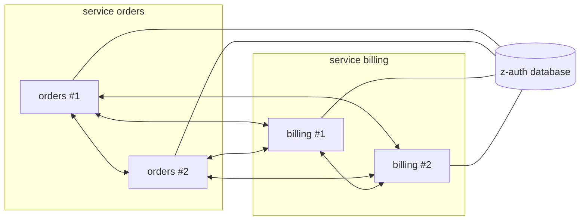
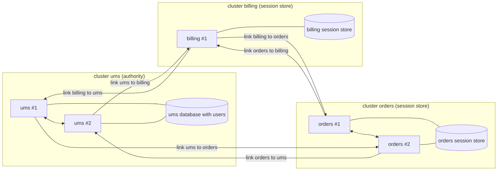

# z-auth-cluster

`z-auth-cluster` lets several z-auth instances act as one. The core crate covers registration, login, logout, sessions, token issuing, verification, refresh and revocation through an in-memory denylist, and it deliberately knows nothing about clusters. Everything a cluster needs (finding peers, pushing revocations and key events, repairing drift, syncing sessions between services) lives in this crate and plugs into `ZAuth` through the core's `Extension` port, described in [the extensions guide](../../docs/extensions.md). A service that runs a single instance never needs this crate.

The crate ships no network code and no database code. The host application supplies an outbound transport, an inbound endpoint that hands received envelopes to the cluster, and the storage ports. The reference implementations of the storage ports live in [z-auth-postgres](../postgres/README.md).

## Two modes

The crate offers two deployment modes, each delivered as its own `Extension`. Shared mode (`SharedCluster`) assumes that every instance of every service talks to the same z-auth database. The database already holds the truth, so the cluster only has to keep the in-memory state of each instance (denylist, key ring, catalog version) in step, which it does by pushing events to every peer and repairing gaps with digests and snapshots.

Federation mode (`Federation`) gives every service its own database. One service, the authority, owns identity (users, roles, grants, the permission catalog) and is the only place where users register and log in. Every other service keeps a session store that holds sessions, revocations and verifying keys plus account and catalog snapshots published by the authority. Sessions, revocations and keys are written anywhere and merged with conflict-free rules, so a token pair issued by the authority can be refreshed, logged out or revoked at any service.

| Aspect | Shared mode | Federation mode |
|---|---|---|
| Extension type | `SharedCluster` | `Federation` |
| `AUTH_DEPLOYMENT_MODE` | `shared` or unset | `federation` |
| Databases | One z-auth database for every instance of every service | One database per service |
| Who registers and logs in users | Any instance | Only the authority (`AUTH_AUTHORITY_SERVICE`) |
| What is replicated between instances | In-memory state only (denylist, key ring, catalog version) | In-memory state inside each cluster, plus sessions, revocations, keys and snapshots between clusters |
| Membership | Every instance meshes with every other | Full mesh inside a service, one link per ordered pair of services |
| Discovery | The node registry in the shared database | The per-service registry plus `AUTH_CLUSTER_SEEDS` |
| Storage ports | `NodeRepository` | `NodeRepository` and `SyncStore` |
| Self-fencing | Never | `quorum` by default (`AUTH_CLUSTER_SELF_FENCE`) |
| Guide | [Shared mode](docs/cluster.md) | [Federation mode](docs/replication.md) |

In shared mode every instance is a peer of every other instance, regardless of the service it belongs to, and they all share one database.



In federation mode each service forms a cluster over its own database. Instances of one cluster mesh with each other, and each ordered pair of clusters is connected by a single link owned by one instance of the sending cluster.



## Features

The crate has two Cargo features. `federation` is the default and implies `shared`.

| Feature | What it enables |
|---|---|
| `shared` | Nothing extra inside this crate. The `shared` module and `SharedCluster` are always compiled, so `default-features = false` still gives you shared mode. The feature exists so that dependents such as z-auth-postgres can forward it (`z-auth-postgres/shared` turns on `z-auth-cluster/shared` and the node registry). |
| `federation` | The `federation` and `sync` modules, the crate-private serving-fence wrappers, the `Cluster::Federation` variant, the `sync_store` and `on_fenced` fields of `ClusterAdapters`, the `ClusterMessage::Sync` wire variant, and the re-exports of `Federation`, `SessionRepositories` and `SyncStore`. |

Without `federation`, `Cluster::new` returns a configuration error when `AUTH_DEPLOYMENT_MODE=federation` is set.

## Wiring

Cluster settings are loaded separately from z-auth's own `AuthConfig`. `ClusterEnvLoader` reads the `AUTH_CLUSTER_*`, `AUTH_LINK_*`, `AUTH_FEDERATION_*`, `AUTH_FORK_*`, `AUTH_DEPLOYMENT_MODE`, `AUTH_AUTHORITY_SERVICE` and `AUTH_SESSION_DISTRIBUTION` variables into a `ClusterSettings`, and `ClusterSourceLoader` reads the same settings from the `cluster` section of a YAML configuration file with those variables on top, as described in [the configuration guide](docs/configuration.md).

Shared mode is a single constructor. `SharedCluster::new(settings, transport, nodes)` takes the settings, an `Arc<dyn ClusterTransport>` and an `Arc<dyn NodeRepository>`. Register the same `Arc` with the builder and keep a clone for the inbound endpoint.

```rust
use std::sync::Arc;
use z_auth::ZAuth;
use z_auth::conf::config::{ConfigLoader, EnvLoader};
use z_auth_cluster::SharedCluster;
use z_auth_cluster::config::{ClusterConfigLoader, ClusterEnvLoader};

let cluster = Arc::new(SharedCluster::new(
    ClusterEnvLoader.load_settings()?,
    transport, // Arc<dyn ClusterTransport>
    nodes,     // Arc<dyn NodeRepository>, e.g. z_auth_postgres::PgNodeRepository
));
let auth = ZAuth::builder(EnvLoader.load_config()?, repos)
    .extension(cluster.clone())
    .build()?;

auth.start().await?; // joins the cluster
// every AUTH_CLUSTER_HEARTBEAT_MS: auth.tick().await?;
// inbound cluster endpoint:        cluster.receive(envelope).await?;
// on shutdown:                     auth.shutdown().await?;
```

Federation mode adds a `SyncStore` and a decision about repositories. `Federation::new(settings, transport, nodes, store)` builds the extension, and the optional builder methods `delay(Arc<dyn Delay>)` and `on_fenced(FenceHook)` set the retry sleeper and the hook called when the instance fences itself. The authority builds its repositories normally. Every other service must build them through `Federation::session_store_repositories`, which keeps the session, revocation and key repositories and replaces users, roles and role assignments with stores that refuse with `AuthError::NotAuthority`.

```rust
use z_auth_cluster::{Federation, SessionRepositories};

let federation = Arc::new(
    Federation::new(settings, transport, nodes, sync_store).on_fenced(Arc::new(restart)),
);
let repos = if federation.is_authority() {
    z_auth_postgres::repositories(&pool)
} else {
    federation.session_store_repositories(SessionRepositories { sessions, revocations, keys })
};
let auth = ZAuth::builder(config, repos).extension(federation.clone()).build()?;
```

`Cluster::new(settings, adapters)` picks the mode from `AUTH_DEPLOYMENT_MODE` at run time instead of in code. It takes a `ClusterAdapters` value with the fields `transport`, `nodes`, `sync_store` (required in federation mode), `delay` and `on_fenced`, and returns `Cluster::Shared` or `Cluster::Federation`. `Cluster::extension()` gives the `Arc<dyn Extension>` to register, `Cluster::receive` serves the inbound endpoint, and `Cluster::mode()` reports the resolved `DeploymentMode`. Unset or `shared` selects shared mode, `federation` selects federation mode, and `standalone` is an error because a standalone service should not build a cluster at all. In federation mode a session store must still build its repositories from the `Federation` inside `Cluster::Federation` before calling `ZAuth::builder`, which [the deployment guide](docs/deployment.md) shows in full.

## What the host provides

The crate never opens a socket and never touches a database directly. The host supplies the pieces below and drives the lifecycle through `ZAuth::start`, `ZAuth::tick` and `ZAuth::shutdown`.

| Piece | Mode | Purpose |
|---|---|---|
| `ClusterTransport` | both | Outbound delivery of a signed `ClusterEnvelope` to a peer, returning the peer's reply |
| Inbound endpoint | both | Receives envelopes from peers and passes them to `SharedCluster::receive`, `Federation::receive` or `Cluster::receive`, returning the reply envelope |
| `NodeRepository` | both | The node registry, read at start and written only when a node changes state |
| `SyncStore` | federation | The change feed, snapshots, cursors and session merges of this service's database |
| `Delay` | federation, optional | Sleeps between retries of inter-cluster requests (for example with `tokio::time::sleep`); defaults to `NoDelay` |
| `FenceHook` | federation, optional | Called once when the instance fences itself; the host should restart the process |

The tick loop is the cluster's clock. Call `ZAuth::tick` every `AUTH_CLUSTER_HEARTBEAT_MS` (2000 ms by default), because heartbeats, liveness decisions, retries, snapshot repair and inter-cluster pulls all happen inside it. Each start and tick returns a report, and `ClusterReportExt::cluster()` reads the cluster's part of it.

```rust
use z_auth_cluster::ClusterReportExt;

let report = auth.tick().await?;
if let Some(cluster) = report.cluster() {
    println!("online {} offline {} fenced {}", cluster.online, cluster.offline, cluster.fenced);
}
```

## Module tree

The public modules mirror the two modes, with shared types reused by federation mode.

```text
z_auth_cluster
├── config              ClusterSettings and its loaders (always compiled)
│   ├── loaders         ClusterConfigLoader, ClusterEnvLoader, ClusterSourceLoader, ClusterDirectLoader, RawClusterConfig::build
│   └── model           ClusterSettings, ClusterConfig, FederationConfig, LinkConfig, ForkPolicy, enums
├── constants           defaults, protocol limits, environment variable names
├── shared              shared mode, and the wire model both modes use (always compiled)
│   ├── extension       SharedCluster, CLUSTER_EXTENSION
│   ├── model           NodeInfo, NodeState, HeartbeatStatus, NodeTransition, ClusterEnvelope, ClusterMessage, ClusterReport
│   ├── repository      NodeRepository
│   ├── service         ClusterService
│   ├── service_impl    ClusterServiceImpl
│   ├── transport       ClusterTransport, Delay, NoDelay
│   └── (private)       local, memory, messenger (ClusterPublisher is re-exported), signer, state
├── federation          federation mode (feature federation)
│   ├── engine          FederationEngine, FederationReport, config_fingerprint
│   ├── extension       Federation, SessionRepositories
│   ├── fork            evaluate_chain, ChainVerdict, BenignFork, ForkParams
│   ├── guard           NotAuthorityUsers, NotAuthorityRoles, NotAuthorityLogin, SnapshotPermissions, SnapshotAccountSource
│   ├── membership      FederationClusterService, FenceHook
│   │   ├── breaker     per-target circuit breaker
│   │   ├── service     sibling mesh, links, eviction, fencing
│   │   └── state       MeshState
│   ├── merge           merge_session, merge_revocation, merge_key, merge_account, merge_catalog
│   ├── producer        SnapshotProducer and the Producing* wrappers
│   └── store           SyncStore
├── fence               FencedAuthentication, FencedRevocation (crate-private, feature federation)
├── sync                SyncRecord, SyncMessage, SessionAggregate, snapshots, FeedCursor (feature federation)
├── mode                Cluster, ClusterAdapters (re-exported at the root)
├── report              ClusterReportExt
└── prelude             convenience re-exports
```

`use z_auth_cluster::prelude::*;` brings in the loaders, the settings types, both extensions, `Cluster`, `ClusterAdapters`, `ClusterReportExt`, the shared wire and registry types, and, with the `federation` feature, `Federation`, `SessionRepositories`, `SyncStore` and `FederationClusterService`.

## Storage

The crate defines storage ports but implements none of them. [z-auth-postgres](../postgres/README.md) provides `PgNodeRepository` behind its `shared` feature and `PgSyncStore` behind its `federation` feature. In shared mode, and on the authority in federation mode, the `cluster_` tables come from a separate migration set applied by `run_cluster_migrations` (or `setup_db --cluster`). A session store in federation mode uses its own schema, applied by `run_session_store_migrations`. The schema and the change-feed triggers are documented in [the PostgreSQL federation guide](../postgres/docs/federation.md).

## Guides

[Shared mode](docs/cluster.md) covers the transport contract, the wire format and its HMAC signing, the receive pipeline, membership and liveness, the node registry state machine, event broadcast, anti-entropy and the cluster report. [Federation mode](docs/replication.md) covers the authority and session stores, the refusal guards, links between clusters, eviction and self-fencing, the sync engine, merge rules, refresh forks and the refresh gate. [Configuration](docs/configuration.md) lists every variable with its default, alias and validation, plus the fixed protocol constants and the gotchas. [Deployment](docs/deployment.md) walks through choosing a mode, end-to-end wiring with z-auth-postgres, implementing a transport, and how a running cluster behaves under partitions and failures.

For two-factor authentication in federation mode, see [z-auth-mfa](../mfa/README.md). Both login steps belong to the authority, so register z-auth-mfa on the authority only.
