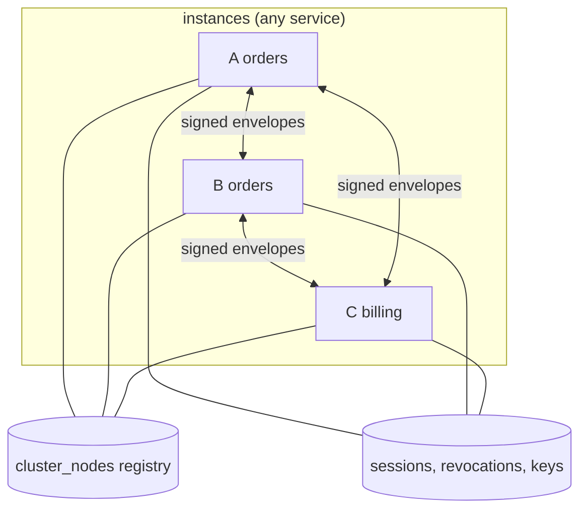
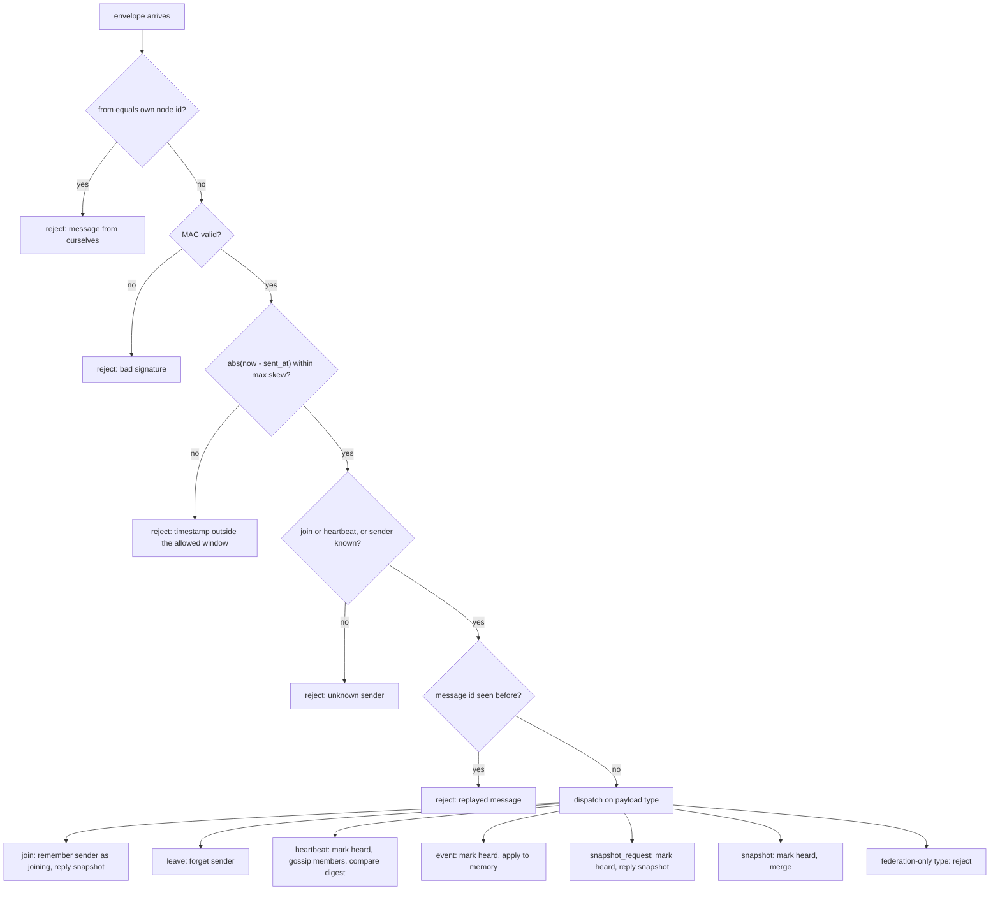
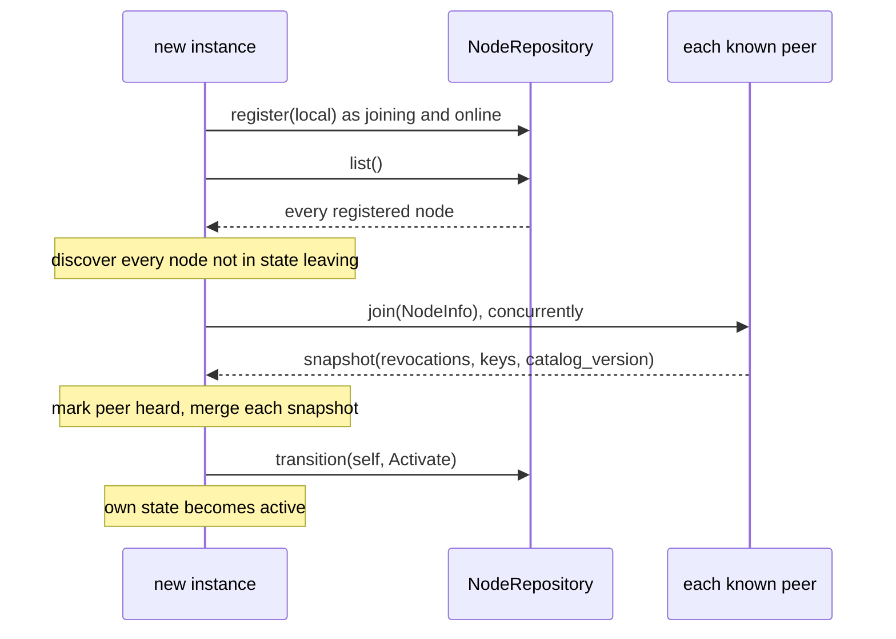
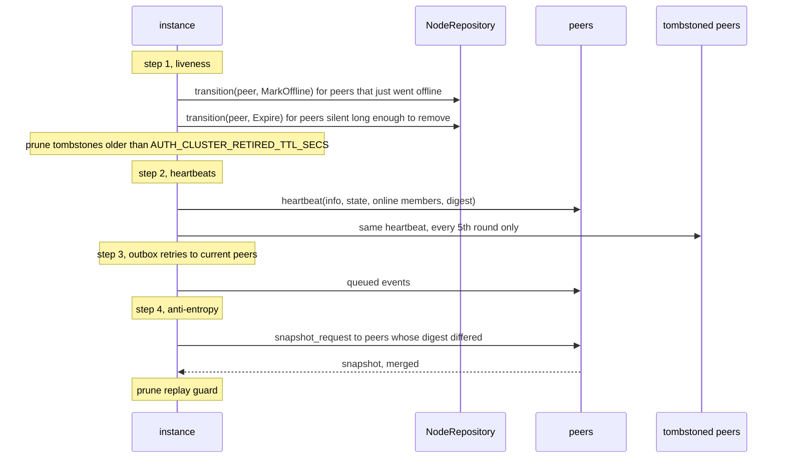
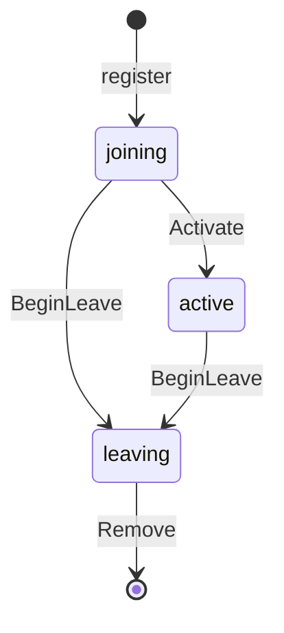
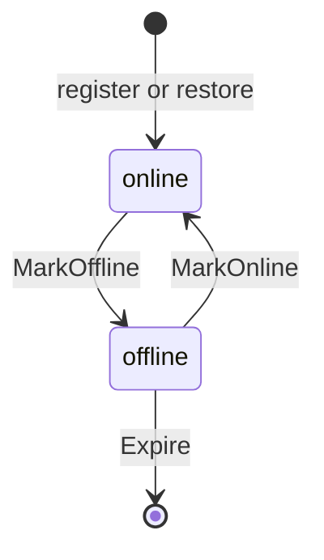
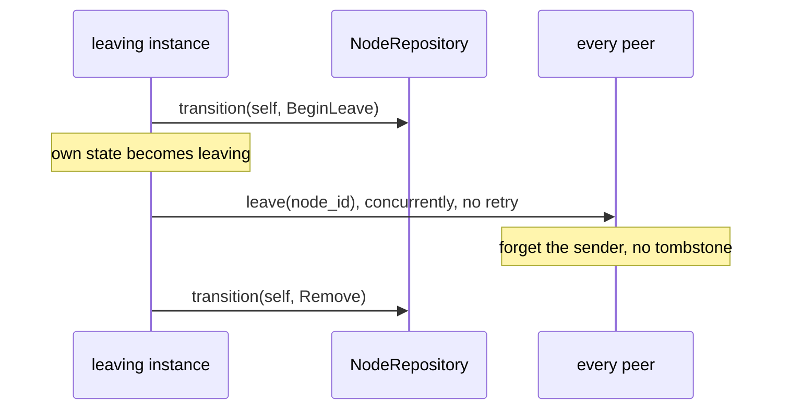

# Shared mode

Shared mode turns every z-auth instance that uses one database into a peer of every other instance. The database is already the source of truth for users, sessions, revocations and keys, so the cluster has a narrow job. It keeps the in-memory state each instance needs for I/O-free token verification (the denylist, the key ring and the catalog version) identical everywhere, it pushes changes the moment they happen, and it repairs whatever a lost message left behind. This guide describes the protocol in depth, from the transport contract to the liveness timing. Wiring is summarised in [the crate README](../README.md), every setting is listed in [the configuration guide](configuration.md), and end-to-end examples are in [the deployment guide](deployment.md).

## Topology

All instances of all services share one z-auth database, and each instance sends to every other instance directly. There is no leader, no coordinator and no gossip hierarchy. An instance learns about its peers from the node registry when it starts, from the heartbeats it receives, and from the member lists those heartbeats carry.



The `service` field each instance advertises (`AUTH_CLUSTER_SERVICE`, default `z-auth`) is informational in shared mode. Peers are sorted by service and node id in `ClusterService::peers`, but membership does not depend on it.

## The transport port

z-auth never opens a connection. The host implements `ClusterTransport` with whatever client it already uses (HTTP, gRPC, a message bus) and passes it to `SharedCluster::new`.

```rust
#[async_trait]
pub trait ClusterTransport: Send + Sync {
    async fn send(
        &self,
        to: &NodeInfo,
        envelope: &ClusterEnvelope,
    ) -> Result<Option<ClusterEnvelope>, AuthError>;
}
```

The contract is short. Deliver `envelope` to the instance described by `to`, reaching it at `to.host()` and `to.port`, and return the envelope the peer answered with, or `None` if it answered with nothing. `NodeInfo::host()` returns the advertised DNS name when there is one and the IP address otherwise. Use a short timeout, because the cluster sends heartbeats to every peer concurrently on every tick and a slow peer should fail fast rather than stall the round. On any failure return `AuthError::ClusterUnreachable`. The cluster treats every error the same way (the send failed), retries events from its outbox, and repairs anything still missing through the heartbeat digest, so the transport should not retry on its own.

The transport must carry the envelope losslessly. The MAC is recomputed on the receiving side from the deserialized fields, so any serialization works as long as the decoded `message_id`, `from`, `sent_at` and `payload` are exactly what was sent. JSON through serde is the natural choice because `ClusterEnvelope` derives `Serialize` and `Deserialize`.

In federation mode the transport is also used to probe seeds by address. Such a `NodeInfo` has a nil `node_id` and an empty `service`, and only `to.host()` and `to.port` are meaningful. A shared-mode transport never sees that case, but writing the transport to route purely by address makes it reusable in both modes.

## Delay and NoDelay

`Delay` is a second, optional port with one method, `async fn sleep(&self, duration: Duration)`. z-auth has no async runtime of its own, so a host that wants real pauses between retries passes an implementation backed by its runtime, for example `tokio::time::sleep`. `NoDelay` is the built-in implementation that returns immediately.

Shared mode never waits between retries. Its retries happen once per tick from the outbox, so `SharedCluster::new` takes no delay and `Cluster::new` ignores `ClusterAdapters::delay` in shared mode. The port matters only for inter-cluster requests in [federation mode](replication.md).

## The inbound endpoint

The other half of the transport is an endpoint the host exposes on the advertised address and port. It decodes the incoming `ClusterEnvelope`, calls `SharedCluster::receive(envelope)` (or `Cluster::receive`), and sends back the returned `Option<ClusterEnvelope>` as the response. The reply is already signed. Calling `receive` before `ZAuthBuilder::build` has run returns `AuthError::Config("cluster not wired: build ZAuth first")`.

`receive` rejects anything suspicious with `AuthError::ClusterMessageRejected`, which z-auth's HTTP error mapping turns into status 401 with code `cluster_message_rejected`. Errors from storage or configuration propagate unchanged. The endpoint should be reachable only from the cluster network. The MAC already makes forged messages useless, but there is no reason to expose the endpoint to the public internet.

## Wire format

`ClusterEnvelope` is the only type that crosses the wire.

| Field | Type | Meaning |
|---|---|---|
| `message_id` | `Uuid` | Unique per message, used by the replay guard; a broadcast uses one id for every recipient |
| `from` | `Uuid` | Node id of the sender, generated per process start |
| `sent_at` | `DateTime<Utc>` | Sender's clock at sealing time, checked against `AUTH_CLUSTER_MAX_SKEW_SECS` |
| `payload` | `ClusterMessage` | The message itself |
| `mac` | `String` | base64url without padding of the HMAC-SHA256 tag |

`ClusterMessage` is an adjacently tagged serde enum, `#[serde(tag = "type", content = "data", rename_all = "snake_case")]`, so every payload serializes as an object with a snake-case `type` and, for variants that carry data, a `data` field. `DomainEvent`, carried inside `event`, uses the same tagging. Shared mode uses six variants and rejects the rest.

| `type` | `data` | Purpose | Reply |
|---|---|---|---|
| `join` | `NodeInfo` | A node started and announces itself | `snapshot` |
| `leave` | `{ "node_id": ... }` | A node shuts down gracefully | none |
| `heartbeat` | `Heartbeat` (`info`, `state`, `members`, `digest`) | Liveness, member gossip and the state digest | none |
| `event` | `DomainEvent` | A change to push | none |
| `snapshot_request` | none | Ask for the replicated state | `snapshot` |
| `snapshot` | `ClusterSnapshot` (`revocations`, `keys`, `catalog_version`) | The replicated state | none |

The remaining variants (`probe`, `welcome`, `node_updated`, `peer_status`, `evicted`, `retired`, `directory`, `link_heartbeat`, `link_handover`, `cluster_dead`, `cluster_alive`, `relayed_event`, `forward`, `forward_reply` and `sync`) belong to federation mode. A shared-mode instance that receives one rejects it with "federation-mode message in a shared-mode cluster".

A heartbeat envelope looks like the following on the wire when the transport uses JSON. The values are examples.

```json
{
  "message_id": "6f1c2a7e-3b0d-4c55-9a8e-1d2f3a4b5c6d",
  "from": "0d9e8f7a-6b5c-4d3e-8f1a-2b3c4d5e6f70",
  "sent_at": "2026-10-16T09:30:02.125Z",
  "payload": {
    "type": "heartbeat",
    "data": {
      "info": {
        "node_id": "0d9e8f7a-6b5c-4d3e-8f1a-2b3c4d5e6f70",
        "service": "orders",
        "ip": "10.0.0.5",
        "dns_name": null,
        "port": 7000,
        "version": "0.3.0",
        "started_at": "2026-10-16T09:12:40.001Z"
      },
      "state": "active",
      "members": [],
      "digest": { "revocations": "3fa2c1d09b8e7a65", "keys": "a1b2c3d4e5f60718", "catalog_version": 4 }
    }
  },
  "mac": "kH3w0m6r2sQ7xXcY1f8pVbN4aZtLq5eU9jGdR0yCw2E"
}
```

`NodeInfo::version` is the z-auth library version (`z_auth::VERSION`), so operators can see which release each peer runs. `started_at` is taken from the instance's clock when the extension is configured.

## Message authentication

Every envelope is signed with HMAC-SHA256 under the shared cluster secret. The signed bytes are the serde_json encoding of a struct with exactly four fields in this order, `{message_id, from, sent_at, payload}`, and the tag is stored in `mac` as base64url without padding. Verification recomputes the tag from the received fields and compares it in constant time with `verify_slice`. Changing any field, including `from`, invalidates the MAC.

The secret is `AUTH_CLUSTER_SECRET`, a standard base64 string that must decode to at least 32 bytes (`MIN_CLUSTER_SECRET_LEN`). Every instance in the cluster must use the same value. Configuration rejects a secret that is too short or not valid base64, while a missing secret in shared mode is only detected when `ZAuth::build()` runs the extension's configure phase, as described in [the configuration guide](configuration.md).

Replies are verified too. When an instance sends a message and gets an envelope back, it checks that `reply.from` equals the node it sent to and that the reply's MAC verifies. Otherwise the send fails with `ClusterMessageRejected("reply not signed by the peer")`. A compromised network path can therefore neither forge requests nor substitute replies.

## The receive pipeline

`receive` runs every envelope through a fixed sequence of checks before it dispatches the payload. The order matters. The cheap identity check runs first, the MAC runs before any field is trusted, and the replay guard runs last so that rejected forgeries never pollute it.



A sender counts as known when it is a current peer or a removed peer that is still remembered as a tombstone. Only `join` and `heartbeat` may introduce a new sender, because only they carry the sender's `NodeInfo`. Both are additionally rejected when the `NodeInfo` they carry names a different node than `from` ("join for another node", "heartbeat for another node"). A `leave` only removes the sender itself; a `leave` naming another node is accepted and ignored.

The replay guard remembers every message id it has accepted together with the time it first saw it. Each tick prunes ids older than twice `AUTH_CLUSTER_MAX_SKEW_SECS`, which is safe because a replay that old already fails the skew check. With the default skew of 30 s, ids are kept for 60 s.

## Joining the cluster

`ZAuth::start` calls `SharedCluster::start`, which registers the instance and announces it. The registry is read exactly once here; after start, an instance learns about others only through messages.



On the peer's side, a `join` adds the sender as a peer in state `joining` and replies with its snapshot. The joiner registered itself, so the receiving peer does not write to the registry for it. Peers that do not answer the join are still discovered from the registry and count as online until they miss their first heartbeat, at which point normal liveness handling takes over. A registry row left behind by a crashed process therefore cleans itself up after the usual offline and removal delays.

## Heartbeat rounds

Every `ZAuth::tick` runs one heartbeat round, in four steps.



A heartbeat carries the sender's `NodeInfo`, its own lifecycle state, the peers it currently sees online, and a digest of its replicated state. The receiver marks the sender heard, discovers every listed member it did not know yet (so instances that missed each other in the registry still find each other), and compares the digest with its own. A mismatch schedules a snapshot request for the next round.

## Node states

The registry tracks two independent state machines per node. `NodeState` is the lifecycle a node reports about itself.



`HeartbeatStatus` is how the node's peers last observed it. Shared mode uses `online` and `offline`; `missing` exists only in federation mode, where evicted nodes are kept as retired rows instead of being deleted.



`NodeTransition` names each registry change. Every transition is guarded by the state it starts from, so a repository applies it as a conditional, idempotent write. When several instances observe the same event, all of them attempt the write, exactly one changes the row, and the others get `false`.

| Transition | Guard and effect | Written by |
|---|---|---|
| `Activate` | `joining` to `active` | The node itself, at the end of `start` |
| `BeginLeave` | `joining` or `active` to `leaving` | The node itself, at the start of `leave` |
| `Remove` | `leaving` to deleted | The node itself, at the end of `leave` |
| `MarkOffline` | heartbeat `online` to `offline` | Every observer that notices the missed heartbeat |
| `MarkOnline` | heartbeat `offline` to `online` | Every observer that hears from the node again |
| `Expire` | heartbeat `offline` to deleted | Every observer that decides to remove the node |

Two more writes complete the picture. `register` inserts a starting node as `joining` and `online`, resetting any leftover row with the same id. `restore` re-inserts a node that was heard again after being removed, or first heard through gossip, as the reported state and `online`, and changes nothing if the row is already present and online.

## Liveness timing

Liveness is judged on every tick from the time each peer was last heard, or from the time it was discovered if it has never been heard. A heartbeat counts as missed half an interval after it was due, which absorbs normal scheduling jitter between instances.

```text
beat          = AUTH_CLUSTER_HEARTBEAT_MS            (default 2 s)
offline_after = AUTH_CLUSTER_WARNING_AFTER           (default 1)
remove_after  = AUTH_CLUSTER_MISSING_AFTER           (default 1)

offline once silent >= offline_after * beat + beat / 2                    (default 3 s)
removed once silent >= (offline_after + remove_after) * beat + beat / 2   (default 5 s)
```

Because the decision is made on ticks, a peer is marked offline at the first tick at or after the threshold. With the defaults and ticks every 2 s, a peer that stops answering is typically offline after one or two ticks and removed one tick later. Hearing anything from an offline peer (a heartbeat, an event, a snapshot request) brings it straight back to online and writes `MarkOnline`.

| Silence | Default | Registry write | In memory |
|---|---|---|---|
| below `offline_after * beat + beat / 2` | under 3 s | none | `online` |
| at or above that, below the removal threshold | 3 s to 5 s | `MarkOffline` once | `offline`, still sent heartbeats and events |
| at or above `(offline_after + remove_after) * beat + beat / 2` | 5 s or more | `Expire` once (row deleted) | removed, kept as a tombstone |

## Tombstones

A removed peer is not forgotten immediately. It is kept as a tombstone with its last `NodeInfo` and lifecycle state for `AUTH_CLUSTER_RETIRED_TTL_SECS` (alias `AUTH_CLUSTER_TOMBSTONE_SECS`, default 1800 s). Tombstoned peers are excluded from normal heartbeats, events and outbox retries, but every fifth tick (`CLUSTER_TOMBSTONE_PROBE_EVERY`) the heartbeat is sent to them as well.

The probe exists for nodes that were only cut off. When the probe reaches such a node, the node learns about the sender again and resumes heartbeating it. The first message from the node arrives at a sender that still knows it as a tombstone, so it is accepted even when it is not a heartbeat, the peer is re-added, and `restore` re-inserts its registry row. A peer that left gracefully with `leave` is forgotten entirely and never tombstoned.

## The node registry port

`NodeRepository` is the persisted side of membership. Its shared-mode methods are required; the federation-mode methods have defaults that either refuse or do nothing.

```rust
#[async_trait]
pub trait NodeRepository: Send + Sync {
    async fn register(&self, node: &NodeInfo) -> Result<(), AuthError>;
    async fn restore(&self, node: &NodeInfo, state: NodeState) -> Result<bool, AuthError>;
    async fn transition(&self, node_id: Uuid, transition: NodeTransition) -> Result<bool, AuthError>;
    async fn list(&self) -> Result<Vec<NodeRecord>, AuthError>;

    // federation mode
    async fn evict(&self, target: Uuid, observer: Uuid) -> Result<EvictOutcome, AuthError>;
    async fn update_address(&self, node: &NodeInfo) -> Result<bool, AuthError>;
    async fn purge_retired(&self, older_than: std::time::Duration) -> Result<u64, AuthError>;
}
```

The default `evict` and `update_address` return `AuthError::Config` naming the method as required in federation mode, and the default `purge_retired` returns `Ok(0)`. `list` returns `NodeRecord` values with the node's `info`, `state`, `heartbeat`, `state_changed_at` and `heartbeat_changed_at`.

The registry is read once at startup and written only when a node's state changes. Steady heartbeats never touch it, and neither does token verification. In a healthy cluster of any size the registry sees two writes per instance start (register and activate), two per graceful stop (begin leave and remove), and one per liveness change. The suite in `tests/shared.rs` asserts exactly this, including that every observer attempts the offline and expiry writes but each change is written once. z-auth-postgres implements the port as `PgNodeRepository` on the `cluster_nodes` table.

## Leaving the cluster

`ZAuth::shutdown` calls each extension's `shutdown` in reverse registration order, and the cluster's shutdown leaves gracefully.



Peers that miss the `leave` message notice the silence and remove the node through normal liveness handling. Their `Expire` write is a no-op because the row is already gone.

## Event broadcast

During `configure`, `SharedCluster` subscribes a `ClusterPublisher` to z-auth's domain events. Each event is sent at once, concurrently, to every current peer, online or offline, as an `event` message. Deliveries that fail go to the outbox. The core publishes five kinds of event, and the receiving instance applies each one to its in-memory state.

| `DomainEvent` | Raised when | Effect on the receiver |
|---|---|---|
| `Revoked(Revocation)` | A new revocation is created | `denylist.apply(&revocation)` |
| `RevocationEnforced(Revocation)` | A covered token was presented and the revocation was enforced | `denylist.apply(&revocation)` |
| `VerifyingKeyPublished(VerifyingKeyRecord)` | An instance published a verifying key | `keyring.merge(key)` |
| `SigningKeyRevoked { kid }` | A signing key was revoked | `keyring.revoke(&kid, now)` |
| `CatalogChanged { version }` | The permission catalog grew | `permissions.reload_catalog()` if `version` is newer than the local catalog |

Verification stays I/O-free on every instance. A pushed revocation lands directly in the denylist the token verifier reads, a pushed key lands in the key ring, and neither involves the database. The only database read caused by an event is the catalog reload, and it happens only when another instance actually changed the catalog. Reload errors are ignored, because the next heartbeat digest carries the catalog version and the repair cycle will try again.

`ZAuth::start` starts the extensions before it publishes the instance's own verifying key. By the time the key event is raised, the cluster has joined and the event reaches every peer, so tokens signed by a freshly started instance verify everywhere.

## Anti-entropy

Pushes can be lost, for example when a peer is briefly unreachable or the outbox overflows. Each heartbeat therefore carries a `SyncDigest`, an order-independent fingerprint of the sender's replicated state.

| Digest field | Computation |
|---|---|
| `revocations` | First 8 bytes, as 16 hex characters, of SHA-256 over one line per denylist entry, `"{id}:{status:?}\n"`, in the denylist's sorted order |
| `keys` | The same over one line per key ring record, `"{kid}:{status:?}\n"` |
| `catalog_version` | The local catalog version |

A receiver whose own digest differs remembers the sender. On the next tick it sends a `snapshot_request` to each such peer and merges the `snapshot` it gets back, applying every revocation to the denylist, merging every key into the key ring, and reloading the catalog if the snapshot's version is newer. All three merges are idempotent, so receiving the same snapshot twice is harmless. Each peer is asked at most once per `CLUSTER_SNAPSHOT_COOLDOWN_BEATS` heartbeat intervals (5 beats, 10 s by default), which stops a persistent difference from turning into a snapshot storm.

The same snapshot is what a joining node receives in reply to `join`, so a node that starts late, or comes back after a long partition, converges in its first round.

## The outbox

Events that could not be delivered are queued per recipient with their original message id. Each tick retries the queue, but only to recipients that are still current peers; a removed peer catches up through its join or a snapshot instead. A message is attempted at most `CLUSTER_OUTBOX_MAX_ATTEMPTS` times (5, counting the original send), one retry per tick, and then dropped. The queue holds at most `CLUSTER_OUTBOX_CAPACITY` messages (10000) per instance, and when it is full the oldest entry is dropped first. Dropping is safe because the heartbeat digest repairs anything still missing.

Retries keep the original message id. A peer that received the first attempt but whose reply was lost rejects the retry as a replay, the send counts as failed, and the entry is retried until it runs out of attempts. The duplicate is harmless because the event was already applied.

## The cluster report

`start` and `tick` each return a `ClusterReport`, wrapped in an `ExtensionReport` named `cluster` (`CLUSTER_EXTENSION`). `ClusterReportExt`, implemented for `StartReport` and `TickReport`, reads it back.

| Field | Shared mode meaning |
|---|---|
| `online` | Peers currently `online` |
| `offline` | Peers currently `offline` |
| `removed` | Peers removed (expired) in this round |
| `sent` | Messages delivered in this round (joins, heartbeats, retries) |
| `failed` | Messages that failed in this round |
| `snapshots_merged` | Snapshots merged in this round |
| `clusters`, `dead_clusters` | Always 0 (federation mode only) |
| `fenced` | Always `false` (federation mode only) |

```rust
use z_auth_cluster::ClusterReportExt;

let started = auth.start().await?;
if let Some(report) = started.cluster() {
    println!("joined: {} peers answered, {} merged", report.sent, report.snapshots_merged);
}
let tick = auth.tick().await?;
let removed = tick.cluster().map(|r| r.removed).unwrap_or(0);
```

`SharedCluster::service()` returns the `ClusterService` once `ZAuth` is built, and `ClusterService::peers()` lists every known peer as a `PeerState` with its `info`, reported `state`, `heartbeat`, `last_heard` and `known_since`, without any I/O. That is the natural source for a health or admin endpoint.

## No self-fencing

Shared mode never fences an instance. All instances use the same database, so an instance cut off from its peers still reads and writes the truth, and the worst it can miss is a pushed denylist entry until its next successful heartbeat repairs the gap. `SharedCluster` does not claim z-auth's serving fence, `ClusterReport::fenced` is always `false`, and `AUTH_CLUSTER_SELF_FENCE` has no effect in this mode. Partitions in shared mode simply show up as offline peers, removed peers and, after healing, merged snapshots.
