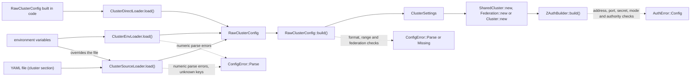
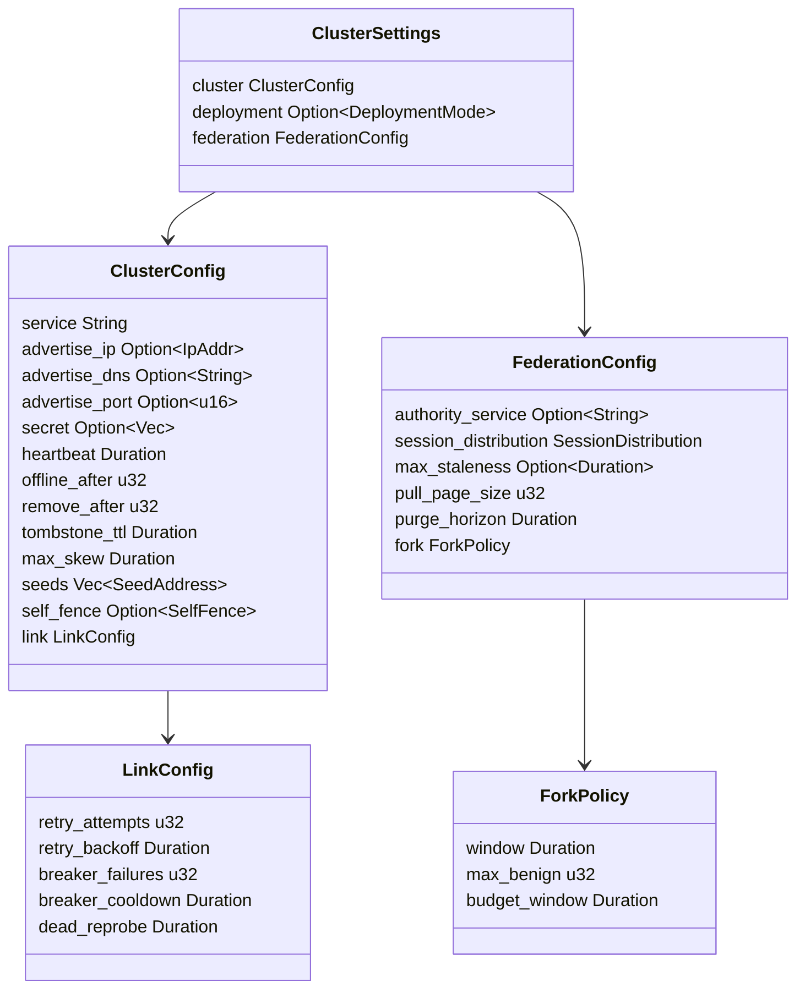

# Cluster configuration

z-auth-cluster reads its own settings, separate from z-auth's `AuthConfig`. This guide lists every variable with its default, its alias, its path in the configuration file, the validation applied to it and, just as important, the moment that validation happens. Some mistakes are caught when the settings are built, some only when `ZAuthBuilder::build()` runs the extension, and a few are never caught at all, so the last section collects the gotchas. The protocols these settings tune are described in [the shared-mode guide](cluster.md) and [the federation guide](replication.md), and z-auth's own variables are covered in [the core configuration guide](../../../docs/configuration.md).

## Loading settings

Settings flow through three stages. A loader produces a `RawClusterConfig`, a flat struct in which every field is an `Option`. `RawClusterConfig::build()` validates it and fills in defaults, producing a `ClusterSettings`. The extension then reads the settings when `ZAuthBuilder::build()` calls its configure and assemble phases, which is where the remaining checks happen.



`ClusterConfigLoader` is the loader trait. It has one required method, `load()`, returning `Result<RawClusterConfig, ConfigError>`, and a provided method `load_settings()` that calls `load()` and then `build()`. Three loaders ship with the crate.

`ClusterEnvLoader` reads the environment. Like z-auth's `EnvLoader`, it never loads a `.env` file itself, so a host that keeps settings in `.env` must load that file first (for example with `dotenvy`) before calling the loader. Numeric variables are parsed while loading, so a value like `AUTH_CLUSTER_HEARTBEAT_MS=fast` fails in `load()` with `ConfigError::Parse` naming the variable. String variables are read as is and validated by `build()`.

`ClusterSourceLoader::new(source)` reads the `cluster` section of a z-auth `ConfigSource`, the YAML configuration file described in [the core configuration guide](../../../docs/configuration.md#configuration-file), with the environment layered on top. `ClusterEnvLoader` is the same loader over a source that only has the environment, so both parse and validate identically. A variable that is set always wins over the file, and a value from the file that does not parse is reported with its path, for example `cluster.heartbeat_ms in z-auth.yaml`. A key in the `cluster` section that the crate does not know fails the load as well.

```rust
use z_auth::conf::config::ConfigSource;
use z_auth_cluster::config::{ClusterConfigLoader, ClusterSourceLoader};

let source = ConfigSource::standard()?; // AUTH_CONFIG_FILE, then the environment
let settings = ClusterSourceLoader::new(source).load_settings()?;
```

The section groups the address under `advertise`, the inter-cluster links under `link` and the federation settings under `federation`, with the fork policy one level deeper.

```yaml
cluster:
  deployment_mode: federation
  service: orders
  secret: ~                    # keep AUTH_CLUSTER_SECRET in the environment
  advertise:
    dns: orders-1.internal
    port: 7000
  heartbeat_ms: 2000
  seeds: [ums.internal:7000]
  link:
    retry_attempts: 3
  federation:
    authority_service: ums
    session_distribution: on_demand
    fork:
      window_ms: 5000
```

| Path | Variable |
|---|---|
| `cluster.deployment_mode` | `AUTH_DEPLOYMENT_MODE` |
| `cluster.service` | `AUTH_CLUSTER_SERVICE` |
| `cluster.secret` | `AUTH_CLUSTER_SECRET` |
| `cluster.advertise.ip` | `AUTH_CLUSTER_ADVERTISE_IP` |
| `cluster.advertise.dns` | `AUTH_CLUSTER_ADVERTISE_DNS` |
| `cluster.advertise.port` | `AUTH_CLUSTER_ADVERTISE_PORT` |
| `cluster.heartbeat_ms` | `AUTH_CLUSTER_HEARTBEAT_MS` |
| `cluster.warning_after` | `AUTH_CLUSTER_WARNING_AFTER` |
| `cluster.missing_after` | `AUTH_CLUSTER_MISSING_AFTER` |
| `cluster.retired_ttl_secs` | `AUTH_CLUSTER_RETIRED_TTL_SECS` |
| `cluster.max_skew_secs` | `AUTH_CLUSTER_MAX_SKEW_SECS` |
| `cluster.self_fence` | `AUTH_CLUSTER_SELF_FENCE` |
| `cluster.seeds` | `AUTH_CLUSTER_SEEDS` |
| `cluster.link.retry_attempts` | `AUTH_LINK_RETRY_ATTEMPTS` |
| `cluster.link.retry_backoff_ms` | `AUTH_LINK_RETRY_BACKOFF_MS` |
| `cluster.link.breaker_failures` | `AUTH_LINK_BREAKER_FAILURES` |
| `cluster.link.breaker_cooldown_secs` | `AUTH_LINK_BREAKER_COOLDOWN_SECS` |
| `cluster.link.dead_reprobe_secs` | `AUTH_LINK_DEAD_REPROBE_SECS` |
| `cluster.federation.authority_service` | `AUTH_AUTHORITY_SERVICE` |
| `cluster.federation.session_distribution` | `AUTH_SESSION_DISTRIBUTION` |
| `cluster.federation.max_staleness_secs` | `AUTH_FEDERATION_MAX_STALENESS_SECS` |
| `cluster.federation.pull_page_size` | `AUTH_FEDERATION_PULL_PAGE_SIZE` |
| `cluster.federation.purge_horizon_secs` | `AUTH_FEDERATION_PURGE_HORIZON_SECS` |
| `cluster.federation.fork.window_ms` | `AUTH_FORK_WINDOW_MS` |
| `cluster.federation.fork.max_benign` | `AUTH_FORK_MAX_BENIGN` |
| `cluster.federation.fork.budget_window_secs` | `AUTH_FORK_BUDGET_WINDOW_SECS` |

The legacy aliases (`AUTH_CLUSTER_OFFLINE_AFTER`, `AUTH_CLUSTER_REMOVE_AFTER` and `AUTH_CLUSTER_TOMBSTONE_SECS`) have no path in the file. They are still honoured in the environment, after the preferred variable and before the file, so an old variable left in a deployment keeps overriding the file just as the preferred one would. Seeds may be written as a YAML list or as the comma-separated string of the variable, and an empty list counts as unset.

`ClusterDirectLoader::new(raw)` wraps a `RawClusterConfig` assembled in code and returns a clone of it from `load()`. `RawClusterConfig` has a consuming builder method for every field, named after the field, so a configuration can be written fluently and built directly without a loader.

```rust
use z_auth_cluster::config::RawClusterConfig;

let settings = RawClusterConfig::default()
    .deployment_mode("federation")
    .authority_service("ums")
    .cluster_service("orders")
    .cluster_secret("KioqKioqKioqKioqKioqKioqKioqKioqKioqKioqKio=")
    .cluster_advertise_dns("orders-1.internal")
    .cluster_advertise_port(7000)
    .cluster_seeds(["ums.internal:7000"])
    .session_distribution("on_demand")
    .build()?;
```

`ClusterSettings` holds three parts. `cluster` is a `ClusterConfig` with the membership settings and a nested `LinkConfig`, `deployment` is the explicit `Option<DeploymentMode>`, and `federation` is a `FederationConfig` with a nested `ForkPolicy`. All of these are plain structs with public fields.



The `Debug` implementations of `ClusterConfig` and `RawClusterConfig` print `<redacted>` instead of the secret, so logging the settings at startup is safe. The `RawClusterConfig` output is deliberately partial and lists only the identity, address, secret, mode and authority fields.

## When validation happens

The three stages check different things, and knowing which stage catches which mistake saves a confusing deployment.

| Stage | Error type | Checks |
|---|---|---|
| `ClusterEnvLoader::load()` or `ClusterSourceLoader::load()` | `ConfigError::Parse` | Every numeric setting parses as its type (`u16`, `u32` or `u64`); the `cluster` section of the file has no unknown keys |
| `RawClusterConfig::build()` | `ConfigError::Parse` | Secret is base64 and at least 32 bytes; warning and missing counts at least 1; advertise IP parses; every seed parses; mode, self-fence and session distribution values are known; link retry attempts, breaker failures and pull page size at least 1 |
| `RawClusterConfig::build()` with `AUTH_DEPLOYMENT_MODE=federation` | `ConfigError::Missing` | `AUTH_AUTHORITY_SERVICE` set, `AUTH_CLUSTER_SECRET` set, `AUTH_CLUSTER_SEEDS` non-empty on every service except the authority |
| `ZAuthBuilder::build()` (extension configure and assemble) | `AuthError::Config` | An advertise IP or DNS name is set; an advertise port is set; a secret is present; the explicit mode matches the extension; in federation mode the authority name resolves and the repositories match the instance's role |

`ConfigError` converts into `AuthError` with `?`, so a host function returning `Result<_, AuthError>` can propagate both.

## Deployment mode

| Variable | Default | Builder method | Values and validation |
|---|---|---|---|
| `AUTH_DEPLOYMENT_MODE` | unset | `deployment_mode` | `standalone`, `shared` or `federation` (surrounding whitespace ignored); any other value fails `build()` |

Unset is a real state, `ClusterSettings::deployment == None`, and each consumer interprets it. `Cluster::new` treats unset as shared. `SharedCluster` accepts unset or `shared` and refuses the rest during `ZAuthBuilder::build()`. `Federation` accepts unset or `federation` and refuses the rest. `standalone` is always refused by the cluster types, with the message that a cluster transport was configured, because a standalone service should simply not register a cluster extension. Setting the mode explicitly is recommended in federation mode, because it is what turns on the federation checks inside `build()`.

## Identity and address

| Variable | Default | Builder method | Values and validation |
|---|---|---|---|
| `AUTH_CLUSTER_SERVICE` | `z-auth` | `cluster_service` | Any string; in federation mode it names this service's cluster and is compared with `AUTH_AUTHORITY_SERVICE` |
| `AUTH_CLUSTER_ADVERTISE_IP` | unset | `cluster_advertise_ip` | Must parse as an IPv4 or IPv6 address in `build()` |
| `AUTH_CLUSTER_ADVERTISE_DNS` | unset | `cluster_advertise_dns` | Any string; preferred over the IP when peers connect |
| `AUTH_CLUSTER_ADVERTISE_PORT` | unset | `cluster_advertise_port` | Must parse as `u16` in `load()`; required by `ZAuthBuilder::build()` |

z-auth cannot discover the address peers should use to reach an instance, so the host must advertise one. At least one of the IP and the DNS name is required, together with the port, but both requirements are enforced only when the extension builds its local `NodeInfo` during `ZAuthBuilder::build()`, with the messages "set AUTH_CLUSTER_ADVERTISE_IP or AUTH_CLUSTER_ADVERTISE_DNS" and "set AUTH_CLUSTER_ADVERTISE_PORT". The advertised address must be the one the host's inbound endpoint listens on, as seen from the other instances.

## Security

| Variable | Default | Builder method | Values and validation |
|---|---|---|---|
| `AUTH_CLUSTER_SECRET` | unset | `cluster_secret` | Standard base64 (surrounding whitespace ignored) decoding to at least 32 bytes, checked in `build()`; required in both modes |
| `AUTH_CLUSTER_MAX_SKEW_SECS` | `30` | `cluster_max_skew_secs` | `u64`; largest accepted difference between a message's `sent_at` and the local clock |

The secret authenticates every cluster message with HMAC-SHA256 and must be identical on every instance of every service. Generate it with a cryptographic random source, for example `openssl rand -base64 32`. A malformed or short secret fails `build()` in every mode, but a missing secret fails `build()` only with an explicit `AUTH_DEPLOYMENT_MODE=federation`; otherwise it surfaces in `ZAuthBuilder::build()` as "missing AUTH_CLUSTER_SECRET".

The skew bound also sizes the replay guard, which remembers message ids for twice this long. In federation mode it widens the effective fork window and the cutoff for user-wide revocations, and it is part of the config fingerprint, so every service must use the same value.

## Liveness

| Variable | Alias | Default | Builder method | Values and validation |
|---|---|---|---|---|
| `AUTH_CLUSTER_HEARTBEAT_MS` | none | `2000` | `cluster_heartbeat_ms` | `u64`; no range check |
| `AUTH_CLUSTER_WARNING_AFTER` | `AUTH_CLUSTER_OFFLINE_AFTER` | `1` | `cluster_offline_after` | `u32`, at least 1, checked in `build()` |
| `AUTH_CLUSTER_MISSING_AFTER` | `AUTH_CLUSTER_REMOVE_AFTER` | `1` | `cluster_remove_after` | `u32`, at least 1, checked in `build()` |
| `AUTH_CLUSTER_RETIRED_TTL_SECS` | `AUTH_CLUSTER_TOMBSTONE_SECS` | `1800` | `cluster_tombstone_secs` | `u64` |
| `AUTH_CLUSTER_SELF_FENCE` | none | mode default | `cluster_self_fence` | `quorum` or `off`, checked in `build()` |

The heartbeat interval is also the cadence at which the host must call `ZAuth::tick`, because every heartbeat, liveness decision, retry and pull happens inside a tick. With the defaults a silent peer is marked offline (warning, in federation mode) after 3 s and removed (evicted) after 5 s, from the formulas in [the shared-mode guide](cluster.md).

The preferred names and their aliases are read by `ClusterEnvLoader` with the preferred name first. If the preferred variable is set, the alias is ignored; if it is unset, the alias is used. The builder methods keep the legacy names (`cluster_offline_after`, `cluster_remove_after`, `cluster_tombstone_secs`), as do the fields of `ClusterConfig` (`offline_after`, `remove_after`, `tombstone_ttl`).

The retired TTL means two things. In shared mode it is how long a removed peer is remembered as a tombstone and still probed. In federation mode it is how long an evicted node id stays retired in memory, and also the age after which `missing` registry rows are purged.

`AUTH_CLUSTER_SELF_FENCE` left unset means the mode's default, which is `quorum` in federation mode. Shared mode never fences and ignores the variable entirely.

## Federation membership and links

| Variable | Default | Builder method | Values and validation |
|---|---|---|---|
| `AUTH_AUTHORITY_SERVICE` | unset | `authority_service` | Any string; blank counts as unset; required in federation mode |
| `AUTH_CLUSTER_SEEDS` | empty | `cluster_seeds` | Comma-separated, entries trimmed and empty entries dropped; each `host:port`, `ip:port` or `[ipv6]:port` with a non-empty host and a port from 1 to 65535, checked in `build()`; required on every service except the authority |
| `AUTH_LINK_RETRY_ATTEMPTS` | `3` | `link_retry_attempts` | `u32`, at least 1 |
| `AUTH_LINK_RETRY_BACKOFF_MS` | `200` | `link_retry_backoff_ms` | `u64`; base of the exponential backoff between attempts |
| `AUTH_LINK_BREAKER_FAILURES` | `3` | `link_breaker_failures` | `u32`, at least 1 |
| `AUTH_LINK_BREAKER_COOLDOWN_SECS` | `30` | `link_breaker_cooldown_secs` | `u64` |
| `AUTH_LINK_DEAD_REPROBE_SECS` | `60` | `link_dead_reprobe_secs` | `u64` |

Seeds are parsed even outside federation mode, so a malformed `AUTH_CLUSTER_SEEDS` fails `build()` in shared mode too, although shared mode never uses seeds. The authority name must be the same on every service, and it is part of the config fingerprint.

## Federation sync

| Variable | Default | Builder method | Values and validation |
|---|---|---|---|
| `AUTH_SESSION_DISTRIBUTION` | `all` | `session_distribution` | `all` or `on_demand`, checked in `build()` |
| `AUTH_FEDERATION_MAX_STALENESS_SECS` | `0` | `federation_max_staleness_secs` | `u64`; `0` or unset disables the staleness guard |
| `AUTH_FEDERATION_PULL_PAGE_SIZE` | `500` | `federation_pull_page_size` | `u32`, at least 1 |
| `AUTH_FEDERATION_PURGE_HORIZON_SECS` | `604800` (7 days) | `federation_purge_horizon_secs` | `u64` |

The pull page size also caps the pages this cluster serves, since an incoming `limit` is clamped to the server's own page size.

## Refresh forks

| Variable | Default | Builder method | Values and validation |
|---|---|---|---|
| `AUTH_FORK_WINDOW_MS` | `5000` | `fork_window_ms` | `u64`; the max skew is added to it |
| `AUTH_FORK_MAX_BENIGN` | `1` | `fork_max_benign` | `u32`; `0` is accepted and makes every fork a compromise |
| `AUTH_FORK_BUDGET_WINDOW_SECS` | `3600` | `fork_budget_window_secs` | `u64` |

All three are part of the config fingerprint, and a cluster with different values is refused by the sync engine.

## Fixed constants

Some protocol parameters are constants in `z_auth_cluster::constants` (and one in the engine) rather than settings.

| Constant | Value | Meaning |
|---|---|---|
| `MIN_CLUSTER_SECRET_LEN` | 32 | Minimum decoded length of `AUTH_CLUSTER_SECRET` in bytes |
| `CLUSTER_TOMBSTONE_PROBE_EVERY` | 5 | Shared mode probes tombstoned peers every this many ticks |
| `CLUSTER_OUTBOX_MAX_ATTEMPTS` | 5 | Delivery attempts per queued message, counting the original send |
| `CLUSTER_OUTBOX_CAPACITY` | 10000 | Queued retries per instance (and per link outbox), oldest dropped first |
| `CLUSTER_SNAPSHOT_COOLDOWN_BEATS` | 5 | A peer or cluster is asked for a snapshot at most once per this many heartbeat intervals |
| `CLUSTER_SEED_PROBE_EVERY` | 5 | Federation mode re-probes seeds every this many ticks while isolated, and purges retired registry rows at the same cadence |
| `FEDERATION_PROTOCOL_VERSION` | 2 | Wire protocol of federation sync; peers must match |
| `FEDERATION_MERGE_ATTEMPTS` | 5 | Compare-and-swap attempts per incoming session merge |
| `PULL_PAGES_PER_ROUND` (private, in `federation::engine`) | 20 | Feed pages pulled from one cluster per tick |
| `DEPLOYMENT_STANDALONE`, `DEPLOYMENT_SHARED`, `DEPLOYMENT_FEDERATION` | `standalone`, `shared`, `federation` | The accepted `AUTH_DEPLOYMENT_MODE` values |

The defaults in the tables above are also exported as constants (`DEFAULT_CLUSTER_SERVICE`, `DEFAULT_CLUSTER_HEARTBEAT_MS`, `DEFAULT_LINK_RETRY_ATTEMPTS` and so on), as are the variable names (`ENV_CLUSTER_SECRET`, `ENV_AUTHORITY_SERVICE` and the rest).

## Example environments

A shared-mode instance needs the secret, an address and a port. Everything else has workable defaults.

```env
AUTH_DEPLOYMENT_MODE=shared
AUTH_CLUSTER_SERVICE=orders
AUTH_CLUSTER_SECRET=KioqKioqKioqKioqKioqKioqKioqKioqKioqKioqKio=
AUTH_CLUSTER_ADVERTISE_IP=10.0.0.5
AUTH_CLUSTER_ADVERTISE_PORT=7000
AUTH_CLUSTER_HEARTBEAT_MS=2000
```

A federation-mode session store adds the authority and at least one seed. The authority's own instances use the same block with `AUTH_CLUSTER_SERVICE=ums` and may omit the seeds.

```env
AUTH_DEPLOYMENT_MODE=federation
AUTH_AUTHORITY_SERVICE=ums
AUTH_CLUSTER_SERVICE=orders
AUTH_CLUSTER_SECRET=KioqKioqKioqKioqKioqKioqKioqKioqKioqKioqKio=
AUTH_CLUSTER_ADVERTISE_DNS=orders-1.internal
AUTH_CLUSTER_ADVERTISE_PORT=7000
AUTH_CLUSTER_SEEDS=ums.internal:7000
AUTH_SESSION_DISTRIBUTION=all
AUTH_FEDERATION_MAX_STALENESS_SECS=120
```

The secret shown is the 32 bytes of `0x2a` used by the test suite. Never use it in a real deployment.

## Gotchas

The advertise address, the advertise port and the presence of the secret are not checked by `RawClusterConfig::build()` in shared mode. A configuration that builds without errors can still fail later in `ZAuthBuilder::build()`, so build `ZAuth` during startup rather than lazily.

The federation requirements (`AUTH_AUTHORITY_SERVICE`, `AUTH_CLUSTER_SECRET`, and seeds on every non-authority service) are enforced by `build()` only when `AUTH_DEPLOYMENT_MODE=federation` is set explicitly. With the mode unset, a `Federation` extension still refuses a missing authority or secret during `ZAuthBuilder::build()`, but nothing ever checks the seeds, and a session store without seeds starts, finds no other cluster, and keeps probing an empty seed list.

The zero-value errors for the liveness counters always name the legacy keys. Setting `AUTH_CLUSTER_WARNING_AFTER=0` fails with an error about `AUTH_CLUSTER_OFFLINE_AFTER`, and `AUTH_CLUSTER_MISSING_AFTER=0` with one about `AUTH_CLUSTER_REMOVE_AFTER`, because validation runs on the merged value and reports it under the original names.

`AUTH_FEDERATION_MAX_STALENESS_SECS=0` does not mean "zero tolerance". It disables the staleness guard, so refreshes on a session store keep working however long it has been cut off from the authority. Set a positive value to fail closed with `ReplicaStale`.

`AUTH_CLUSTER_SELF_FENCE` has no effect in shared mode. Shared-mode instances never fence, whatever the variable says, and a value other than `quorum` or `off` still fails `build()`.

`AUTH_CLUSTER_HEARTBEAT_MS` is not only the heartbeat interval but the cadence of `ZAuth::tick`. Ticking less often than the configured interval makes every peer look late and triggers spurious warnings and removals; ticking more often sends more heartbeats than necessary. The value is not range checked, so `0` is accepted and makes every liveness threshold zero.

`ClusterEnvLoader` never loads a `.env` file. Variables in a `.env` file are invisible unless the host loads the file into the process environment first.

A variable left in the environment silently overrides the configuration file. When a value in the file seems to have no effect, check the environment for the variable (or one of its legacy aliases) first.
