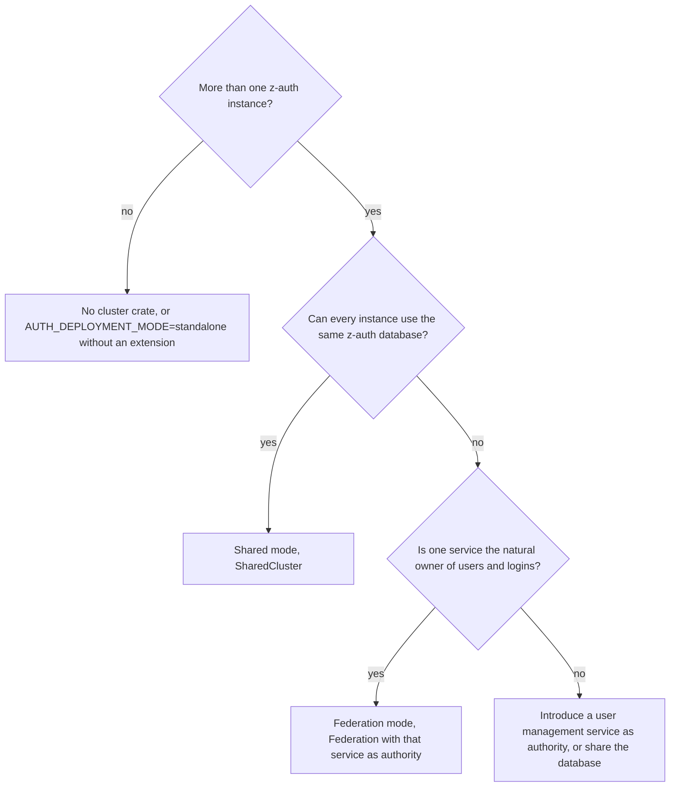
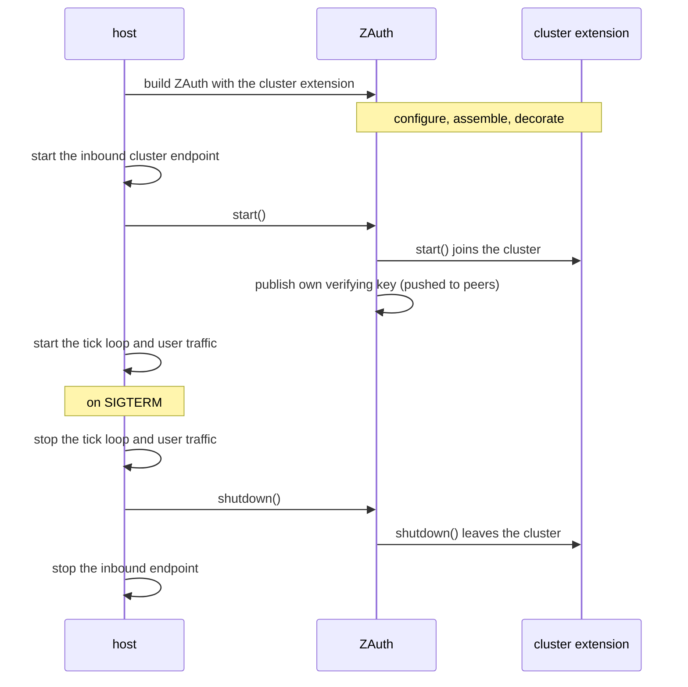

# Deploying a cluster

This guide takes a service from a single z-auth instance to a running cluster. It starts with choosing between shared and federation mode, wires each mode end to end with [z-auth-postgres](../../postgres/README.md), shows how to implement the transport and the inbound endpoint, and closes with how a running cluster behaves under partitions, crashes and late arrivals, as exercised by the crate's test suite. The protocols themselves are explained in [the shared-mode guide](cluster.md) and [the federation guide](replication.md), and every setting is listed in [the configuration guide](configuration.md).

## Choosing a mode

The deciding question is whether your services can share one z-auth database. If they can, shared mode is simpler in every respect. It has one schema, no authority, no merge rules and no fencing, and its only job is to keep in-memory state in step. Federation mode exists for organisations where each service owns its database and must keep working, including refreshing and revoking sessions, when other services or the network between them fail.



Within federation mode, two settings deserve an early decision. `AUTH_SESSION_DISTRIBUTION=all` stores every session in every session store and keeps every refresh local, while `on_demand` stores only sessions that were refreshed at that service and saves space when users touch few services. `AUTH_FEDERATION_MAX_STALENESS_SECS` decides whether a session store that has lost contact with the authority keeps refreshing (the default, fail-open) or refuses with `ReplicaStale` after the given time (fail-closed).

## Shared mode with z-auth-postgres

Shared mode needs z-auth-postgres with its `shared` feature, which provides `PgNodeRepository` and the cluster migration set. The manifest below assumes the z-auth workspace is checked out next to the host crate; adjust the paths to your layout. `run_cluster_migrations` applies the core migrations and then the `cluster_` tables, and is safe to call from several instances at once.

```toml
[dependencies]
z-auth = { path = "z-auth", features = ["argon2", "crypto", "serde"] }
z-auth-cluster = { path = "z-auth/adapters/cluster", default-features = false }
z-auth-postgres = { path = "z-auth/adapters/postgres", features = ["shared"] }
```

Every instance runs the same startup code. The transport is your own type, described later in this guide.

```rust
use std::sync::Arc;

use z_auth::ZAuth;
use z_auth::conf::config::{ConfigLoader, EnvLoader};
use z_auth_cluster::SharedCluster;
use z_auth_cluster::config::{ClusterConfigLoader, ClusterEnvLoader};
use z_auth_cluster::shared::ClusterTransport;
use z_auth_postgres::{PgConfig, PgNodeRepository, build_pg_pool, repositories, run_cluster_migrations};

async fn build_shared(
    transport: Arc<dyn ClusterTransport>,
) -> Result<(ZAuth, Arc<SharedCluster>), Box<dyn std::error::Error>> {
    let pool = build_pg_pool(&PgConfig::from_env()?).await?;
    run_cluster_migrations(&pool).await?; // core tables, then the cluster_ tables

    let cluster = Arc::new(SharedCluster::new(
        ClusterEnvLoader.load_settings()?,
        transport,
        Arc::new(PgNodeRepository::new(pool.clone())),
    ));
    let auth = ZAuth::builder(EnvLoader.load_config()?, repositories(&pool))
        .extension(cluster.clone())
        .build()?;
    Ok((auth, cluster))
}
```

In a permission authorization mode, add `.permissions(Arc::new(PgPermissionRepository::new(pool.clone())))` to the builder as you would without a cluster. Keep the returned `Arc<SharedCluster>` for the inbound endpoint, then call `auth.start().await?` once the endpoint is listening, so that peers answering the join can already reach this instance.

## Federation mode with z-auth-postgres

Federation mode needs z-auth-postgres with its `federation` feature, which adds `PgSyncStore` and the session-store schema. The authority and the session stores differ in their schema and their repositories, and both use a `Delay` for link retries and a fence hook.

```rust
use std::time::Duration;

use async_trait::async_trait;
use z_auth_cluster::shared::Delay;

/// Sleeps between retries of inter-cluster requests.
struct TokioDelay;

#[async_trait]
impl Delay for TokioDelay {
    async fn sleep(&self, duration: Duration) {
        tokio::time::sleep(duration).await;
    }
}
```

The authority uses the full z-auth schema plus the cluster tables, applied by `run_cluster_migrations`, and the normal repositories.

```rust
use std::sync::Arc;

use z_auth::ZAuth;
use z_auth::conf::config::{ConfigLoader, EnvLoader};
use z_auth_cluster::Federation;
use z_auth_cluster::config::{ClusterConfigLoader, ClusterEnvLoader};
use z_auth_cluster::federation::membership::FenceHook;
use z_auth_cluster::shared::ClusterTransport;
use z_auth_postgres::{
    PgConfig, PgNodeRepository, PgPermissionRepository, PgSyncStore, build_pg_pool, repositories,
    run_cluster_migrations,
};

async fn build_authority(
    transport: Arc<dyn ClusterTransport>,
    on_fenced: FenceHook,
) -> Result<(ZAuth, Arc<Federation>), Box<dyn std::error::Error>> {
    let pool = build_pg_pool(&PgConfig::from_env()?).await?;
    run_cluster_migrations(&pool).await?;

    let federation = Arc::new(
        Federation::new(
            ClusterEnvLoader.load_settings()?,
            transport,
            Arc::new(PgNodeRepository::new(pool.clone())),
            Arc::new(PgSyncStore::new(pool.clone())),
        )
        .delay(Arc::new(TokioDelay))
        .on_fenced(on_fenced),
    );
    assert!(federation.is_authority(), "AUTH_CLUSTER_SERVICE must equal AUTH_AUTHORITY_SERVICE");

    let auth = ZAuth::builder(EnvLoader.load_config()?, repositories(&pool))
        .permissions(Arc::new(PgPermissionRepository::new(pool.clone()))) // permission modes only
        .extension(federation.clone())
        .build()?;
    Ok((auth, federation))
}
```

A session store uses the session-store schema, applied by `run_session_store_migrations`, which contains sessions, revocations, keys, snapshots, the instance registry and the change feed, and no identity tables. Its repositories come from `Federation::session_store_repositories`, called on the same `Federation` that is then registered with the builder. It needs no permission repository, because the extension supplies the permission service from the authority's catalog snapshot.

```rust
use z_auth_cluster::SessionRepositories;
use z_auth_postgres::{
    PgKeyRepository, PgRevocationRepository, PgSessionRepository, run_session_store_migrations,
};

async fn build_session_store(
    transport: Arc<dyn ClusterTransport>,
    on_fenced: FenceHook,
) -> Result<(ZAuth, Arc<Federation>), Box<dyn std::error::Error>> {
    let pool = build_pg_pool(&PgConfig::from_env()?).await?;
    run_session_store_migrations(&pool).await?;

    let federation = Arc::new(
        Federation::new(
            ClusterEnvLoader.load_settings()?,
            transport,
            Arc::new(PgNodeRepository::new(pool.clone())),
            Arc::new(PgSyncStore::new(pool.clone())),
        )
        .delay(Arc::new(TokioDelay))
        .on_fenced(on_fenced),
    );
    let repos = federation.session_store_repositories(SessionRepositories {
        sessions: Arc::new(PgSessionRepository::new(pool.clone())),
        revocations: Arc::new(PgRevocationRepository::new(pool.clone())),
        keys: Arc::new(PgKeyRepository::new(pool.clone())),
    });
    let auth = ZAuth::builder(EnvLoader.load_config()?, repos)
        .extension(federation.clone())
        .build()?;
    Ok((auth, federation))
}
```

A session store usually lives inside a database the service already owns. Giving z-auth its own Postgres schema keeps its tables apart from the host's, which [the PostgreSQL federation guide](../../postgres/docs/federation.md) explains together with the change-feed triggers. Change capture switches on when the service first starts in federation mode, because `ZAuth::start` creates the database's site identity before any peer can pull.

## Choosing the mode at run time

`Cluster::new(settings, adapters)` lets one binary run in either mode depending on `AUTH_DEPLOYMENT_MODE`. It returns a `Cluster`, an enum with the variants `Shared(Arc<SharedCluster>)` and `Federation(Arc<Federation>)`, built from a `ClusterAdapters` value. In shared mode it uses only `transport` and `nodes`; in federation mode it requires `sync_store` and applies `delay` and `on_fenced` when present.

There is one catch. A session store must build its repositories with `session_store_repositories` before calling `ZAuth::builder`, and that method lives on `Federation`, not on `Cluster`. Match on the variant first, and only then build `ZAuth` with `cluster.extension()`.

```rust
use z_auth_cluster::{Cluster, ClusterAdapters, SessionRepositories};

let settings = ClusterEnvLoader.load_settings()?;
let delay: Arc<dyn Delay> = Arc::new(TokioDelay);
let cluster = Cluster::new(
    settings,
    ClusterAdapters {
        transport,
        nodes: Arc::new(PgNodeRepository::new(pool.clone())),
        sync_store: Some(Arc::new(PgSyncStore::new(pool.clone()))),
        delay: Some(delay),
        on_fenced: Some(on_fenced),
    },
)?;

let repos = match &cluster {
    Cluster::Federation(federation) if !federation.is_authority() => {
        run_session_store_migrations(&pool).await?;
        federation.session_store_repositories(SessionRepositories {
            sessions: Arc::new(PgSessionRepository::new(pool.clone())),
            revocations: Arc::new(PgRevocationRepository::new(pool.clone())),
            keys: Arc::new(PgKeyRepository::new(pool.clone())),
        })
    }
    _ => {
        run_cluster_migrations(&pool).await?;
        repositories(&pool)
    }
};
let auth = ZAuth::builder(EnvLoader.load_config()?, repos)
    .extension(cluster.extension())
    .build()?;
// inbound endpoint: cluster.receive(envelope).await
```

`Cluster::new` refuses `AUTH_DEPLOYMENT_MODE=standalone` with a configuration error, and refuses federation mode without a `sync_store`. A service meant to run standalone should skip the cluster entirely.

## The tick loop

`ZAuth::tick` must run every `AUTH_CLUSTER_HEARTBEAT_MS`. Heartbeats, liveness, retries, snapshot repair, link heartbeats and pulls all happen inside it, along with z-auth's own enforcement of pending revocations and denylist pruning. The following loop uses tokio and is illustrative. Read the interval from the settings before they are moved into the extension.

```rust
use z_auth_cluster::ClusterReportExt;

let heartbeat = settings.cluster.heartbeat; // before `settings` is moved
let auth = Arc::new(auth);
let ticker = tokio::spawn({
    let auth = auth.clone();
    async move {
        let mut interval = tokio::time::interval(heartbeat);
        interval.set_missed_tick_behavior(tokio::time::MissedTickBehavior::Delay);
        loop {
            interval.tick().await;
            match auth.tick().await {
                Ok(report) if report.cluster().is_some_and(|c| c.fenced) => break,
                Ok(_) => {}
                Err(error) => eprintln!("cluster tick failed: {error}"),
            }
        }
    }
});
```

A tick error is worth logging but not fatal. Most errors come from the registry or the sync store being briefly unavailable, and the next tick tries again. Keep the tick loop independent of request handling, so a burst of traffic cannot delay heartbeats long enough for peers to mark the instance offline.

## The inbound endpoint and the transport

The host owns both directions of the wire. The inbound endpoint receives an envelope, hands it to the cluster and returns the reply. The transport does the opposite. The two sketches below use axum and reqwest with JSON bodies and are illustrative, since z-auth depends on neither crate. Any framework works, as long as the endpoint listens on the advertised address and port and both sides agree on the encoding.

```rust
use axum::{Json, extract::State, http::StatusCode};
use z_auth::AuthError;
use z_auth_cluster::shared::ClusterEnvelope;

async fn cluster_endpoint(
    State(cluster): State<Arc<SharedCluster>>,
    Json(envelope): Json<ClusterEnvelope>,
) -> Result<Json<Option<ClusterEnvelope>>, StatusCode> {
    match cluster.receive(envelope).await {
        Ok(reply) => Ok(Json(reply)),
        Err(AuthError::ClusterMessageRejected(_)) => Err(StatusCode::UNAUTHORIZED),
        Err(AuthError::NodeFenced) => Err(StatusCode::SERVICE_UNAVAILABLE),
        Err(_) => Err(StatusCode::INTERNAL_SERVER_ERROR),
    }
}
```

The transport posts the envelope to the peer and decodes the reply. It reaches the peer at `to.host()` and `to.port`, wraps IPv6 literals in brackets, uses a short timeout, and maps every failure to `AuthError::ClusterUnreachable`. It must not route by `to.node_id`, because federation-mode seed probes carry a nil node id.

```rust
use std::time::Duration;

use async_trait::async_trait;
use z_auth::AuthError;
use z_auth_cluster::shared::{ClusterEnvelope, ClusterTransport, NodeInfo};

struct HttpTransport {
    client: reqwest::Client,
}

impl HttpTransport {
    fn new() -> Self {
        let client = reqwest::Client::builder()
            .timeout(Duration::from_millis(500))
            .build()
            .expect("HTTP client");
        Self { client }
    }
}

#[async_trait]
impl ClusterTransport for HttpTransport {
    async fn send(
        &self,
        to: &NodeInfo,
        envelope: &ClusterEnvelope,
    ) -> Result<Option<ClusterEnvelope>, AuthError> {
        let host = to.host();
        let url = if host.contains(':') {
            format!("http://[{host}]:{}/cluster", to.port)
        } else {
            format!("http://{host}:{}/cluster", to.port)
        };
        let unreachable = |e: reqwest::Error| AuthError::ClusterUnreachable(e.to_string());
        let response = self.client.post(&url).json(envelope).send().await.map_err(unreachable)?;
        if !response.status().is_success() {
            return Err(AuthError::ClusterUnreachable(format!("{url} answered {}", response.status())));
        }
        response.json::<Option<ClusterEnvelope>>().await.map_err(unreachable)
    }
}
```

The envelope's MAC protects its content but not its confidentiality. Revocations, key events and, in federation mode, whole session aggregates including session secrets travel inside envelopes, so run the cluster endpoint on a private network or behind TLS.

For tests, `tests/support/cluster.rs` in this crate contains `InMemoryNetwork`, a complete `ClusterTransport` that routes envelopes between in-process instances by node id or by `host:port`, can cut single nodes, pairs or groups, and records every delivered envelope. It is the reference for the transport contract and a good starting point for integration tests of a host application.

## Startup and shutdown order

Startup has a natural order. Build `ZAuth`, start the inbound endpoint, call `auth.start()` (which loads z-auth's state, joins the cluster, and then publishes the instance's verifying key so that peers receive it), and finally start the tick loop. Serving user traffic before `start` completes is possible but means verifying tokens without the cluster's denylist and keys.



On graceful shutdown, stop the tick loop, call `auth.shutdown()`, and only then stop the inbound endpoint. `shutdown` runs every extension's shutdown in reverse registration order, and the cluster's shutdown marks the instance as leaving, tells its peers (and in federation mode the clusters it holds links to), and removes its registry row, so peers forget it at once instead of waiting for the liveness timeout.

## Restarting a fenced instance

In federation mode an instance that fences itself stops serving for good, and the fence hook is the host's signal to restart. The hook is a synchronous `Fn` called from inside the cluster's tick or receive path, so it should not block. Notifying the main task is the cleanest approach.

```rust
use tokio::sync::Notify;
use z_auth_cluster::federation::membership::FenceHook;

let fenced = Arc::new(Notify::new());
let on_fenced: FenceHook = {
    let fenced = fenced.clone();
    Arc::new(move || fenced.notify_one())
};
// ... build Federation with .on_fenced(on_fenced), start everything ...
fenced.notified().await;
eprintln!("instance fenced by its cluster, exiting for restart");
std::process::exit(75);
```

Exiting with a non-zero status lets the orchestrator restart the process, which comes back with a new node id and joins cleanly. Calling `shutdown` first is unnecessary, because the cluster has already evicted the instance. Readiness probes can use `ZAuth::is_fenced()` or `Federation::is_fenced()` to take a fenced instance out of rotation even before it exits.

## Operational behaviour

The test suites in `tests/shared.rs`, `tests/membership.rs` and `tests/federation.rs` run whole clusters over `InMemoryNetwork` with a mock clock, and the behaviour below is what they assert. Timings assume the defaults (2 s heartbeat, warning or offline after 1 missed beat, removal or eviction after 1 more).

| Situation | Mode | What happens |
|---|---|---|
| An instance is cut off | shared | Peers mark it offline after 3 s and remove it after 5 s, each change written once to the registry; when reachable again it is re-added and its row restored |
| A revocation while one instance is cut off | shared | Retries to it fail and are dropped after 5 attempts; after healing, the heartbeat digest differs and the instance merges a snapshot in its next tick |
| An instance starts while cut off | shared | Its first events are rejected as coming from an unknown sender; its first heartbeat introduces it and the queued retries land |
| A revoked token is presented | shared | The revocation is already in every denylist without a tick; the instance that saw the token enforces it on its next tick and every peer learns it is enforced |
| One instance of a cluster is cut off from its siblings | federation | Warning at 3 s; the majority evicts it through the registry at 5 s; the isolated instance waits 2 s more, loses at the registry, fences itself, and its hook runs once |
| A frozen instance missed its eviction | federation | Its next message is answered with `retired` and it fences itself |
| A 3 to 2 split inside a cluster | federation | The majority keeps serving and the minority fences; healing causes no eviction storm |
| A 2 to 2 split inside a cluster | federation | The side holding the lowest node id survives and the other side fences |
| One of two instances crashes | federation | The survivor evicts the crashed one through the registry and keeps serving, whichever of the two crashed |
| A single-instance cluster is isolated | federation | It never fences |
| One service is cut off from another | federation | Neither side evicts the other's instances and nobody fences; the link fails over or the cluster is marked dead |
| The link owner loses one target | federation | The owner keeps the link and talks to the remaining target |
| The link owner loses the whole target cluster | federation | After its breakers open (3 failed requests, one per tick) it hands the link to the next sibling, and every sibling agrees on the new owner |
| Every instance loses the target cluster | federation | The cluster is marked dead by every sibling; after healing it is re-probed within one `AUTH_LINK_DEAD_REPROBE_SECS` interval (60 s) and marked alive again |
| A service with different merge settings joins | federation | Membership works but the sync engine refuses it and lists it in `FederationReport::refused` |
| A service starts late | federation | It bootstraps every existing session from the authority's feed in pages over a few ticks |
| A refresh right after login at the authority | federation | The session store fetches the session and account on the miss and the refresh succeeds |
| A refresh of a generation that has not arrived | federation | The refresh fails with `ReplicaBehind` (503), the session stays active, and it succeeds once sync catches up |
| Isolation from the authority with the staleness guard set | federation | Refreshes fail with `ReplicaStale` until a pull reaches the authority's head again; with the default of 0 they keep succeeding |
| Random operations under random partitions | federation | After healing, every cluster's sessions converge to the same aggregates and every cluster keeps at least one serving instance |

A few practical consequences follow. Run at least three instances of any service whose availability matters in federation mode, so that one failure leaves a clear majority; two instances survive a crash through the registry, but a network split between them can fence the side without the lowest node id even if both are healthy. Keep the database reachable from every instance, because in federation mode the registry is the witness for evictions. Monitor `ClusterReport::dead_clusters`, `FederationReport::refused` and the fenced flag, which are the three signals that a federation needs attention. And keep the tick loop healthy, because an instance that ticks late looks dead to its peers.
