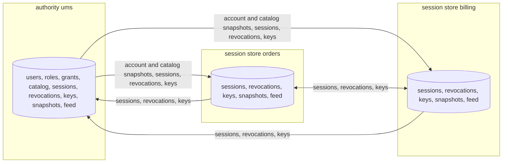
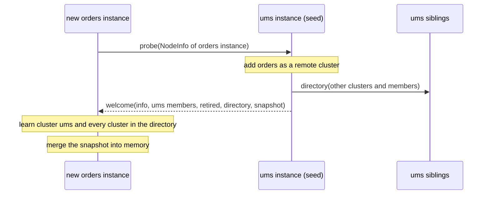
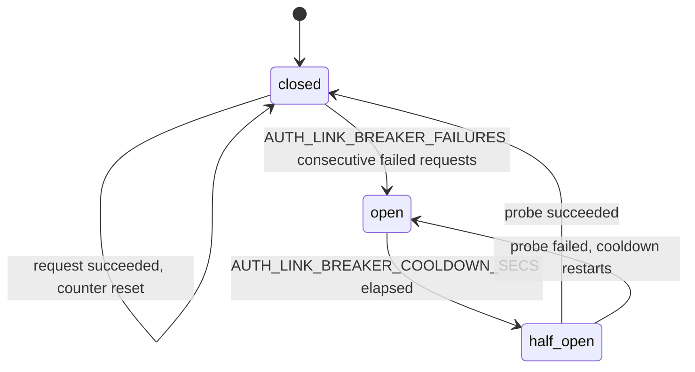
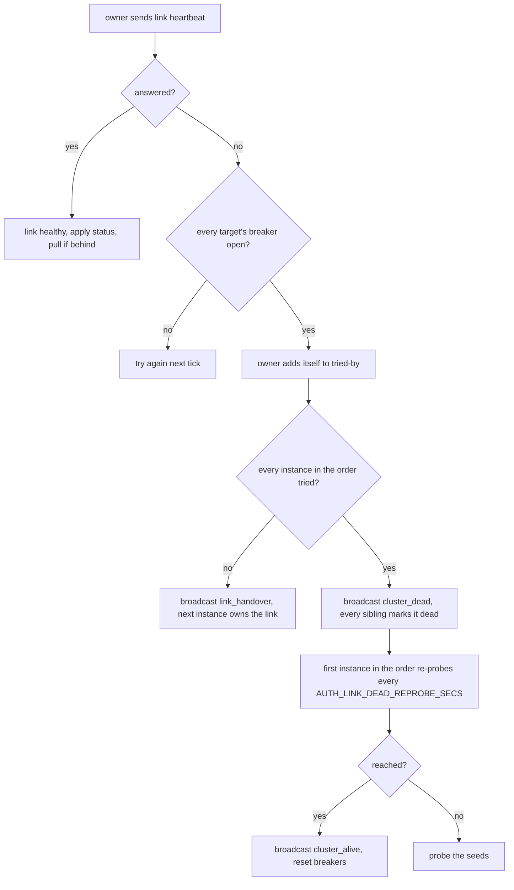
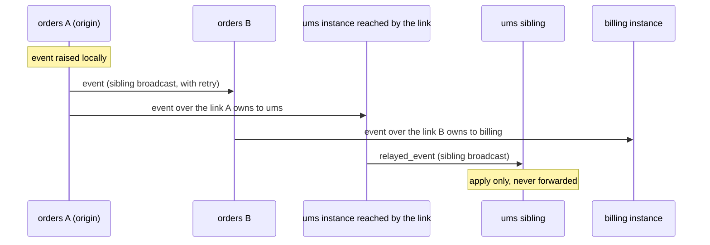
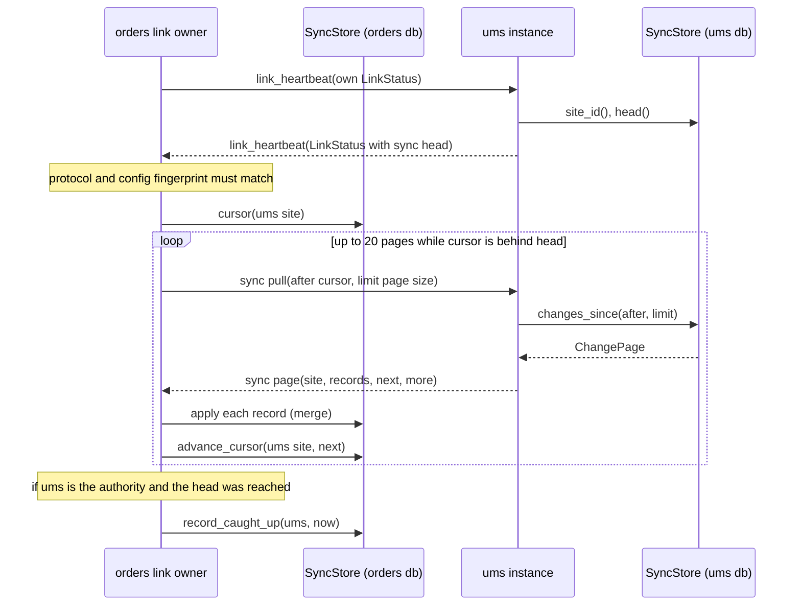
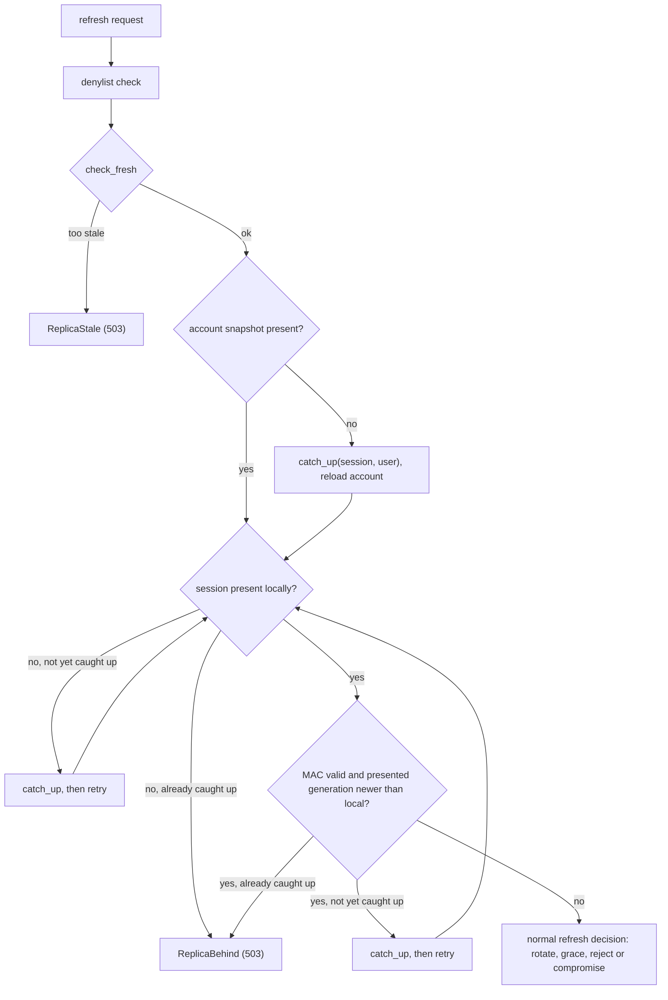

# Federation mode

Federation mode runs z-auth with one database per service. One service, the authority, owns identity. Every other service keeps a session store that can refresh, log out and revoke any session the authority issued, without a shared database and without calling the authority on the hot path. This guide explains how the pieces fit together, from the repositories a session store is built with to the merge rules that make every database converge. Shared-mode concepts that federation reuses (the transport, the envelope and its MAC, the replay guard, the registry state machine) are described in [the shared-mode guide](cluster.md), every setting is in [the configuration guide](configuration.md), and wiring examples are in [the deployment guide](deployment.md).

## Authority and session stores

Each service forms its own cluster, named by `AUTH_CLUSTER_SERVICE` and backed by its own database. `AUTH_AUTHORITY_SERVICE` names the authority, typically a user management service, and must be the same on every instance of every service. An instance is the authority exactly when its `AUTH_CLUSTER_SERVICE` equals `AUTH_AUTHORITY_SERVICE`, which `Federation::is_authority()` reports.



The split follows from what each side needs. Registration, login and every identity write need users, password hashes, roles and grants, so they happen only at the authority. A refresh needs the session with its generations, the revocations, the verifying keys, and a few facts about the user (is the account active, which roles and permissions go into the new token). The authority publishes those facts as an `AccountSnapshot` per user and a `CatalogSnapshot` for the permission catalog, and the session stores read the snapshots instead of the user tables. Users, roles and grants never leave the authority's database.

| Data | Authority | Session store |
|---|---|---|
| Users, password hashes, roles, role assignments, grants | Stored and written | Never present |
| Permission catalog | Stored and written | Read from the catalog snapshot |
| Account snapshots | Produced after every identity write | Received and read by refreshes |
| Sessions, generations, fork aliases | Stored, written and merged | Stored, written and merged |
| Revocations and verifying keys | Stored, written and merged | Stored, written and merged |
| Node registry | Its own instances only | Its own instances only |
| Change feed and cursors | Its own database | Its own database |

## Building the repositories

The authority builds its `Repositories` normally, for example with `z_auth_postgres::repositories(&pool)`. Every other service builds them with `Federation::session_store_repositories`, passing a `SessionRepositories` value that holds the three repositories a session store actually has.

```rust
pub struct SessionRepositories {
    pub sessions: Arc<dyn SessionRepository>,
    pub revocations: Arc<dyn RevocationRepository>,
    pub keys: Arc<dyn KeyRepository>,
}
```

The returned `Repositories` keeps `sessions`, `revocations` and `keys` and fills `users`, `roles` and `user_roles` with `NoUserStore`, `NoRoleStore` and `NoUserRoleStore`. Every method of those three refuses with `AuthError::NotAuthority`. Nothing in a session store should reach them, because login is refused before it reads a user, but the stores make the boundary explicit.

The extension checks the combination during `ZAuth::build()`. A non-authority service built without `session_store_repositories` fails with a configuration error telling you to use it, and an authority built with it fails because a session store is for services other than the authority. An explicit `AUTH_DEPLOYMENT_MODE` other than `federation` is also refused. The flag that records the call is set on the `Federation` value itself, which is why `session_store_repositories` must be called on the same instance that is later registered with the builder.

## Refusals and NotAuthority

A session store replaces or wraps several core services so that identity operations are refused openly instead of failing obscurely. `AuthError::NotAuthority { service, addresses }` names the authority service and lists the `host:port` of every authority instance this instance currently knows, sorted by node id. z-auth's HTTP mapping turns it into status 421 (Misdirected Request) with code `not_authority`, which lets a gateway or client retry at the authority.

| Component | Replaces | Behaviour on a session store |
|---|---|---|
| `NotAuthorityUsers` | `UserService` | Every method refused, reads included |
| `NotAuthorityRoles` | `RoleService` | Every method refused, reads included |
| `NotAuthorityLogin` | wraps `AuthenticationService` | `login` and `complete_login` refused; `refresh`, `logout`, `logout_all`, `verify_access_token` and `purge_sessions` served locally |
| `SnapshotPermissions` | `PermissionService` | Writes and grant listings refused; `catalog()` returns the cached catalog; `reload_catalog()` loads the catalog snapshot if its version is not older than the cache |
| `SnapshotAccountSource` | `RefreshAccountSource` | Reads the account snapshot; a missing snapshot is `AuthError::ReplicaBehind`, a deleted account is `None`, an inactive account carries no authorization claims |

`SnapshotPermissions` and `SnapshotAccountSource` are installed in the assemble phase, and the session store also declares that the extension provides the permission service, so permission modes need no permission repository on a session store. The catalog snapshot is loaded into memory at start even when the authorization mode does not use permissions. The user, role and login wrappers are installed in the decorate phase.

`ReplicaBehind` from the account source is not a failure the client sees directly. The refresh path treats it as a signal to fetch the account and session from another cluster and retry once, as described under the refresh gate below. Only if the fetch does not help does the client get status 503 with code `replica_behind`, which is retryable.

## The authority's snapshot producer

On the authority, the decorate phase wraps the user, role, permission and authentication services with `ProducingUsers`, `ProducingRoles`, `ProducingPermissions` and `ProducingLogin`. Each wrapper calls the `SnapshotProducer` after a successful write. The producer recomputes the affected account snapshots from the authority's own `RefreshAccountSource` and stores a new snapshot, with a version from `SyncStore::next_version`, only when `is_active`, `deleted` or the authorization claims actually changed. The change feed then carries the snapshot to every session store.

| Write at the authority | Republished |
|---|---|
| `register`, `update`, `activate`, `deactivate`, `delete` | That user's account snapshot (`update` and `delete` only when they found the user) |
| `login` that returned tokens, `complete_login` | That user's account snapshot, so it exists before the first refresh elsewhere |
| Role `assign`, `revoke`, `revoke_all_for_user` | That user's account snapshot |
| Role `delete` | Every holder's account snapshot (holders are read before the role is deleted) |
| `grant_to_role`, `revoke_from_role` | Every active holder's account snapshot |
| `grant_to_user`, `revoke_from_user` | That user's account snapshot |
| Permission `define`, `add_option`, `delete` | The catalog snapshot |
| Role `create`, `update` | Nothing, because snapshots carry role codes and a code never changes |

A login that returned a second-factor challenge opened no session, so its snapshot is published when `complete_login` succeeds. The catalog snapshot is written only when the authorization mode uses permissions, and the authority also stores it once at start. A deleted user is published as a snapshot with `deleted = true`, which makes every session store end that user's sessions.

Sessions created before the service switched to federation mode have no snapshot yet. When a session store asks the authority for such a session with `FetchSession`, the authority produces the missing snapshot on the spot and returns it with the session.

## Clusters and membership

Inside one service, instances form a full mesh exactly as in shared mode, but the registry lives in that service's own database and lists only that service's instances. The crate calls the other instances of one's own cluster siblings. Instances of other services are remote members, grouped by cluster in a directory.

An instance starts by registering itself. If it does not know any siblings yet, it reads the registry once, retires the ids of rows marked `missing`, skips rows in state `leaving`, and adds the rest as siblings. It then sends `join` to every sibling. In federation mode the reply is a `Welcome`, which carries the responder's `NodeInfo`, the members of its cluster with their state and heartbeat, the ids its cluster has retired, its directory of other clusters, and its replicated-state snapshot. The joiner merges all of it. A newly started instance writes the registry twice (register and activate) and reads it once, and its siblings learn about it from its join without reading the registry at all.

If the instance still knows no other cluster after joining its siblings, it probes its seeds. `AUTH_CLUSTER_SEEDS` lists `host:port` addresses (IPv6 as `[addr]:port`) of any instances of any service, and one seed is enough. A probe is a `probe` message carrying the instance's `NodeInfo`, sent to a `NodeInfo` with a nil node id. The seed answers with a `Welcome`, from which the newcomer learns the seed's cluster and, through the directory, every other cluster the seed knows. The seed in turn learns about the newcomer's cluster and announces the change to its own siblings with a `directory` message.



The authority needs no seeds, because the other services find it. Every other service must have at least one seed, and configuration rejects a missing seed list on non-authority services when `AUTH_DEPLOYMENT_MODE=federation` is set. While every known cluster is unreachable (including the case of knowing none), an instance probes its seeds again every `CLUSTER_SEED_PROBE_EVERY` ticks (5).

Directories spread between siblings with `directory` messages. Merging a directory only adds clusters and members that were unknown, because a cluster's own description of itself (from its `Welcome` or link heartbeat) replaces the member list and wins over second-hand entries. When a running instance changes its advertised address, `FederationClusterService::update_address(ip, dns_name, port)` stores it with `NodeRepository::update_address`, tells the siblings with `node_updated`, and other clusters see it in the next link heartbeat.

## Links between clusters

Clusters do not mesh with each other. For every ordered pair of clusters there is exactly one link, owned by one instance of the sending cluster, and all traffic from that cluster to the other one goes over it. With three services that makes six links, which `tests/membership.rs` asserts by counting senders of link heartbeats per pair.

The owner is chosen by rendezvous hashing, so siblings agree on it without coordination. Each instance ranks the healthy siblings and itself for a target cluster by the first 8 bytes, read big-endian, of SHA-256 over the node id bytes followed by the cluster name. The highest rank comes first, with ties broken by node id. The owner is the first instance in that order that has not given up on the target in the current failure round. Because different clusters hash differently, the links of one cluster spread across its instances, and when a sibling goes into warning it drops out of the order and its links move to the next instance.

On every tick the owner sends a `link_heartbeat` to the target cluster. The request and the reply each carry a `LinkStatus` with the sender's `NodeInfo`, the members of its cluster, its retired ids, its directory, its replicated-state digest and its sync head. Each side treats the other's member list as authoritative. If the digests differ, the owner asks for a snapshot over the link, at most once per 5 heartbeat intervals per cluster, and the sync head drives the pull described later.

### Requests, retries and the breaker

Every request over a link goes through the same routine. The targets are the target cluster's members that are not missing and whose circuit breaker allows a request, with the last target that answered first and the rest in random order. Each target is tried `AUTH_LINK_RETRY_ATTEMPTS` times (3 by default) with exponential backoff between attempts, `AUTH_LINK_RETRY_BACKOFF_MS` times two to the power of the attempt number, so 200 ms and then 400 ms by default. The wait uses the host's `Delay`, and without one (`NoDelay`) the attempts follow each other immediately. A success resets that target's breaker and remembers the target. A target that fails every attempt records one breaker failure, and the routine moves on to the next target. When no target answers, the request fails with `ClusterUnreachable`.

Each target has its own breaker, which is a small state machine driven by request outcomes and the clock.



A failed request here means one that exhausted its retries against that target. With the defaults a target's breaker opens after 3 consecutive failed requests and allows one probe request after 30 s.

### Handover and dead clusters

When the owner's link heartbeat fails and every known target of the cluster has an open breaker, the owner gives up. It adds itself to the cluster's tried-by set and broadcasts the result to its siblings. If some instance in the link order has not tried yet, the message is `link_handover` with the set of instances that tried, and the next instance in the order becomes the owner. If every instance has tried, the message is `cluster_dead` and every sibling marks the target cluster dead. An instance that finds no owner at all, for example because the instance that held the link left, also marks the cluster dead.



A dead cluster has no owner and receives no traffic. The first instance in its link order re-probes it every `AUTH_LINK_DEAD_REPROBE_SECS` (60 s). It resets the cluster's breakers, tries a link heartbeat against each last-known member, and probes the seeds if that fails. A successful heartbeat, or a `Welcome` from that cluster, marks it reachable, clears the tried-by set, and is announced to the siblings with `cluster_alive`, which makes them reset their breakers too. A probe or link heartbeat received from the dead cluster also clears the dead flag and is announced, but leaves a handover in progress alone, because being contacted says nothing about whether the local owner can reach the other side. Marking a cluster dead never fences anyone, and `ClusterReport::dead_clusters` reports how many are currently dead.

## Event routing

Domain events must reach every instance of every cluster. Inside a cluster they travel as in shared mode; across clusters they travel only over links.



The origin sends `event` to all of its siblings and over every link it owns. A sibling that receives `event` from a sibling applies it and forwards it over the links that sibling owns, so between them the instances of the origin cluster deliver the event over every outgoing link. An instance that receives `event` from another cluster applies it and fans it out to its own siblings as `relayed_event`, which siblings apply and never forward again. Failed sibling sends go to the sibling outbox and failed link sends go to the link outbox, both retried for up to 5 attempts with a capacity of 10000 entries, exactly like the shared-mode outbox. A link outbox entry is dropped if the instance no longer owns the link, because the new owner repairs the gap through the digest.

The sync engine uses one more pair of messages. When an instance needs to send a request to another cluster but does not own the link, it sends `forward { cluster, message }` to the sibling that does, which runs the request over its link and returns the remote reply as `forward_reply`. This is how any instance can pull a feed page or fetch a session through the current link owner.

## Liveness and eviction

Federation mode uses the same heartbeat counters as shared mode under different names. `online` reads as healthy, `offline` as warning, and instead of being deleted, a sibling that stays silent is evicted and marked `missing`, which retires its node id. A retired id cannot come back; the process must restart with a new node id.

```text
warning once silent  >= warning_after * beat + beat / 2                       (default 3 s)
evictable once silent >= (warning_after + missing_after) * beat + beat / 2    (default 5 s)
minority side waits a further missing_after * beat                           (default 2 s)
```

When a sibling goes into warning, the observer writes `MarkOffline` (advisory, not retried) and tells its siblings with a `peer_status` message. When it is heard again, the observer writes `MarkOnline` and broadcasts the recovery. Eviction is where federation mode differs. A split inside a cluster could leave both sides believing the other is dead, so eviction goes through the registry, which acts as the witness that decides which side survives.

The observer first counts the siblings it can still hear, including itself. If that is a strict majority of its cluster, or exactly half and its side holds the lowest node id of the whole cluster, it has priority and evicts silent siblings as soon as they are evictable. Otherwise it waits `missing_after` more beats, which gives the majority side time to evict it first. To evict, it calls `NodeRepository::evict(target, observer)`, which atomically marks the target missing unless it already is, but only while the observer itself is not missing.

| `evict` outcome | Meaning | What the observer does |
|---|---|---|
| `Evicted` | This call marked the target missing | Retire the id, broadcast `evicted` to siblings, and send `evicted` to the target in case it is still alive |
| `AlreadyMissing` | Another observer got there first | Same as `Evicted` |
| `ObserverMissing` | The observer itself is already missing, so it lost the race | Fence itself |
| error, observer has a majority | The registry is unreachable | Try again next tick |
| error, observer has no majority | Neither the registry nor a majority confirms it | Fence itself |

Retired ids are kept in memory for `AUTH_CLUSTER_RETIRED_TTL_SECS` (1800 s by default), and every fifth tick the registry is asked to purge `missing` rows retired longer than that with `NodeRepository::purge_retired`. Any message from a retired id is answered with `retired` instead of being processed.

An instance whose own tick loop stalled (a paused container, a long GC pause in the host) would otherwise wake up and judge every sibling on its own silence. Before each liveness round the instance checks when it last ran one, and if that was longer ago than the warning threshold it gives every sibling a fresh start and skips judging for that round.

## Self-fencing

An instance whose view of its own cluster can no longer be trusted fences itself, meaning it stops serving until it is restarted. `AUTH_CLUSTER_SELF_FENCE=quorum`, the default in federation mode, enables this; `off` disables it, and the instance then only reports liveness and keeps serving even when its cluster has evicted it.

| Trigger | Where it is detected |
|---|---|
| `NodeRepository::evict` returns `ObserverMissing` | The instance's own eviction attempt |
| The registry fails during eviction while the instance lacks a majority | The instance's own eviction attempt |
| Any reply is `retired` | Every send; this is how a frozen instance that missed the eviction notice finds out |
| A sibling's `Welcome` lists this instance's id as retired | Joining or probing |
| A sibling sends `evicted` or `peer_status` with `missing` for this instance | Receiving |

Fencing raises z-auth's `ServingFence`, which the extension claims during configure and shares with the token verifier. From then on the verifier refuses every token with `AuthError::NodeFenced` (HTTP 503, code `node_fenced`). The outermost wrappers, `FencedAuthentication` and `FencedRevocation`, refuse `login`, `complete_login`, `refresh`, `logout`, `logout_all`, `verify_access_token`, `revoke`, `revoke_many`, `end_session`, `end_all_for_user` and `enforce_pending`, while purges and loading still work. `ZAuth::tick` stops enforcing pending revocations, the cluster's tick only reports (with `ClusterReport::fenced` set), the sync engine stops ticking, `receive` refuses every envelope with `NodeFenced`, and the instance publishes and forwards nothing. `ZAuth::is_fenced()` and `Federation::is_fenced()` both report the state.

The fence never comes down. The `FenceHook` passed to `Federation::on_fenced` (or `ClusterAdapters::on_fenced`) is an `Arc<dyn Fn() + Send + Sync>` called exactly once, the first time the fence is raised, and the host should restart the process from it. A restarted process gets a new node id and joins cleanly.

Two situations never fence. A single-instance cluster always holds a majority of one and has nobody to evict, so it keeps serving however long it is cut off, and `tests/membership.rs` runs one through twenty isolated rounds to prove it. Other clusters never evict either. Eviction messages are accepted only from siblings, link failures only mark clusters dead, and an instance cut off from every other service keeps serving its own users.

## The sync engine

The `FederationEngine` is the data plane of federation mode. Each cluster's database has an identity, its `SiteId`, created on first use by `SyncStore::site_id`, and a change feed that records the key of every synced record whenever it changes. Positions in the feed are `FeedCursor { txid, seq }` values, and each database keeps one cursor per remote site recording how far it has read that site's feed.



The pull is driven by link heartbeats, so only the link owner of each ordered pair pulls, once per tick. The cursor lives in the database, so siblings share the progress and a new owner continues where the old one stopped. A pull reads at most `PULL_PAGES_PER_ROUND` pages (20) per tick of `AUTH_FEDERATION_PULL_PAGE_SIZE` records each (500 by default) and stops early when a page reports no more data or does not advance the cursor. A reply for a different site, or one that is not a feed page, is rejected, and any error is simply retried on the next heartbeat. When the pulled cluster is the authority and the cursor reached the advertised head, the engine records that this database caught up with the authority at the current time. That timestamp, shared by every instance of the cluster through the database, feeds the staleness guard.

The engine also serves requests from other clusters. `pull { after, limit }` returns a `page` from `changes_since`, with the limit clamped to between 1 and the serving cluster's own page size. `fetch_session { session_id, user_id }` returns `session_state` with the stored session aggregate and the user's account snapshot, either of which may be absent.

### The change-feed contract

A `SyncStore` implementation must keep a few promises, and the convergence of the whole federation rests on them. Every write to a synced table (sessions with their generations and aliases, revocations, verifying keys, account and catalog snapshots) records the record's key in the feed in the same transaction, including writes made directly in SQL. The feed holds one entry per record, its latest change, so reading it from the start is a full export. `changes_since` must never return a cursor past a change that may still commit; in Postgres that means only entries whose transaction is older than every running transaction. And an apply that changes nothing must write nothing, which is what stops changes from bouncing between clusters forever. `tests/federation.rs` checks the last promise by asserting that, once converged, further rounds leave every feed and every apply counter unchanged.

### Config fingerprint and protocol version

Two clusters that merged with different rules would never converge, so each link heartbeat carries a `SyncHead` with the database's site id, its feed head, the protocol version and a config fingerprint. The fingerprint is the first 8 bytes, as hex, of SHA-256 over one line built from the settings that affect merging, computed by `config_fingerprint`.

```text
v{FEDERATION_PROTOCOL_VERSION}|grace={refresh_grace:?}|match={retry_match:?}|skew={max_skew:?}|history={history_size}|authz={authz.mode:?}|authority={authority_service:?}|fork={ForkPolicy:?}
```

The inputs are `AUTH_REFRESH_GRACE_SECS`, `AUTH_REFRESH_RETRY_MATCH`, `AUTH_CLUSTER_MAX_SKEW_SECS`, `AUTH_SESSION_HISTORY_SIZE`, `AUTH_AUTHZ_MODE`, `AUTH_AUTHORITY_SERVICE` and the fork policy (`AUTH_FORK_WINDOW_MS`, `AUTH_FORK_MAX_BENIGN`, `AUTH_FORK_BUDGET_WINDOW_SECS`). When the protocol version or the fingerprint of a remote cluster differs, the engine refuses to pull from it and lists the cluster in `FederationReport::refused`. Membership is unaffected, so links and events still work, but no records cross.

`FEDERATION_PROTOCOL_VERSION` is 2. Version 2 added the session's authentication methods (`amr`) to `SyncSession`, so `Authorizer::require_mfa` works on every service. Every service must run the same protocol version, and a cluster on an older version is refused like one with a different fingerprint.

## Applying records

Each pulled or fetched record is applied through `FederationEngine::apply`, which merges it into the local database and then produces the in-memory effects of anything that actually changed. The outcome is an `ApplyOutcome`, one of `Applied`, `Unchanged`, `Dropped` (expired, purgeable, or not held here in on-demand mode) or `Conflict`.

| Record | Store call | Effects when applied |
|---|---|---|
| Session aggregate | `load_session` then `store_session` with compare-and-swap | A newly ended session derives a session revocation; each new benign fork derives a revocation of its losing tokens |
| Revocation | `merge_revocation` (expired ones are dropped first) | `denylist.apply`, publish `Revoked` or `RevocationEnforced` to the cluster; a user-scope revocation also ends this cluster's sessions of that user created up to `revoked_at` plus the max skew |
| Verifying key | `merge_key` | `keyring.merge`, publish `VerifyingKeyPublished` or `SigningKeyRevoked` |
| Account snapshot | `apply_account` | If deleted or inactive, end every active session of the user with reason `AccountDeleted` or `AccountDisabled` |
| Catalog snapshot | `apply_catalog` | On a session store replace the in-memory catalog; publish `CatalogChanged`; the engine's tick reloads the catalog while the in-memory version is still behind the newest applied snapshot |

Session merges run as a loop of up to `FEDERATION_MERGE_ATTEMPTS` (5). Each attempt loads the local aggregate and its revision, merges, and stores the result only if the revision is still the one it loaded. When a concurrent local write wins, `store_session` answers `Conflict` and the loop merges again against the new state. If the merge changes nothing, nothing is written.

### Merge rules

Every merge is a lattice join, which means it is commutative, associative and idempotent. Clusters therefore converge to the same state whatever order records arrive in and however many times they arrive.

| Record | Rule |
|---|---|
| Session status | `active` below `revoked` below `compromised`, highest wins; a compromising fork adds a `compromised` end with reason `TokenReuse` |
| Session end | `ended_at` is the earliest end; `end_reason` comes from the earliest end of the winning status, ties broken by a fixed reason order; both are cleared while active |
| Session times | `idle_expires_at` latest, `absolute_expires_at` earliest, `created_at` earliest |
| Session generations | Union of variants per generation, keyed by `access_jti`; `superseded_at` is the earliest of the recorded values and the next generation's earliest issue time; `current_generation` is the highest seen; generations older than `AUTH_SESSION_HISTORY_SIZE` are trimmed |
| Session `amr` | Sorted union, so a copy from an older peer cannot drop methods |
| Revocation | `enforced` wins over pending; the earliest `enforced_at` with its `enforced_by`; earliest `revoked_at`; latest `expires_at`; reason by the fixed order; lowest `origin_node` |
| Verifying key | `revoked` wins; earliest `revoked_at`; earliest `created_at`; lowest `published_by` |
| Account snapshot | Higher `version` wins |
| Catalog snapshot | Higher `version` wins |

## Refresh forks

Federation allows a refresh at any service, so two services can rotate the same generation of a session before either has seen the other's rotation. A client that retries a timed-out refresh at another service produces exactly that. Merging keeps both rotations as variants of the generation, and `evaluate_chain` judges the result. The function is pure and deterministic, so every cluster reaches the same verdict from the same variants.

| Rule | The fork is a compromise when |
|---|---|
| Linkage | A variant's `parent_jti` is not a variant of the previous generation, for example a continuation of a token this cluster never saw |
| Same parent | The variants of one generation were obtained with different access tokens, meaning both branches kept refreshing |
| Same client | Two variants fail the `AUTH_REFRESH_RETRY_MATCH` comparison of IP, user agent and fingerprint |
| Window | The variants' issue times are further apart than the effective window |
| Budget | The session has more than `AUTH_FORK_MAX_BENIGN` benign forks within `AUTH_FORK_BUDGET_WINDOW_SECS` |

The effective window is `AUTH_FORK_WINDOW_MS` plus `AUTH_CLUSTER_MAX_SKEW_SECS`, 5 s plus 30 s by default, because the issue times come from different clocks. A compromise verdict carries the time of the earliest violation and ends the session as `compromised` everywhere. A benign fork keeps the variant with the lowest `access_jti` as the winner, and the other variants become aliases of the stored generation. The stored form puts the winner in the generation row and lists the losers in its aliases, which lets a client holding a losing pair refresh once more into the winning chain.

Two kinds of revocation are derived identically on every cluster, so their ids collide on purpose and merge instead of multiplying. When a session newly ends through a merge, the engine creates a session-scope revocation with id `Uuid::new_v5(NS_SESSION_END, session_id)`, the session's end reason (or `Administrative`), and `revoked_at` equal to the end time. This stops tokens minted during the sync lag at once, which a user-wide cutoff would miss. For each new benign fork, every losing access token gets a token-scope revocation with id `Uuid::new_v5(NS_FORK_LOSER, loser_jti)` and reason `ConcurrentRefresh`. Both are created pending, expire one denylist entry lifetime after the later of their time and now, are stored with `merge_revocation`, applied to the denylist, and published to the cluster.

## The refresh gate

On every service except the authority, the engine is installed as z-auth's `RefreshGate`. The core refresh path consults it at three points, and the gate guarantees that a session or generation that simply has not arrived yet is fetched or reported as retryable, never mistaken for token theft.



`check_fresh` implements the staleness guard. When `AUTH_FEDERATION_MAX_STALENESS_SECS` is 0 or unset, which is the default, it always passes and the guard is fail-open. When it is set, the guard reads the last time this database caught up with the authority's feed head, and refuses with `AuthError::ReplicaStale` if there is no such time or it is older than the limit. The authority itself never installs the gate.

`catch_up(session_id, user_id)` asks the authority first, because every session starts there, and then every other known cluster, skipping clusters marked dead. Each request is a `fetch_session` sent through the link owner. The returned account snapshot and session aggregate are applied with the hold flag set, so an on-demand store keeps them, and the search stops at the first cluster that delivered something new. The core calls `catch_up` at most once per refresh. If the session or generation is still missing afterwards, the refresh fails with `AuthError::ReplicaBehind`, never with a compromise, and the session stays active.

## Session distribution and purge horizon

`AUTH_SESSION_DISTRIBUTION` decides which sessions a session store keeps. With `all`, the default, every session is pulled into every session store, so every refresh is local and `catch_up` is needed only right after a login elsewhere. With `on_demand`, a session store drops incoming sessions it does not already hold and stores a session only when a refresh fetched it with `catch_up`. Later changes to a held session still arrive through the feed, and revocations always arrive because they are separate records, so verification stays correct either way. The authority always stores every session.

`AUTH_FEDERATION_PURGE_HORIZON_SECS` (7 days by default) protects against resurrecting old data. An incoming session whose earliest of idle expiry, absolute expiry and end time lies further in the past than the horizon is dropped, so a cluster that purged a session does not get it back from a slower peer. Incoming revocations that have already expired are dropped as well.

## The sync store port

`SyncStore` is implemented per database, for the authority's full schema and the session-store schema alike. z-auth-postgres provides it as `PgSyncStore`.

```rust
#[async_trait]
pub trait SyncStore: Send + Sync {
    async fn site_id(&self) -> Result<SiteId, AuthError>;
    async fn head(&self) -> Result<FeedCursor, AuthError>;
    async fn changes_since(&self, after: FeedCursor, limit: u32) -> Result<ChangePage, AuthError>;
    async fn load_session(&self, id: Uuid) -> Result<Option<(SessionAggregate, u64)>, AuthError>;
    async fn store_session(&self, merged: &SessionAggregate, expected: Option<u64>) -> Result<ApplyOutcome, AuthError>;
    async fn active_session_ids(&self, user_id: Uuid) -> Result<Vec<Uuid>, AuthError>;
    async fn merge_revocation(&self, revocation: &Revocation) -> Result<ApplyOutcome, AuthError>;
    async fn merge_key(&self, key: &VerifyingKeyRecord) -> Result<ApplyOutcome, AuthError>;
    async fn apply_account(&self, account: &AccountSnapshot) -> Result<ApplyOutcome, AuthError>;
    async fn load_account(&self, user_id: Uuid) -> Result<Option<AccountSnapshot>, AuthError>;
    async fn apply_catalog(&self, catalog: &CatalogSnapshot) -> Result<ApplyOutcome, AuthError>;
    async fn load_catalog(&self) -> Result<Option<CatalogSnapshot>, AuthError>;
    async fn cursor(&self, site: SiteId) -> Result<FeedCursor, AuthError>;
    async fn advance_cursor(&self, site: SiteId, to: FeedCursor) -> Result<(), AuthError>;
    async fn reset_cursor(&self, site: SiteId) -> Result<(), AuthError>;
    async fn next_version(&self) -> Result<u64, AuthError>;
    async fn record_caught_up(&self, service: &str, at: DateTime<Utc>) -> Result<(), AuthError>;
    async fn caught_up_at(&self, service: &str) -> Result<Option<DateTime<Utc>>, AuthError>;
}
```

`site_id` creates the database identity on first use, which in z-auth-postgres also switches on change capture. `store_session` replaces the stored session only if its revision is still `expected` (`None` meaning it must not exist yet) and answers `Conflict` otherwise; every local session write bumps the revision. `merge_revocation` and `merge_key` merge atomically in the database with the rules above. `apply_account` and `apply_catalog` store a snapshot only if it is newer. `advance_cursor` never moves a cursor back, and `reset_cursor` forgets it so the next pull reads the whole feed again. `next_version` hands out monotonic account-snapshot versions and is used only by the authority.

The data carried between clusters is defined in the `sync` module.

| Type | Contents |
|---|---|
| `SiteId` | The `Uuid` identity of a cluster's database |
| `FeedCursor` | `txid` and `seq`; Postgres uses the transaction id, an in-memory store may use `(0, seq)` |
| `SyncSession` | The session row (id, user, secret, status, end reason, created IP, user agent, `amr`, current generation, created, idle and absolute expiry, end time) |
| `GenerationVariant` | One rotation (`access_jti`, `parent_jti`, issued IP, user agent, fingerprint hash, issue time, access expiry, `superseded_at`) |
| `GenerationVariants` | Every variant of one generation, sorted by `access_jti`; the first is the winner |
| `SessionAggregate` | A `SyncSession` with all its `GenerationVariants`, the unit merged between clusters |
| `AccountSnapshot` | `user_id`, `version`, `is_active`, `deleted`, `authz` claims |
| `CatalogSnapshot` | `version` and the `PermissionCatalog` |
| `SyncRecord` | One of `session`, `revocation`, `verifying_key`, `account`, `catalog` (tagged with `kind` and `data`) |
| `ChangePage` | `site`, `records`, `next` cursor, `more` flag |
| `SyncMessage` | `pull`, `page`, `fetch_session`, `session_state` (tagged with `type` and `data`) |

Only state a refresh needs crosses clusters. Users, password hashes, roles and grants stay in the authority's database, and session stores see only their effect through account snapshots.

## Engine report

`Federation::engine()` returns the `FederationEngine` once `ZAuth` is built, and `FederationEngine::report()` returns a `FederationReport` with counters accumulated since the instance started.

| Field | Meaning |
|---|---|
| `pulled` | Records received in feed pages |
| `applied` | Records whose apply changed local state |
| `dropped` | Records dropped as expired, purgeable or not held |
| `benign_forks` | Benign forks discovered by merges |
| `sessions_ended` | Sessions ended by merges, user-wide revocations or account snapshots |
| `refused` | Clusters whose protocol version or config fingerprint differs |

The per-tick `ClusterReport` describes membership instead. In federation mode `online` and `offline` count this cluster's healthy and warning siblings, `removed` counts evictions in the round, `clusters` and `dead_clusters` count the other clusters known and currently dead, and `fenced` is set once the instance has fenced itself. `Federation::cluster()` returns the `FederationClusterService`, whose `link_owner`, `remote_clusters`, `is_cluster_dead`, `retired` and `addresses_of` methods expose the membership view for health endpoints.

The lifecycle ties the two halves together. `ZAuth::start` starts the engine first, which creates the site identity so the feed is on before anyone can pull it and loads the catalog snapshot on a session store, then lets the authority store its catalog snapshot, and finally starts the cluster membership. Each `ZAuth::tick` runs the membership tick (liveness, heartbeats, retries, snapshots, links and pulls) and then, unless the instance is fenced, the engine's tick.

## Two-factor authentication

Sessions carry the authentication methods they were opened with in `amr`, and protocol version 2 syncs them, so `Authorizer::require_mfa` gives the same answer on every service. Both login steps, `login` and `complete_login`, belong to the authority. Session stores refuse them with `NotAuthority`, and the authority publishes the account snapshot once the session is open. Register [z-auth-mfa](../../mfa/README.md) on the authority only; a session store never sees a login and has no use for a second-factor gate.
