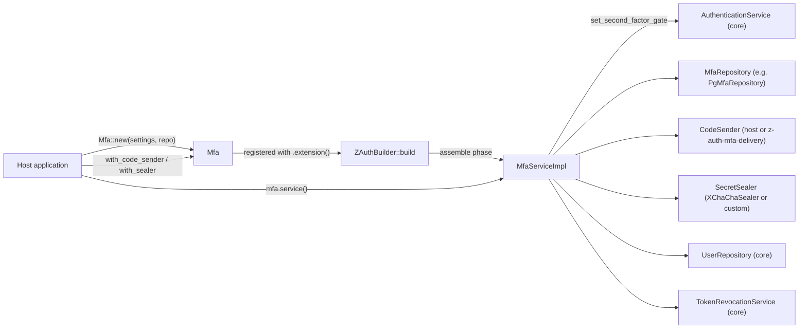

# z-auth-mfa

`z-auth` verifies passwords and manages the sessions that follow. `z-auth-mfa` adds a second factor on top of that. The host application imports the crate, builds an `Mfa` value and registers it with `ZAuth` through the core's `Extension` port, so the core never depends on this crate and a service that does not need two-factor authentication pays nothing for it. Everything the crate needs is configured through its own `AUTH_MFA_*` environment variables, or through a `RawMfaConfig` filled in by code, and is kept separate from the core's `AuthConfig`.

Once registered, the extension changes what a login returns. A user who has enrolled a factor no longer receives tokens for a correct password. The password step yields a short-lived challenge instead, and the session is opened only when the client answers that challenge with a valid code. Sessions opened this way carry `mfa` in their `amr` claim, which lets the host guard sensitive routes with `Authorizer::require_mfa`. Enrollment, factor management and recovery codes are offered through the `MfaService` trait and a set of framework-agnostic HTTP handlers.

## Second factors

Three families of second factor are supported, and the host chooses which of them are enabled with `AUTH_MFA_METHODS`, listed in order of preference.

Time-based one-time passwords follow RFC 6238 and work with any authenticator app. The crate generates a random shared secret, shows it to the user as an `otpauth://` URI for a QR code, and from then on verifies six to eight digit codes computed with HMAC-SHA-1, HMAC-SHA-256 or HMAC-SHA-512. The secret is sealed before it is stored, and every time step is accepted at most once, so a code observed over someone's shoulder cannot be replayed.

Email and SMS codes are generated, hashed and checked by this crate, but delivering them is the host's job. The host implements the `CodeSender` trait with its mail or SMS provider, or takes a ready-made one from [z-auth-mfa-delivery](../mfa-delivery/README.md), which covers SMTP, SendGrid, Postmark, Mailgun, Twilio and a signed webhook, and hands it to `Mfa::with_code_sender`. This crate never talks to a provider itself and never stores a code in clear. Email and SMS destinations are sealed like TOTP secrets, and only a masked hint such as `j*******@example.com` is kept readable.

Recovery codes are the fallback for a lost phone. A set of single-use codes is issued together with the user's first factor, shown once, and stored only as keyed hashes. A recovery code completes a login exactly like a TOTP code does, and a new set can be generated at any time with a fresh proof.

## How the extension plugs in

`Mfa` is the extension value. During `ZAuthBuilder::build` it checks its own setup, constructs an `MfaServiceImpl` from the core's user repository, revocation service and clock, and installs that service as the core's `SecondFactorGate` unless enforcement is `off`. The same object then serves both roles. As the gate it is consulted by `login` and `complete_login`, and as the `MfaService` it handles enrollment and factor management.



The repository holds factors, recovery codes, login challenges and lockout counters. The sender delivers email and SMS codes. The sealer encrypts the two kinds of secret that must be read back later, TOTP secrets and delivery destinations. The core's user repository supplies the account's email address and roles, and its revocation service ends sessions when a factor is removed.

## Wiring

The extension is built from validated settings and a repository, optionally given a code sender and a custom sealer, and registered on the builder. The sketch below uses the PostgreSQL adapter's `PgMfaRepository`; any `MfaRepository` works the same way.

```rust
use std::sync::Arc;

use z_auth::prelude::*;
use z_auth_mfa::config::{MfaConfigLoader, MfaEnvLoader};
use z_auth_mfa::{CodeSender, Mfa, MfaService};
use z_auth_postgres::PgMfaRepository;

fn build_auth(
    pool: sqlx::PgPool,
    repos: Repositories,
    mailer: Arc<dyn CodeSender>,
) -> Result<(ZAuth, Arc<dyn MfaService>), Box<dyn std::error::Error>> {
    let mfa = Arc::new(
        Mfa::new(
            MfaEnvLoader.load_settings()?,              // AUTH_MFA_*
            Arc::new(PgMfaRepository::new(pool)),       // z-auth-postgres, feature `mfa`
        )
        .with_code_sender(mailer),                      // needed when email or sms is enabled
    );
    let auth = ZAuth::builder(EnvLoader.load_config()?, repos)
        .extension(mfa.clone())
        .build()?;                                      // validates and installs the gate
    let service = mfa.service().expect("ZAuth was built with this extension");
    Ok((auth, service))
}
```

`Mfa::service()` returns `None` until the `ZAuth` the extension was registered with has been built, because the service needs the core's repositories and revocation service. Keep the `Arc<Mfa>` or the returned `Arc<dyn MfaService>` around for the enrollment endpoints. `Mfa::settings()` exposes the validated `MfaSettings`.

To seal secrets with a key management service instead of the built-in XChaCha20-Poly1305 sealer, pass a `SecretSealer` implementation with `with_sealer`. A custom sealer takes precedence over `AUTH_MFA_ENCRYPTION_KEY`, which may then be left unset. The [ports guide](docs/ports.md) shows an illustrative implementation.

`ZAuth::tick` should already run every few minutes for the core's own housekeeping. The extension piggybacks on it and purges expired challenges, enrollments and lockout rows at most once per `AUTH_MFA_PURGE_INTERVAL_SECS`. A tick that purged reports an `MfaTickReport`, which can be read with `tick_report.extension::<MfaTickReport>()`.

## Build failures

`ZAuthBuilder::build` fails with `AuthError::Config` when the extension cannot work as configured. That happens when `AUTH_MFA_METHODS` lists `email` or `sms` but no `CodeSender` was given, and when there is no way to seal secrets. With the `aead` feature the second case means that neither `AUTH_MFA_ENCRYPTION_KEY` nor a custom sealer was provided, and without the feature it means that no custom sealer was provided. The build also fails when the same `Mfa` value is registered with a second `ZAuth`, because its service can be wired only once, and when another extension has already installed a second-factor gate.

Configuration mistakes are reported earlier. `MfaConfigLoader::load_settings` returns a `ConfigError` for a missing `AUTH_MFA_HASH_KEY`, a malformed key, an unknown method or a value outside its range. The [configuration guide](docs/configuration.md) lists every check.

## Module layout

The crate is organised by responsibility. Most hosts only touch `Mfa`, `config`, `api`, the `MfaService` trait and the two ports they implement, `MfaRepository` and `CodeSender`.

```text
z_auth_mfa
├── Mfa, EXTENSION_NAME      the extension (private module extension.rs, re-exported)
├── api
│   ├── dto                  request and response shapes of the enrollment endpoints
│   ├── handlers             framework-agnostic handlers, including send_login_code
│   └── mapping              conversions between DTOs and domain models
├── config
│   ├── loaders              MfaConfigLoader, MfaEnvLoader, MfaDirectLoader, validation
│   └── model                MfaSettings, RawMfaConfig, Enforcement, Unenrolled, ...
├── constants                defaults, limits and AUTH_MFA_* names
├── crypto
│   ├── base32               RFC 4648 for TOTP secrets, Crockford for recovery codes
│   ├── codes                code generation, keyed hashing, challenge tokens, masking
│   ├── sealer               SecretSealer, XChaChaSealer (feature aead)
│   └── totp                 HOTP and TOTP with constant-time verification
├── gate                     SecondFactorGate for MfaServiceImpl (the login side)
├── keys                     generate_keys, GeneratedMfaKeys
├── model                    MfaMethod, Factor, Challenge, StepUpProof, views, ...
├── prelude                  convenience re-exports
├── report                   MfaTickReport
├── repository               MfaRepository, CodeLimits
├── sender                   CodeSender, CodeDelivery, CodePurpose
├── service                  MfaService
└── service_impl             MfaServiceImpl
```

## Features

The crate has one feature, `aead`, which is enabled by default. It provides `XChaChaSealer`, the built-in XChaCha20-Poly1305 sealer used whenever no custom sealer is supplied. Without it the host must call `Mfa::with_sealer`, otherwise the build fails.

There is a trap here when the crate is used together with the PostgreSQL adapter. The `mfa` feature of `z-auth-postgres` depends on `z-auth-mfa` with `default-features = false`, so that the adapter does not force a sealer on anyone. Cargo unifies features across the dependency graph, which means `aead` is enabled only if some crate asks for it. A host that declares its own `z-auth-mfa` dependency with default features keeps `aead`. A host that relies on the adapter's transitive dependency, or that disables default features itself, ends up without the built-in sealer and must provide one with `with_sealer`.

## Deployments

In shared mode every instance of the service runs the extension against the same database, and every instance must use the same `AUTH_MFA_ENCRYPTION_KEY`, `AUTH_MFA_PREVIOUS_ENCRYPTION_KEYS` and `AUTH_MFA_HASH_KEY`. An instance with a different hash key cannot verify challenge tokens or recovery codes created by the others, and an instance with a different encryption key cannot open their TOTP secrets.

In federation mode second factors belong to the authority, the service that owns users and logins. Register the extension there only, and route the enrollment endpoints, `POST /login/second-factor` and `POST /login/second-factor/code` to it. Session stores refuse `complete_login` exactly as they refuse `login`, with `not_authority`, so a misrouted request fails cleanly. Session stores need no `z-auth-mfa` dependency at all, because the `amr` of every session is replicated with the session itself and `require_mfa` therefore works on every service. The [federation guide](../postgres/docs/federation.md) and the [cluster guide](../cluster/docs/cluster.md) describe the topology.

## Storage

The crate ships no database code. Storage is the `MfaRepository` port, whose contract (including which methods must be atomic) is described in the [ports guide](docs/ports.md). The PostgreSQL adapter implements it as `PgMfaRepository` behind its `mfa` feature, together with a separate migration set in `migrations_mfa/` (versions from 2001) applied by `MFA_MIGRATOR` or `run_mfa_migrations`, or by `cargo run -p z-auth-postgres --features mfa --bin setup_db -- --mfa`. See the [PostgreSQL adapter](../postgres/README.md) for details. For tests, `z-auth-testkit` with its `mfa` feature provides an in-memory implementation.

## Guides

The guides in `docs/` cover the crate in depth. The [login flow](docs/login-flow.md) explains the gate's decision, challenge tokens, the verification order and the HTTP endpoints of the two-step login. [Enrollment and factor management](docs/enrollment.md) covers `MfaService`, step-up proofs, recovery codes and the enrollment endpoints. [Security](docs/security.md) describes TOTP verification, sealing, keyed hashing, code generation and the guarantees the crate makes. [Configuration](docs/configuration.md) lists every `AUTH_MFA_*` variable with its default and validation. [Ports](docs/ports.md) documents `MfaRepository`, `CodeSender` and `SecretSealer` for implementers.

For the core concepts this crate builds on, see the [extensions guide](../../docs/extensions.md), [sessions and tokens](../../docs/sessions-and-tokens.md), [authorization](../../docs/authorization.md) and the [HTTP API](../../docs/http-api.md).
