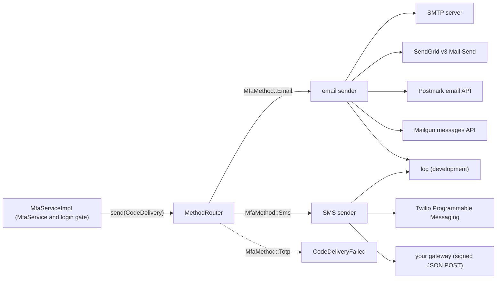

# z-auth-mfa-sender

`z-auth-mfa` generates email and SMS codes, stores their keyed hashes and checks what the user types, but it never talks to a mail server or an SMS gateway. Every code it wants delivered is handed to a `CodeSender`, a one-method port the host supplies through `Mfa::with_code_sender`. `z-auth-mfa-sender` is a ready-made `CodeSender`. It covers the common providers, composes the message text for each purpose, and is configured through its own `AUTH_MFA_*` variables, so a host that is content with SMTP, SendGrid, Postmark, Mailgun, Twilio or a signed webhook does not have to write delivery code at all.

The crate is a subcrate of `z-auth-mfa`. It lives in that crate's `delivery` directory but is a package of its own, because it builds on the `CodeSender` port that `z-auth-mfa` defines and a host that delivers codes itself should not compile it. `AUTH_MFA_METHODS`, read by `z-auth-mfa`, decides which methods users can enroll. The variables described here decide how the resulting codes leave the service. A host with its own delivery pipeline can ignore this crate and implement `CodeSender` directly, as the [ports guide](../docs/ports.md) shows.

## Where it fits

Codes are produced in three situations, all inside `z-auth-mfa`'s `MfaServiceImpl`. During login the gate sends one automatically when a user with an email or SMS factor (and no TOTP factor) passes the password step, provided `AUTH_MFA_AUTO_SEND` is on as it is by default, and `send_login_code` sends one whenever the client asks for it. Enrolling an email or SMS factor sends a code with `CodePurpose::Enrollment`, and requesting a step-up proof sends one with `CodePurpose::StepUp`. In each case the service stores the hash first and then awaits `CodeSender::send` with a `CodeDelivery`, which carries the plaintext destination, the code, the purpose and the expiry. The sender built by this crate is a `MethodRouter` that looks at the delivery's method and forwards it to the configured email or SMS provider.



TOTP codes are never delivered, and `z-auth-mfa` never asks for them to be, but the router still refuses a `CodeDelivery` with `MfaMethod::Totp` by returning `CodeDeliveryFailed` rather than guessing a destination.

## Providers

Each method has its own provider, chosen with `AUTH_MFA_EMAIL_PROVIDER` and `AUTH_MFA_SMS_PROVIDER`. The two choices are independent, so a deployment can send email through Postmark and SMS through its own gateway.

| Method | Provider value | Delivers through | Guide |
|---|---|---|---|
| Email | `smtp` | Any SMTP server, with STARTTLS, implicit TLS or (for local development) no encryption | [Email](docs/email.md) |
| Email | `sendgrid` | SendGrid's v3 Mail Send API | [Email](docs/email.md) |
| Email | `postmark` | Postmark's email API, on a configurable message stream | [Email](docs/email.md) |
| Email | `mailgun` | Mailgun's messages API, in the US or EU region | [Email](docs/email.md) |
| SMS | `twilio` | Twilio Programmable Messaging, from a number or a Messaging Service | [SMS](docs/sms.md) |
| SMS | `webhook` | A JSON `POST` to your own gateway, optionally signed with HMAC-SHA256 | [SMS](docs/sms.md) |
| Either | `log` | Nowhere, the code is written to the log at `WARN` level | [Operations](docs/operations.md) |

`log` is the default for both methods. That keeps a fresh checkout working without any provider account, but it also means that a production deployment which forgets to set the provider variables writes every code into its logs, where anyone who can read them can complete a sign-in. Set both variables explicitly wherever real users sign in.

## Cargo features

Every provider except `log` is a Cargo feature of the same name, and all six are enabled by default. Turning features off removes the provider's code and its dependencies, which is worthwhile for a service that only ever uses one provider.

| Feature | Provider | Pulls in |
|---|---|---|
| `smtp` | SMTP | `lettre`, with rustls, aws-lc-rs and the platform certificate verifier |
| `sendgrid` | SendGrid | `http` |
| `postmark` | Postmark | `http` |
| `mailgun` | Mailgun | `http` |
| `twilio` | Twilio | `http` |
| `webhook` | Signed webhook | `http`, `hmac`, `sha2`, `hex` |
| `http` | None on its own | `reqwest` with rustls, the HTTP client shared by the API providers |

`http` is an internal feature. It is enabled by the providers that need it and is not meant to be selected directly. `log` needs no feature and is always available.

The configuration types are compiled regardless of features, so `EmailProvider::Smtp` exists even in a build without `smtp`. Selecting a provider that is not compiled in is therefore a configuration error rather than a compile error. `DeliveryConfig::from_env` rejects it with a `ConfigError` on the selecting variable, and `build` rejects a `DeliveryConfig` built in code with `AuthError::Config`, both with the message ``z-auth-mfa-sender was built without the `smtp` feature`` (naming the provider in question).

A host that only sends email through Postmark and SMS through Twilio would declare the dependency as follows. The path assumes the z-auth workspace is checked out next to the host crate, so adjust it to your layout.

```toml
[dependencies]
z-auth-mfa-sender = { path = "z-auth/adapters/mfa/delivery", default-features = false, features = ["postmark", "twilio"] }
```

The crate depends on `z-auth` and `z-auth-mfa` with their default features off, so it never adds features to them. In particular it does not enable `z-auth-mfa`'s `aead` sealer, which remains the host's decision as described in the [z-auth-mfa guide](../README.md).

## Wiring

The usual setup reads the delivery settings from the environment, builds one sender for both methods and passes it to `Mfa::with_code_sender`. The repository argument is whatever `MfaRepository` the host uses, for example `PgMfaRepository` from the PostgreSQL adapter.

```rust
use std::sync::Arc;

use z_auth_mfa::config::{MfaConfigLoader, MfaEnvLoader};
use z_auth_mfa::{Mfa, MfaRepository};
use z_auth_mfa_sender::DeliveryConfig;

fn mfa_extension(repo: Arc<dyn MfaRepository>) -> Result<Arc<Mfa>, Box<dyn std::error::Error>> {
    let delivery = DeliveryConfig::from_env()?; // AUTH_MFA_EMAIL_PROVIDER, AUTH_MFA_SMS_PROVIDER, ...
    let mfa = Arc::new(
        Mfa::new(MfaEnvLoader.load_settings()?, repo)
            .with_code_sender(z_auth_mfa_sender::build(&delivery)?),
    );
    Ok(mfa)
}
```

`DeliveryConfig::from_env` returns a `ConfigError` that names the offending variable, and `build` returns an `AuthError::Config` when a provider cannot be constructed, for example when the SMTP From address does not parse or the webhook URL is malformed. Both happen at startup, so a misconfigured deployment fails before it serves anyone. Neither call touches the network, so an unreachable provider is only discovered at the first send.

`build` returns an `Arc<dyn CodeSender>` that routes by method. When only one half is wanted, `email_sender` and `sms_sender` build the email or the SMS sender alone from the same `DeliveryConfig`. That is useful for a host that delivers email itself but wants Twilio for SMS, and combines the two in its own `CodeSender`. A sender obtained this way is not wrapped in `MethodRouter`, so it does not refuse other methods and does not write the debug line described in the [operations guide](docs/operations.md).

```rust
use std::sync::Arc;

use z_auth_mfa::CodeSender;
use z_auth_mfa_sender::DeliveryConfig;

fn sms_only() -> Result<Arc<dyn CodeSender>, Box<dyn std::error::Error>> {
    let delivery = DeliveryConfig::from_env()?;
    Ok(z_auth_mfa_sender::sms_sender(&delivery)?)
}
```

`MethodRouter` is public as well, with public `email`, `sms`, `email_provider` and `sms_provider` fields, so a host can route between a sender of its own and one from this crate without reimplementing the dispatch.

## Configuration from other sources

`DeliveryConfig::from_lookup` performs exactly the same parsing and validation as `from_env`, but reads each variable through a closure instead of the process environment. It suits hosts that keep secrets in a vault or a configuration file. The closure below consults a map first and falls back to the environment.

```rust
use std::collections::HashMap;

use z_auth_mfa_sender::DeliveryConfig;

fn from_secrets(vars: &HashMap<String, String>) -> Result<DeliveryConfig, z_auth::conf::config::ConfigError> {
    DeliveryConfig::from_lookup(|key| vars.get(key).cloned().or_else(|| std::env::var(key).ok()))
}
```

Every field of `DeliveryConfig` and of the provider structs in the `config` module is public, so the configuration can also be built entirely in code. Credentials are wrapped in `Secret::new`, and the `api_base` fields take the provider's official endpoint from the `constants` module (or a proxy).

```rust
use std::sync::Arc;
use std::time::Duration;

use z_auth_mfa::CodeSender;
use z_auth_mfa_sender::config::{PostmarkConfig, WebhookConfig};
use z_auth_mfa_sender::constants::POSTMARK_API;
use z_auth_mfa_sender::{DeliveryConfig, EmailProvider, Secret, SmsProvider};

fn sender(token: String, secret: String) -> Result<Arc<dyn CodeSender>, z_auth::AuthError> {
    let cfg = DeliveryConfig {
        sender_name: "Acme".into(),
        timeout: Duration::from_secs(5),
        email: EmailProvider::Postmark(PostmarkConfig {
            server_token: Secret::new(token),
            message_stream: "outbound".into(),
            from: "no-reply@acme.example".into(),
            api_base: POSTMARK_API.into(),
        }),
        sms: SmsProvider::Webhook(WebhookConfig {
            url: "https://sms-gateway.internal/send".into(),
            secret: Some(Secret::new(secret)),
            bearer_token: None,
        }),
    };
    z_auth_mfa_sender::build(&cfg)
}
```

A configuration built in code skips the loader's validation. `build` still parses the SMTP From address and the webhook URL, but it does not check the From address of the API providers, does not insist on an `http` or `https` scheme, and accepts a zero timeout, which would make every send fail. `DeliveryConfig::default()` is a safe base for struct update syntax, with `log` for both methods, the sender name `z-auth` and a ten-second timeout. The [configuration guide](docs/configuration.md) covers both loaders in detail.

## Failures

A send that does not succeed returns `AuthError::CodeDeliveryFailed`, whose detail starts with the provider name and continues with the transport error or with the provider's HTTP status and the first 200 characters of its answer, for example `sendgrid: 401 Unauthorized: {"errors":["bad key"]}`. z-auth's HTTP mapping turns it into status 503 with the code `code_delivery_failed` and the generic message `the code could not be delivered; retry later`, so provider details never reach the client. The detail is meant for the host's log, and the core does not log it on its own. The [operations guide](docs/operations.md) explains how failures interact with the resend cooldown.

## Module layout

Most hosts only touch the crate root. The provider structs live in `config`, and the sender types in `email` and `sms` are public for hosts that want to construct a single sender by hand.

```text
z_auth_mfa_sender
├── DeliveryConfig, EmailProvider, SmsProvider, Secret   re-exported from config
├── LogCodeSender                                        re-exported from log
├── build, email_sender, sms_sender, MethodRouter, mask  re-exported from the private router module
├── config      DeliveryConfig::from_env, from_lookup, SmtpConfig, SmtpSecurity, SendGridConfig,
│               PostmarkConfig, MailgunConfig, TwilioConfig, TwilioSender, WebhookConfig
├── constants   defaults, provider endpoints, webhook header names, AUTH_MFA_* variable names
├── email       SmtpSender and build_email (smtp), SendGridSender, PostmarkSender, MailgunSender
├── log         LogCodeSender, the development sender
├── message     EmailMessage, email and sms, the text of every message
├── sms         TwilioSender (twilio), WebhookSender and signature (webhook)
├── http        private, feature http, the shared reqwest client and response check
└── router      private, the MethodRouter, build functions and destination masking
```

Two types share the name `TwilioSender`. `config::TwilioSender` is the enum that says where Twilio messages come from (`From` or `MessagingService`), while `sms::TwilioSender` is the sender itself. Code that builds a Twilio configuration by hand imports the former.

## Guides

The guides in `docs/` cover the crate in depth. The [configuration guide](docs/configuration.md) lists every variable with its default, its requirements and its validation, and explains the loaders and secret redaction. The [email guide](docs/email.md) describes the SMTP security modes, the three email APIs, the message format and local development with Mailpit. The [SMS guide](docs/sms.md) covers Twilio, the SMS text and the signed webhook, including how a receiver verifies the signature. The [operations guide](docs/operations.md) deals with timeouts, failure handling, logging, TLS, the resend cooldown and the test suites.

For the side of the port that produces the codes, see the [z-auth-mfa guide](../README.md), its [ports guide](../docs/ports.md) for the `CodeSender` contract, its [login flow](../docs/login-flow.md) for when codes are sent, and its [configuration guide](../docs/configuration.md) for `AUTH_MFA_CODE_TTL_SECS`, `AUTH_MFA_CODE_RESEND_SECS` and the other code limits.
