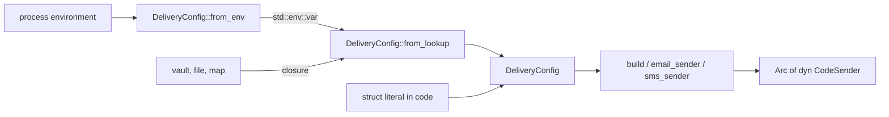
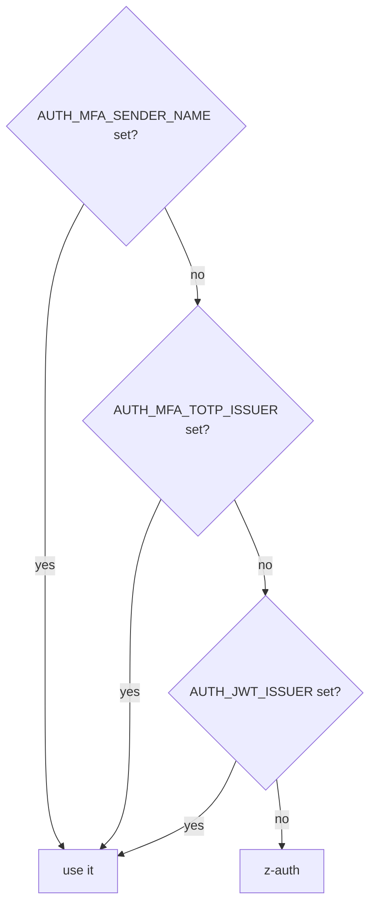
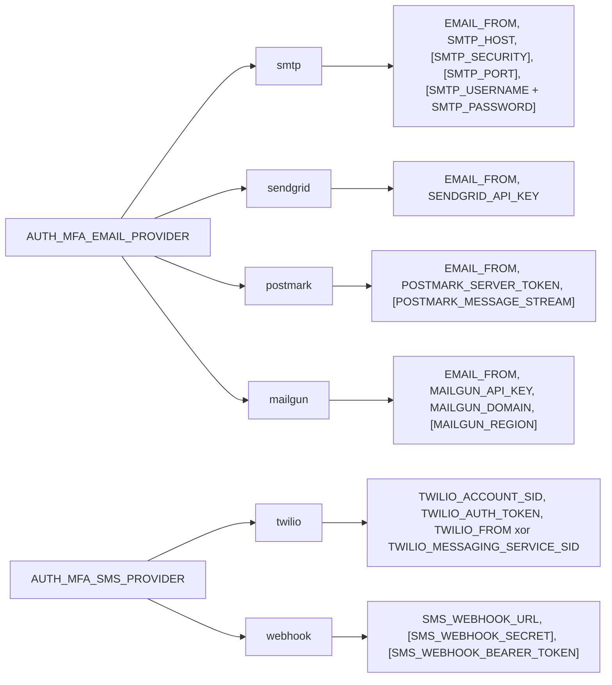

# Configuration

`z-auth-mfa-sender` is configured through a `DeliveryConfig` value, which names the email provider, the SMS provider, the sender name used in messages and the timeout of each send. The value is normally read from `AUTH_MFA_*` environment variables by `DeliveryConfig::from_env`, but it can equally be read from any other source with `DeliveryConfig::from_lookup` or built directly in code. This guide lists every variable with its default and validation rule, explains which variables each provider requires, and describes how errors are reported and how credentials are kept out of logs.

The variables share the `AUTH_MFA_` prefix with `z-auth-mfa`, but the two crates read disjoint sets. `MfaEnvLoader` ignores everything listed here, and `DeliveryConfig::from_env` ignores everything in the [z-auth-mfa configuration guide](../../docs/configuration.md) except `AUTH_MFA_TOTP_ISSUER`, which it consults as a fallback for the sender name.

## Loading

Both loaders end in the same function. `from_env` is a thin wrapper that calls `from_lookup` with `std::env::var`, so the two always agree on defaults, validation and error messages.



`from_lookup` takes any `Fn(&str) -> Option<String>`, calls it with each variable name it needs, and treats `None` as unset. Every value is trimmed of surrounding whitespace, and a value that is empty after trimming counts as unset, so `AUTH_MFA_EMAIL_PROVIDER=` in an environment file selects the default rather than failing. Provider names, `AUTH_MFA_SMTP_SECURITY` and `AUTH_MFA_MAILGUN_REGION` are compared case-insensitively. Credentials are trimmed too, which matters only for the unusual secret that genuinely begins or ends with a space.

The loader checks the timeout first, then resolves the sender name, then the email provider and finally the SMS provider, and it stops at the first problem. A deployment with several mistakes therefore sees them one at a time, in that order.

Like z-auth's other loaders, `from_env` never reads a `.env` file. The process environment is the only source, and a host that keeps its settings in `.env` during development loads the file itself before calling the loader, for example with the dotenvy crate. A configuration built in code bypasses the loader entirely, along with its validation, which the [README](../README.md) discusses together with an example.

## General variables

These variables apply whatever the providers are.

| Variable | Default | Validation | Purpose |
|---|---|---|---|
| `AUTH_MFA_EMAIL_PROVIDER` | `log` | `log`, `smtp`, `sendgrid`, `postmark` or `mailgun` | Which provider delivers email codes |
| `AUTH_MFA_SMS_PROVIDER` | `log` | `log`, `twilio` or `webhook` | Which provider delivers SMS codes |
| `AUTH_MFA_SENDER_NAME` | See the fallback chain below | Any non-blank string | The name in email subjects, in SMS texts and as the From display name |
| `AUTH_MFA_EMAIL_FROM` | None | A single bare email address | The From address, required by every email provider except `log` |
| `AUTH_MFA_DELIVERY_TIMEOUT_SECS` | `10` | An integer greater than 0 | The time limit of one send |

`AUTH_MFA_EMAIL_FROM` is a bare address such as `no-reply@acme.example`, never a `Name <address>` form, because the display name comes from the sender name. The loader accepts it when it is at most 254 characters long, contains no whitespace and none of the characters `<`, `>`, `,`, `;` and `"`, and has a non-empty local part before the `@` and a domain after it that contains a dot, does not begin or end with a dot and contains no second `@`. That rule rejects `no-reply@localhost`, which is worth knowing when pointing the service at a local mail catcher. The address must also be one the provider is willing to send from, typically a verified sender or an address on a verified domain, and the provider reports that problem only at the first send.

The timeout applies to each send and defaults to ten seconds. Its exact meaning differs between the HTTP providers and SMTP, as the [operations guide](operations.md) explains.

## The sender name

The sender name appears in every message, so the loader tries hard to find a meaningful one. It takes the first non-blank value among `AUTH_MFA_SENDER_NAME`, `AUTH_MFA_TOTP_ISSUER` and `AUTH_JWT_ISSUER`, and falls back to `z-auth` when none of them is set. The intermediate steps mean that a deployment which already names itself in authenticator apps, or in its tokens' `iss` claim, sends codes under the same name without further configuration.



The chain reads the variables themselves, not the validated settings of the other crates. If `AUTH_JWT_ISSUER` is unset, the core uses its own default issuer, and the delivery crate independently arrives at the same `z-auth`. The name is used verbatim and is escaped where the format requires it, in the HTML body and in the quoted display names sent to Postmark and Mailgun.

## Email provider variables

Each email provider other than `log` requires `AUTH_MFA_EMAIL_FROM` in addition to the variables below. The variables of providers that are not selected are ignored, so they can stay in a shared environment file without effect.

| Variable | Provider | Default | Requirement and validation |
|---|---|---|---|
| `AUTH_MFA_SMTP_HOST` | `smtp` | None | Required, the server's host name, also used to verify its certificate |
| `AUTH_MFA_SMTP_SECURITY` | `smtp` | `starttls` | `starttls`, `tls` or `none` |
| `AUTH_MFA_SMTP_PORT` | `smtp` | `587`, `465` or `25` by security mode | A port number that fits in 16 bits |
| `AUTH_MFA_SMTP_USERNAME` | `smtp` | None | Optional, set together with `AUTH_MFA_SMTP_PASSWORD` or not at all |
| `AUTH_MFA_SMTP_PASSWORD` | `smtp` | None | Optional, set together with `AUTH_MFA_SMTP_USERNAME` or not at all |
| `AUTH_MFA_SENDGRID_API_KEY` | `sendgrid` | None | Required, an API key with the Mail Send permission |
| `AUTH_MFA_POSTMARK_SERVER_TOKEN` | `postmark` | None | Required, the server API token |
| `AUTH_MFA_POSTMARK_MESSAGE_STREAM` | `postmark` | `outbound` | Any non-blank stream ID |
| `AUTH_MFA_MAILGUN_API_KEY` | `mailgun` | None | Required, a Mailgun API key |
| `AUTH_MFA_MAILGUN_DOMAIN` | `mailgun` | None | Required, the sending domain configured in Mailgun |
| `AUTH_MFA_MAILGUN_REGION` | `mailgun` | `us` | `us` or `eu` |

The SMTP username and password follow a both-or-neither rule. Both set means the client authenticates, neither set means it talks to an unauthenticated relay, and exactly one set is an error that names the missing partner. The port default follows the security mode, 587 for `starttls`, 465 for `tls` and 25 for `none`, and an explicit port overrides it. The [email guide](email.md) explains the modes and what each provider sends.

## SMS provider variables

| Variable | Provider | Default | Requirement and validation |
|---|---|---|---|
| `AUTH_MFA_TWILIO_ACCOUNT_SID` | `twilio` | None | Required, the account SID (`AC...`) |
| `AUTH_MFA_TWILIO_AUTH_TOKEN` | `twilio` | None | Required, the account's auth token |
| `AUTH_MFA_TWILIO_FROM` | `twilio` | None | Exactly one of this and the Messaging Service SID, a Twilio number in E.164 form or an alphanumeric sender ID |
| `AUTH_MFA_TWILIO_MESSAGING_SERVICE_SID` | `twilio` | None | Exactly one of this and `AUTH_MFA_TWILIO_FROM`, a Messaging Service SID (`MG...`) |
| `AUTH_MFA_SMS_WEBHOOK_URL` | `webhook` | None | Required, a URL beginning with `http://` or `https://` |
| `AUTH_MFA_SMS_WEBHOOK_SECRET` | `webhook` | None | Optional, signs each request with HMAC-SHA256 when set |
| `AUTH_MFA_SMS_WEBHOOK_BEARER_TOKEN` | `webhook` | None | Optional, sent as an `Authorization` bearer token when set |

Twilio needs to know where messages come from, and there are two mutually exclusive ways to say it. `AUTH_MFA_TWILIO_FROM` names a sending number or sender ID directly, while `AUTH_MFA_TWILIO_MESSAGING_SERVICE_SID` lets a Messaging Service choose the number. Setting neither or both is an error. The loader does not check the format of either value, so a malformed number is reported by Twilio at the first send.

The webhook URL is checked for its scheme by the loader and parsed in full by `build`, which reports an unparsable URL as `AuthError::Config`. Plain `http` is accepted for gateways on a trusted local network, but the request carries the plaintext code, so anything that crosses a network boundary should use `https`. The [SMS guide](sms.md) describes the request and its signature.

## Provider requirements at a glance

The diagram summarises which variables each provider choice pulls in. Variables in brackets are optional.



The names in the diagram omit the common `AUTH_MFA_` prefix for brevity. `log` requires nothing for either method.

## Errors

The loaders return z-auth's `ConfigError`, with the same two variants and the same wording as the core's loaders. `ConfigError::Missing` reports a variable that must be set, together with the reason it is required, and `ConfigError::Parse` reports a value that is present but unusable, keyed by the variable's name. The table shows the messages the loader produces, as printed through `Display`.

| Situation | Message |
|---|---|
| A provider's required variable is unset | `missing required configuration field: AUTH_MFA_SMTP_HOST (required by AUTH_MFA_EMAIL_PROVIDER=smtp)` |
| Only one SMTP credential is set | `missing required configuration field: AUTH_MFA_SMTP_PASSWORD (set with AUTH_MFA_SMTP_USERNAME)` |
| Neither Twilio sender is set | `missing required configuration field: AUTH_MFA_TWILIO_FROM or AUTH_MFA_TWILIO_MESSAGING_SERVICE_SID (required by AUTH_MFA_SMS_PROVIDER=twilio)` |
| Both Twilio senders are set | `failed to parse configuration field 'AUTH_MFA_TWILIO_FROM': set exactly one of it and AUTH_MFA_TWILIO_MESSAGING_SERVICE_SID` |
| Unknown provider | `failed to parse configuration field 'AUTH_MFA_SMS_PROVIDER': expected log, twilio or webhook` |
| Provider not compiled in | ``failed to parse configuration field 'AUTH_MFA_EMAIL_PROVIDER': z-auth-mfa-sender was built without the `smtp` feature`` |
| Invalid From address | `failed to parse configuration field 'AUTH_MFA_EMAIL_FROM': "no-reply@localhost" is not an email address` |
| Unknown security mode | `failed to parse configuration field 'AUTH_MFA_SMTP_SECURITY': expected starttls, tls or none` |
| Unknown Mailgun region | `failed to parse configuration field 'AUTH_MFA_MAILGUN_REGION': expected us or eu` |
| Webhook URL without an http scheme | `failed to parse configuration field 'AUTH_MFA_SMS_WEBHOOK_URL': must be an http(s) URL` |
| Zero timeout | `failed to parse configuration field 'AUTH_MFA_DELIVERY_TIMEOUT_SECS': must be greater than 0` |
| A number that does not parse | `failed to parse configuration field 'AUTH_MFA_SMTP_PORT': number too large to fit in target type` |

The last row shows that numeric parse errors carry the standard library's reason, so `AUTH_MFA_DELIVERY_TIMEOUT_SECS=abc` reports `invalid digit found in string`. A value in an error message is never a credential, because secrets are not validated beyond being present.

A few problems surface only in `build`, as `AuthError::Config`. They are a provider that is not compiled in (for a configuration built in code), an SMTP From address or host that `lettre` cannot use, an unparsable webhook URL, and a failure to construct the HTTP client. Each message names the component, for example `configuration error: SMTP From address "..."` followed by the parser's reason.

## Secret redaction

Every credential is held in a `Secret`, a small wrapper whose `Debug` implementation prints `<redacted>`. That covers the SMTP password, the SendGrid key, the Postmark token, the Mailgun key, the Twilio auth token and the webhook's secret and bearer token, so a `DeliveryConfig` can be logged with `{:?}` at startup without leaking them. `Secret::new` wraps a value and `Secret::expose` returns it, which is how the senders read it when building a request.

The redaction is limited to those fields. The SMTP username, the Twilio account SID, the Mailgun domain, the From address and the webhook URL are printed as they are. A webhook gateway that authenticates through a query parameter would therefore have its token printed with the URL, which is one more reason to use `AUTH_MFA_SMS_WEBHOOK_BEARER_TOKEN` or the signature instead.

## The template

The repository's `env.example` contains a commented section for this crate, headed `z-auth-mfa-sender (optional)`, with every variable above and its default. A Postmark and Twilio deployment needs only a handful of them.

```env
AUTH_MFA_EMAIL_PROVIDER=postmark
AUTH_MFA_EMAIL_FROM=no-reply@acme.example
AUTH_MFA_POSTMARK_SERVER_TOKEN=...
AUTH_MFA_SMS_PROVIDER=twilio
AUTH_MFA_TWILIO_ACCOUNT_SID=AC...
AUTH_MFA_TWILIO_AUTH_TOKEN=...
AUTH_MFA_TWILIO_MESSAGING_SERVICE_SID=MG...
AUTH_MFA_SENDER_NAME=Acme
```
