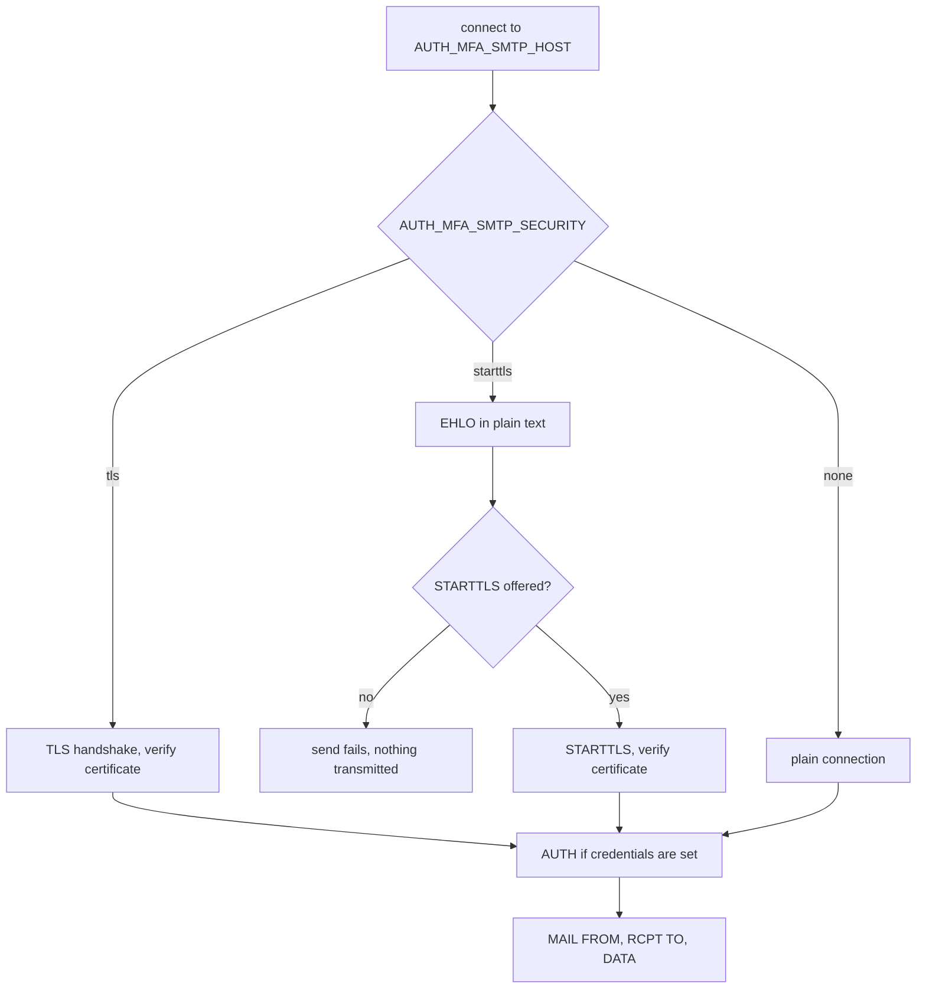
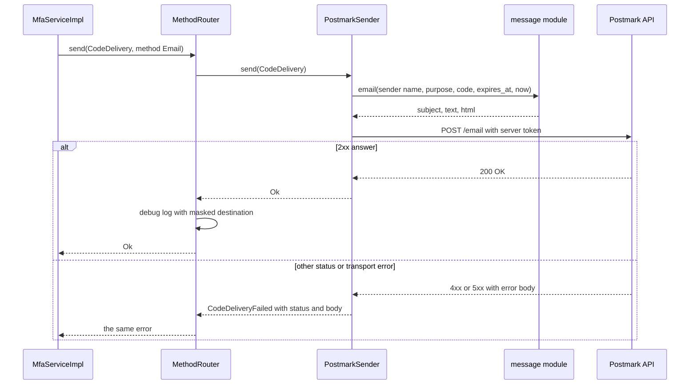

# Email delivery

Email codes go out through one of four providers, selected with `AUTH_MFA_EMAIL_PROVIDER`. `smtp` talks to any SMTP server, which makes it the natural choice for a corporate relay, Amazon SES, a self-hosted server or a local mail catcher. `sendgrid`, `postmark` and `mailgun` use the providers' HTTP APIs, which avoids SMTP's port and firewall concerns and reports errors more precisely. This guide describes each provider, the message every one of them sends, local development with Mailpit, and the life of a single send. The variables themselves are tabulated in the [configuration guide](configuration.md).

All four providers share the same inputs. The From address comes from `AUTH_MFA_EMAIL_FROM`, the display name from the sender name (see the configuration guide for its fallback chain), and the subject and bodies from the `message` module, so switching providers changes only the transport. They also share the same failure contract. Anything that goes wrong during a send becomes `AuthError::CodeDeliveryFailed` with the provider's name at the start of the detail.

## SMTP

The `smtp` provider uses `lettre`'s asynchronous SMTP transport on tokio, with TLS through rustls. It opens one connection per message and closes it afterwards, since `lettre`'s connection pool is not compiled in. Codes are sent rarely enough that reconnecting costs little, and no idle connection is left to break between sends.

### Security modes

`AUTH_MFA_SMTP_SECURITY` chooses how the connection is protected, and its value also determines the default port.

| Mode | Connection | Default port | Use for |
|---|---|---|---|
| `starttls` | Plain TCP upgraded with STARTTLS, which is required | 587 | Most submission servers, and the default |
| `tls` | TLS from the first byte, often called SMTPS | 465 | Servers that offer implicit TLS |
| `none` | Plain TCP, no encryption at all | 25 | Local development servers such as Mailpit or MailHog |

`starttls` never downgrades. The client connects in plain text, sends `EHLO`, and requires the server to accept `STARTTLS`. If the server does not offer it, or the upgrade fails, the send fails before any credentials or message data have been transmitted. This protects against an attacker on the path who strips the `STARTTLS` capability from the server's greeting, a downgrade that opportunistic clients would silently accept. `tls` starts the TLS handshake immediately and is equally strict. In both modes the server's certificate is verified against `AUTH_MFA_SMTP_HOST` using the platform's certificate store, so the host name must be the one on the certificate rather than an IP address or an internal alias.

`none` sends everything in clear text, including the code and, if they are configured, the SMTP credentials. It exists for mail catchers on the developer's own machine and has no place in production. The mode is never chosen implicitly, and the default is `starttls`.



### Authentication

When `AUTH_MFA_SMTP_USERNAME` and `AUTH_MFA_SMTP_PASSWORD` are both set, the client authenticates after the connection is secured, using `lettre`'s default mechanisms, `PLAIN` or `LOGIN`, whichever the server advertises. When neither is set, it sends without authenticating, which suits relays that trust the sender by network address. Setting only one is a configuration error. Many hosted SMTP services use an API key as the password and a fixed string as the user name, which their documentation states.

### What is checked when

`build` parses the From address with `lettre` and constructs the transport, so a From address that `lettre` rejects, or a host name that cannot be used for TLS, fails at startup with `AuthError::Config`. The recipient address is parsed at each send, and an address that does not parse fails that send with `smtp: bad recipient` followed by the reason. `z-auth-mfa` validates destinations at enrollment, so this is rare in practice. The client introduces itself in `EHLO` with the machine's host name, falling back to `127.0.0.1` when the host name is unavailable.

## SendGrid

The `sendgrid` provider posts to SendGrid's v3 Mail Send endpoint, `https://api.sendgrid.com/v3/mail/send`, with the API key as a bearer token. The key needs the Mail Send permission and nothing more, and the From address must be a verified single sender or belong to an authenticated domain. The JSON body has the following shape, shown here with illustrative values and the bodies shortened.

```json
{
  "personalizations": [{ "to": [{ "email": "bob@example.com" }] }],
  "from": { "email": "no-reply@acme.example", "name": "Acme" },
  "subject": "Your Acme sign-in code",
  "content": [
    { "type": "text/plain", "value": "Use this code to finish signing in: ..." },
    { "type": "text/html", "value": "<!doctype html>..." }
  ]
}
```

SendGrid answers an accepted message with `202 Accepted`. Any 2xx status counts as success, and anything else becomes `CodeDeliveryFailed` with the status and the start of SendGrid's error body.

## Postmark

The `postmark` provider posts to `https://api.postmarkapp.com/email` with the server token in the `X-Postmark-Server-Token` header and `Accept: application/json`. The body carries `From` (as a quoted display name followed by the address in angle brackets), `To`, `Subject`, `TextBody`, `HtmlBody` and `MessageStream`.

Postmark separates transactional and broadcast mail into message streams, and every server starts with a transactional stream whose ID is `outbound`. That is the default of `AUTH_MFA_POSTMARK_MESSAGE_STREAM`. A deployment that keeps sign-in codes in a stream of their own, so that their delivery statistics and suppressions are separate from other transactional mail, sets the variable to that stream's ID. Codes should never be sent through a broadcast stream, which Postmark reserves for bulk mail with unsubscribe handling. The From address must be a confirmed sender signature or on a verified domain.

## Mailgun

The `mailgun` provider posts a form to `/v3/<domain>/messages` with HTTP basic authentication, the user name being the literal `api` and the password the API key. The form fields are `from`, `to`, `subject`, `text` and `html`, with `from` formatted as a quoted display name followed by the address.

Mailgun runs separate regions, and a domain lives in exactly one of them. `AUTH_MFA_MAILGUN_REGION` selects the base URL accordingly.

| Region | Base URL |
|---|---|
| `us` (default) | `https://api.mailgun.net` |
| `eu` | `https://api.eu.mailgun.net` |

A domain created in the EU region is unknown to the US endpoint, and the resulting failure looks like an authentication or not-found error rather than a region mismatch, so the region is the first thing to check when a correct key is refused. `AUTH_MFA_MAILGUN_DOMAIN` is the sending domain as configured in Mailgun, for example `mg.acme.example`, and the From address normally belongs to it.

## The message

Every provider sends the same message, composed by `message::email`. It is a multipart message with a plain-text part and an HTML part, so that clients which do not render HTML, and spam filters that compare the two, see the same content. SMTP builds a `multipart/alternative` body itself, and the HTTP providers pass both parts to the API, which does the same.

The subject and the opening line depend on the code's purpose.

| `CodePurpose` | Subject | Opening line |
|---|---|---|
| `Login` | `Your Acme sign-in code` | `Use this code to finish signing in` |
| `Enrollment` | `Confirm two-factor authentication for Acme` | `Use this code to finish setting up two-factor authentication` |
| `StepUp` | `Confirm a security change on Acme` | `Use this code to confirm the change to your account's security settings` |

Here `Acme` stands for the sender name, and each opening line ends with a colon in the message itself. The plain-text body of a login code valid for five minutes reads as follows.

```text
Use this code to finish signing in:

    482915

The code expires in 5 minutes.

If you didn't request it, someone may know your password: change it and don't share this code with anyone.

— Acme
```

The HTML part contains the same paragraphs, with the code set in a large monospaced font and the warning in grey, all styled inline so that it survives mail clients that strip style sheets. Every interpolated value is HTML-escaped, so a sender name such as `A&B` appears correctly.

The validity sentence is computed when the message is composed, from the code's `expires_at` and the sending host's current time. The remaining time is rounded up to whole minutes and never shown as less than one, and the word is singular for exactly one minute. With the default `AUTH_MFA_CODE_TTL_SECS` of 300 a fresh code reads "5 minutes". Because `expires_at` comes from the store's clock and the current time from the application host's, a large clock skew between the two would show up here, though it never affects whether the code is accepted.

The wording is fixed. A host that needs its own templates, another language or branding implements `CodeSender` itself, as shown in the [ports guide](../../docs/ports.md), and may still reuse `message::email` or `email::build_email` (feature `smtp`) for parts of the work.

## A send from start to finish

The sequence below follows a login code sent through Postmark. The other HTTP providers differ only in the request, and SMTP replaces the single HTTP exchange with the SMTP dialogue described above.



The whole exchange is bounded by `AUTH_MFA_DELIVERY_TIMEOUT_SECS`, and the user's request waits for it, which the [operations guide](operations.md) discusses.

## Local development with Mailpit

[Mailpit](https://mailpit.axllent.org) is a small SMTP server that accepts every message and shows it in a web inbox, which makes it convenient for testing the email flow without sending real mail. Start it with Docker, with SMTP on port 1025 and the web interface on port 8025.

```sh
docker run -p 8025:8025 -p 1025:1025 axllent/mailpit
```

Point the service at it with the `none` security mode, which Mailpit expects by default, and an explicit port, since the default for `none` is 25.

```env
AUTH_MFA_EMAIL_PROVIDER=smtp
AUTH_MFA_SMTP_HOST=localhost
AUTH_MFA_SMTP_PORT=1025
AUTH_MFA_SMTP_SECURITY=none
AUTH_MFA_EMAIL_FROM=no-reply@example.com
```

Codes then appear at `http://localhost:8025`, where both the text and HTML parts can be inspected. The From address must still pass the loader's check, so `no-reply@localhost` is refused and an address on a dotted domain such as `example.com` is needed even though nothing is actually delivered there. Leaving the security mode at `starttls` against an unmodified Mailpit fails every send, because Mailpit does not offer `STARTTLS` and the client refuses to continue without it. That is the downgrade protection doing its job.

For quick experiments without any server, the `log` provider writes each code to the log instead, as described in the [operations guide](operations.md).
