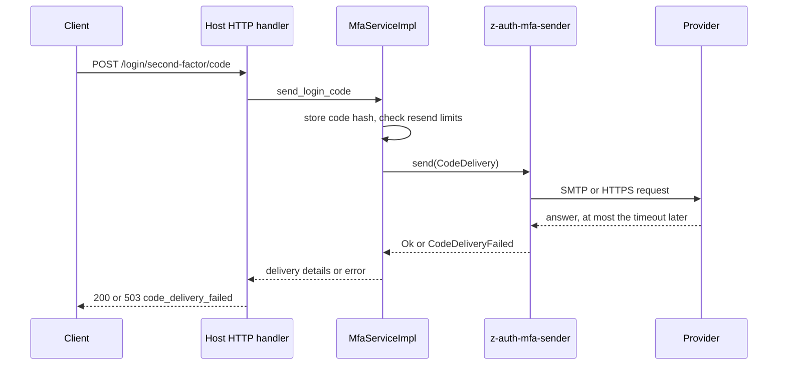
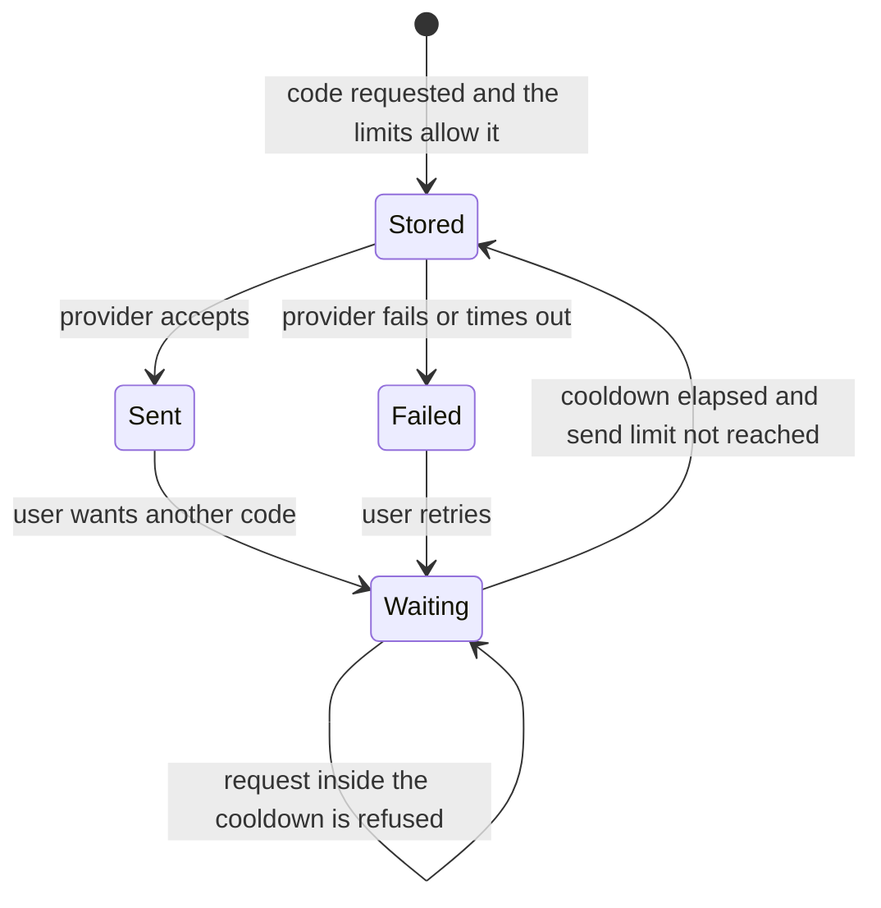

# Operations

Delivering a code is the one place where `z-auth-mfa` depends on a service outside the host's control, and the way that dependency behaves under load or failure shapes what users experience. This guide explains why sends happen while the user waits and how the timeout bounds them, what a failure carries and how it interacts with the resend limits, what the crate logs, how TLS is set up, and how to run the crate's tests.

## Sends happen inline

`z-auth-mfa` stores a new code's hash and then awaits `CodeSender::send` before it answers the request that asked for the code. The login that triggers an automatic code, `send_login_code`, the start of an email or SMS enrollment and the request for a step-up code all wait for the provider. That is a deliberate trade. Waiting lets the service report a failed delivery to the user immediately, as `code_delivery_failed`, instead of leaving them staring at an empty inbox, and it needs no queue or background worker. The cost is that a slow provider makes these requests slow.



A host that would rather never wait can implement `CodeSender` itself, enqueue the delivery and return at once, as the [ports guide](../../docs/ports.md) notes. It then gives up reporting delivery failures to the user, and the queue becomes a store of plaintext codes that needs the same care as the codes themselves.

## Timeouts

`AUTH_MFA_DELIVERY_TIMEOUT_SECS`, ten seconds by default, limits each send. Its precise reach depends on the transport.

For the HTTP providers (SendGrid, Postmark, Mailgun, Twilio and the webhook) the value is the total timeout of the `reqwest` client, measured from the start of the request until the response body has been read. A provider that does not answer in time fails the send with a timeout error.

For SMTP the value is handed to `lettre`, whose asynchronous transport, in the 0.11 series this crate uses, applies it only to establishing the TCP connection to each address the host name resolves to. The TLS handshake and the SMTP dialogue that follows are not bounded by it, so a server that accepts the connection and then stalls can hold the user's request for much longer. A host that needs a hard upper bound for SMTP can wrap the sender in a `CodeSender` of its own that imposes a deadline. The following wrapper is illustrative, since it relies on tokio's timer.

```rust
use std::sync::Arc;
use std::time::Duration;

use async_trait::async_trait;
use z_auth::AuthError;
use z_auth_mfa::{CodeDelivery, CodeSender};

pub struct Deadline {
    pub inner: Arc<dyn CodeSender>,
    pub limit: Duration,
}

#[async_trait]
impl CodeSender for Deadline {
    async fn send(&self, d: CodeDelivery) -> Result<(), AuthError> {
        tokio::time::timeout(self.limit, self.inner.send(d))
            .await
            .map_err(|_| AuthError::CodeDeliveryFailed("deadline: the send took too long".into()))?
    }
}
```

It is registered with `Mfa::with_code_sender(Arc::new(Deadline { inner: z_auth_mfa_sender::build(&delivery)?, limit }))`. Dropping an SMTP send midway simply closes its connection, since every message uses a fresh one.

The right value is a few seconds, comfortably below the request timeout of the host's HTTP server and of any proxy in front of it, so that the user sees a clean `code_delivery_failed` rather than a gateway timeout. A user who received no code can ask for another once the resend cooldown has passed, which is usually a better experience than a long wait.

## Failures

Every failure during a send is returned as `AuthError::CodeDeliveryFailed`. The crate never retries, because the user is waiting and can retry themselves. The detail string identifies the provider first and then the cause.

| Cause | Detail |
|---|---|
| The provider answered with a status other than 2xx | `<provider>: <status>: <first 200 characters of the body>`, for example `sendgrid: 401 Unauthorized: {"errors":["bad key"]}` |
| A connection, TLS, timeout or protocol error | `<provider>: <error>`, as reported by `reqwest` or `lettre` |
| An SMTP recipient that does not parse | `smtp: bad recipient: <reason>` |
| A `CodeDelivery` for TOTP reached the router | `router: totp codes are not delivered` |

`AuthError`'s `Display` prefixes the detail with `code delivery failed: `, which is what a host sees when it logs the error. z-auth's HTTP mapping turns the error into status 503 with the code `code_delivery_failed` and the fixed message `the code could not be delivered; retry later`, deliberately omitting the detail, so that clients learn nothing about the provider or its credentials. Neither the core nor this crate logs failures, which leaves the host responsible for recording them where the error reaches its handler. The detail can contain whatever the provider put in its error body, which for SMS providers sometimes includes the phone number, so it belongs in the same logs as other personal data.

Configuration problems are kept apart from delivery failures. They surface at startup, as `ConfigError` from the loader or `AuthError::Config` from `build`, and are described in the [configuration guide](configuration.md).

## Failures and the resend limits

`z-auth-mfa` stores a code before it hands it to the sender, and the store applies `AUTH_MFA_CODE_RESEND_SECS` and `AUTH_MFA_CODE_MAX_SENDS` at that moment. A send that then fails has still consumed its slot. This keeps a failing provider from being hammered by retries, but it also means that a user who retries immediately after a `code_delivery_failed` receives `code_resend_too_soon` (status 429) until the cooldown, 30 seconds by default, has passed.



The limits apply per sign-in attempt, not per method. Login codes are stored on the login challenge, so the cooldown and the send count are shared by every code of that challenge, whatever its channel. When the gate has automatically sent a code by email and the user would rather receive it by SMS, the request for the SMS code has to wait for the cooldown as well. Clients should therefore show the remaining wait rather than offering an immediate switch. Enrollment and step-up codes are stored on the factor instead, so their limits apply per factor.

An automatic code that fails at login is a special case. The login itself then fails with `code_delivery_failed` and the client receives no challenge token, so the user simply starts over with the password, which creates a new challenge with fresh limits. The [login flow guide](../../docs/login-flow.md) describes the sequence.

## Logging

The crate logs through `tracing` and never installs a subscriber, so what appears where is decided by the host's subscriber configuration. The events come from two modules, which makes them easy to filter.

The real providers never log a code or a full destination. After a successful send, the `MethodRouter` emits one event at `DEBUG` level with the message `second-factor code sent` and the fields `provider`, `method`, `purpose` and `to`, where `to` is the destination masked by `mask`. An email address keeps its first character and its domain, so `bob@example.com` becomes `b***@example.com`, and a phone number keeps its last four digits, so `+15555550100` becomes `***0100`. That is enough to tell destinations apart while following a support case, without recording them. The event's target is `z_auth_mfa_sender::router`. Senders obtained from `email_sender` or `sms_sender` are not wrapped in the router and emit no such event. Failures are not logged by the crate, as explained above.

The `log` provider is the exception, by design. It delivers nothing and instead emits a `WARN` event with the message `DEV ONLY: second-factor code not delivered` and the fields `user_id`, `method`, `destination`, `code`, `purpose` and `expires_at`, under the target `z_auth_mfa_sender::log`. That makes the whole flow usable on a laptop without any provider account. It also means that anyone who can read the logs can complete a sign-in as any user, which is why the provider is for development only. Because `log` is the default for both methods, a production deployment must set `AUTH_MFA_EMAIL_PROVIDER` and `AUTH_MFA_SMS_PROVIDER` explicitly, and a host may want to refuse to start in production when `email.name()` or `sms.name()` of its `DeliveryConfig` returns `log`. Conversely, a developer who sees no code needs a `tracing` subscriber that shows `WARN` events from this crate.

With a typical `tracing-subscriber` setup that honours `RUST_LOG`, the following filter shows both the development codes and the masked confirmation of real sends.

```sh
RUST_LOG=info,z_auth_mfa_sender=debug
```

## TLS

Both transports use rustls with the aws-lc-rs cryptography provider, and both verify server certificates with the platform's verifier, which consults the operating system's trust store (the Keychain on macOS, the system store on Windows, and the system CA bundle on Linux). There is no option to disable verification or to pin a certificate. Three practical consequences follow. Minimal container images need their CA certificate package installed, otherwise every TLS connection fails. A private CA, for example in front of an internal SMTP relay or webhook gateway, is trusted by adding it to the operating system's store rather than to the application. And aws-lc-rs compiles a C library, so the build environment needs a C toolchain.

For SMTP, the certificate is checked against `AUTH_MFA_SMTP_HOST`, in both the `starttls` and the `tls` mode. For the webhook, it is checked against the host of `AUTH_MFA_SMS_WEBHOOK_URL` whenever the URL uses `https`.

## Running the tests

The crate's tests need no network access and no provider accounts. The main suite, `tests/delivery.rs`, starts a local `wiremock` server for each HTTP provider and checks the exact requests, including headers, authentication, form fields and JSON bodies, the webhook signature against a known vector, failures becoming `CodeDeliveryFailed`, SMTP message construction and transport setup for all three security modes (without connecting), routing by method, destination masking, the message texts and the configuration loader. It is compiled only when all six provider features are on, which is the default.

```sh
cargo test -p z-auth-mfa-sender
```

The second suite, `tests/features.rs`, checks that a provider which is not compiled in is refused, both by `DeliveryConfig::from_lookup` and by `build`, and that `log` works without any feature. It is compiled only when the `smtp` feature is off, so it needs a build without default features. Any feature set that leaves out `smtp` works, and `twilio` is the conventional choice.

```sh
cargo test -p z-auth-mfa-sender --no-default-features --features twilio
```

The workspace's CI runs the first suite as part of `cargo test --workspace --exclude z-auth-postgres --all-features`, and its cargo-hack job compiles the crate with each feature on its own, but it does not run the second suite. Run it locally after changing anything that is gated by a feature. The [development guide](../../../../docs/development.md) describes the CI jobs in full.
