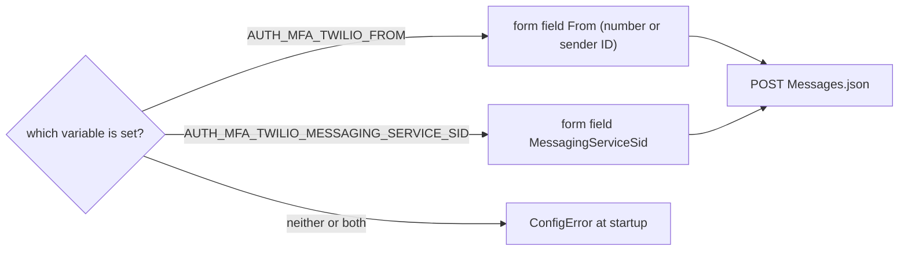
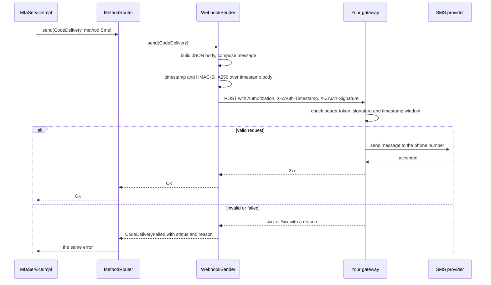

# SMS delivery

SMS codes go out through one of two providers, selected with `AUTH_MFA_SMS_PROVIDER`. `twilio` sends through Twilio Programmable Messaging and needs nothing but an account. `webhook` hands each code to a gateway of your own as a JSON `POST`, optionally signed with HMAC-SHA256, which is the way to reach any other SMS provider, an internal messaging service or a queue. This guide covers both, together with the text that every SMS carries and what a webhook receiver has to do. The variables are tabulated in the [configuration guide](configuration.md).

## The SMS text

Both providers send the same text, composed by `message::sms`. It names the sender, puts the code right after the name, states the validity and warns against sharing the code. The wording depends on the purpose.

| `CodePurpose` | Text |
|---|---|
| `Login` | `Acme: 482915 is your sign-in code. Valid 5 min. Don't share it with anyone.` |
| `Enrollment` | `Acme: 482915 is your code to set up two-factor authentication. Valid 5 min. Don't share it with anyone.` |
| `StepUp` | `Acme: 482915 is your code to confirm a security change. Valid 5 min. Don't share it with anyone.` |

`Acme` stands for the sender name. The validity is computed when the text is composed, from the code's `expires_at` and the current time, rounded up to whole minutes and never less than one, exactly as in the email body. With a short sender name the texts stay well within one 160-character SMS segment. The texts themselves use only characters from the GSM 7-bit alphabet, so a sender name with characters outside it (accented letters beyond the few GSM covers, or emoji) switches the message to UCS-2 encoding, where a segment holds only 70 characters and the longer texts are split into two.

The wording is fixed. A webhook receiver that wants its own text can ignore the ready-made `message` field and build one from `code`, `purpose` and `expires_at`, and a host with other needs implements `CodeSender` itself.

## Twilio

The `twilio` provider posts a form to `https://api.twilio.com/2010-04-01/Accounts/<account SID>/Messages.json`, authenticating with HTTP basic authentication where the user name is the account SID and the password the auth token. The form carries `To` (the destination in E.164 form), `Body` (the text above) and one sender field.

Twilio needs to know where a message comes from, and there are two ways to tell it, which is why exactly one of two variables must be set. `AUTH_MFA_TWILIO_FROM` names the sender directly, as a Twilio phone number in E.164 form such as `+15550001111` or as an alphanumeric sender ID such as `Acme` where the destination country allows those, and is sent as the `From` field. `AUTH_MFA_TWILIO_MESSAGING_SERVICE_SID` names a Messaging Service (its SID starts with `MG`) and is sent as `MessagingServiceSid`. The service then picks a number from its sender pool, which lets Twilio choose a local number per country, spread volume over several numbers and apply the compliance settings configured on the service. For anything beyond a single country, the Messaging Service is usually the better choice.



The crate authenticates with the account SID and its auth token only. Twilio's API keys, which use a separate key SID as the user name, cannot be configured, because the account SID serves as both the user name and the path segment. Twilio answers an accepted message with `201 Created`, which, like any 2xx status, counts as success. Acceptance means Twilio has queued the message, not that the handset received it, and later delivery failures are visible only in Twilio's console or through its status callbacks, which this crate does not configure.

## The signed webhook

The `webhook` provider is for every case Twilio does not cover. Each code becomes one HTTP `POST` to `AUTH_MFA_SMS_WEBHOOK_URL`, and the receiver is responsible for getting the text to the phone. The receiver can be a thin adapter in front of another SMS provider, a service that already sends notifications, or a queue consumer, as long as it answers within the delivery timeout.

### The request

The request has a JSON body and a handful of headers of interest. `Content-Type` is `application/json` and `User-Agent` is `z-auth-mfa-sender/` followed by the crate version. When `AUTH_MFA_SMS_WEBHOOK_BEARER_TOKEN` is set the request carries `Authorization: Bearer <token>`, and when `AUTH_MFA_SMS_WEBHOOK_SECRET` is set it carries `X-ZAuth-Timestamp` and `X-ZAuth-Signature`, described below. Without the respective variables those headers are absent altogether.

The body is a single JSON object with seven string fields.

| Field | Content |
|---|---|
| `to` | The destination phone number in E.164 form, as stored for the factor |
| `message` | The ready-made text from the table above, which can be sent as it is |
| `code` | The code itself, digits only, for receivers that compose their own text |
| `purpose` | `login`, `enrollment` or `step_up` |
| `method` | `sms` for every request that arrives through the `MethodRouter` |
| `expires_at` | The code's expiry as an RFC 3339 timestamp with a `+00:00` offset, with fractional seconds when the stored time has them |
| `user_id` | The user's id as a hyphenated UUID |

An example body, pretty-printed for reading, looks like this. The request itself carries it on one line, and the fields are not guaranteed to appear in any particular order, so receivers must parse the JSON rather than match it textually.

```json
{
  "code": "482915",
  "expires_at": "2026-10-16T12:05:00.376583+00:00",
  "message": "Acme: 482915 is your sign-in code. Valid 5 min. Don't share it with anyone.",
  "method": "sms",
  "purpose": "login",
  "to": "+15555550100",
  "user_id": "c9de0db1-61c5-4ec2-9ed5-c09f7f1741ad"
}
```

The body contains the plaintext code, so the URL should use `https` unless the gateway runs on the same host or a trusted private network. The loader accepts `http` for exactly that case.

### The signature

With a secret configured, every request is signed. The sender takes the current Unix time in seconds as a decimal string, concatenates it, a single `.` and the exact bytes of the body, and computes HMAC-SHA256 over the result with the secret's UTF-8 bytes as the key. The timestamp goes into `X-ZAuth-Timestamp`, and the signature goes into `X-ZAuth-Signature` as `sha256=` followed by the lowercase hexadecimal digest.

```text
X-ZAuth-Timestamp: 1700000000
X-ZAuth-Signature: sha256=<hex of HMAC-SHA256(secret, "{timestamp}.{raw body}")>
```

Including the timestamp in the signed input binds it to the body, so a captured request cannot be replayed later with a fresh timestamp, and checking that the timestamp is recent limits replays to a short window. The signature covers neither the URL nor the other headers. The function that computes it is public as `z_auth_mfa_sender::sms::signature(secret, timestamp, body)` (feature `webhook`), which a Rust receiver or a test can call directly. A known vector, taken from the crate's tests, is useful for checking an implementation in another language. With the secret `key`, the timestamp `1700000000` and the body `{}`, the header value is `sha256=9d713ed406bb7076d4123f0dc2c39d2df5c654ed4b0cd56b52c8b4c940bd63ae`.

The bearer token and the signature are independent and can be combined. The token suits gateways behind an API gateway or proxy that already checks bearer tokens, and the signature additionally proves that the body was not altered and is recent. Only one secret can be configured at a time, so rotating it means having the receiver accept both the old and the new secret for the duration of the switch.

### The response

Any 2xx status counts as delivered, and the response body is ignored. Any other status fails the send with `CodeDeliveryFailed`, whose detail holds the status and the first 200 characters of the response body, so a receiver that explains its refusals in the body makes the host's logs more useful. A connection error or a timeout fails the send the same way, with the transport error as the detail. The sender never retries.

A receiver should answer 2xx only once the message has been handed to whatever delivers it, and should answer quickly, since the user's request is waiting and the whole exchange must finish within `AUTH_MFA_DELIVERY_TIMEOUT_SECS`. If the receiver is slower than that, the service reports a failure to the user while the receiver may still send the SMS. The code was stored before the send, so the late SMS carries a code that is still valid, which a client that keeps its code prompt open after the error can still use.

### Verifying requests

A receiver verifies the signature over the raw request body, before parsing it, because re-serialising parsed JSON rarely reproduces the original bytes. It also rejects timestamps outside a small window and compares the signatures in constant time. The following Python function is illustrative and independent of any web framework. It expects the secret as bytes, the two header values as strings, and the body exactly as received.

```python
import hashlib
import hmac
import time

MAX_AGE_SECS = 300


def verify(secret: bytes, timestamp: str, signature: str, raw_body: bytes) -> bool:
    try:
        ts = int(timestamp)
    except ValueError:
        return False
    if abs(time.time() - ts) > MAX_AGE_SECS:
        return False
    mac = hmac.new(secret, timestamp.encode() + b"." + raw_body, hashlib.sha256)
    expected = "sha256=" + mac.hexdigest()
    return hmac.compare_digest(expected, signature)
```

A request whose headers are missing should be refused as well, unless the receiver deliberately accepts unsigned requests. The five-minute window tolerates moderate clock skew between the two hosts, and a receiver that wants stronger replay protection can additionally remember the signatures it has seen within the window and refuse duplicates.

### The exchange

The sequence below shows one signed request with a bearer token, from the moment `z-auth-mfa` asks for an SMS code to the gateway's answer.


