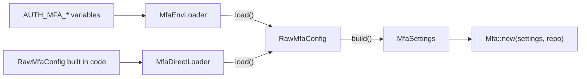
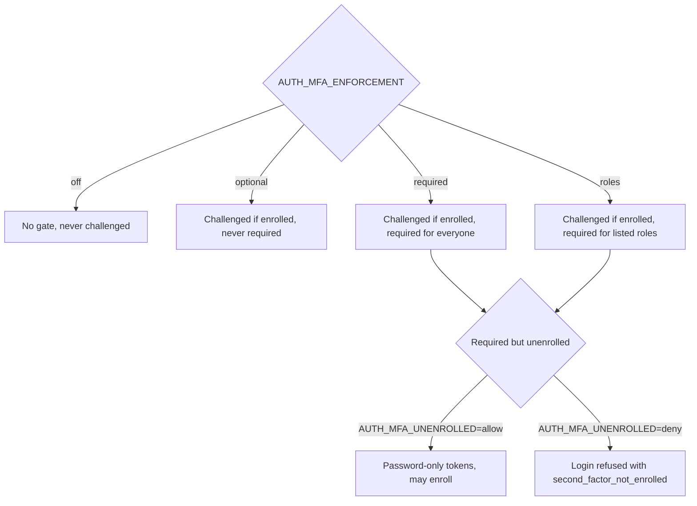

# Configuration

`z-auth-mfa` has its own configuration, separate from the core's `AuthConfig`. It is read from `AUTH_MFA_*` environment variables by `MfaEnvLoader`, or supplied by code as a `RawMfaConfig`, and validated into an `MfaSettings` value that `Mfa::new` takes. This guide explains how loading works, lists every variable with its default and validation rule, and shows how to generate the two keys. The core's own variables are described in the [configuration guide](../../../docs/configuration.md).

## Loading

Every source of configuration implements `MfaConfigLoader`. Its `load` method produces a `RawMfaConfig`, a flat struct in which every field is optional, and its provided `load_settings` method validates that into `MfaSettings`. The crate ships two loaders.



`MfaEnvLoader` reads the process environment. It never loads a `.env` file on its own, exactly like the core's `EnvLoader`, so a host that keeps its settings in a file loads that file before calling the loader (for example with the `dotenvy` crate). A variable that is unset, empty or contains only whitespace is treated as absent and falls back to its default. Lists, `AUTH_MFA_METHODS`, `AUTH_MFA_REQUIRED_ROLES`, `AUTH_MFA_PREVIOUS_ENCRYPTION_KEYS` and `AUTH_MFA_CHALLENGE_MATCH`, are comma-separated, with whitespace around each item trimmed and empty items dropped. Numbers must parse as unsigned integers, and booleans must be exactly `true` or `false`.

```rust
use z_auth_mfa::config::{MfaConfigLoader, MfaEnvLoader};

let settings = MfaEnvLoader.load_settings()?;
```

`MfaDirectLoader` wraps a `RawMfaConfig` assembled by code, which suits tests, embedded deployments and hosts with their own configuration system. `RawMfaConfig` has a builder-style setter for every field, named after the variable without its `AUTH_MFA_` prefix and lowercased. List setters accept any iterator of strings. Calling `build()` directly on a `RawMfaConfig` is equivalent to going through the loader.

```rust
use z_auth_mfa::config::{MfaConfigLoader, MfaDirectLoader, RawMfaConfig};

let raw = RawMfaConfig::default()
    .enforcement("roles")
    .required_roles(["admin", "ops"])
    .methods(["totp", "email"])
    .encryption_key("YO8DjMyLuoNbXiIHP4B27jBp0emkIrBM8LCB3QMsjzg=")
    .hash_key("/fd/bYxvv8+PGaiAgR/aWp5N/10yEkdRgmPdp+xitN0=")
    .challenge_match("ip,user_agent")
    .lockout_threshold(5);
let settings = MfaDirectLoader::new(raw).load_settings()?;
```

The blank-value rule belongs to the environment loader. A blank string given to a `RawMfaConfig` setter is passed on to validation, where it usually fails, with the exception of `totp_issuer`, for which a blank value means the default.

## Validation errors

`RawMfaConfig::build` returns a `z_auth::conf::config::ConfigError`, which converts into `AuthError::Config` with `?`. `ConfigError::Missing` names a required variable that is absent, which applies to `AUTH_MFA_HASH_KEY` and to `AUTH_MFA_REQUIRED_ROLES` when enforcement is `roles`. `ConfigError::Parse` carries the variable name and a reason for every value that does not parse or lies outside its range, such as `must be 6–8, got 9` for `AUTH_MFA_TOTP_DIGITS`.

Two conditions are only checked later, by `ZAuthBuilder::build`, because they depend on how the extension is wired rather than on the configuration alone. A missing `AUTH_MFA_ENCRYPTION_KEY` is acceptable to `build()` on the settings, because the host may supply a custom `SecretSealer`, and is rejected when the extension is built without one. Enabling `email` or `sms` without calling `Mfa::with_code_sender` is rejected at the same point.

## Variables

The table lists every variable read by `MfaEnvLoader`, its default, and what `build()` accepts. Ranges are inclusive.

| Variable | Default | Accepted values | Effect |
|---|---|---|---|
| `AUTH_MFA_ENFORCEMENT` | `optional` | `off`, `optional`, `required`, `roles` | Who must use a second factor, see below |
| `AUTH_MFA_REQUIRED_ROLES` | none | Role codes matching `^[a-z][a-z0-9_.:-]*$`, at most 64 characters each | Roles that require a factor, mandatory and non-empty with `roles`, ignored otherwise |
| `AUTH_MFA_UNENROLLED` | `allow` | `allow`, `deny` | What a required but unenrolled user gets at login |
| `AUTH_MFA_METHODS` | `totp` | Non-empty list of `totp`, `email`, `sms` without duplicates | Enabled methods, preferred first |
| `AUTH_MFA_ENCRYPTION_KEY` | none | Standard base64 of exactly 32 bytes | Seals TOTP secrets and destinations, required unless a custom sealer is given |
| `AUTH_MFA_PREVIOUS_ENCRYPTION_KEYS` | none | List of standard base64 keys of 32 bytes each | Older keys still accepted for opening |
| `AUTH_MFA_HASH_KEY` | none, required | Standard base64 of at least 32 bytes | HMAC key for recovery codes, email and SMS codes and challenge tokens |
| `AUTH_MFA_TOTP_ISSUER` | `AUTH_JWT_ISSUER` | Any non-blank string | Issuer shown in authenticator apps |
| `AUTH_MFA_TOTP_ALGORITHM` | `sha1` | `sha1`, `sha256`, `sha512`, case-insensitive | HMAC of new TOTP factors |
| `AUTH_MFA_TOTP_DIGITS` | `6` | 6 to 8 | Digits of new TOTP factors |
| `AUTH_MFA_TOTP_PERIOD_SECS` | `30` | 1 or more | Time step of new TOTP factors |
| `AUTH_MFA_TOTP_SKEW_STEPS` | `1` | 0 to 5 | Steps accepted on either side of the current one |
| `AUTH_MFA_TOTP_SECRET_BYTES` | `20` | 16 to 64 | Length of new TOTP secrets |
| `AUTH_MFA_ENROLLMENT_TTL_SECS` | `600` | 1 or more | Lifetime of a pending factor |
| `AUTH_MFA_RECOVERY_CODE_COUNT` | `10` | 0 to 32 | Codes per set, 0 disables recovery codes |
| `AUTH_MFA_RECOVERY_CODE_LENGTH` | `10` | 8 to 32 | Crockford base32 characters per code |
| `AUTH_MFA_CHALLENGE_TTL_SECS` | `300` | 1 or more | Lifetime of a login challenge |
| `AUTH_MFA_CHALLENGE_MAX_ATTEMPTS` | `5` | 1 or more | Codes accepted per challenge, also per email or SMS code on a factor |
| `AUTH_MFA_CHALLENGE_MATCH` | `none` | `none`, or a list of `ip`, `user_agent`, `fingerprint` | Client attributes that must match between the two login steps |
| `AUTH_MFA_LOCKOUT_THRESHOLD` | `10` | Any unsigned integer, no range check | Failures per window that lock the user, 0 disables the lockout |
| `AUTH_MFA_LOCKOUT_WINDOW_SECS` | `900` | 1 or more | Window in which failures are counted |
| `AUTH_MFA_LOCKOUT_SECS` | `900` | 1 or more | Duration of a lockout |
| `AUTH_MFA_CODE_DIGITS` | `6` | 6 to 10 | Digits of email and SMS codes |
| `AUTH_MFA_CODE_TTL_SECS` | `300` | 1 or more | Lifetime of an email or SMS code |
| `AUTH_MFA_CODE_RESEND_SECS` | `30` | 0 or more | Minimum gap between two sends, 0 allows immediate resends |
| `AUTH_MFA_CODE_MAX_SENDS` | `5` | 1 or more | Sends while the latest code is still valid |
| `AUTH_MFA_AUTO_SEND` | `true` | `true`, `false` | Send a code at login when the user has no TOTP factor |
| `AUTH_MFA_END_SESSIONS_ON_REMOVAL` | `true` | `true`, `false` | End the user's sessions on `remove_factor` and `reset` |
| `AUTH_MFA_PURGE_INTERVAL_SECS` | `300` | 1 or more | Minimum time between purges in `ZAuth::tick` |
| `AUTH_MFA_PURGE_RETENTION_SECS` | `86400` | 0 or more | How long expired or consumed rows are kept before the purge deletes them |

A commented template of all these variables is part of the repository's `env.example`. The same file also lists the delivery variables, such as `AUTH_MFA_EMAIL_PROVIDER` and `AUTH_MFA_SMS_PROVIDER`, which share the prefix but are read by z-auth-mfa-delivery rather than by `MfaEnvLoader`. They are documented in its [configuration guide](../../mfa-delivery/docs/configuration.md).

## Enforcement

`AUTH_MFA_ENFORCEMENT` decides who must use a second factor, while enrollment decides who is challenged. With `off` the extension installs no gate and logins never see a challenge, although the enrollment service still works. With `optional` every user who has enrolled a factor is challenged and nobody is required to enroll. With `required` every user is required to have a factor, and with `roles` only users holding one of the roles in `AUTH_MFA_REQUIRED_ROLES` are, while everybody else is treated as under `optional`.



`required` and `roles` do not by themselves block a password-only session under the default `allow`. They mark the user as required in `MfaStatus::required`, so the host can steer them to enrollment, and the host protects its other routes with `require_mfa`. The [login flow](login-flow.md) explains the decision in detail.

## Methods

`AUTH_MFA_METHODS` lists the enabled methods in order of preference. The order determines the order of the `methods` list in a login challenge, which delivered factor receives an automatic login code, and which factor `send_step_up_code` and `send_login_code` use when no method is given. Removing a method from the list hides existing factors of that method, which then neither satisfy a login nor count as enrolled, so the change effectively unenrolls users who relied on that method alone. Enabling `email` or `sms` requires a `CodeSender`.

## Keys

`AUTH_MFA_HASH_KEY` is always required and must decode to at least 32 bytes. Changing it invalidates every recovery code, pending challenge and outstanding code, so it should be generated once and kept. `AUTH_MFA_ENCRYPTION_KEY` must decode to exactly 32 bytes. It is required when the built-in sealer is used, which is the case whenever the `aead` feature is enabled and no custom sealer was passed with `Mfa::with_sealer`. Both keys must be identical on every instance in shared mode, and live only on the authority in federation mode. The [security guide](security.md) explains what each key protects and how to rotate the encryption key with `AUTH_MFA_PREVIOUS_ENCRYPTION_KEYS`.

The `aead` feature deserves attention when the PostgreSQL adapter is in the dependency graph. The `mfa` feature of `z-auth-postgres` depends on `z-auth-mfa` with `default-features = false`. A host that declares its own `z-auth-mfa` dependency with default features keeps `aead` and the built-in sealer, while a host that relies on the adapter's dependency alone, or disables default features, has no built-in sealer and must call `Mfa::with_sealer`. In that situation `AUTH_MFA_ENCRYPTION_KEY` is ignored, and the build fails with a message asking for the `aead` feature or a sealer.

## Generating keys

The `mfa_keygen` example prints a fresh pair of keys in `.env` form, each 32 random bytes from the operating system's generator in standard base64.

```sh
cargo run -p z-auth-mfa --example mfa_keygen
```

```env
AUTH_MFA_ENCRYPTION_KEY=YO8DjMyLuoNbXiIHP4B27jBp0emkIrBM8LCB3QMsjzg=
AUTH_MFA_HASH_KEY=/fd/bYxvv8+PGaiAgR/aWp5N/10yEkdRgmPdp+xitN0=
```

The same is available in code as `z_auth_mfa::keys::generate_keys()`, which returns a `GeneratedMfaKeys` with the base64 strings in its `encryption_key` and `hash_key` fields. Its `Debug` output is redacted. The example values above are for illustration only and must never be used in a deployment.

## Other tunables

The challenge, lockout and code settings interact. Each challenge accepts `AUTH_MFA_CHALLENGE_MAX_ATTEMPTS` codes, and failures across challenges count toward `AUTH_MFA_LOCKOUT_THRESHOLD` within `AUTH_MFA_LOCKOUT_WINDOW_SECS`. Lowering the attempt count makes a single challenge less useful to a guesser, and lowering the threshold makes a series of challenges less useful, at the price of locking out clumsy users sooner. `AUTH_MFA_LOCKOUT_THRESHOLD` is the one numeric setting without a range check. Any value is accepted, and 0 turns the lockout off entirely, so neither the password step nor the second step ever reports `second_factor_locked`.

`AUTH_MFA_CODE_TTL_SECS`, `AUTH_MFA_CODE_RESEND_SECS` and `AUTH_MFA_CODE_MAX_SENDS` together bound how many codes can be sent. A new code may follow the previous one after the resend gap, at most `AUTH_MFA_CODE_MAX_SENDS` codes can be sent while the latest is still valid, and the count starts over once it has expired. A challenge's own lifetime, `AUTH_MFA_CHALLENGE_TTL_SECS`, caps everything, since codes cannot be sent for an expired challenge.

`AUTH_MFA_PURGE_INTERVAL_SECS` and `AUTH_MFA_PURGE_RETENTION_SECS` control housekeeping. The extension purges during `ZAuth::tick`, at most once per interval, deleting challenges and pending factors that expired (or challenges that were consumed) more than the retention ago, as well as lockout rows with nothing left to remember. The first tick after start always purges.
