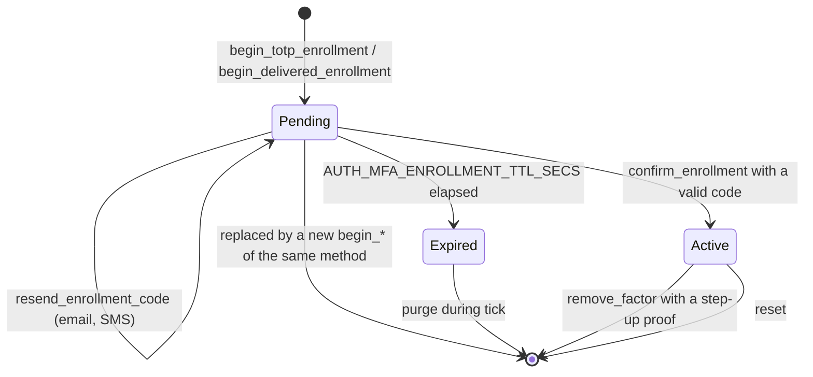
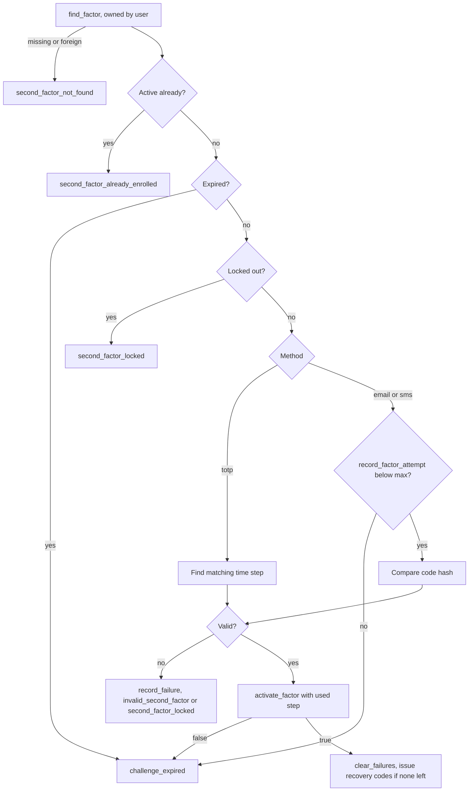
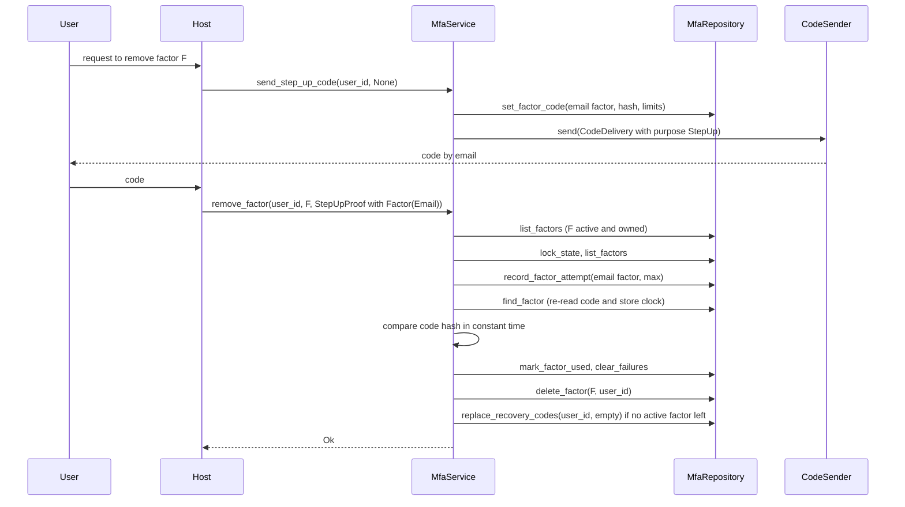

# Enrollment and factor management

Everything a user, or an administrator acting for one, does with second factors outside the login itself goes through the `MfaService` trait. That covers enrolling a factor, confirming it with a first code, listing factors, sending codes for sensitive operations, replacing recovery codes, removing a factor and resetting everything. This guide describes each operation, the states a factor moves through, the step-up proofs that protect destructive operations, and the HTTP handlers in `z_auth_mfa::api` that expose them.

The service is obtained from the extension once `ZAuth` has been built.

```rust
let mfa_service: Arc<dyn MfaService> = mfa.service().expect("ZAuth was built with this extension");
```

## Trust model

Every method that takes a `user_id` trusts it. The host is expected to take it from the `sub` claim of an access token it has verified, never from a request body or path. Enrollment accepts tokens that were issued after the password step alone, which is what makes `AUTH_MFA_UNENROLLED=allow` work. A user who is required to have a second factor but has none logs in with password-only tokens, reaches the enrollment endpoints, and from then on is challenged at every login.

Operations that weaken an account's protection, removing a factor or replacing the recovery codes, additionally require a fresh code from one of the user's active factors. A stolen session alone is therefore not enough to strip a user's second factor. The administrative `reset` takes no proof at all, and the host must guard it with its own authorization and identity checks.

## Operations

| Method | Purpose |
|---|---|
| `status(user_id) -> MfaStatus` | Active factors, whether the policy requires one, recovery codes left, methods available to enroll |
| `factors(user_id) -> Vec<FactorView>` | Active factors only, in `AUTH_MFA_METHODS` order |
| `begin_totp_enrollment(user_id, label: Option<String>) -> TotpEnrollment` | Create a pending TOTP factor and return its secret and `otpauth://` URI |
| `begin_delivered_enrollment(user_id, method: MfaMethod, destination: Option<String>, label: Option<String>) -> PendingDelivery` | Create a pending email or SMS factor and send its first code |
| `resend_enrollment_code(user_id, factor_id) -> PendingDelivery` | Send a new code for a pending email or SMS factor |
| `confirm_enrollment(user_id, factor_id, code: &str) -> EnrollmentConfirmed` | Activate a pending factor, issuing recovery codes if the user has none |
| `send_step_up_code(user_id, method: Option<MfaMethod>) -> ChallengeDelivery` | Send an email or SMS code for a step-up proof |
| `regenerate_recovery_codes(user_id, proof: StepUpProof) -> Vec<String>` | Replace the recovery codes after a step-up proof |
| `remove_factor(user_id, factor_id, proof: StepUpProof) -> ()` | Delete an active factor after a step-up proof |
| `reset(user_id) -> u64` | Delete every factor, recovery code, challenge and lockout row of a user, without proof |
| `send_login_code(challenge_token: &str, method: Option<MfaMethod>) -> ChallengeDelivery` | Send the email or SMS code of a pending login, see the [login flow](login-flow.md) |

Every method is `async` and returns `Result<_, AuthError>`. `MfaStatus` contains `factors`, `required`, `recovery_codes_left` and `available_methods`. `FactorView` shows a factor to its owner without secrets, with its `id`, `method`, `label`, `destination_hint`, `created_at`, `confirmed_at` and `last_used_at`.

## Factor lifecycle

A factor starts life as a pending row created by one of the `begin_*` methods. It becomes active when the user proves possession with a first code, and it disappears when it is removed, when the user is reset, or when it expires unconfirmed and the periodic purge deletes it.



A user has at most one pending and at most one active factor per method. Starting a new enrollment replaces any pending factor of the same method, which is how a user who lost the QR code simply starts over. Starting an enrollment for a method that already has an active factor fails with `second_factor_already_enrolled`. To switch to a new phone, the user enrolls the new factor of another method or removes the old one first.

Pending factors live for `AUTH_MFA_ENROLLMENT_TTL_SECS` (ten minutes by default). An expired pending factor can no longer be confirmed or receive codes, and both operations report `challenge_expired`. The row itself stays until the purge in `ZAuth::tick` removes it after `AUTH_MFA_PURGE_RETENTION_SECS`.

## TOTP enrollment

`begin_totp_enrollment` requires `totp` to be enabled, the user to exist and no active TOTP factor. It draws `AUTH_MFA_TOTP_SECRET_BYTES` random bytes (20 by default, the 160 bits RFC 4226 recommends) and seals them with the configured `SecretSealer`, bound to the user id, the new factor's id and the label `totp-secret`. The parameters in force at that moment, the algorithm, the number of digits and the period, are stored with the factor. Later configuration changes only affect new enrollments and never break an authenticator that is already set up.

The method returns a `TotpEnrollment` with the factor id, the secret in unpadded RFC 4648 base32 (32 characters for the default 20 bytes) for manual entry, an `otpauth://` URI to render as a QR code, and the expiry of the pending factor. The URI has the following form, where the issuer and the account's email address are percent-encoded per RFC 3986.

```text
otpauth://totp/{issuer}:{email}?secret={base32}&issuer={issuer}&algorithm={SHA1|SHA256|SHA512}&digits={digits}&period={period}
```

With `AUTH_MFA_TOTP_ISSUER=Acme Inc.` and the account `jane+mfa@example.com`, the URI starts with `otpauth://totp/Acme%20Inc.:jane%2Bmfa%40example.com?secret=`. When `AUTH_MFA_TOTP_ISSUER` is unset, the issuer defaults to the core's `AUTH_JWT_ISSUER`. The optional label is trimmed and cut to 64 characters, and an empty label is stored as none.

The secret and the URI are shown once and are redacted from `Debug` output. They cannot be retrieved later, because the stored copy is sealed and the service never returns it again.

## Email and SMS enrollment

`begin_delivered_enrollment` accepts `MfaMethod::Email` or `MfaMethod::Sms`. Passing `MfaMethod::Totp` fails with `unsupported_second_factor`, as does a method missing from `AUTH_MFA_METHODS`.

For email the destination defaults to the account's own address. A given address is normalised the same way the core normalises login emails and validated, and an invalid one fails with `invalid_email`. For SMS a destination is mandatory and must be an international number in E.164 form. The number must start with `+`, may contain spaces, dots, dashes and parentheses, which are dropped, and must then consist of 8 to 15 digits. `+1 (555) 123-4567` is accepted and stored as `+15551234567`, while `5551234567` is refused because it lacks the country code. A missing or malformed number fails with `invalid_destination`.

The normalised destination is sealed, bound to the user, the factor and the label `destination`, and only a masked hint is stored in clear. `jane.doe@example.com` becomes `j*******@example.com` and `+15551234567` becomes `*******4567`. The service then generates a numeric code of `AUTH_MFA_CODE_DIGITS` digits, stores its keyed hash on the pending factor and hands the code to the `CodeSender` with `CodePurpose::Enrollment`. The returned `PendingDelivery` carries the factor id, the method, the hint and the code's expiry.

`resend_enrollment_code` sends a new code for a pending email or SMS factor of the same user. Each send replaces the previous code. Sends are limited in two ways, both enforced atomically by the repository. A new code may be sent only `AUTH_MFA_CODE_RESEND_SECS` after the previous one, and while codes remain valid at most `AUTH_MFA_CODE_MAX_SENDS` of them can be sent. The count starts over once the latest code has expired. Either refusal is reported as `code_resend_too_soon`. A factor that is not pending, is not an email or SMS factor, or belongs to someone else yields `second_factor_not_found`.

## Confirming an enrollment

`confirm_enrollment` turns a pending factor into an active one. It finds the factor, checks that it belongs to the user, that its method is still enabled, that it is not already active (`second_factor_already_enrolled`) and that it has not expired (`challenge_expired`), and that the user is not locked out.



For a TOTP factor the code is checked against every step in the skew window. The matching step is passed to `activate_factor`, which stores it as the factor's last used step in the same atomic update that activates it. The code that confirmed the enrollment therefore cannot be replayed at the next login.

For an email or SMS factor one attempt is recorded on the factor's code before the code is compared, bounded by `AUTH_MFA_CHALLENGE_MAX_ATTEMPTS`. Once the attempts are exhausted the code is dead and the user must request a new one with `resend_enrollment_code`. In both cases a wrong code counts toward the user's lockout.

`activate_factor` is a compare-and-swap. If the factor expired or was replaced in the meantime it returns `false` and the call fails with `challenge_expired`. If another factor of the same method became active concurrently, the repository reports `second_factor_already_enrolled`.

After activation the service clears the user's failure count. If recovery codes are enabled and the user has no unused recovery code, a new set of `AUTH_MFA_RECOVERY_CODE_COUNT` codes is generated and returned in `EnrollmentConfirmed::recovery_codes`. In practice that happens with the user's first factor. A second factor enrolled later returns `None`, because the existing codes still stand. The codes are formatted in groups of five characters, such as `7KQ2M-X9D4R`, must be shown to the user once, and are stored only as keyed hashes.

## Step-up proofs

`remove_factor` and `regenerate_recovery_codes` take a `StepUpProof`, a fresh code from one of the user's active factors. `StepUpProof` has two fields, `method` of type `ProofMethod` and `code`. `ProofMethod` is either `ProofMethod::Factor(MfaMethod)` or `ProofMethod::RecoveryCode`, and parses from the strings `totp`, `email`, `sms` and `recovery_code`.

A TOTP proof needs nothing beforehand. An email or SMS proof needs a code sent with `send_step_up_code` first, which picks the first active email or SMS factor in `AUTH_MFA_METHODS` order when no method is given, and sends with `CodePurpose::StepUp`. A recovery code proof consumes the recovery code.



The proof is checked like a login code. The lockout state is consulted first, a TOTP step is accepted only once, an email or SMS code is counted against `AUTH_MFA_CHALLENGE_MAX_ATTEMPTS` before it is compared, and a wrong proof counts toward the lockout. A user without any active factor receives `second_factor_not_enrolled`. A proof naming a method the user has no active factor of simply fails as `invalid_second_factor` and counts toward the lockout like any other wrong proof.

`send_step_up_code` with `MfaMethod::Totp`, or with a method that is not enabled, fails with `unsupported_second_factor`. Without a matching active email or SMS factor it fails with `second_factor_not_enrolled`. It shares the send limits with enrollment codes, because both live on the factor row.

## Recovery codes

`regenerate_recovery_codes` checks the proof and then replaces the user's whole set atomically with `AUTH_MFA_RECOVERY_CODE_COUNT` new codes. The old codes stop working immediately. When recovery codes are disabled with `AUTH_MFA_RECOVERY_CODE_COUNT=0` the call fails with `unsupported_second_factor`. `status` reports how many unused codes are left, which lets the host prompt the user to regenerate before the set runs out.

## Removing a factor

`remove_factor` first checks that the factor is active and belongs to the user, failing with `second_factor_not_found` otherwise, then verifies the step-up proof and deletes the factor. Pending factors cannot be removed this way. They are replaced by a new enrollment or expire.

If the removed factor was the user's last active factor, the recovery codes are deleted as well. Recovery codes stand in for a factor, and without any factor left they would only be a way around enrolling again. If the policy requires a second factor of the user, the next login follows the unenrolled path described in the [login flow](login-flow.md).

## Resetting a user

`reset` is the administrative escape hatch for a user who lost every factor and every recovery code. It deletes all of the user's factors, pending ones included, along with recovery codes, challenges and lockout state, and returns the number of factors deleted. Both the PostgreSQL and the in-memory repository count pending factors in that number. It requires no proof, so the host must expose it only to administrators and only after its own identity checks. The `api` module deliberately has no handler for it.

## Ending sessions

With `AUTH_MFA_END_SESSIONS_ON_REMOVAL` on (the default), `remove_factor` and `reset` end all of the user's sessions through the core's revocation service with `RevocationReason::SecondFactorChanged`, the session that made the request included. A session opened by an attacker who used the removed factor is thereby closed as well. `reset` ends sessions only when it actually deleted a factor. Turning the setting off leaves sessions untouched, which is occasionally useful for administrative tooling but weakens the response to a compromised factor.

## HTTP handlers

`z_auth_mfa::api::handlers` wraps every user-facing operation in a framework-agnostic function that takes the `MfaService`, the verified `user_id` where applicable and a request DTO, and returns a response DTO or a `z_auth::controller::api::ApiError`. The routes in the table are the ones the handlers' documentation suggests. The host is free to choose others.

| Handler | Suggested route | Request | Response |
|---|---|---|---|
| `status` | `GET /mfa` | none | `MfaStatus` |
| `factors` | `GET /mfa/factors` | none | `Vec<FactorView>` |
| `begin_totp` | `POST /mfa/totp` | `BeginTotpRequest` | `TotpEnrollmentResponse` |
| `begin_delivered` | `POST /mfa/delivered` | `BeginDeliveredRequest` | `PendingDeliveryResponse` |
| `resend_enrollment_code` | `POST /mfa/factors/{id}/code` | none | `PendingDeliveryResponse` |
| `confirm_enrollment` | `POST /mfa/factors/{id}/confirm` | `ConfirmEnrollmentRequest` | `EnrollmentConfirmedResponse` |
| `send_step_up_code` | `POST /mfa/step-up/code` | `SendCodeRequest` | `CodeSentResponse` |
| `regenerate_recovery_codes` | `POST /mfa/recovery-codes` | `StepUpRequest` | `RecoveryCodesResponse` |
| `remove_factor` | `DELETE /mfa/factors/{id}` | `StepUpRequest` | `()` |
| `send_login_code` | `POST /login/second-factor/code` | `SendLoginCodeRequest` | `CodeSentResponse` |

All handlers except `send_login_code` require an authenticated user. Password-only tokens are sufficient for enrollment, so these routes must not be guarded with `require_mfa`. `send_login_code` is unauthenticated, because the challenge token is its credential. Responses that contain secrets, the TOTP secret, the `otpauth://` URI and recovery codes, redact them in their `Debug` output, so logging a response does not leak them.

Starting a TOTP enrollment takes an optional label.

```json
{ "label": "Work phone" }
```

```json
{
  "factor_id": "5d2c9f0e-8a51-4b7e-9c63-0f1e2d3c4b5a",
  "secret": "OEQ4A6HWVBKZ3YKNMYCS7HVX4GCTPSL5",
  "otpauth_uri": "otpauth://totp/Acme:jane.doe%40example.com?secret=OEQ4A6HWVBKZ3YKNMYCS7HVX4GCTPSL5&issuer=Acme&algorithm=SHA1&digits=6&period=30",
  "expires_at": "2026-10-16T12:10:00Z"
}
```

Starting an SMS enrollment names the method and the number. For email the destination may be omitted.

```json
{ "method": "sms", "destination": "+1 (555) 123-4567", "label": "Mobile" }
```

```json
{
  "factor_id": "9a7b6c5d-4e3f-4a1b-8c2d-1e0f9a8b7c6d",
  "method": "sms",
  "destination_hint": "*******4567",
  "code_expires_at": "2026-10-16T12:05:00Z"
}
```

Confirming sends the code. The response contains `recovery_codes` only when they were issued.

```json
{ "code": "492817" }
```

```json
{
  "factor": {
    "id": "5d2c9f0e-8a51-4b7e-9c63-0f1e2d3c4b5a",
    "method": "totp",
    "label": "Work phone",
    "destination_hint": null,
    "created_at": "2026-10-16T12:00:00Z",
    "confirmed_at": "2026-10-16T12:01:12Z",
    "last_used_at": null
  },
  "recovery_codes": ["7KQ2M-X9D4R", "H3NPV-0WZ8C", "..."]
}
```

A step-up proof is a method name and a code. `remove_factor` and `regenerate_recovery_codes` both accept it, and an unknown method name fails with `unsupported_second_factor`.

```json
{ "method": "totp", "code": "306218" }
```

A route in the host is a thin wrapper around a handler. The axum sketch below is illustrative, with `App` holding the `Arc<dyn MfaService>`, `Bearer` standing for an extractor that verifies the access token with `auth.verifier()`, and `MyError` for the host's error type built from `ApiError`.

```rust
use axum::{Json, extract::{Path, State}};
use uuid::Uuid;
use z_auth_mfa::api::dto::{ConfirmEnrollmentRequest, EnrollmentConfirmedResponse};
use z_auth_mfa::api::handlers;

async fn confirm(
    State(app): State<App>,
    Bearer(claims): Bearer,
    Path(factor_id): Path<Uuid>,
    Json(req): Json<ConfirmEnrollmentRequest>,
) -> Result<Json<EnrollmentConfirmedResponse>, MyError> {
    Ok(Json(handlers::confirm_enrollment(app.mfa.as_ref(), claims.sub, factor_id, req).await?))
}
```

## Errors

The enrollment operations use the same error codes as the login, plus a few of their own.

| Code | HTTP status | Typical cause |
|---|---|---|
| `user_not_found` | 404 | `status` or a `begin_*` call for a user that does not exist |
| `second_factor_already_enrolled` | 409 | An active factor of the method exists |
| `second_factor_not_found` | 404 | The factor does not exist, is not the user's or is in the wrong state |
| `second_factor_not_enrolled` | 403 | A step-up proof or step-up code without a suitable active factor |
| `unsupported_second_factor` | 422 | A disabled method, a TOTP method where a delivered one is needed, or recovery codes disabled |
| `invalid_destination` | 422 | A missing or malformed phone number |
| `invalid_email` | 422 | A malformed email address |
| `invalid_second_factor` | 401 | A wrong confirmation or step-up code |
| `second_factor_locked` | 429 | The user is locked out |
| `challenge_expired` | 401 | The pending factor expired, or its code's attempts are exhausted |
| `code_resend_too_soon` | 429 | Send limits reached |
| `code_delivery_failed` | 503 | The `CodeSender` failed |
