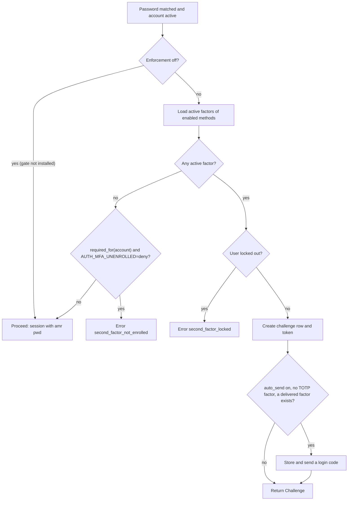
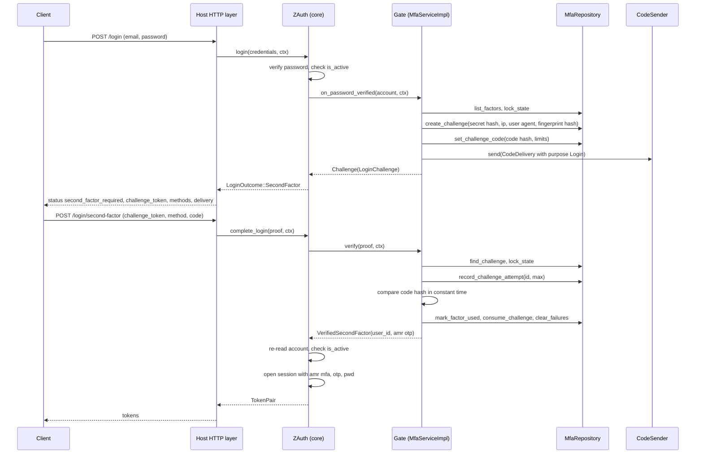
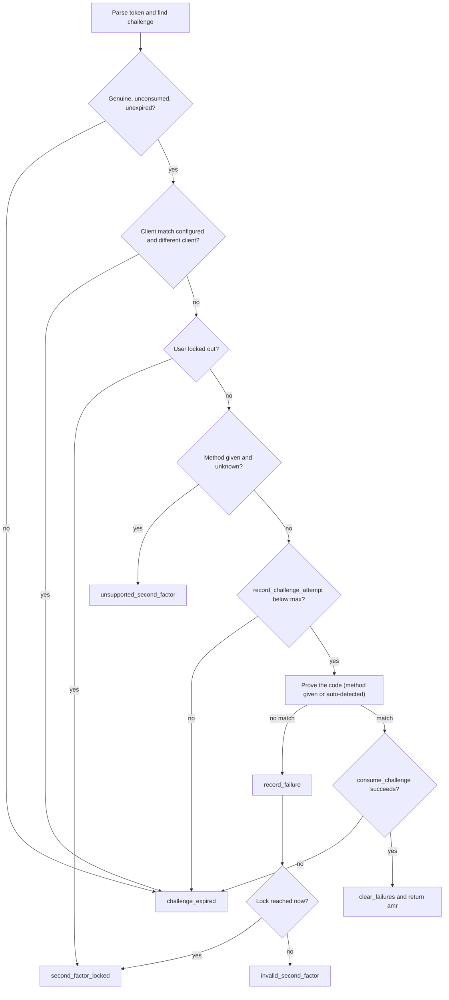

# The two-step login

This guide follows a login through `z-auth-mfa` from the moment the password matches to the moment a session exists. It covers the decision the second-factor gate makes after the password step, the challenge token handed to the client, the order in which the second step is checked, the `amr` values the resulting session carries, and the HTTP endpoints that expose the flow. The core's side of the contract, the `SecondFactorGate` trait and `AuthenticationService::complete_login`, is described in the [extensions guide](../../../docs/extensions.md) and the [sessions and tokens guide](../../../docs/sessions-and-tokens.md).

## Where the gate sits

`AuthenticationService::login` in the core looks the account up by email, verifies the password hash and refuses inactive accounts with `AuthError::AccountDisabled`. Only then, and before any session is created, does it consult the installed `SecondFactorGate`. The gate answers with `SecondFactorDecision::Proceed`, in which case the core opens a session with `amr` set to `["pwd"]` and returns `LoginOutcome::Tokens`, or with `SecondFactorDecision::Challenge`, in which case the core returns `LoginOutcome::SecondFactor` carrying a `LoginChallenge` and nothing else happens. The gate may also return an error, which refuses the login outright.

Because the gate runs before the session is opened, a correct password alone never creates a session for a user who must answer a challenge, and it never evicts an existing session under `AUTH_MAX_SESSIONS_PER_USER`. Someone who has stolen a password cannot use it to push the owner's sessions out.

## The gate's decision

`MfaServiceImpl::on_password_verified` implements the decision. When enforcement is `off` the extension does not install the gate at all, so the core never calls it. The method still begins with an `off` check as a guard, which returns `Proceed`.



Active factors are the user's confirmed factors whose method is still listed in `AUTH_MFA_METHODS`, sorted in the order of that list. Pending enrollments do not count. A factor of a method that has since been removed from `AUTH_MFA_METHODS` is ignored, so removing a method from the configuration effectively unenrolls the users who relied on it alone.

A user without any active factor is let through with password-only tokens unless the policy requires a second factor of them and `AUTH_MFA_UNENROLLED` is `deny`. Whether the policy requires a factor is decided by `required_for`. Enforcement `optional` never requires one, `required` always does, and `roles` requires one when any of the account's roles has a code listed in `AUTH_MFA_REQUIRED_ROLES`. With the default `allow`, a required but unenrolled user receives tokens whose `amr` lacks `mfa`. That is deliberate. It lets the user reach the enrollment endpoints, while the host guards everything else with `require_mfa`. With `deny` such a user cannot log in at all until an administrator enrolls a factor on their behalf, which is rarely what is wanted.

A user who has at least one active factor is always challenged, whatever the enforcement mode, unless enforcement is `off`. Before creating a challenge the gate checks the user's lockout state, so a locked-out user is refused already at the password step with `second_factor_locked`. This keeps a locked account from accumulating fresh challenges.

The challenge lists the methods the client may answer with. These are the methods of the user's active factors, in `AUTH_MFA_METHODS` order, followed by `recovery_code` when recovery codes are enabled and the user has at least one unused code. A user with a TOTP factor and recovery codes therefore sees `["totp", "recovery_code"]`, and a user with only an email factor sees `["email", "recovery_code"]`.

When `AUTH_MFA_AUTO_SEND` is on (the default) and the user has no TOTP factor but has an email or SMS factor, the gate immediately stores a code on the challenge and sends it through the first such factor, with `CodePurpose::Login`. The `delivery` field of the challenge then names the method, the masked destination and the code's expiry. A user who also has a TOTP factor gets no automatic code, because the authenticator app is assumed to be at hand, and the client requests a code explicitly if the user prefers email or SMS. If the `CodeSender` fails, the login fails with `code_delivery_failed`, and the client simply starts over.

## Challenge tokens

A challenge token has three dot-separated parts. The first is the format version `mfa1`. The second is the challenge's UUID in its simple form, 32 lowercase hexadecimal characters without hyphens. The third is 32 random bytes from the operating system's generator, encoded as unpadded base64url (43 characters).

```text
mfa1.7a49aa16673c4b788d426776ef2c212d.-6K5opKH1_UXWqGQvQN01V8-rFjz2l-xK5lyaCeObfg
└──┘ └──────────────────────────────┘ └─────────────────────────────────────────┘
version     challenge id (uuid simple)      secret (32 bytes, base64url, no padding)
```

The secret is never stored. The challenge row holds `HMAC-SHA256(AUTH_MFA_HASH_KEY, "z-auth-mfa/challenge" ‖ 0x00 ‖ challenge id ‖ secret)`, and the token is accepted only if the presented secret hashes to the stored value, compared in constant time. Someone who reads the challenge table therefore cannot complete a pending login. Alongside the hash the row records the user, the client IP address, the user agent (truncated to 512 bytes), the SHA-256 of the client fingerprint if one was supplied, an attempt counter, the creation and expiry times assigned by the store, the consumption time, and the email or SMS code sent for the challenge if any.

The client IP, user agent and fingerprint are recorded so that `AUTH_MFA_CHALLENGE_MATCH` can require the second step to come from the same client. Its syntax is the same as the core's `AUTH_REFRESH_RETRY_MATCH`. With `none` (the default) nothing is compared, and with a comma set such as `ip,fingerprint` every listed attribute must match. A fingerprint criterion requires a fingerprint to be present at both steps.

## The full sequence

The diagram follows a user with only an email factor, so that the code delivery is visible. For a TOTP user the `CodeSender` interaction is simply absent.



## Verifying the second step

`MfaServiceImpl::verify` checks a `SecondFactorProof` in a fixed order. The order matters, because each check is placed so that it neither leaks information nor lets an attacker gain extra guesses.



The challenge is opened first. The token must parse, the row must exist, the secret must match its hash, and the challenge must be neither consumed nor expired by the store's clock. Every one of these failures produces the same `challenge_expired`, so a client cannot tell an unknown token from a forged one, an expired one or one that was already used.

If `AUTH_MFA_CHALLENGE_MATCH` is set, the request's client attributes are compared next, and a mismatch also yields `challenge_expired`. A mismatch is not counted as an attempt, so a request from the wrong client cannot burn the legitimate user's attempts. The lockout state is checked after that, and then the optional `method` field is parsed into a `ProofMethod`. An unknown method name is rejected with `unsupported_second_factor` before any attempt is counted.

Only then is one attempt recorded on the challenge with `record_challenge_attempt`, a compare-and-swap that succeeds only while the challenge is open and below `AUTH_MFA_CHALLENGE_MAX_ATTEMPTS`. The attempt is counted before the code is examined, so even a burst of parallel requests cannot try more codes than the limit allows. When the limit is reached the challenge is dead and every further proof receives `challenge_expired`. The user has to log in with the password again, which creates a new challenge.

Proving the code depends on the `method` field. With `totp` the code is checked against the user's TOTP factor, with `email` or `sms` it is compared with the code stored on this challenge (and only if that code was sent through a factor of the named method), and with `recovery_code` it is checked against the user's unused recovery codes. Without a method the gate tries whatever the code's shape allows, cheapest first. A code with exactly the TOTP factor's number of digits is tried as TOTP. A code with `AUTH_MFA_CODE_DIGITS` digits is tried as the challenge's delivered code, if one was sent. A code that normalises to a recovery code of `AUTH_MFA_RECOVERY_CODE_LENGTH` characters is tried as a recovery code. Email and SMS codes may contain spaces and dashes, which are dropped before comparison, and recovery codes accept any case and the usual look-alike substitutions, as described in the [security guide](security.md). TOTP codes are only trimmed of surrounding whitespace. A TOTP code typed with an inner space, such as `123 456`, passes the shape test of auto-detection but is then rejected by the TOTP check and counted as a failure, so clients should strip separators from authenticator codes before sending them.

A wrong code is recorded as a failure for the user with `record_failure`. If that failure reaches `AUTH_MFA_LOCKOUT_THRESHOLD` within `AUTH_MFA_LOCKOUT_WINDOW_SECS`, the response is `second_factor_locked`, otherwise it is `invalid_second_factor`. The challenge stays usable for its remaining attempts.

A correct code consumes the challenge with `consume_challenge`, another compare-and-swap. If two correct proofs race, only one of them consumes the challenge and the other receives `challenge_expired`. The winner clears the user's failure count and returns a `VerifiedSecondFactor` with the user id and the `amr` value of the method that succeeded. A successful TOTP proof also advances the factor's last used step, a successful email or SMS proof marks the factor used and clears its code, and a successful recovery code is marked used.

## Lockout

Failures are counted per user, not per challenge. Each failed second step, failed enrollment confirmation and failed step-up proof adds to the same counter. The counting window opens with the first failure, and once it is older than `AUTH_MFA_LOCKOUT_WINDOW_SECS` the next failure starts a new count and a new window. Reaching `AUTH_MFA_LOCKOUT_THRESHOLD` locks the user out of second-factor checks for `AUTH_MFA_LOCKOUT_SECS` and restarts the count. While locked, the password step is refused for users who have a factor, and so are second steps, confirmations and step-up proofs. A correct proof clears the count. Setting the threshold to 0 disables the lockout entirely.

The attempt limit per challenge and the lockout per user work together. The former bounds what a single challenge can be used for, and the latter bounds what an attacker can do by starting many challenges in a row. With the defaults of five attempts per challenge and ten failures per fifteen minutes, an attacker who knows the password can try ten codes before waiting fifteen minutes. Only someone who knows the password, or who already holds one of the user's sessions, can trigger a lockout.

## The session that results

After the gate accepts a proof, the core reads the account again by id, because it may have changed between the two steps. A user who was deactivated in the meantime receives `account_disabled`, and a deleted user receives `invalid_credentials`. Otherwise the core opens the session with the gate's `amr` value plus `pwd` and `mfa`, sorted and deduplicated. Only now is the session limit enforced.

| Method used in the second step | `amr` of the session |
|---|---|
| `totp` | `["mfa", "otp", "pwd"]` |
| `email` | `["mfa", "otp", "pwd"]` |
| `recovery_code` | `["mfa", "otp", "pwd"]` |
| `sms` | `["mfa", "pwd", "sms"]` |
| none (password only) | `["pwd"]` |

The values follow RFC 8176. The `amr` list is stored on the session, so every refresh of the session mints access tokens with the same value. Routes that need a second factor call `auth.authorizer().require_mfa(&claims)`, which returns `AuthError::SecondFactorRequired` (HTTP 403, `second_factor_required`) for tokens whose `amr` lacks `mfa`. Finer checks can use `Authorizer::has_amr`, for example to accept only TOTP for an especially sensitive operation.

## The flow in code

Outside HTTP the two steps are two calls on the authentication service. In a real application they happen in two separate requests, so the challenge token travels to the client and back.

```rust
use z_auth::prelude::*;

async fn password_step(
    auth: &ZAuth,
    credentials: Credentials,
    ctx: ClientContext,
) -> Result<Result<TokenPair, LoginChallenge>, AuthError> {
    Ok(match auth.authentication().login(credentials, ctx).await? {
        LoginOutcome::Tokens(pair) => Ok(pair),
        // challenge.methods, e.g. ["totp", "recovery_code"]
        // challenge.delivery is Some when an email or SMS code was already sent
        LoginOutcome::SecondFactor(challenge) => Err(challenge),
    })
}

async fn second_step(
    auth: &ZAuth,
    challenge_token: String,
    code: String,
    ctx: ClientContext,
) -> Result<TokenPair, AuthError> {
    auth.authentication()
        .complete_login(
            SecondFactorProof {
                challenge_token,
                method: None, // let the gate recognise the code
                code,
            },
            ctx,
        )
        .await
}
```

The email or SMS code of a pending login is sent, or sent again, with `MfaService::send_login_code`. The challenge token is the only credential this needs, so the call is safe to expose without authentication. `None` picks the first enrolled email or SMS factor in `AUTH_MFA_METHODS` order. Each send replaces the previous code, and sends are limited by `AUTH_MFA_CODE_RESEND_SECS` and `AUTH_MFA_CODE_MAX_SENDS`.

```rust
use z_auth_mfa::{MfaMethod, MfaService};

async fn resend(mfa: &dyn MfaService, challenge_token: &str) -> Result<(), z_auth::AuthError> {
    let delivery = mfa.send_login_code(challenge_token, Some(MfaMethod::Email)).await?;
    println!("code sent to {}, valid until {}", delivery.destination_hint, delivery.expires_at);
    Ok(())
}
```

## HTTP endpoints

Three endpoints make up the login over HTTP. The first two are the core's framework-agnostic handlers in `z_auth::controller::api::handlers`, and the third comes from this crate. The host routes them in its web framework and builds the `ClientContext` from the real client address, as described in the [HTTP API guide](../../../docs/http-api.md).

| Route | Handler | Request DTO | Response DTO |
|---|---|---|---|
| `POST /login` | `handlers::login` (core) | `LoginRequest` | `LoginResponse` |
| `POST /login/second-factor` | `handlers::complete_login` (core) | `CompleteLoginRequest` | `TokenPairResponse` |
| `POST /login/second-factor/code` | `z_auth_mfa::api::handlers::send_login_code` | `SendLoginCodeRequest` | `CodeSentResponse` |

The password step takes the usual credentials.

```json
{ "email": "jane.doe@example.com", "password": "correct horse battery staple" }
```

`LoginResponse` is tagged by a `status` field. A user without a second factor receives `authenticated` with the token pair inline, and a user who must answer a challenge receives `second_factor_required`. The `delivery` field is `null` unless a code was sent automatically.

```json
{
  "status": "second_factor_required",
  "challenge_token": "mfa1.7a49aa16673c4b788d426776ef2c212d.-6K5opKH1_UXWqGQvQN01V8-rFjz2l-xK5lyaCeObfg",
  "expires_at": "2026-10-16T12:05:00Z",
  "methods": ["email", "recovery_code"],
  "delivery": {
    "method": "email",
    "destination_hint": "j*******@example.com",
    "expires_at": "2026-10-16T12:05:00Z"
  }
}
```

The second step sends the token back with the code. The `method` field is optional and accepts `totp`, `email`, `sms` or `recovery_code`.

```json
{
  "challenge_token": "mfa1.7a49aa16673c4b788d426776ef2c212d.-6K5opKH1_UXWqGQvQN01V8-rFjz2l-xK5lyaCeObfg",
  "method": "email",
  "code": "482913"
}
```

On success the response is a plain token pair.

```json
{
  "session_id": "0b8e3c3e-5d0f-4c55-9a51-3f4f8c2b7d10",
  "access_token": "eyJhbGciOiJFZERTQSIsImtpZCI6Ii4uLiJ9...",
  "access_expires_at": "2026-10-16T12:15:00Z",
  "refresh_token": "...",
  "refresh_expires_at": "2026-11-15T12:00:00Z"
}
```

Requesting a code for a pending login needs only the challenge token. `method` may be omitted.

```json
{ "challenge_token": "mfa1.7a49aa16673c4b788d426776ef2c212d.-6K5opKH1_UXWqGQvQN01V8-rFjz2l-xK5lyaCeObfg", "method": "sms" }
```

```json
{ "method": "sms", "destination_hint": "*******4567", "expires_at": "2026-10-16T12:05:00Z" }
```

A handler for the third endpoint is a thin wrapper. The axum sketch below is illustrative host code, with `App` standing for the host's state and `MyError` for its error type built from `ApiError`.

```rust
use axum::{Json, extract::State};
use z_auth_mfa::api::dto::{CodeSentResponse, SendLoginCodeRequest};
use z_auth_mfa::api::handlers;

async fn send_login_code(
    State(app): State<App>,
    Json(req): Json<SendLoginCodeRequest>,
) -> Result<Json<CodeSentResponse>, MyError> {
    Ok(Json(handlers::send_login_code(app.mfa.as_ref(), req).await?))
}
```

## Errors

Every failure maps to an `ApiError` with a stable code. The body is an `ErrorBody` with `code` and `message`.

| Code | HTTP status | When |
|---|---|---|
| `challenge_expired` | 401 | The token is unknown, malformed, forged, expired, used or out of attempts, or the client does not match |
| `invalid_second_factor` | 401 | The code is wrong and the user is not (yet) locked out |
| `second_factor_locked` | 429 | The user reached the lockout threshold, at either step |
| `second_factor_not_enrolled` | 403 | A factor is required, none is enrolled and `AUTH_MFA_UNENROLLED` is `deny`, or no email or SMS factor exists for a code request |
| `unsupported_second_factor` | 422 | The proof names an unknown method, or a code is requested for a method that is not enabled or not delivered |
| `code_resend_too_soon` | 429 | A code was sent less than `AUTH_MFA_CODE_RESEND_SECS` ago, or `AUTH_MFA_CODE_MAX_SENDS` valid codes were sent |
| `code_delivery_failed` | 503 | The `CodeSender` failed, with a generic message |
| `account_disabled` | 403 | The account was deactivated between the two steps |
| `invalid_token` | 401 | `complete_login` was called on an instance without a second-factor gate |
| `not_authority` | 421 | A session store in federation mode received a login step |

A request for a login code on a challenge that is no longer usable also receives `challenge_expired`.
