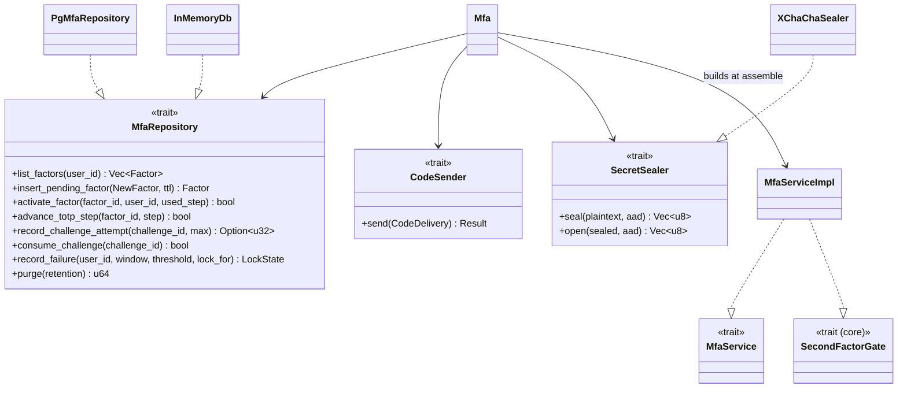
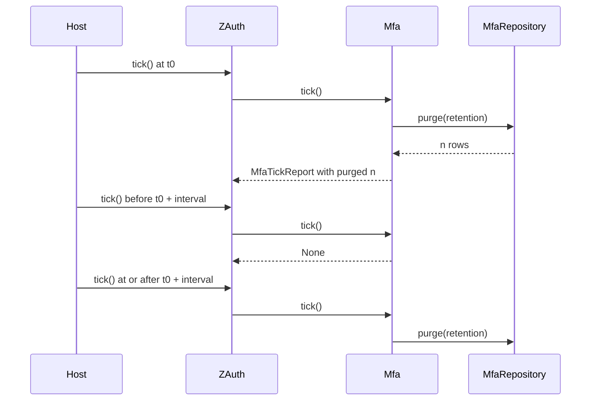

# Ports

`z-auth-mfa` depends on three ports that the host fills in. `MfaRepository` stores factors, recovery codes, challenges and lockout state. `CodeSender` delivers email and SMS codes. `SecretSealer` encrypts TOTP secrets and destinations, and has a built-in implementation behind the `aead` feature. This guide documents each contract for implementers, along with the tick report the extension produces and the reference implementations that already exist. The core's own storage ports are covered in the [storage ports guide](../../../docs/storage-ports.md).



## The repository

`MfaRepository` is an `async_trait` with `Send + Sync` bounds and returns `Result<_, AuthError>` from every method. Storage failures should be reported as `AuthError::Storage`. The trait groups its methods into factors, recovery codes, login challenges, lockout and housekeeping.

### The store is the clock

As in the core, the store is the only time source for stored state. Callers never pass instants. They pass durations, a time to live, a resend gap, a lockout window, a retention period, and the store computes every timestamp from its own clock. Reads that the service needs to judge expiry return the store's current time alongside the row. `find_factor` and `find_challenge` return a `(row, now)` pair, and `LockState` carries a `now` field. A store backed by a database should use the database's clock (`now()` in PostgreSQL) for all of this, so that instances with slightly different clocks still agree. The one exception is TOTP, whose time step comes from the service's clock because the authenticator app uses its own clock too.

The service picks the ids of new factors and challenges itself, because sealed values are bound to the factor id and token secrets are hashed with the challenge id. The store must use the ids it is given.

### Atomic operations

Several methods are documented as compare-and-swap. Each must check its condition and apply its change in one atomic step, so that of two concurrent callers at most one succeeds. In SQL that is a single `UPDATE ... WHERE <condition>` whose affected-row count is the answer. These methods carry the crate's security guarantees. A non-atomic implementation would let parallel requests exceed the attempt limit, replay a TOTP step or use a recovery code twice.

| Method | Kind | Contract |
|---|---|---|
| `list_factors(user_id)` | Read | Every factor of the user, pending ones included, oldest first |
| `find_factor(factor_id)` | Read | The factor plus the store's clock at read time |
| `insert_pending_factor(factor, ttl)` | Atomic | Insert a pending factor expiring after `ttl`, replacing any pending factor of the same user and method |
| `activate_factor(factor_id, user_id, used_step)` | Compare-and-swap | A pending, unexpired factor of `user_id` becomes active, `confirmed_at` set, code cleared, `last_used_step` set when given. `false` if not pending, expired or someone else's |
| `delete_factor(factor_id, user_id)` | Write | Delete a factor of the user, `false` if there was none |
| `advance_totp_step(factor_id, step)` | Compare-and-swap | Record `step` and `last_used_at` only if `step` is later than `last_used_step`, `false` means already used |
| `mark_factor_used(factor_id)` | Write | Set `last_used_at` and clear the factor's code |
| `set_factor_code(factor_id, code_hash, limits)` | Atomic | Store a new code within `limits` and reset its attempt count, returning a `SendOutcome` |
| `record_factor_attempt(factor_id, max)` | Compare-and-swap | Count one attempt if the factor's code is unexpired and below `max`, returning the new count or `None` |
| `replace_recovery_codes(user_id, code_hashes)` | Atomic | Replace the user's whole set, an empty slice deletes it |
| `consume_recovery_code(user_id, code_hash)` | Compare-and-swap | Mark an unused code with this hash used, `false` if there is none |
| `count_recovery_codes(user_id)` | Read | Unused recovery codes of the user |
| `create_challenge(challenge, ttl)` | Write | Insert a challenge expiring after `ttl` |
| `find_challenge(challenge_id)` | Read | The challenge plus the store's clock at read time |
| `record_challenge_attempt(challenge_id, max)` | Compare-and-swap | Count one attempt if unconsumed, unexpired and below `max`, returning the new count or `None` |
| `set_challenge_code(challenge_id, code, limits)` | Atomic | Store a new code on an unconsumed, unexpired challenge within `limits`, returning a `SendOutcome` |
| `consume_challenge(challenge_id)` | Compare-and-swap | Mark the challenge consumed, `false` if it already was or expired |
| `lock_state(user_id)` | Read | Failures in the current window, `locked_until` and the store's clock |
| `record_failure(user_id, window, threshold, lock_for)` | Atomic | Count one failure, see below |
| `clear_failures(user_id)` | Write | Forget the user's failures after a successful proof |
| `delete_all(user_id)` | Atomic | Delete factors, recovery codes, challenges and lockout state of the user, returning the number of factors deleted |
| `purge(retention)` | Write | Delete expired rows older than `retention`, returning the number of rows deleted |

`activate_factor` has one more obligation. If the user already has an active factor of the same method, it must fail with `AuthError::SecondFactorAlreadyEnrolled` rather than create a second one. The service checks for an existing active factor before it starts an enrollment, but two enrollments of the same method can still race, and only the store can settle that. The PostgreSQL adapter does it with a partial unique index on `(user_id, method) WHERE status = 'active'`, whose violation it maps to that error.

`record_failure` counts one failed attempt. When the current window started more than `window` ago, the count restarts at this failure with a new window. When the count reaches `threshold`, the user is locked until `now + lock_for` and the count restarts. The returned `LockState` reflects the update, and the service reports `second_factor_locked` when `LockState::is_locked()` is true. Concurrent failures must each be counted, which in SQL means a single `UPDATE` (the PostgreSQL adapter first ensures the row exists with an `INSERT ... ON CONFLICT DO NOTHING`). The service never calls `record_failure` or `lock_state` when `AUTH_MFA_LOCKOUT_THRESHOLD` is 0.

`purge` deletes challenges that expired or were consumed more than `retention` ago, pending factors that expired more than `retention` ago, and lockout rows that are not locked and whose window started more than `retention` ago. Active factors and recovery codes are never purged.

### Codes and send limits

`set_factor_code` and `set_challenge_code` store the keyed hash of a freshly generated email or SMS code, replacing any previous code, and are bounded by `CodeLimits`. Its `ttl` is the new code's lifetime, `resend_after` is the minimum gap since the previous send, and `max_sends` is the number of sends allowed while codes remain valid. The send count restarts once the latest code has expired. Both methods also reset the code's attempt count. `set_factor_code` applies to active factors and to unexpired pending factors, and `set_challenge_code` to unconsumed, unexpired challenges. `NewCode` carries the hash and the id of the factor the challenge's code is sent through.

The result is a `SendOutcome`, which the service maps to its own result.

| `SendOutcome` | Meaning | Service result |
|---|---|---|
| `Stored { expires_at }` | The code was stored and must be delivered | The code is handed to the `CodeSender` |
| `TooSoon` | The previous code was sent less than `resend_after` ago | `AuthError::CodeResendTooSoon` |
| `LimitReached` | `max_sends` codes were sent and the latest is still valid | `AuthError::CodeResendTooSoon` |
| `NotFound` | No such factor or challenge, or it is no longer usable | `AuthError::ChallengeExpired` |

The code is stored before it is delivered. If delivery then fails, the send still counts against the limits, which prevents a failing provider from being hammered.

## The code sender

`CodeSender` is how email and SMS codes leave the service. A ready-made implementation covering SMTP, SendGrid, Postmark, Mailgun, Twilio and a signed webhook is provided by [z-auth-mfa-sender](../delivery/README.md), so a host needs to implement the trait only when it wants its own delivery pipeline or message templates. The trait has a single method.

```rust
#[async_trait]
pub trait CodeSender: Send + Sync {
    async fn send(&self, delivery: CodeDelivery) -> Result<(), AuthError>;
}
```

`CodeDelivery` carries the `user_id`, the `method` (`MfaMethod::Email` or `MfaMethod::Sms`, never `Totp`), the plaintext `destination` (an email address or an E.164 phone number), the `code`, the `purpose` and the code's `expires_at`. Its `Debug` implementation redacts the destination and the code. `CodePurpose` tells the sender which message to compose. `CodePurpose::Login` is the second step of a login, `CodePurpose::Enrollment` confirms a new email or SMS factor, and `CodePurpose::StepUp` confirms a sensitive change such as removing a factor or replacing recovery codes.

Failures should be reported as `AuthError::CodeDeliveryFailed`, which the API maps to HTTP 503 with a generic message, so that provider details never reach the client. The sender is awaited inline, so a slow provider slows down the login or enrollment request that triggered it. A host that prefers to queue messages can enqueue in `send` and return at once, at the cost of no longer reporting delivery failures to the user.

The following implementation is illustrative. `MailClient` and `SmsClient` stand for whatever clients the host already uses.

```rust
use async_trait::async_trait;
use z_auth::AuthError;
use z_auth_mfa::{CodeDelivery, CodePurpose, CodeSender, MfaMethod};

pub struct ProviderSender {
    mail: MailClient,
    sms: SmsClient,
}

#[async_trait]
impl CodeSender for ProviderSender {
    async fn send(&self, d: CodeDelivery) -> Result<(), AuthError> {
        let subject = match d.purpose {
            CodePurpose::Login => "Your sign-in code",
            CodePurpose::Enrollment => "Confirm your new sign-in method",
            CodePurpose::StepUp => "Confirm a security change",
        };
        let text = format!("{subject} is {}. It expires at {} UTC.", d.code, d.expires_at.format("%H:%M"));
        let sent = match d.method {
            MfaMethod::Email => self.mail.send(&d.destination, subject, &text).await,
            MfaMethod::Sms => self.sms.send(&d.destination, &text).await,
            MfaMethod::Totp => return Err(AuthError::Internal("TOTP codes are not delivered".into())),
        };
        sent.map_err(|e| AuthError::CodeDeliveryFailed(e.to_string()))
    }
}
```

The sender is registered with `Mfa::with_code_sender(Arc::new(sender))`. It is required whenever `AUTH_MFA_METHODS` includes `email` or `sms`, and ignored otherwise.

## The secret sealer

`SecretSealer` encrypts the secrets the service must read back. Unlike the other ports it is synchronous.

```rust
pub trait SecretSealer: Send + Sync {
    fn seal(&self, plaintext: &[u8], aad: &[u8]) -> Result<Vec<u8>, AuthError>;
    fn open(&self, sealed: &[u8], aad: &[u8]) -> Result<Vec<u8>, AuthError>;
}
```

`seal` must encrypt and authenticate the plaintext together with `aad`, and `open` must refuse a value whose `aad` differs. The associated data binds each value to its user, factor and purpose, and a sealer that ignores it would allow sealed secrets to be copied between rows. The output format is the implementation's own business, but it should carry enough information, such as a key id, to support rotation. An unknown key is best reported as `AuthError::Config` and any other failure as `AuthError::Internal`.

The built-in `XChaChaSealer` (feature `aead`) is described in the [security guide](security.md). It is constructed with `XChaChaSealer::new(&current, &previous)` from a 32-byte current key and a slice of previous keys, and is what the extension uses when no custom sealer is given.

Because the trait is synchronous and is called from within async request handling, a sealer must not make a network round trip per call. The usual way to use a key management service is envelope encryption. The service's data key is stored wrapped by the KMS, unwrapped once at startup, and handed to a local AEAD. With the `aead` feature the built-in sealer can serve as that local AEAD. In the sketch below, `kms.unwrap_key` is illustrative.

```rust
use std::sync::Arc;
use z_auth_mfa::Mfa;
use z_auth_mfa::crypto::XChaChaSealer;

let current: [u8; 32] = kms.unwrap_key(&wrapped_current).await?;   // illustrative KMS call
let previous: Vec<[u8; 32]> = Vec::new();
let sealer = Arc::new(XChaChaSealer::new(&current, &previous));
let mfa = Mfa::new(settings, repo).with_sealer(sealer);
```

A fully custom sealer, for example one that delegates to a local hardware security module through a synchronous client, implements the trait directly. The `Hsm` type below is illustrative, and the leading byte is the sealer's own key version.

```rust
use z_auth::AuthError;
use z_auth_mfa::SecretSealer;

pub struct HsmSealer {
    hsm: Hsm,
    key_version: u8,
}

impl SecretSealer for HsmSealer {
    fn seal(&self, plaintext: &[u8], aad: &[u8]) -> Result<Vec<u8>, AuthError> {
        let body = self
            .hsm
            .aead_encrypt(self.key_version, plaintext, aad)
            .map_err(|e| AuthError::Internal(format!("sealing failed: {e}")))?;
        let mut out = Vec::with_capacity(1 + body.len());
        out.push(self.key_version);
        out.extend_from_slice(&body);
        Ok(out)
    }

    fn open(&self, sealed: &[u8], aad: &[u8]) -> Result<Vec<u8>, AuthError> {
        let (&version, body) = sealed
            .split_first()
            .ok_or_else(|| AuthError::Internal("malformed sealed value".into()))?;
        if !self.hsm.has_key(version) {
            return Err(AuthError::Config(format!("unknown sealing key version {version}")));
        }
        self.hsm
            .aead_decrypt(version, body, aad)
            .map_err(|_| AuthError::Internal("sealed value failed authentication".into()))
    }
}
```

A custom sealer is passed with `Mfa::with_sealer` and takes precedence over `AUTH_MFA_ENCRYPTION_KEY`. Values sealed by one sealer cannot be opened by another, so changing sealer on a live deployment requires keeping the old one able to open existing values, or re-enrolling users.

## Tick report and purge cadence

The extension's `tick` runs inside `ZAuth::tick`. It purges at most once per `AUTH_MFA_PURGE_INTERVAL_SECS`, measured with the core's clock. The first tick after the `ZAuth` is built always purges, and it schedules the next purge one interval later. Ticks before that return no report at all. A tick that purged returns an `MfaTickReport` whose `purged` field counts the challenges, pending factors and lockout rows deleted.



The report is read back from the core's `TickReport`.

```rust
let report = auth.tick().await?;
if let Some(mfa) = report.extension::<z_auth_mfa::MfaTickReport>() {
    println!("z-auth-mfa purged {} rows", mfa.purged);
}
```

A purge error is returned from `ZAuth::tick`. The next purge is still scheduled one interval later, so a failing database does not turn every tick into a purge attempt.

## Reference implementations

`PgMfaRepository` in `z-auth-postgres`, behind its `mfa` feature, is the production implementation. Its tables, `mfa_factors`, `mfa_recovery_codes`, `mfa_challenges` and `mfa_user_state`, are created by the separate migration set in `adapters/postgres/migrations_mfa`, and every compare-and-swap is a single conditional `UPDATE`. The [PostgreSQL adapter](../../postgres/README.md) and its [schema guide](../../postgres/docs/schema.md) describe it.

`z-auth-testkit` with its `mfa` feature provides an in-memory implementation on its `InMemoryDb` (in `testkit/src/in_memory.rs`), driven by the testkit's `MockClock`, which is convenient for tests and as a readable model of the contract. `testkit/src/mfa.rs` adds the helpers used by this crate's own tests. `mfa_raw_config()` returns a valid configuration with fixed keys, `RecordingCodeSender` records deliveries instead of sending them and can be told to fail, `mfa_server(raw)` and `mfa_server_with(raw, config)` build a `ZAuth` with the extension wired in, and `totp_code` computes the TOTP code for a base32 secret at the mock clock's time.
