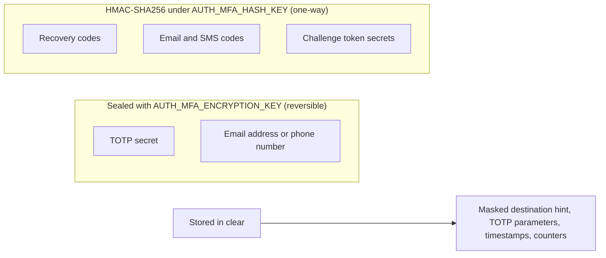
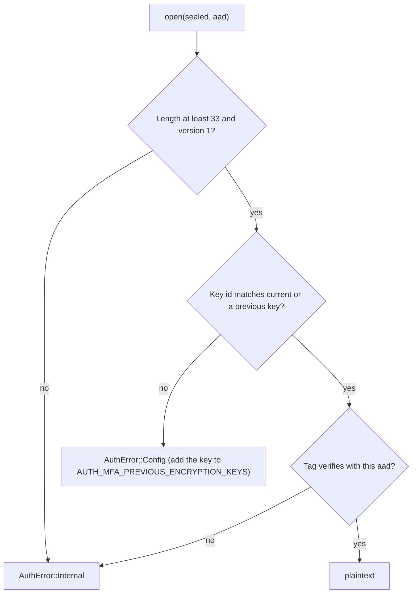

# Security design

This guide describes the cryptography and the storage decisions behind `z-auth-mfa`, and what they protect against. It covers TOTP verification and replay protection, the sealed format of TOTP secrets and destinations, the keyed hashes used for every other secret, how codes are generated and normalised, and the guarantees that follow. The implementation lives in `src/crypto` and is small enough to audit, and the byte counts given here are taken from it.

## Two keys, two jobs

The crate uses two independent keys, generated by `cargo run -p z-auth-mfa --example mfa_keygen`.

`AUTH_MFA_ENCRYPTION_KEY` is a 32-byte key for XChaCha20-Poly1305. It seals the two kinds of secret that must be read back later, TOTP shared secrets (to compute the expected codes) and email or SMS destinations (to send codes to them). It is needed only by the built-in sealer and can be replaced by a custom `SecretSealer`, for example one backed by a key management service.

`AUTH_MFA_HASH_KEY` is an HMAC-SHA256 key of at least 32 bytes. It protects everything that only ever needs to be compared, never read back. Recovery codes, email and SMS codes and the secret part of challenge tokens are stored only as keyed hashes under it. It is always required.



## TOTP verification

TOTP codes are computed per RFC 6238 on top of HOTP (RFC 4226), with HMAC-SHA-1, HMAC-SHA-256 or HMAC-SHA-512 and dynamic truncation to six to eight digits. The implementation is checked against the test vectors of both RFCs.

To verify a code, `crypto::totp::verify` computes the current time step from the service's clock and the factor's period, and then computes the expected code for every step from `current - skew` to `current + skew`, where `skew` is `AUTH_MFA_TOTP_SKEW_STEPS`. Every candidate is computed and compared with the submitted code using a constant-time comparison, whatever the input looks like, and a malformed input (wrong length or non-digits) is only rejected after all comparisons have run. Neither the response time nor its variation reveals how close a guess was or which step matched. When several steps match, the latest one is returned.

The returned step is then offered to `MfaRepository::advance_totp_step`, a compare-and-swap that records the step only if it is later than the factor's `last_used_step`. If it is not, the code counts as wrong. Each time step is therefore accepted at most once, even by concurrent requests on different instances. A code read off the user's screen, or captured in transit, is useless once the user has submitted it, and so is any code from an earlier step. The step that confirms an enrollment is recorded the same way, so the confirming code cannot be replayed at the next login.

TOTP parameters, the algorithm, digits and period, are stored with each factor at enrollment and used for every later verification of that factor. Changing `AUTH_MFA_TOTP_ALGORITHM`, `AUTH_MFA_TOTP_DIGITS` or `AUTH_MFA_TOTP_PERIOD_SECS` only affects new enrollments and never invalidates an authenticator that is already set up. The skew window is global and taken from the current configuration.

The time step comes from the service's own clock, not from the database, because the authenticator app computes its code from its own clock too. Instances need reasonably synchronised clocks, which NTP provides. Expiry of stored rows, in contrast, is always judged by the store's clock.

## Sealed values

The built-in `XChaChaSealer` (feature `aead`) encrypts with XChaCha20-Poly1305 under a fresh random 24-byte nonce for every value, so sealing the same secret twice gives unrelated outputs. Its 192-bit nonce is large enough that random nonces never collide in practice. A sealed value has the following layout.

```text
┌─────────┬───────────────┬────────────────┬──────────────────┬───────────┐
│ version │ key id        │ nonce          │ ciphertext       │ tag       │
│ 1 byte  │ 8 bytes       │ 24 bytes       │ same length as   │ 16 bytes  │
│ = 0x01  │ SHA-256(key)  │ random         │ the plaintext    │ Poly1305  │
│         │ first 8 bytes │                │                  │           │
└─────────┴───────────────┴────────────────┴──────────────────┴───────────┘
```

The header is 33 bytes and the whole envelope adds 49 bytes to the plaintext, so a default 20-byte TOTP secret is stored as 69 bytes. The version byte allows the format to evolve. The key id is the first eight bytes of the SHA-256 of the 32-byte key that sealed the value, which tells the sealer which key to open it with without revealing anything about the key.

Every seal and open call passes associated data that binds the value to its row. The associated data is the user's UUID (16 bytes), followed by the factor's UUID (16 bytes), followed by a purpose label, `totp-secret` for TOTP secrets and `destination` for email and SMS destinations. Associated data is authenticated but not stored, so a sealed value copied into another user's row, another factor's row or the other column fails authentication instead of opening. An attacker with write access to the database therefore cannot move a known TOTP secret onto a victim's factor. This is also why the service chooses factor ids itself rather than letting the store assign them.

Opening a value that is too short or has an unknown version fails with `AuthError::Internal`, as does a value whose tag does not verify. A value sealed with a key the sealer does not know fails with `AuthError::Config`, whose message asks for the key to be added to `AUTH_MFA_PREVIOUS_ENCRYPTION_KEYS`.

## Key rotation

To rotate the encryption key, generate a new one, set it as `AUTH_MFA_ENCRYPTION_KEY`, and move the old one into `AUTH_MFA_PREVIOUS_ENCRYPTION_KEYS`, a comma-separated list. New values are sealed with the current key, and existing values open with whichever key their id names.



Values are not re-sealed automatically. A factor sealed with an old key keeps that seal until it is removed and enrolled again, so an old key may only be dropped from the list once no factor uses it any more. In shared mode every instance must carry the same current and previous keys.

Losing an encryption key makes every value sealed with it unusable. TOTP factors sealed with it can no longer be verified, and every attempt to check one of their codes fails with a configuration error. Email and SMS factors can no longer be sent to, and with automatic sending on, a user whose only factors are of that kind cannot even obtain a challenge, because the login fails while sending the code. Recovery codes keep working for users who can still obtain a challenge, since they depend only on the hash key. The administrative `MfaService::reset` always works, because deleting rows needs no key.

## Keyed hashes

Recovery codes, email and SMS codes and challenge secrets are hashed with `CodeHasher`, which computes `HMAC-SHA256(AUTH_MFA_HASH_KEY, label ‖ 0x00 ‖ owner ‖ value)`. The label separates the three kinds of value, so a hash of one kind can never be confused with a hash of another. The owner is the 16-byte UUID of what the value belongs to, so the same value hashes differently for different owners. Comparisons are constant-time.

| Kind | Label | Owner | Value |
|---|---|---|---|
| Recovery code | `z-auth-mfa/recovery` | user id | the canonical code, uppercase without dashes |
| Email or SMS code | `z-auth-mfa/code` | challenge id for login codes, factor id for enrollment and step-up codes | the digits |
| Challenge token secret | `z-auth-mfa/challenge` | challenge id | the 32 random bytes |

A plain hash would not do here. A six-digit code has only a million possible values and a recovery code about 50 bits, so anyone holding an unkeyed hash could find the code by brute force in moments. Keyed with a 32-byte secret, the stored hashes are useless without the key, and a leaked table can neither be replayed nor brute-forced offline.

Changing `AUTH_MFA_HASH_KEY` therefore invalidates every stored hash at once. All recovery codes stop working, every pending login challenge and every outstanding email or SMS code becomes unusable, and users must regenerate their recovery codes. Unlike the encryption key there is no list of previous hash keys, so the hash key should be generated once and kept.

## Code generation

All randomness comes from the operating system's generator through `getrandom`. A failure of the generator is reported as `AuthError::Internal` rather than falling back to anything weaker.

Email and SMS codes are numeric with `AUTH_MFA_CODE_DIGITS` digits (six by default). They are produced by rejection sampling. Random bytes are drawn sixteen at a time, bytes of 250 and above are discarded, and each remaining byte contributes the digit `byte % 10`. Since 250 is a multiple of 10, every digit is exactly equally likely, which a plain `byte % 10` over all 256 values would not achieve.

Recovery codes use Crockford's base32 alphabet, `0123456789ABCDEFGHJKMNPQRSTVWXYZ`, which omits `I`, `L`, `O` and `U` to avoid confusion with digits and accidental words. Each character is the low five bits of a random byte, which is uniform because 32 divides 256. A code has `AUTH_MFA_RECOVERY_CODE_LENGTH` characters (ten by default, 50 bits) and is displayed in groups of five separated by dashes, such as `7KQ2M-X9D4R`. Codes within one set are distinct.

Recovery codes are forgiving on input. They are uppercased, dashes, spaces and tabs are dropped, `O` is read as `0`, and `I` and `L` are read as `1`. Any other character outside the alphabet, `U` included, makes the input invalid, and so does a length different from the configured one. `7kq2m x9d4r` and `7KQ2MX9D4R` are the same code. Email and SMS codes have spaces, dashes and tabs removed and must then be exactly the configured number of digits. TOTP codes are only trimmed of surrounding whitespace.

Challenge token secrets are 32 random bytes, and TOTP secrets are `AUTH_MFA_TOTP_SECRET_BYTES` random bytes (20 by default).

## Masked destinations

Only a masked hint of each email address or phone number is stored in clear, so that the user interface can say where a code went without the database holding the destination. An email address keeps the first character of its local part and its domain, with the rest of the local part replaced by between three and eight asterisks. A phone number keeps its last four digits, with every other digit replaced by an asterisk and the leading `+` dropped.

| Destination | Stored hint |
|---|---|
| `jane.doe@example.com` | `j*******@example.com` |
| `a@b.io` | `a***@b.io` |
| `christopher.robinson@example.com` | `c********@example.com` |
| `+15551234567` | `*******4567` |
| `+442071234567` | `********4567` |

## Custom sealers

`SecretSealer` is a port with two synchronous methods, `seal(plaintext, aad)` and `open(sealed, aad)`. A host that wants secrets protected by a hardware security module or a cloud key management service implements it and passes it with `Mfa::with_sealer`. The implementation must authenticate the associated data, so that the row binding described above still holds, and it owns its own format and key rotation. The [ports guide](ports.md) contains an illustrative envelope-encryption implementation. Switching sealers does not migrate existing values, so a deployment that changes sealer must keep the old one able to open what it sealed, or have users enroll again.

## Guarantees

Taken together, the design gives the following properties.

Guessing is bounded. Each login challenge accepts at most `AUTH_MFA_CHALLENGE_MAX_ATTEMPTS` codes, and each email or SMS code on a factor at most the same number of attempts. The attempt is recorded atomically before the code is checked, so parallel requests cannot exceed the limit. Across challenges, `AUTH_MFA_LOCKOUT_THRESHOLD` failures within `AUTH_MFA_LOCKOUT_WINDOW_SECS` lock the user out of all second-factor checks, including the password step, for `AUTH_MFA_LOCKOUT_SECS`.

Everything is single use. A challenge is consumed by a compare-and-swap on success, a TOTP time step is accepted once per factor, a recovery code is marked used by a compare-and-swap, and an email or SMS code is cleared when it succeeds and replaced when a new one is sent. Challenges, pending enrollments and codes expire by the store's clock.

Responses leak little. Unknown, malformed, forged, expired, used and exhausted challenge tokens all fail with the same `challenge_expired`, and a client mismatch looks the same. Secret comparisons, TOTP candidates and keyed hashes alike, run in constant time.

A database leak reveals little. Without the encryption key, TOTP secrets and destinations cannot be read, and the associated data prevents moving sealed values between rows. Without the hash key, stored codes and challenge secrets can neither be used nor brute-forced. What remains readable is masked hints, TOTP parameters, counters and timestamps.

A password alone achieves nothing for an enrolled user. It opens no session and evicts none, and the account is checked again before the session is opened by the second step. Removing a factor or replacing recovery codes requires a fresh proof, and by default removing a factor ends all of the user's sessions.

Secrets stay out of logs. Every type that carries a secret, from `CodeDelivery` and `TotpEnrollment` to the configuration and the API DTOs, redacts it in its `Debug` implementation.
