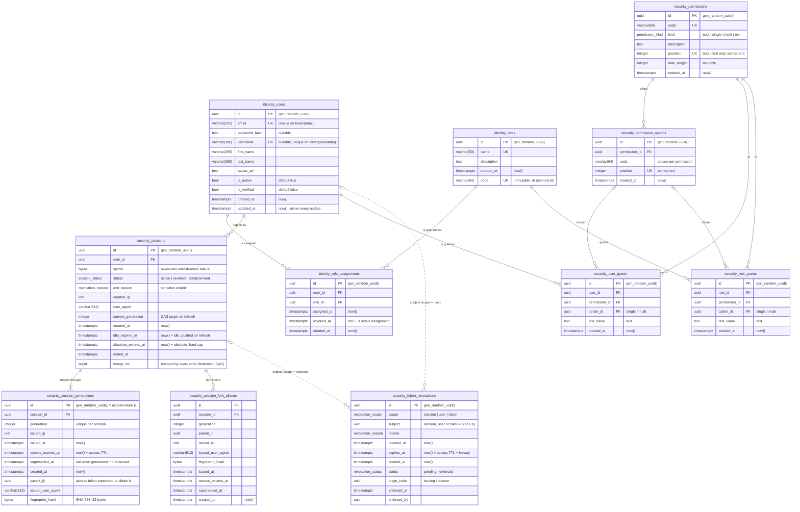

# z-auth-postgres — reference PostgreSQL adapter

Implements every `z-auth` repository port on top of `sqlx` / PostgreSQL. The core `z-auth` crate never depends on this crate. A host application either uses this adapter or writes its own against the same traits.

The core ports are `PgUserRepository`, `PgRoleRepository`, `PgUserRoleRepository`, `PgSessionRepository`, `PgRevocationRepository`, `PgPermissionRepository` and `PgKeyRepository`, one for each z-auth repository trait.

The ports of the optional `z-auth-cluster` crate sit behind features. `PgNodeRepository` (its `NodeRepository`) needs feature `shared`, and `PgSyncStore` (its `SyncStore`) needs feature `federation`.

---

## Wiring it into z-auth

```rust
use std::sync::Arc;
use z_auth::{ZAuth, conf::config::{ConfigLoader, EnvLoader}};
use z_auth_postgres::*;

let pool = build_pg_pool(&PgConfig::from_env()?).await?;
run_migrations(&pool).await?;   // apply any pending schema migrations
// `repositories(&pool)` supplies every required repository (users, roles,
// user_roles, sessions, revocations, keys); a missing one is a compile error.
let auth = ZAuth::builder(EnvLoader.load_config()?, repositories(&pool))
    .permissions(Arc::new(PgPermissionRepository::new(pool.clone()))) // AUTH_AUTHZ_MODE=permissions|combined
    .build()?;

// Load revocations / keys / catalog; then call auth.tick() periodically.
auth.start().await?;
```

With a cluster, enable feature `shared` here and add the `z-auth-cluster` crate to the service application.

```rust
use z_auth_cluster::{SharedCluster, config::{ClusterConfigLoader, ClusterEnvLoader}};

run_cluster_migrations(&pool).await?;   // core, then the cluster tables
let cluster = Arc::new(SharedCluster::new(
    ClusterEnvLoader.load_settings()?,
    transport,
    Arc::new(PgNodeRepository::new(pool.clone())),
));
let auth = ZAuth::builder(EnvLoader.load_config()?, repositories(&pool))
    .extension(cluster.clone())
    .build()?;
auth.start().await?;   // joins the cluster; then auth.tick() every heartbeat
// inbound cluster endpoint: cluster.receive(envelope).await?
```

## Schema conventions

- Every table starts with the layer that owns it, `identity_` (users, roles), `security_` (permissions, sessions, tokens) and, for z-auth-cluster, `cluster_` (instances and the federation change feed). Constraints, indexes, sequences and triggers embed their table's name.
- Tables have a surrogate `id uuid` primary key generated by the database (`gen_random_uuid()`), unless a natural key exists (`jti`, `user_id`, `service`, …).
- Every table has `created_at`, recording when the row was inserted. Event columns such as `assigned_at`, `issued_at` and `revoked_at` sit alongside it where they carry business meaning.
- Only rows edited in place have `updated_at`, which means `identity_users` (free-form edits) and the federation snapshots and cursors. Every other change has its own column (`revoked_at`, `superseded_at`, `ended_at`, `idle_expires_at`).
- The database is the clock. Every persisted timestamp comes from `now()`. z-auth passes durations such as TTLs, timeouts and retention, never instants, and reads back what was stored. The JWT `iat`/`exp` are copied from the stored generation.
- All timestamps are `timestamptz`, which is stored as a UTC instant. The pool also pins each connection's `TimeZone` to `UTC`.
- Closed value sets are Postgres ENUM types, namely `session_status`, `revocation_scope`, `revocation_reason`, `revocation_status`, `permission_kind` and `verifying_key_status`, plus `node_state` and `heartbeat_status` in the cluster set.

## Tables

| Table | Purpose |
|---|---|
| identity tables | |
| `identity_users` | User accounts: email, password hash, profile, active/verified flags |
| `identity_roles` | RBAC roles. `code` is the immutable identifier carried in tokens (`rol`) |
| `identity_role_assignments` | Which user holds which role; `revoked_at` keeps the history as an audit trail |
| security tables | |
| `security_permissions`, `security_permission_options` | The application's permission catalog (`bool`, `single`, `multi`, `text`). Every `bool`/`text` permission and every option takes a permanent position from `security_permission_position_seq`, which is how permissions are encoded in tokens |
| `security_user_grants`, `security_role_grants` | Granted values, directly to a user or to a role: one row per `bool`/`text` grant or per chosen option. Read only at login / refresh |
| `security_sessions` | One row per login on one device: status (`active`, `revoked` or `compromised`), creating IP, user agent, current generation, idle and absolute expiry, and a per-session secret. No tokens are stored |
| `security_session_generations` | Rotation history (newest N per session, default 10): who each generation was issued to (IP, user agent, fingerprint hash, parent `jti`), `issued_at`, `superseded_at`. The row's `id` is the access token's `jti` |
| `security_session_fork_aliases` | Federation mode: the losing variants of a benign refresh fork, still accepted once so their client can move to the winning chain |
| `security_token_revocations` | Persisted denylist (`session`, `user` or `token` scope), `pending` → `enforced` once a covered token is used. Rows only live for the access TTL plus leeway |
| `security_verifying_keys` | Public Ed25519 keys published by instances; `revoked` keys are rejected everywhere |
| cluster tables (`migrations_cluster/`, feature `shared`) | |
| `cluster_nodes` | Registry of z-auth instances as a state machine: lifecycle `state` (`joining` → `active` → `leaving`) and `heartbeat` (`online` → `offline` → `missing`). Written only on state changes |
| `cluster_account_snapshots`, `cluster_catalog_snapshot` | Federation mode: per-user account/authz snapshots and the permission catalog, published by the authority |
| `cluster_sync_site` | Federation mode: this database's site id; its row switches change capture on |
| `cluster_change_feed` | Federation mode: one entry per synced record (its latest change), written by triggers |
| `cluster_feed_cursors` | Federation mode: how far this database has read each other site's feed |
| `cluster_sync_freshness` | Federation mode: when this database last caught up with each service |

Refresh rotation is a compare-and-swap on `security_sessions.current_generation`, done inside a transaction. When refreshes race, one wins and the others get a conflict, which the core resolves through the grace window.

### Entity-relationship diagram

This diagram shows the schema built by [`migrations/`](migrations/). Solid lines are foreign keys, and every one of them is `ON DELETE CASCADE`. The dotted lines from `security_token_revocations` are logical references only. `subject` holds a session, user or access-token id, depending on `scope`, so there is no FK constraint. A revocation row can outlive what it refers to. The `cluster_` tables have no foreign keys and are left out.



### Constraints and indexes

| Table | Constraint / index | Purpose |
|---|---|---|
| `identity_users` | `identity_users_email`, `identity_users_username_key` (unique on `lower(...)`) | One account per email and per username, case-insensitively |
| `identity_roles` | `identity_roles_name_key`, `identity_roles_code_key` (unique), `chk_identity_roles_code_format` | Unique names; unique, well-formed codes |
| `identity_role_assignments` | `unique_user_role_active` (unique, partial: `revoked_at IS NULL`) | A user holds a role at most once at a time, while old revoked assignments stay as an audit trail |
| `identity_role_assignments` | `chk_identity_role_assignments_revoked_after_assigned` | `revoked_at` can't precede `assigned_at` |
| `identity_role_assignments` | `idx_identity_role_assignments_active`, `idx_identity_role_assignments_removed` (partial) | Fast lookup of a user's active and revoked assignments |
| `identity_role_assignments` | `idx_identity_role_assignments_user_id`, `idx_identity_role_assignments_role_id` | FK lookups |
| `security_permissions` | `security_permissions_code_key`, `security_permissions_position_key` (unique) | One entry per code; positions never collide |
| `security_permissions` | `chk_security_permissions_position`, `chk_security_permissions_max_length` | Position exactly for `bool`/`text`; `max_length` exactly for `text` |
| `security_permission_options` | `security_permission_options_permission_code_key`, `security_permission_options_position_key` (unique) | Option codes unique per permission; positions never collide |
| `security_*_grants` | `*_value_key` (partial: `option_id IS NULL`), `*_option_key` (partial: `option_id IS NOT NULL`) | One `bool`/`text` row per owner and permission; one row per chosen option |
| `security_*_grants` | `idx_security_user_grants_user_id`, `idx_security_role_grants_role_id` | `effective_grants` at login / refresh |
| `security_sessions` | `chk_security_sessions_ended` | Active ⇔ `ended_at` and `end_reason` are both NULL |
| `security_sessions` | `chk_security_sessions_generation_positive` | `current_generation >= 1` |
| `security_sessions` | `idx_security_sessions_user_active` (partial: `status = 'active'`) | Session cap and logout-all, oldest first |
| `security_sessions` | `idx_security_sessions_purge` (expression: `LEAST(idle, absolute, COALESCE(ended_at, 'infinity'))`) | Purge is an index scan. The purge query must repeat the expression verbatim |
| `security_session_generations` | `security_session_generations_session_generation_key` (unique `(session_id, generation)`) | One row per rotation. Rows older than the newest N are trimmed on each refresh |
| `security_session_generations` | `chk_security_session_generations_positive`, `chk_security_session_generations_fingerprint` | `generation >= 1`; a fingerprint hash is 32 bytes |
| `security_session_fork_aliases` | `idx_security_session_fork_aliases_session` | Aliases of a session's generation |
| `security_token_revocations` | `chk_security_token_revocations_enforced` | `enforced` ⇔ `enforced_at` is set |
| `security_token_revocations` | `idx_security_token_revocations_expires_at` | `list_active()` and `purge_expired()` |
| `security_verifying_keys` | `security_verifying_keys_kid_key` (unique), `chk_security_verifying_keys_length`, `chk_security_verifying_keys_revoked` | One key per `kid`; 32-byte keys; `revoked` ⇔ `revoked_at` is set |
| `cluster_nodes` | `chk_cluster_nodes_port`, `chk_cluster_nodes_address` | A valid port; an IP or a DNS name |
| `cluster_change_feed` | `idx_cluster_change_feed_order` (`txid, seq`) | Feed pages are read in commit order |

The `CONSTRAINT_*` constants in `src/constants.rs` map the unique indexes above to domain errors (`EmailAlreadyTaken`, `RoleAlreadyExists`, …). Allowed status, scope and reason values are enforced by the ENUM types, so no CHECKs are needed.

---

## Configuration

`PgConfig::from_env()` reads these variables.

```env
DB_HOST=localhost
DB_PORT=5432          # optional, defaults to 5432
DB_USER=postgres
DB_PASSWORD=secret
DB_NAME=auth          # optional, defaults to "auth"
DB_MAX_POOL_SIZE=10   # optional
DB_CONNECT_TIMEOUT_SECS=5  # optional
```

---

## Migrations

The schema is a series of numbered SQL files in [`migrations/`](migrations/), applied in order by sqlx's migrator. It is embedded in the crate as `MIGRATOR` and run with `run_migrations(&pool)`. Postgres records each applied file, with a checksum, in the `_sqlx_migrations` table, so a run only applies the files it hasn't seen. Concurrent runs are serialised with an advisory lock.

Never edit a migration that has been applied anywhere, because the checksum check will refuse to run. To change the schema, add the next file, e.g. `0002_add_login_attempts.sql`.

One database holds two sets. The core set (`migrations/`, versions below 1000, `MIGRATOR`) holds the `identity_` and `security_` tables. The cluster set (`migrations_cluster/`, versions from 1001, `CLUSTER_MIGRATOR`, feature `shared`) adds the `cluster_` tables and the change-feed triggers on the `security_` tables, and is applied after the core set (`run_cluster_migrations`). Both record into `_sqlx_migrations` and ignore each other's versions.

The current migrations are `0001` initial schema (`migrations/`), `1001` cluster schema (`migrations_cluster/`) and `0001` session store (`migrations_session_store/`, feature `federation`). These files replaced the earlier migrations (0001–0008, and the session store's 0001–0002) when the tables got their layer prefixes. A database built with the earlier files can't be upgraded in place, so `setup_db` refuses it and asks for `--reset`, which drops everything and rebuilds it.

Adding an ENUM value takes `ALTER TYPE revocation_reason ADD VALUE '...'` in a new migration, plus the matching variant in `src/enums.rs`. Values can't be removed or reordered without recreating the type.

## Federation mode

Feature `federation` serves z-auth-cluster's `Federation` extension (`AUTH_DEPLOYMENT_MODE=federation`, see `docs/replication.md`).

The authority uses the core and cluster sets (`run_cluster_migrations`) and `repositories(&pool)`. Every other service uses the session-store schema (`migrations_session_store/`, applied by `run_session_store_migrations`) and `federation.session_store_repositories(SessionRepositories { … })`.

Both build `Federation::new(settings, transport, Arc::new(PgNodeRepository::new(pool.clone())), Arc::new(PgSyncStore::new(pool)))` and register it with `.extension(federation.clone())`.

- The session store holds `security_sessions` (with generations and fork aliases), `security_token_revocations`, `security_verifying_keys`, the account / catalog snapshots, the service's own `cluster_nodes` and the change feed. It has no `identity_` tables and no grants.
- Give the session store its own Postgres schema, so the z-auth tables never collide with the host's, by connecting with `options=-c search_path=auth`.
- The feed (`cluster_change_feed`) is written by triggers on the synced tables, so direct SQL edits are captured too. Capture switches on when the service first starts in federation mode (`cluster_sync_site` gets its row). Until then the triggers do nothing.

## setup_db — database setup script

```bash
cargo run -p z-auth-postgres --bin setup_db            # create DB + apply pending migrations
cargo run -p z-auth-postgres --bin setup_db -- --reset # dev only: drop everything first
cargo run -p z-auth-postgres --features shared --bin setup_db -- --cluster  # also the cluster tables
```

It runs these steps.

1. Loads `.env` from the current directory (skips silently if absent). Real environment variables take priority.
2. Checks the PostgreSQL server. If it is unreachable or the credentials are wrong, it prints a specific error and exits.
3. Creates the database if it doesn't exist yet.
4. Replaces a legacy schema. Tables created before versioned migrations (no `_sqlx_migrations`) are dropped, and so is everything when `--reset` is given — under both the current table names and the names used before the baseline. If any table contains data, it asks first.
   ```
   ⚠️  Existing tables with data were found in database 'auth'.
      Drop everything and re-create? [y/N]:
   ```
   Answering `N` exits with no changes made.
5. Applies pending migrations and lists each one — the core set, then with `--cluster` the cluster set. A database that is already up to date is left untouched. A database built with the migrations the baseline replaced is refused with a hint to rerun with `--reset`.

---

## Integration tests

The tests in `tests/` need a reachable database. `helpers::pool()` applies pending migrations itself, so it's enough to have run `setup_db` once:

```bash
cargo test -p z-auth-postgres                  # core ports
cargo test -p z-auth-postgres --all-features   # plus the cluster ports (applies the cluster set)
```
