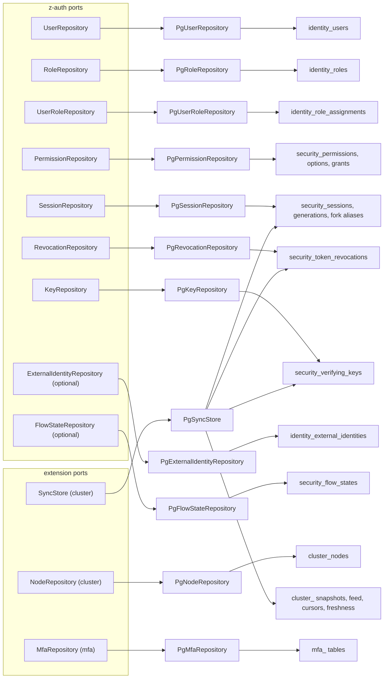

# z-auth-postgres

`z-auth-postgres` is the reference PostgreSQL adapter for z-auth. It implements every storage port that the core `z-auth` crate and its optional extensions `z-auth-cluster` and `z-auth-mfa` define, including the optional external-identity ports, using `sqlx` 0.8 with the Tokio runtime. The dependency points one way only. The core crate never depends on this adapter, so a host application can use it as is, copy and adapt it, or write its own adapter against the same traits; nothing in z-auth assumes PostgreSQL.

The crate ships four things. It provides repository types (`PgUserRepository`, `PgSessionRepository` and the rest) that turn the port calls into SQL, a connection-pool helper that reads `DB_*` environment variables or the `database` section of a configuration file, five embedded migration sets that build the schema, and the `setup_db` binary that creates and upgrades a development database. The guides in [`docs/`](docs/) describe the schema, the migrations, the federation storage and the query internals in depth; this page is the starting point.

## Public API

Everything a host needs is re-exported from the crate root, except `connect_options` (in the public `pool` module) and the constants (in the public `constants` module). Items behind a feature only exist when that feature is enabled.

| Item | Kind | Feature | Purpose |
|---|---|---|---|
| `repositories(&pool)` | function | none | Returns a `z_auth::Repositories` holding `PgUserRepository`, `PgRoleRepository`, `PgUserRoleRepository`, `PgSessionRepository`, `PgRevocationRepository` and `PgKeyRepository`, all on clones of one pool |
| `PgConfig` | struct | none | Connection settings with public fields, read by `PgConfig::from_env()` or `PgConfig::from_source(&source)`; `connection_url()` and `connection_url_for(db)` render a URL, and `Debug` redacts the password |
| `build_pg_pool(&PgConfig)` | async function | none | Builds a `sqlx::PgPool` with the configured size and acquire timeout, every connection pinned to UTC |
| `pool::connect_options(url)` | function | none | Parses a URL into `PgConnectOptions` and adds the `timezone=UTC` startup option, for hosts that build their own pool |
| `constants` | module | none | Connection defaults, the `DB_*` variable names and the constraint names that map to domain errors |
| `MIGRATOR`, `run_migrations(&pool)` | static, async function | none | The core set in `migrations/` (`identity_` and `security_` tables) |
| `CLUSTER_MIGRATOR`, `run_cluster_migrations(&pool)` | static, async function | `shared` | The cluster set in `migrations_cluster/`; the function applies the core set first |
| `SESSION_STORE_MIGRATOR`, `run_session_store_migrations(&pool)` | static, async function | `federation` | The self-contained session-store schema in `migrations_session_store/` for non-authority services |
| `MFA_MIGRATOR`, `run_mfa_migrations(&pool)` | static, async function | `mfa` | The mfa set in `migrations_mfa/`; the function applies the core set first |
| `EXTERNAL_MIGRATOR`, `run_external_migrations(&pool)` | static, async function | `external-identity` | The external-identity set in `migrations_external/`; the function applies the core set first |

The repository types each wrap a `PgPool` and are built with `new(pool)`. Every one of them implements exactly one port.

| Type | Port | Defined in | Feature |
|---|---|---|---|
| `PgUserRepository` | `UserRepository` | `z_auth::identity::user` | none |
| `PgRoleRepository` | `RoleRepository` | `z_auth::identity::access` | none |
| `PgUserRoleRepository` | `UserRoleRepository` | `z_auth::identity::access` | none |
| `PgSessionRepository` | `SessionRepository` | `z_auth::security::session` | none |
| `PgRevocationRepository` | `RevocationRepository` | `z_auth::security::token` | none |
| `PgKeyRepository` | `KeyRepository` | `z_auth::security::token` | none |
| `PgPermissionRepository` | `PermissionRepository` | `z_auth::security::authorization` | none |
| `PgNodeRepository` | `NodeRepository` | `z_auth_cluster::shared` | `shared` |
| `PgSyncStore` | `SyncStore` | `z_auth_cluster::federation` | `federation` |
| `PgMfaRepository` | `MfaRepository` | `z_auth_mfa::repository` | `mfa` |
| `PgExternalIdentityRepository` | `ExternalIdentityRepository` | `z_auth::identity::external` | `external-identity` |
| `PgFlowStateRepository` | `FlowStateRepository` | `z_auth::security::authentication` | `external-identity` |

`PgPermissionRepository` is not part of `repositories(&pool)` because the core treats it as optional. The same holds for `PgExternalIdentityRepository` and `PgFlowStateRepository`, which are passed together with `.external_identities(...)` when the host signs users in through external identity providers. It is passed to the builder with `.permissions(...)` and is required when `AUTH_AUTHZ_MODE` is `permissions` or `combined`. `PgSyncStore` also has an inherent `next_account_version()` method that draws the next account-snapshot version on the authority.

## Features

No feature is enabled by default, and the default build depends only on `z-auth`, `sqlx`, `tokio`, `chrono`, `uuid`, `serde_json` and `async-trait`. Each of the first three features pulls in one optional crate and adds the matching repository and migration set. `external-identity` pulls in nothing, because its ports are defined by the core.

| Feature | Enables | Adds |
|---|---|---|
| `shared` | `z-auth-cluster` with its `shared` feature | `PgNodeRepository`, `CLUSTER_MIGRATOR`, `run_cluster_migrations` |
| `federation` | `shared` plus `z-auth-cluster/federation` | `PgSyncStore`, `SESSION_STORE_MIGRATOR`, `run_session_store_migrations` |
| `mfa` | `z-auth-mfa` with `default-features = false` | `PgMfaRepository`, `MFA_MIGRATOR`, `run_mfa_migrations` |
| `external-identity` | nothing beyond the default build | `PgExternalIdentityRepository`, `PgFlowStateRepository`, `EXTERNAL_MIGRATOR`, `run_external_migrations` |

A host that runs a federated authority with two-factor authentication would therefore declare the dependency as follows.

```toml
[dependencies]
z-auth-postgres = { path = "adapters/postgres", features = ["federation", "mfa"] }
```

## How the ports map to tables

Each port is served by one type, and each type touches one group of tables. The diagram reads from left to right, from the trait z-auth calls to the tables that end up holding the data.



`PgSyncStore` is the only type that writes across groups. It reads and replaces whole session aggregates, merges revocations and keys arriving from other clusters, and maintains the `cluster_` federation tables; [federation storage](docs/federation.md) explains how.

## Wiring

The examples below are written as functions returning `Box<dyn std::error::Error>`, which accepts every error type involved (`PgConfig::from_env` returns a `String`, the pool a `sqlx::Error`, the migrators a `MigrateError`, the loaders a `ConfigError` and the builder an `AuthError`). The calls themselves are taken from the crate's source and tests.

### Core

A standalone deployment needs one pool, the core migrations and `repositories(&pool)`. The permission repository is added because permission modes need it; in `none` and `rbac` modes it can be left out.

```rust
use std::sync::Arc;

use z_auth::ZAuth;
use z_auth::conf::config::{ConfigLoader, EnvLoader};
use z_auth_postgres::{
    PgConfig, PgPermissionRepository, build_pg_pool, repositories, run_migrations,
};

async fn build_auth() -> Result<ZAuth, Box<dyn std::error::Error>> {
    let pool = build_pg_pool(&PgConfig::from_env()?).await?;
    run_migrations(&pool).await?;
    let auth = ZAuth::builder(EnvLoader.load_config()?, repositories(&pool))
        .permissions(Arc::new(PgPermissionRepository::new(pool.clone())))
        .build()?;
    auth.start().await?; // loads revocations, keys and the catalog
    Ok(auth)
}
```

After `start`, the host calls `auth.tick()` periodically so that pending revocations are enforced and expired denylist entries are dropped.

### Shared cluster

A shared cluster runs several instances of one service on one database. Enable the `shared` feature, apply the cluster set (which applies the core set first) and hand a `PgNodeRepository` to `SharedCluster`. The transport is the host's own network client implementing `ClusterTransport`, so it appears here as a parameter.

```rust
use std::sync::Arc;

use z_auth::ZAuth;
use z_auth::conf::config::{ConfigLoader, EnvLoader};
use z_auth_cluster::SharedCluster;
use z_auth_cluster::config::{ClusterConfigLoader, ClusterEnvLoader};
use z_auth_cluster::shared::ClusterTransport;
use z_auth_postgres::{
    PgConfig, PgNodeRepository, build_pg_pool, repositories, run_cluster_migrations,
};

async fn build_clustered(
    transport: Arc<dyn ClusterTransport>,
) -> Result<(ZAuth, Arc<SharedCluster>), Box<dyn std::error::Error>> {
    let pool = build_pg_pool(&PgConfig::from_env()?).await?;
    run_cluster_migrations(&pool).await?; // core, then cluster
    let cluster = Arc::new(SharedCluster::new(
        ClusterEnvLoader.load_settings()?,
        transport,
        Arc::new(PgNodeRepository::new(pool.clone())),
    ));
    let auth = ZAuth::builder(EnvLoader.load_config()?, repositories(&pool))
        .extension(cluster.clone())
        .build()?;
    auth.start().await?; // joins the cluster
    Ok((auth, cluster))
}
```

The host routes inbound cluster envelopes to `cluster.receive(envelope)` and calls `auth.tick()` every heartbeat. Federation, where each service has its own database, is wired differently and is covered in [federation storage](docs/federation.md).

### Two-factor authentication

With the `mfa` feature, `run_mfa_migrations` applies the core set and then the `mfa_` tables, and `PgMfaRepository` is handed to the `Mfa` extension. A code sender is only needed when email or SMS factors are enabled; `mailer` below stands for the host's implementation of `z_auth_mfa::CodeSender`.

```rust
use std::sync::Arc;

use z_auth::ZAuth;
use z_auth::conf::config::{ConfigLoader, EnvLoader};
use z_auth_mfa::{CodeSender, Mfa};
use z_auth_mfa::config::{MfaConfigLoader, MfaEnvLoader};
use z_auth_postgres::{
    PgConfig, PgMfaRepository, build_pg_pool, repositories, run_mfa_migrations,
};

async fn build_with_mfa(
    mailer: Arc<dyn CodeSender>,
) -> Result<ZAuth, Box<dyn std::error::Error>> {
    let pool = build_pg_pool(&PgConfig::from_env()?).await?;
    run_mfa_migrations(&pool).await?; // core, then mfa
    let mfa = Arc::new(
        Mfa::new(MfaEnvLoader.load_settings()?, Arc::new(PgMfaRepository::new(pool.clone())))
            .with_code_sender(mailer),
    );
    let auth = ZAuth::builder(EnvLoader.load_config()?, repositories(&pool))
        .extension(mfa)
        .build()?;
    auth.start().await?;
    Ok(auth)
}
```

Both extensions can be registered on the same builder. In that case run `run_cluster_migrations` and `run_mfa_migrations` one after the other; each applies the core set first, which is a no-op the second time.

### External identities

With the `external-identity` feature, `run_external_migrations` applies the core set and then the tables for linked identities and pending sign-ins, and the two repositories are handed to the builder. A protocol adapter such as [z-auth-sso](../sso/README.md) then signs users in through the providers it is configured for, and keeps its redirect state in the same flow-state table through `ZAuth::flow_states()`.

```rust
use std::sync::Arc;

use z_auth::ZAuth;
use z_auth::conf::config::{ConfigLoader, EnvLoader};
use z_auth_postgres::{
    PgConfig, PgExternalIdentityRepository, PgFlowStateRepository, build_pg_pool, repositories,
    run_external_migrations,
};

async fn build_with_external_identities() -> Result<ZAuth, Box<dyn std::error::Error>> {
    let pool = build_pg_pool(&PgConfig::from_env()?).await?;
    run_external_migrations(&pool).await?; // core, then external identities
    let auth = ZAuth::builder(EnvLoader.load_config()?, repositories(&pool))
        .external_identities(
            Arc::new(PgExternalIdentityRepository::new(pool.clone())),
            Arc::new(PgFlowStateRepository::new(pool.clone())),
        )
        .build()?;
    auth.start().await?;
    Ok(auth)
}
```

`ZAuth::tick` deletes expired flow states, so the periodic `tick` the host already runs keeps `security_flow_states` small. The external-identity set can be combined with the cluster and mfa sets in the same way as they combine with each other. Neither of its tables is in the cluster change feed, because external sign-in and linking happen at the authority only.

## Configuration

`PgConfig::from_env()` reads seven variables. Three are required and the call fails with a `missing env var ...` message when one of them is absent; the others fall back to the defaults in `src/constants.rs`. Numeric values that do not parse produce an `invalid ...` error instead of silently using the default.

| Variable | Path in the file | Required | Default | Meaning |
|---|---|---|---|---|
| `DB_HOST` | `database.host` | yes | none | Server host name or address |
| `DB_PORT` | `database.port` | no | `5432` | Server port, parsed as `u16` |
| `DB_USER` | `database.user` | yes | none | Login role |
| `DB_PASSWORD` | `database.password` | yes | none | Password, inserted into the connection URL as is (see the gotchas below) |
| `DB_NAME` | `database.name` | no | `auth` | Database name |
| `DB_MAX_POOL_SIZE` | `database.max_pool_size` | no | `10` | Maximum number of pooled connections |
| `DB_CONNECT_TIMEOUT_SECS` | `database.connect_timeout_secs` | no | `5` | Seconds to wait for a connection from the pool before failing |

The workspace's `env.example` lists the same variables at the end of the file.

```env
DB_HOST=localhost
DB_PORT=5432
DB_USER=postgres
DB_PASSWORD=secret
DB_NAME=auth
DB_MAX_POOL_SIZE=10
DB_CONNECT_TIMEOUT_SECS=5
```

`PgConfig::from_env` does not read a `.env` file itself; loading one is the host's job. Only the `setup_db` binary parses `.env` on its own.

`PgConfig::from_source(&source)` reads the same settings from the `database` section of a z-auth `ConfigSource`, the YAML configuration file described in the [core configuration guide](../../docs/configuration.md#configuration-file), with the `DB_*` variables layered on top, and `from_env` is the same function over the environment alone. A variable that is set wins over the file, which suits the password in particular. With a file in use, a missing setting is reported with both names, as in `missing DB_PASSWORD or database.password`, a value that does not parse with its path and file, as in `invalid database.port in z-auth.yaml: ...`, and a key in the section that the adapter does not know fails the call.

```yaml
database:
  host: db.internal
  port: 5432
  user: auth
  password: ~                  # DB_PASSWORD from the environment
  name: auth
```

```rust
let source = z_auth::conf::config::ConfigSource::standard()?; // AUTH_CONFIG_FILE, then DB_*
let pool = build_pg_pool(&PgConfig::from_source(&source)?).await?;
```

### Pool behaviour

`build_pg_pool` sets two pool options and one connection option, and leaves everything else at sqlx's defaults. `max_connections` comes from `DB_MAX_POOL_SIZE`, and `acquire_timeout` from `DB_CONNECT_TIMEOUT_SECS`, so the timeout bounds how long a query waits for a free or newly opened connection rather than only the TCP handshake. Every connection is opened with the startup option `timezone=UTC` through `pool::connect_options`, which makes server-side rendering and date arithmetic (`now()::date`, text output, `date_trunc`) independent of the server's default zone. The values themselves are unaffected, because every timestamp column is `timestamptz` and stores an absolute instant.

The adapter sets no `statement_timeout`, no `lock_timeout` and no idle or lifetime limits of its own, so sqlx's defaults apply (connections idle for ten minutes or older than thirty minutes are recycled, and a connection is pinged before it is handed out). `connect_with` opens the first connection eagerly, so `build_pg_pool` fails at startup when the database is unreachable instead of on the first query. A host that needs server-side timeouts can add them as further startup options on its own `PgConnectOptions`, as shown below.

## Gotchas

The connection URL is built with plain string formatting. `connection_url()` renders `postgres://{user}:{password}@{host}:{port}/{name}` without percent-encoding anything, while sqlx percent-decodes the user and password when it parses the URL. A password containing `@`, `:`, `/`, `?`, `#`, `%` or a space therefore breaks the URL or is decoded into a different value. There are three ways around it. The simplest is a password made of letters, digits and unreserved punctuation. The second is to store the percent-encoded form in `DB_PASSWORD` (for example `p%40ss` for `p@ss`), which sqlx decodes back to the real password. The third is to skip `build_pg_pool` and build the pool from options you construct yourself, either from a correctly encoded URL through `pool::connect_options` or directly with `PgConnectOptions`, in which case you must add the UTC time zone yourself.

```rust
use std::time::Duration;

use sqlx::postgres::{PgConnectOptions, PgPoolOptions};

async fn pool_with_awkward_password() -> Result<sqlx::PgPool, sqlx::Error> {
    let options = PgConnectOptions::new()
        .host("db.internal")
        .port(5432)
        .username("auth_service")
        .password("p@ss/word#1")
        .database("auth")
        .options([("timezone", "UTC"), ("statement_timeout", "5s")]);
    PgPoolOptions::new()
        .max_connections(10)
        .acquire_timeout(Duration::from_secs(5))
        .connect_with(options)
        .await
}
```

The `mfa` feature depends on `z-auth-mfa` with `default-features = false`, which means the adapter alone does not enable z-auth-mfa's `aead` feature and its built-in XChaCha20-Poly1305 sealer. A host normally depends on `z-auth-mfa` directly with default features, and Cargo's feature unification then turns `aead` on for the whole build. A host that disables the default features of its own `z-auth-mfa` dependency must supply a sealer with `Mfa::with_sealer`, otherwise `ZAuth::builder(...).build()` fails with an `AuthError::Config` when the extension is configured.

`setup_db` only knows the core, cluster, mfa and external-identity sets. It cannot install the session-store schema, and pointing it at a session-store database makes it refuse, because the session store's `0001` and `0002` have different checksums from the core files with the same versions. Install a session store from the service itself with `run_session_store_migrations`, as described in [federation storage](docs/federation.md).

The session store must live in a schema of its own. `SESSION_STORE_MIGRATOR` does not ignore unknown versions, and its versions overlap the core set's, so it fails if the target schema's `_sqlx_migrations` already holds any other set.

Assigning a role that a user already holds does not produce `RoleAlreadyAssigned` from the database. The insert uses `ON CONFLICT DO NOTHING`, so `PgUserRoleRepository::assign` returns `false` instead, and the constraint mapping for `unique_user_role_active` only fires for writes that bypass that query.

## Module layout

The crate is small enough to read end to end. SQL lives in constants next to the repository that uses it, rows are decoded into private structs and converted into domain types at the boundary, and the cluster, mfa and external-identity code compiles only with its feature.

```text
adapters/postgres/
├── Cargo.toml
├── migrations/                     core set, versions below 1000
│   ├── 0001_initial_schema.sql
│   └── 0002_session_amr.sql
├── migrations_cluster/             cluster set, versions 1001 to 1999 (feature shared)
│   └── 1001_cluster_schema.sql
├── migrations_mfa/                 mfa set, versions 2001 to 2999 (feature mfa)
│   └── 2001_mfa_schema.sql
├── migrations_external/            external-identity set, versions from 3001 (feature external-identity)
│   └── 3001_external_identity_schema.sql
├── migrations_session_store/       session-store schema (feature federation)
│   ├── 0001_session_store.sql
│   └── 0002_session_amr.sql
├── src/
│   ├── lib.rs                      repositories(), the migrators, re-exports
│   ├── config.rs                   PgConfig
│   ├── pool.rs                     build_pg_pool, connect_options
│   ├── constants.rs                defaults, DB_* names, constraint names
│   ├── errors.rs                   map_sqlx_error
│   ├── codes.rs                    generation u32 and i32 conversion
│   ├── enums.rs                    sqlx mirrors of the core ENUM types
│   ├── rows.rs                     row structs and their domain conversions
│   ├── user_repository.rs
│   ├── role_repository.rs
│   ├── user_role_repository.rs
│   ├── permission_repository.rs
│   ├── session_repository.rs
│   ├── revocation_repository.rs
│   ├── key_repository.rs
│   ├── queries/                    SQL constants for the core repositories
│   │   ├── user_queries.rs
│   │   ├── role_queries.rs
│   │   ├── user_role_queries.rs
│   │   ├── permission_queries.rs
│   │   ├── session_queries.rs
│   │   ├── revocation_queries.rs
│   │   └── key_queries.rs
│   ├── cluster/                    feature shared
│   │   ├── node_repository.rs      PgNodeRepository
│   │   ├── node_queries.rs
│   │   ├── node_row.rs             node_state, heartbeat_status
│   │   ├── sync_store.rs           PgSyncStore (feature federation)
│   │   └── sync_queries.rs
│   ├── mfa/                        feature mfa
│   │   ├── mfa_repository.rs       PgMfaRepository
│   │   ├── mfa_queries.rs
│   │   └── mfa_row.rs              mfa_method, mfa_factor_status, mfa_totp_algorithm
│   ├── external/                   feature external-identity
│   │   ├── external_repository.rs  PgExternalIdentityRepository, PgFlowStateRepository
│   │   └── external_queries.rs
│   └── bin/
│       └── setup_db.rs             development database setup
└── tests/                          integration tests against a real database
```

## Integration tests

The tests in `tests/` run against a real PostgreSQL server; there is no mock. They share the helpers in `tests/helpers.rs`, whose `pool()` builds a pool and applies the core migrations, while `cluster_pool()` and `mfa_pool()` also apply their sets and `session_store_pool(schema)` creates a fresh schema and installs the session store in it. The helpers do not create the database, so run `setup_db` once beforehand.

The tests do not load `.env`. They call `PgConfig::from_env()` and, if that fails for any reason (one required variable missing is enough), ignore every `DB_*` variable and fall back to a fixed configuration of `localhost`, port `5432`, user `postgres`, password `passw`, database `auth`, a pool of 20 connections and a 10-second timeout. Either export the variables in the shell that runs `cargo test` or make your local server match that fallback.

```sh
export DB_HOST=localhost DB_USER=postgres DB_PASSWORD=secret DB_NAME=auth
cargo run -p z-auth-postgres --bin setup_db
cargo test -p z-auth-postgres
cargo test -p z-auth-postgres --all-features
```

The plain run covers the core repositories. Five test binaries declare `required-features` and only run with `--all-features` or the specific feature, and the `migrations` binary has extra cases behind `shared` and `mfa`.

| Test binary | Feature | Covers |
|---|---|---|
| `register_user`, `roles`, `user_role`, `permissions` | none | Identity and authorization repositories, error mapping |
| `sessions` | none | Session lifecycle, rotation, purge, revocation round trips |
| `keys` | none | Exactly-once revocation enforcement, verifying key publication and revocation |
| `migrations` | none (more cases with `shared`, `mfa`) | Recorded versions, idempotent reruns, ENUM types, UTC sessions |
| `node_registry` | `shared` | Guarded node transitions and eviction |
| `sync` | `federation` | Feed paging, commit-order safety, merges, cursors, snapshots |
| `federation` | `federation` | Login at an authority, refresh and logout at a session store |
| `mfa` | `mfa` | `PgMfaRepository` end to end with the built-in sealer |
| `external_identity` | `external-identity` | Identity round trips, one owner per `(issuer, subject)`, deletion with the user, single-use and expiring flow states, and a sign-in linked through the password |

All tests use unique names and can run in parallel against one database. The `sync` and `federation` tests create the `cluster_sync_site` row in the test database, which switches change capture on there for good; the session-store schemas they create are dropped at the end of each test, but an interrupted run can leave one behind.

## Guides

The [schema reference](docs/schema.md) documents every table, column, ENUM type, sequence, constraint and index, with an entity-relationship diagram. [Migrations](docs/migrations.md) covers the five migration sets, how to add a migration or an ENUM value, the baseline history and the `setup_db` binary. [Federation storage](docs/federation.md) explains the authority and session-store databases, the trigger-driven change feed and the sync store. [Internals](docs/internals.md) walks through error mapping, the refresh rotation transaction and the compare-and-swap queries.

For the wider picture, the workspace guides describe the [storage ports](../../docs/storage-ports.md) this crate implements, the [configuration](../../docs/configuration.md) of z-auth itself and the [sessions and tokens](../../docs/sessions-and-tokens.md) model the session tables persist. The [z-auth-cluster](../cluster/README.md) and [z-auth-mfa](../mfa/README.md) crates document the extensions whose storage lives here, and the [external identities guide](../../docs/external-identities.md) and [z-auth-sso](../sso/README.md) document the sign-in that the external-identity tables serve.
