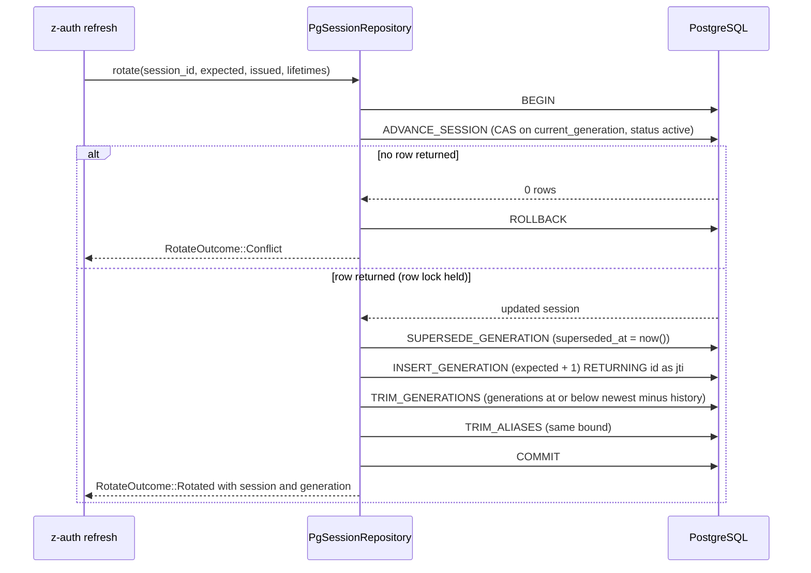

# Internals

This page explains how `z-auth-postgres` turns port calls into SQL where the details matter for correctness, which means error mapping, the refresh rotation transaction, session purge, federation merges, the node registry and the mfa compare-and-swap queries. It is written for contributors and for anyone writing a different adapter who wants to reproduce the same guarantees. All SQL lives in constants next to the code that runs it (`src/queries/`, `src/cluster/*_queries.rs`, `src/mfa/mfa_queries.rs`), every value is bound as a `$N` parameter, and every timestamp is produced by `now()` on the server, as the [schema reference](schema.md#timestamps-and-the-database-clock) explains.

## Error mapping

Every repository funnels `sqlx::Error` through one function, `map_sqlx_error` in `src/errors.rs`. It recognises exactly one SQLSTATE, `23505` (unique violation), and translates it by constraint name into a specific domain error. Every other database error, every unique violation on a constraint not in the list, and every connection or decoding error becomes `AuthError::Storage` with the sqlx message. The constraint names are constants in `src/constants.rs`.

| Constraint | Constant | Domain error |
|---|---|---|
| `identity_users_email` | `CONSTRAINT_IDENTITY_USERS_EMAIL` | `AuthError::EmailAlreadyTaken` |
| `identity_users_username_key` | `CONSTRAINT_IDENTITY_USERS_USERNAME` | `AuthError::UsernameAlreadyTaken` |
| `identity_roles_name_key` | `CONSTRAINT_IDENTITY_ROLES_NAME` | `AuthError::RoleAlreadyExists` |
| `identity_roles_code_key` | `CONSTRAINT_IDENTITY_ROLES_CODE` | `AuthError::RoleAlreadyExists` |
| `security_permissions_code_key` | `CONSTRAINT_SECURITY_PERMISSIONS_CODE` | `AuthError::PermissionAlreadyExists` |
| `unique_user_role_active` | `CONSTRAINT_USER_ROLE_ACTIVE` | `AuthError::RoleAlreadyAssigned` |
| `uq_mfa_factors_user_method_active` | `CONSTRAINT_MFA_FACTORS_ACTIVE` | `AuthError::SecondFactorAlreadyEnrolled` |
| any other constraint, any other SQLSTATE | none | `AuthError::Storage` |

Two of these deserve a note. `unique_user_role_active` rarely fires in practice, because `PgUserRoleRepository::assign` inserts with `ON CONFLICT DO NOTHING` and reports an existing active assignment by returning `false`. And `uq_mfa_factors_user_method_active` fires from `ACTIVATE_FACTOR`, when a pending factor is confirmed while the user already has an active factor of the same method.

One more SQLSTATE is handled outside the mapper. `PgSyncStore::store_session` checks for `23503` (foreign-key violation) when it inserts a merged session. On the authority that means the session's user has been deleted, and since the user's sessions would have been deleted with it, the merge returns `ApplyOutcome::Dropped` instead of an error. Session stores have no foreign key on `user_id`, so there the case cannot arise.

Errors can also come from converting rows into domain types. A negative generation, a fingerprint hash that is not 32 bytes and a node port outside the `u16` range are reported as `AuthError::Storage`; the mfa repository reports a TOTP step that does not fit an `i64` as `AuthError::Internal`.

## Generation numbers

z-auth counts session generations as `u32`, while the columns are PostgreSQL `integer`, a signed 32-bit type. `src/codes.rs` converts in both directions with checked conversions. `to_db_generation` turns a `u32` into an `i32` and fails with `AuthError::Storage("generation overflow")` above `i32::MAX`, and `from_db_generation` fails with `negative generation` for values below zero, which the check constraints already exclude. A session would need more than two billion refreshes to overflow, so the checks exist for correctness rather than as a practical limit. Every query that binds a generation goes through `to_db_generation`.

## Loading a session for refresh

A refresh needs the session, the generation the client presented, the session's current generation (which differs when the client is late or the token was replayed), the fork aliases of both, and the database's current time. `LOAD_FOR_REFRESH` fetches all of it in a single round trip. It selects the session row, joins `security_session_generations` twice with `LEFT JOIN` (once on the presented generation `$2`, once on `current_generation`), collects the alias `jti` values of each with an `ARRAY(SELECT ...)` subquery, and adds `now() AS db_now`. `RefreshRow` in `src/rows.rs` decodes the prefixed columns (`p_` for presented, `c_` for current) and turns each join into `Some(SessionGeneration)` only when the joined row exists, because a trimmed or never-issued generation yields all-NULL columns. z-auth's refresh policy then decides, from this snapshot alone, whether the request is a normal rotation, a retry within the grace window, a benign fork or token reuse.

## Refresh rotation

`PgSessionRepository::rotate` performs the rotation as one transaction whose first statement is a compare-and-swap. `ADVANCE_SESSION` increments `current_generation`, pushes `idle_expires_at` to `now()` plus the idle timeout and bumps `merge_rev`, but only for the row whose id matches, whose `current_generation` still equals the generation the caller expects and whose status is still `active`. If no row comes back, a concurrent rotation won or the session ended, and the method rolls back and returns `RotateOutcome::Conflict`, which the core resolves through its grace window.

```sql
UPDATE security_sessions
SET current_generation = current_generation + 1,
    idle_expires_at    = now() + $3,
    merge_rev          = merge_rev + 1
WHERE id = $1
  AND current_generation = $2
  AND status = 'active'
RETURNING id, user_id, secret, status, end_reason, created_ip, user_agent, amr,
          current_generation, created_at, idle_expires_at, absolute_expires_at, ended_at
```

The rest of the transaction runs only for the winner. `SUPERSEDE_GENERATION` stamps `superseded_at` on the old generation, `INSERT_GENERATION` inserts the new one with `access_expires_at = now() + access TTL` and returns its database-generated `id`, which becomes the access token's `jti`, and two trims delete the generations and fork aliases that fell out of the history window, everything with `generation <= newest - history_size`. Because `now()` is constant within the transaction, the old generation's `superseded_at` equals the new one's `issued_at` exactly.



Concurrency is settled by PostgreSQL's row lock rather than by application logic. Two refreshes of the same session both issue the `UPDATE`; the second blocks on the row lock until the first commits, then, under the default `READ COMMITTED` isolation, re-evaluates its `WHERE` clause against the new row version, finds that `current_generation` no longer matches, and returns no row. Exactly one caller wins, and the integration test `test_concurrent_rotations_have_one_winner` checks it. An adapter for another database has to give the same guarantee, a conditional update that is atomic with respect to concurrent conditional updates.

`create` uses the same pattern without the CAS. It inserts the session and its first generation in one transaction, so a session never exists without a generation, and its `created_at` equals the first generation's `issued_at`.

## Ending sessions

The ending queries are guarded updates as well. `END_SESSION` sets the status, the end reason and `ended_at = now()` only for an `active` session, so ending a session twice reports `false` the second time. `END_ALL_FOR_USER` does the same for all of a user's active sessions and returns their ids, which the core needs to write revocations. `MARK_COMPROMISED` applies to active and already-revoked sessions alike, overwrites the end reason and keeps an existing `ended_at` with `COALESCE(ended_at, now())`, so marking a revoked session compromised does not move the moment it ended. Every one of them bumps `merge_rev`, as every session write must for federation merges to notice local changes.

## Session purge

Ended and expired sessions are deleted in bulk once they have been purgeable for longer than a retention period. A session becomes purgeable at the earliest of its idle expiry, its absolute expiry and the moment it ended, and the purge query compares that moment with `now()` minus the retention.

```sql
DELETE FROM security_sessions
WHERE LEAST(idle_expires_at, absolute_expires_at, COALESCE(ended_at, 'infinity'))
      < now() - $1
```

The expression index `idx_security_sessions_purge` is defined over exactly the same `LEAST(...)` expression, which turns the purge into an index range scan instead of a sequential scan over all sessions. PostgreSQL only uses an expression index when the query contains the identical expression, so the query must repeat it verbatim; reordering the arguments or dropping the `COALESCE` (which `LEAST` would not strictly need, since it ignores NULLs) silently loses the index. Deleting a session cascades to its generations and fork aliases. On a database with change capture switched on, each deleted row also fires its feed trigger, and the resulting entries are skipped by readers because the session no longer loads.

## Federation merges

`PgSyncStore` applies records arriving from other clusters. Its rules are described from the protocol side in [federation storage](federation.md#applying-remote-changes); this section covers the transactions.

`load_session` opens a transaction, switches it to `REPEATABLE READ` with `SET TRANSACTION ISOLATION LEVEL REPEATABLE READ`, and then reads the session with its `merge_rev`, all its generations and all its aliases. The isolation level gives the three queries one snapshot, so a refresh committing in between cannot produce an aggregate whose session row and generations disagree.

`store_session` writes the merged aggregate under a revision check. It starts a transaction and locks the session row with `SELECT merge_rev FROM security_sessions WHERE id = $1 FOR UPDATE`. If the revision it finds differs from the expected one (including the case where the caller expected no row and one exists, or the reverse), it returns `ApplyOutcome::Conflict` and the transaction is rolled back when it is dropped; z-auth-cluster reloads and merges again. Otherwise it inserts the session with its original id and timestamps and `merge_rev = 1`, or updates status, end reason, current generation, idle expiry, `ended_at` and `amr` and bumps `merge_rev`. It then deletes the session's aliases and generations and inserts the merged generations and their aliases with their original ids, so the access token `jti` values survive replication. A foreign-key violation on the insert yields `ApplyOutcome::Dropped`, as described above.

`merge_revocation` and `merge_key` lock the existing row with `SELECT ... FOR UPDATE`, compute the merged value in Rust with z-auth-cluster's `merge_revocation` or `merge_key`, and return `ApplyOutcome::Unchanged` without writing when the result equals what is stored. When no row exists, they insert with `ON CONFLICT DO NOTHING`; if that inserts nothing, another transaction inserted the same id concurrently, and the loop runs a second time to merge into it. If the second attempt also loses, the method returns `ApplyOutcome::Conflict`.

## Node registry queries

`PgNodeRepository` treats `cluster_nodes` as a state machine in which every write names the state it starts from. The transitions map to queries as follows, and each reports success through `rows_affected() > 0`.

| Port call | Query | Guard |
|---|---|---|
| `register` | `REGISTER_NODE` | Upsert; a leftover row with the same id is reset to `joining` and `online` |
| `restore` | `RESTORE_NODE` | Insert with the given state, or bring an existing row back online only if it is `offline` |
| `transition(Activate)` | `ACTIVATE_NODE` | `state = 'joining'` |
| `transition(BeginLeave)` | `BEGIN_LEAVE_NODE` | `state <> 'leaving'` |
| `transition(Remove)` | `REMOVE_NODE` | Deletes only if `state = 'leaving'` |
| `transition(MarkOffline)` | `MARK_NODE_OFFLINE` | `heartbeat = 'online'` |
| `transition(MarkOnline)` | `MARK_NODE_ONLINE` | `heartbeat = 'offline'` |
| `transition(Expire)` | `EXPIRE_NODE` | Deletes only if `heartbeat = 'offline'` |
| `evict` | `LOCK_NODES_FOR_EVICTION`, then `EVICT_NODE` | Both rows locked; target not already `missing` |
| `update_address` | `UPDATE_NODE_ADDRESS` | Not `missing`, and the address actually differs |
| `purge_retired` | `PURGE_RETIRED_NODES` | `missing` and `retired_at` older than the given duration |
| `list` | `LIST_NODES` | none, ordered by `started_at` |

Eviction needs more than a guard, because in federation mode two instances that lose contact with each other may try to evict each other at the same moment, and at most one of them may succeed. `evict` therefore opens a transaction and locks both the target's and the observer's rows with `SELECT ... WHERE id = ANY($1) ORDER BY id FOR UPDATE`. Locking in id order means two crossing evictions acquire the locks in the same order, so they serialise instead of deadlocking. With both rows locked, it inspects their heartbeats. If the observer's own row is gone or already `missing`, the observer has lost and gets `EvictOutcome::ObserverMissing`; if the target is gone or already `missing`, the result is `EvictOutcome::AlreadyMissing`; only otherwise does `EVICT_NODE` set the target's heartbeat to `missing` and stamp `heartbeat_changed_at` and `retired_at`, returning `EvictOutcome::Evicted`. The second of two crossing evictions thus finds itself evicted.

`PURGE_RETIRED_NODES` binds its duration as fractional seconds (`Duration::as_secs_f64`) and builds the interval with `make_interval(secs => $1)`, unlike the other queries, which bind a `Duration` directly as an `interval`.

## MFA queries

`PgMfaRepository` follows one rule throughout. Every compare-and-swap is a single guarded `UPDATE ... WHERE ...`, so concurrent callers serialise on the row lock and at most one of them succeeds; the guard re-checks expiry against `now()` so that an expired factor, code or challenge can never be used, whatever the application clock says. Reads return `now() AS db_now` with the row so z-auth-mfa can evaluate expiry against database time as well.

| Query | Succeeds only if | Effect |
|---|---|---|
| `ACTIVATE_FACTOR` | The factor belongs to the user, is `pending` and has not expired | Becomes `active`, `confirmed_at = now()`, records the first TOTP step and clears any pending code |
| `ADVANCE_TOTP_STEP` | `last_used_step` is NULL or smaller than the new step | Records the step, which makes each TOTP code usable once even across instances |
| `SET_FACTOR_CODE` | The factor is active or unexpired, the resend interval has passed, and the send limit is not reached for a still-valid code | Stores the code hash and expiry, counting sends up while the previous code is valid and restarting at 1 once it expired |
| `RECORD_FACTOR_ATTEMPT` | A code is pending, unexpired and below the attempt limit | Increments and returns `code_attempts` |
| `CONSUME_RECOVERY_CODE` | The hash matches an unused code of the user | Sets `used_at = now()` |
| `RECORD_CHALLENGE_ATTEMPT` | The challenge is unconsumed, unexpired and below the attempt limit | Increments and returns `attempts` |
| `SET_CHALLENGE_CODE` | The challenge is unconsumed and unexpired, plus the same resend and send-limit rules as factors | Stores the code with the factor it was sent through |
| `CONSUME_CHALLENGE` | The challenge is unconsumed and unexpired | Sets `consumed_at = now()`, making the challenge single use |
| `RECORD_FAILURE` | Always (after the row is ensured) | Counts a failure within the window, restarting the count after the window, and locks the user when the threshold is reached |

When `SET_FACTOR_CODE` or `SET_CHALLENGE_CODE` stores nothing, the repository runs `FACTOR_CODE_REFUSAL` or `CHALLENGE_CODE_REFUSAL` to explain why, and maps the answer to `SendOutcome::TooSoon` (usable but within the resend interval), `SendOutcome::LimitReached` (usable but out of sends) or `SendOutcome::NotFound` (missing, expired or consumed).

`RECORD_FAILURE` computes everything inside one `UPDATE`, reading the row as locked by that statement. The failure count including this failure is the stored count plus one, or one if the window has passed. Reaching the threshold sets `locked_until` to `now()` plus the lock duration and restarts both the count and the window; otherwise the count is stored and the window restarts only if it had passed. The threshold is bound as at least 1. `LOCK_STATE` always returns exactly one row, by left-joining the user's state onto a constant row, so a user without failures reads as zero failures and no lock.

Four operations need more than one statement and run in a transaction. `insert_pending_factor` deletes the user's existing pending factor of the same method and inserts the new one, so restarting an enrollment replaces it instead of violating `uq_mfa_factors_user_method_pending`. `replace_recovery_codes` deletes all of the user's codes and inserts the new set with one `INSERT ... SELECT ... FROM unnest($2::bytea[])`. `record_failure` inserts the user's state row with `ON CONFLICT DO NOTHING` before updating it. `delete_all` removes the user's challenges, recovery codes, lockout state and factors and returns the number of factors deleted.

`purge` removes everything past the retention period in one statement made of three data-modifying CTEs, deleting challenges that expired or were consumed before the cutoff, pending factors whose enrollment expired before it, and lockout rows that are not locked and whose window started before it, and returns the total count.

## Other queries worth knowing

A few queries outside sessions encode rules that are easy to miss when porting the adapter. `INSERT_PERMISSION` draws a position from `security_permission_position_seq` only for `bool` and `text` permissions, while `INSERT_OPTION` relies on the column default of `security_permission_options.position`, so both share one number space. `CATALOG_VERSION` is the highest position in either table (0 for an empty catalog), and `load_catalog` reads the permissions, the options and the version in one transaction. `EFFECTIVE_GRANTS` resolves a user's grants in SQL, taking the union of `bool` and `multi` grants from direct and role sources and, for `single` and `text`, the first source by rank (direct grants before role grants) and then by role code. `PUBLISH_KEY` is idempotent per `kid`, returning the existing key unchanged if one is already stored, and `REVOKE_KEY` keeps an existing `revoked_at`. `MARK_ENFORCED` is a compare-and-swap from `pending` to `enforced`, so exactly one instance records the enforcement of a revocation.

## Stale comments

Some comments in the source predate the baseline that gave every table its layer prefix and still use old names. They are not authoritative; the migrations are. The ones known at the time of writing are listed here so that nobody goes looking for an index that does not exist.

| Location | Comment says | Actual |
|---|---|---|
| `src/queries/session_queries.rs`, `LIST_ACTIVE_FOR_USER` | `idx_sessions_user_active` | `idx_security_sessions_user_active` |
| `src/queries/session_queries.rs`, `PURGE_SESSIONS` | `idx_sessions_purge` | `idx_security_sessions_purge` |
| `src/queries/user_role_queries.rs`, `LIST_ACTIVE_FOR_USER` | `idx_users_roles_active` | `idx_identity_role_assignments_active` |
| `migrations/0001_initial_schema.sql`, `identity_roles` | Roles are immutable, with no update API | Name and description can be changed through `RoleRepository::update` (`UPDATE_ROLE`); only `code` is immutable |
| `src/lib.rs`, `MIGRATOR` | Unknown versions are the cluster set's | They can belong to the cluster or the mfa set |
