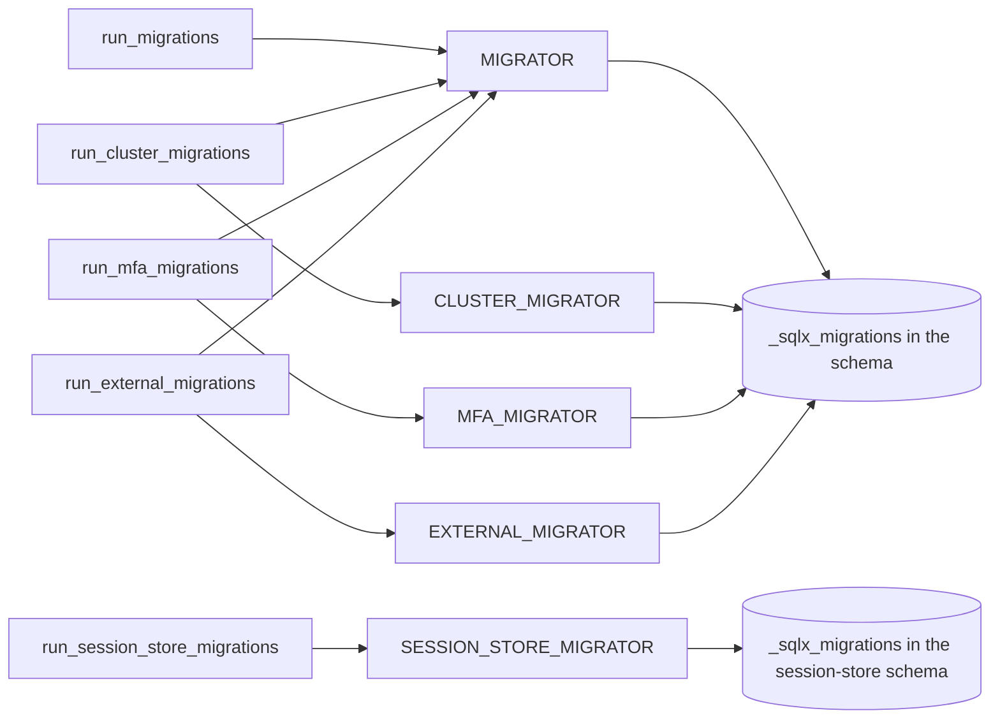
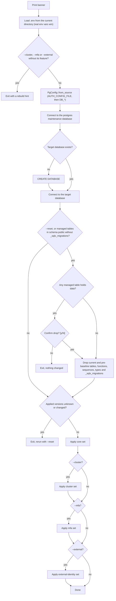

# Migrations

The schema of `z-auth-postgres` is built by plain SQL files, applied in version order by sqlx's migrator and embedded into the crate at compile time with `sqlx::migrate!`. A host never ships SQL files next to its binary; calling `run_migrations(&pool)` (or one of its siblings) at startup is enough, and it is safe to do from every instance at once. This page explains how the files are organised into sets, how sqlx tracks them, how to change the schema without breaking deployed databases, and what the `setup_db` binary does for development databases. The resulting schema is documented in the [schema reference](schema.md).

## The migration sets

One database can hold up to four sets that share sqlx's bookkeeping table, plus a fifth set that builds a different, self-contained schema. Each set lives in its own directory and owns a range of version numbers, so sets never collide in `_sqlx_migrations`.

```text
adapters/postgres/
├── migrations/                     core set (no feature)
│   ├── 0001_initial_schema.sql
│   └── 0002_session_amr.sql
├── migrations_cluster/             cluster set (feature shared)
│   └── 1001_cluster_schema.sql
├── migrations_mfa/                 mfa set (feature mfa)
│   └── 2001_mfa_schema.sql
├── migrations_external/            external-identity set (feature external-identity)
│   └── 3001_external_identity_schema.sql
└── migrations_session_store/       session-store schema (feature federation)
    ├── 0001_session_store.sql
    └── 0002_session_amr.sql
```

| Set | Directory | Versions | Static | Function | Feature | Unknown versions |
|---|---|---|---|---|---|---|
| core | `migrations/` | below 1000 | `MIGRATOR` | `run_migrations` | none | ignored |
| cluster | `migrations_cluster/` | 1001 to 1999 | `CLUSTER_MIGRATOR` | `run_cluster_migrations` | `shared` | ignored |
| mfa | `migrations_mfa/` | 2001 to 2999 | `MFA_MIGRATOR` | `run_mfa_migrations` | `mfa` | ignored |
| external identity | `migrations_external/` | from 3001 | `EXTERNAL_MIGRATOR` | `run_external_migrations` | `external-identity` | ignored |
| session store | `migrations_session_store/` | below 1000 | `SESSION_STORE_MIGRATOR` | `run_session_store_migrations` | `federation` | rejected |

The core, cluster, mfa and external-identity sets are layers of one schema. The cluster set adds the `cluster_` tables and the change-feed triggers on core tables, the mfa set adds the `mfa_` tables with foreign keys to `identity_users`, and the external-identity set adds `identity_external_identities`, with a foreign key to `identity_users`, and `security_flow_states`, so all three need the core set underneath. The session-store set is not a layer. It recreates the subset of core and cluster tables a non-authority service needs in federation mode, in a schema of its own, and is described in [federation storage](federation.md).

## Current files

Each set currently consists of a baseline file plus, for the core and session-store sets, one follow-up that added the authentication methods to sessions.

| File | Set | What it does |
|---|---|---|
| `0001_initial_schema.sql` | core | Creates the six core ENUM types, the `identity_` tables (users, roles, role assignments) and the `security_` tables (permission catalog with `security_permission_position_seq`, user and role grants, sessions, generations, fork aliases, token revocations, verifying keys), with all their constraints and indexes |
| `0002_session_amr.sql` | core | Adds `security_sessions.amr text[] NOT NULL DEFAULT '{pwd}'` and appends `second_factor_changed` to `revocation_reason` |
| `1001_cluster_schema.sql` | cluster | Creates `node_state` and `heartbeat_status`, the `cluster_` tables, the sequences `cluster_account_snapshot_version_seq` and `cluster_change_feed_seq`, the functions `cluster_feed_record` and `cluster_feed_capture`, and the seven `trg_feed_` triggers |
| `2001_mfa_schema.sql` | mfa | Creates `mfa_method`, `mfa_factor_status` and `mfa_totp_algorithm` and the four `mfa_` tables with their constraints and indexes |
| `3001_external_identity_schema.sql` | external identity | Creates `identity_external_identities`, unique on `(issuer, subject)` and deleted with its user, and `security_flow_states`, each with one index |
| `0001_session_store.sql` | session store | Creates sessions, generations, fork aliases, revocations, verifying keys, the instance registry, the snapshots and the change feed with its triggers, without users, roles, grants or the catalog |
| `0002_session_amr.sql` | session store | The same change as the core `0002`, applied to the session store |

The `amr` column was given a constant default on purpose. PostgreSQL adds such a column without rewriting the table, and because no `UPDATE` runs, the change-feed triggers do not fire for existing sessions, so a federated deployment does not replicate every session after the upgrade.

## How sqlx tracks migrations

sqlx records each applied migration in the `_sqlx_migrations` table, with its version, description, a SHA-384 checksum of the file, whether it succeeded and how long it took. A run reads that table, compares it with the embedded files and applies only the versions it has not seen, each in its own transaction. Before doing anything it takes a PostgreSQL advisory lock derived from the database name, so when several instances start at the same time one of them applies the pending files and the others wait and then find nothing to do. Running a migrator on an up-to-date database is a cheap no-op, which is why the integration tests call `run_migrations` in every helper.

The checksums are what make editing an applied file impossible. If the table records a version whose checksum differs from the embedded file, the run fails with a version mismatch instead of guessing which one is right.

All four layered sets write into the same `_sqlx_migrations`, so each has to tolerate the others' rows. sqlx normally refuses to run when the table contains a version it does not have, so `MIGRATOR`, `CLUSTER_MIGRATOR`, `MFA_MIGRATOR` and `EXTERNAL_MIGRATOR` are declared with `ignore_missing: true`, which lets each one skip versions that belong to the other sets. `SESSION_STORE_MIGRATOR` is declared without it. A session store is meant to be alone in its schema, and refusing foreign versions turns an accidental mix with the core set into an error instead of a corrupted schema; the version ranges overlap with the core set, so such a mix would also fail on checksums.

## Order of application

The optional sets must be applied after the core set, because they alter or reference core tables. The three convenience functions take care of that. `run_cluster_migrations` runs `MIGRATOR` and then `CLUSTER_MIGRATOR`, `run_mfa_migrations` runs `MIGRATOR` and then `MFA_MIGRATOR`, and `run_external_migrations` runs `MIGRATOR` and then `EXTERNAL_MIGRATOR`. A host that uses several of them calls each function; every call after the first finds the core set already applied.



When the statics are used directly, keep the same order, core first. The cluster, mfa and external-identity sets do not depend on each other, so they can follow in any order.

## Changing the schema

Never edit a migration that has been applied anywhere, not even to fix a comment, because every database that already ran it will refuse to migrate on the next start. To change the schema, add the next file in the right directory with the next free version of that set, for example `0003_add_login_attempts.sql` in `migrations/`, `1002_<description>.sql` in `migrations_cluster/`, `2002_<description>.sql` in `migrations_mfa/` or `3002_<description>.sql` in `migrations_external/`. sqlx parses the version from the leading number and the description from the rest of the name. Because the files are embedded at compile time, a new file only takes effect after the crate is rebuilt.

A schema change usually needs matching code. A new column has to be added to the query constants in `src/queries/` (or `src/cluster/`, `src/mfa/`, `src/external/`) and to the row struct in `src/rows.rs` or its feature-specific counterpart. A renamed unique index has to be renamed in `src/constants.rs` too, or its domain error silently becomes `AuthError::Storage`. A change to a table that also exists in the session-store schema (sessions, generations, fork aliases, revocations, verifying keys, the cluster tables) must be added to `migrations_session_store/` as well, because the same repositories run against both schemas; the `0002_session_amr.sql` pair is the model to follow.

A change to a table that the change feed captures fires the capture trigger for every row it updates. On a federated database with capture switched on, a backfilling `UPDATE` over `security_sessions` therefore enqueues every touched session for replication. Prefer constant defaults, as `0002` did, when that is not wanted.

### Adding an ENUM value

Adding a value to an ENUM type takes two changes. The new migration appends the value with `ALTER TYPE ... ADD VALUE`, and the Rust mirror gets the matching variant, in `src/enums.rs` for the core types, `src/cluster/node_row.rs` for the cluster types or `src/mfa/mfa_row.rs` for the mfa types, together with its `From` conversions. `0002_session_amr.sql` did exactly this for `second_factor_changed`.

```sql
ALTER TYPE revocation_reason ADD VALUE 'second_factor_changed';
```

PostgreSQL appends the value at the end of the declaration order. Values cannot be removed or reordered without recreating the type and every column that uses it, so treat each value as permanent. A newly added value cannot be used in the same transaction that adds it, which is one more reason to keep `ADD VALUE` in a migration of its own. If the type also exists in the session-store schema (`revocation_reason`, `session_status` and the others listed in [federation storage](federation.md)), add the value there too.

## Baseline history

The current files are a baseline. They replaced the earlier core migrations `0001` to `0008` and the earlier session-store migrations `0001` and `0002` when every table received its layer prefix (`users` became `identity_users`, `sessions` became `security_sessions`, `sync_changes` became `cluster_change_feed`, and so on). Because the new files reuse the old version numbers with different contents, a database built with the earlier files cannot be upgraded in place. sqlx would reject it on checksums, and `setup_db` detects the situation up front and asks for a rebuild.

Such a database has to be reset, which drops every z-auth table and recreates the schema empty. For a development database that is `setup_db --reset`; for a database whose data matters, export what you need first, then reset and reimport. A session store built with the earlier files has to be dropped and recreated with `run_session_store_migrations`, since `setup_db` does not handle session stores.

## The setup_db binary

`setup_db` is a small command-line tool for development and test databases. It creates the database when it does not exist, replaces schemas that predate versioned migrations, and applies the pending migrations of the core set and, on request, the cluster, mfa and external-identity sets. Because the migrations are embedded, it can be run from any directory.

```sh
cargo run -p z-auth-postgres --bin setup_db
cargo run -p z-auth-postgres --bin setup_db -- --reset
cargo run -p z-auth-postgres --features shared --bin setup_db -- --cluster
cargo run -p z-auth-postgres --features mfa --bin setup_db -- --mfa
cargo run -p z-auth-postgres --features external-identity --bin setup_db -- --external
cargo run -p z-auth-postgres --features shared,mfa,external-identity --bin setup_db -- --cluster --mfa --external
```

It understands exactly four flags. Any other argument is ignored without a warning, so a mistyped flag simply has no effect.

| Flag | Needs | Effect |
|---|---|---|
| `--reset` | nothing | Drops every z-auth table, function, sequence and type and the migration records, then rebuilds; asks for confirmation first if any table holds data |
| `--cluster` | `--features shared` | Also applies the cluster set after the core set; without the feature the binary exits with a hint to rebuild with it |
| `--mfa` | `--features mfa` | Also applies the mfa set after the core set; without the feature the binary exits with a hint to rebuild with it |
| `--external` | `--features external-identity` | Also applies the external-identity set after the core set; without the feature the binary exits with a hint to rebuild with it |

### What it does

The binary runs a fixed sequence of steps and exits with status 1 and a specific message at the first failure. Declining the confirmation prompt exits with status 0 and changes nothing.



The `.env` file is parsed by hand rather than with a library. Each non-empty line that does not start with `#` is split at the first `=`, the key and value are trimmed, and surrounding double or single quotes are stripped from the value. A variable that is already set in the real environment is never overridden, so `DB_NAME=scratch cargo run ...` wins over the file. Inline comments are not stripped, which means a line like `DB_NAME=auth  # optional` sets the name to `auth  # optional`; the example in `env.example` uses such comments, so remove them when copying it into `.env`. When no `.env` exists, the binary says so and relies on the environment.

The configuration comes from `PgConfig::from_source` over `ConfigSource::standard()`, so the same three settings are required and the same defaults apply as for the library (see the [crate README](../README.md#configuration)). When `AUTH_CONFIG_FILE` names a YAML file, after `.env` has been loaded, the binary reads its `database` section too, and the `DB_*` variables override it. The binary prints the host, port, user and database it is about to use, never the password.

To create the database, `setup_db` first connects to the `postgres` maintenance database on the same server with the same credentials, built with `connection_url_for("postgres")`. It checks `pg_database` and issues `CREATE DATABASE "<name>"` when the target is missing, so the configured role needs the `CREATEDB` privilege for a first run. Connection failures are diagnosed by message, distinguishing an unreachable server (with hints for starting PostgreSQL on macOS and Linux), failed authentication and a missing database.

On the target database it decides whether to drop anything. A schema is considered legacy when any table z-auth manages exists in schema `public` but `_sqlx_migrations` does not, which identifies databases created before versioned migrations. With `--reset`, or for a legacy schema, it scans the managed tables and, if any of them contains a row, asks for confirmation before going on.

```text
⚠️  Existing tables with data were found in database 'auth'.
   Drop everything and re-create? [y/N]:
```

Only `y` or `yes` (in any case) continues. The drop then issues `DROP ... IF EXISTS ... CASCADE` for every name z-auth has ever used. That covers the current tables, functions, sequences and ENUM types, the names used before the baseline (`users`, `sessions`, `sync_changes`, `permission_position_seq`, `sync_capture`, `node_status` and the rest), the pre-migration `revoked_tokens` table and `_sqlx_migrations` itself. The list is maintained in `MANAGED_TABLES`, `MANAGED_FUNCTIONS`, `MANAGED_SEQUENCES` and `MANAGED_TYPES` in `src/bin/setup_db.rs`; anything else in the database is left alone.

Before applying anything, the baseline check compares `_sqlx_migrations` with the sets compiled into the binary. A recorded version that falls into the range of a known set but is missing from it, or whose checksum differs from the embedded file, means the database was built with migrations the baseline replaced, and the binary exits with a hint to rerun with `--reset`. Versions of a set the binary was built without are not checked, so a plain `setup_db` does not complain about a database that also holds the cluster, mfa or external-identity set. Inside `setup_db`, versions from 1000 to 1999 are attributed to the cluster set, 2000 to 2999 to the mfa set and 3000 to 3999 to the external-identity set.

Finally it applies the sets in order, core first, then cluster with `--cluster`, then mfa with `--mfa`, then external identity with `--external`. For each set it lists the pending files before running the migrator, or reports that nothing is pending and how many of the set's files are already applied, so a database that is up to date is left untouched.

### Limits

`setup_db` cannot install the session-store schema. It has no flag for it, it always works in the default schema of the connection, and its baseline check would reject a session store anyway, because the session store's `0001` and `0002` carry the same versions as the core files with different checksums. Session stores are installed by the service itself with `run_session_store_migrations`, as [federation storage](federation.md) describes.

The binary is meant for development. It runs every statement on a single connection, prompts on standard input, and `--reset` destroys data. Production deployments normally let the service apply migrations at startup with the library functions, or run them from a deployment job that calls the same functions.
