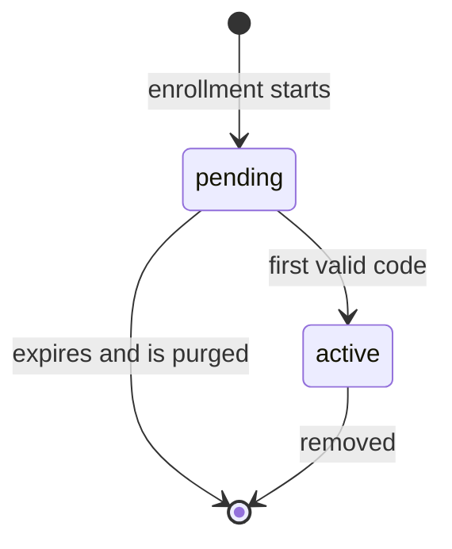

# Schema reference

This page documents the database schema that the migration sets of `z-auth-postgres` build, as it stands after `migrations/0002_session_amr.sql`, `migrations_cluster/1001_cluster_schema.sql`, `migrations_mfa/2001_mfa_schema.sql` and `migrations_external/3001_external_identity_schema.sql`. Every column, type, constraint and index listed here was checked against those files. The session-store schema used by non-authority services in federation mode is a subset of the same definitions and is described in [federation storage](federation.md); how the files are applied is the subject of [migrations](migrations.md).

## Naming conventions

Every table name starts with the layer that owns it. The core set creates `identity_` tables for users, roles and role assignments, and `security_` tables for the permission catalog, grants, sessions, revocations and verifying keys. The optional sets add `cluster_` tables for z-auth-cluster (the instance registry and the federation change feed) and `mfa_` tables for z-auth-mfa (second factors, recovery codes, login challenges and lockout state). The external-identity set adds one table to each core layer, `identity_external_identities` for linked identities and `security_flow_states` for pending sign-ins, because both belong to the core's own ports. A database administrator can therefore tell from the name alone which crate a table belongs to and which migration set created it.

Constraints, indexes, sequences and triggers embed the name of the table they belong to. Check constraints are named `chk_<table>_<rule>`, foreign keys `fk_<table>_<column>`, plain indexes `idx_<table>_<purpose>`, unique indexes on the core tables `<table>_<column>_key`, unique indexes on the mfa and external-identity tables `uq_<table>_<columns>`, sequences `<table>_<column>_seq` and triggers `trg_feed_<table>`. Two names predate the convention and were kept because code depends on them, namely the unique index `identity_users_email` (without the `_key` suffix) and the partial unique index `unique_user_role_active`. Constraint names matter beyond readability, because the adapter maps some of them to domain errors (see [the last section](#constraint-names-and-domain-errors)).

Column names are plain snake case. Event columns are named after the event (`assigned_at`, `issued_at`, `revoked_at`, `superseded_at`, `ended_at`, `enforced_at`, `confirmed_at`, `consumed_at`), and expiry columns end in `_expires_at` or `expires_at`.

## Keys

Most tables have a surrogate primary key `id uuid` with the default `gen_random_uuid()`, so the database assigns identifiers and the adapter reads them back with `RETURNING`. A few tables use a natural key instead, because the domain already has a stable identifier. `security_session_fork_aliases` is keyed by the access token's `jti`, `cluster_account_snapshots` and `mfa_user_state` by `user_id`, `cluster_sync_freshness` by `service`, `cluster_feed_cursors` by `site_id`, and `cluster_change_feed` by the pair `(kind, key)`, and `security_flow_states` by its `key` string. The singleton tables `cluster_catalog_snapshot` and `cluster_sync_site` use a boolean `singleton` column that a check constraint pins to `true`, which allows at most one row.

Three tables have a uuid key without a default, because the caller chooses it. `cluster_nodes.id` is the node id generated per process start by z-auth-cluster, and `mfa_factors.id` and `mfa_challenges.id` are chosen by z-auth-mfa so that sealed secrets can be bound to the factor id before the row exists. In `security_session_generations`, the surrogate `id` doubles as the `jti` of the access token issued with that generation.

## Timestamps and the database clock

Every table except `security_flow_states` has `created_at timestamptz NOT NULL DEFAULT now()`, recording when the row was inserted. Business events have their own columns next to it, even where the two are equal today; `identity_role_assignments.assigned_at` and `created_at` are both stamped at insert, but they mean different things and are kept independent by design.

Only rows that are edited in place carry `updated_at`. In the core set that is `identity_users` alone, and every `UPDATE` query sets `updated_at = now()` explicitly, so there is no trigger overhead. In the cluster set the account and catalog snapshots and the feed cursors carry it, and the upserts that replace them set it. Every other change has a dedicated column (`revoked_at`, `superseded_at`, `ended_at`, `idle_expires_at`, `heartbeat_changed_at` and so on), which records what changed rather than merely that something did. `identity_roles` has no `updated_at` even though name and description can be changed through `RoleRepository::update`; the comment in the migration that calls roles immutable is out of date.

The database is the clock. Every persisted timestamp comes from `now()` on the server, and z-auth passes durations such as TTLs, idle timeouts and retention periods, never instants. A query like `INSERT ... VALUES (..., now() + $5, ...)` binds a `std::time::Duration`, which sqlx encodes as an `interval`. Because `now()` is fixed for the whole transaction, a session's `created_at` equals its first generation's `issued_at`, and a rotation's `superseded_at` equals the next generation's `issued_at`. z-auth then reads back what was stored and uses it, so the JWT `iat` and `exp` claims are copied from the generation's `issued_at` and `access_expires_at`. Reads that need to compare against the current time return `now()` alongside the row (`db_now` in `LOAD_FOR_REFRESH` and in the mfa queries), so a skewed application clock cannot make a token or a challenge look valid.

All timestamps are `timestamptz`, which PostgreSQL stores as an absolute UTC instant regardless of the session time zone. The adapter additionally pins every pooled connection to `timezone=UTC`, so anything rendered or truncated on the server is UTC too.

## Table catalog

The tables are grouped by layer below. Each group is introduced by the migration set that creates it.

### Identity tables

The identity layer holds accounts and role-based access control. `identity_users` is the only table in the schema with free-form edits. Emails are lowercased by z-auth before they reach the database, while usernames keep their display case and are compared with `lower(username) = lower($1)`; both are unique case-insensitively through expression indexes. Role assignments are never deleted when a role is withdrawn. Instead `revoked_at` is set, so the table doubles as an audit trail, and a partial unique index allows the same pair to appear many times in history but only once while active.

| Table | Key | Purpose |
|---|---|---|
| `identity_users` | `id` | Accounts with email, optional password hash and username, profile fields, and the `is_active` and `is_verified` flags |
| `identity_roles` | `id` | Roles with a unique display `name` and a unique, immutable `code` that access tokens carry in the `rol` claim |
| `identity_role_assignments` | `id` | Which user holds which role, with `assigned_at` and `revoked_at` (NULL while active) |
| `identity_external_identities` | `id` | External-identity set only. Identities of other providers linked to a user, unique by `(issuer, subject)`, with the host's `provider` name, the `email` the provider reported at linking, `created_at` (when linked) and `last_login_at` |

### Security tables

The security layer holds the permission catalog and grants, sessions and their rotation history, the persisted denylist and the published verifying keys. No token material is stored. Refresh tokens are re-derived from the session id, generation and per-session `secret` plus the server-wide refresh key, and access tokens are identified by their `jti` only.

Permissions are encoded into access tokens by position. Every `bool` and `text` permission, and every option of a `single` or `multi` permission, takes a number from `security_permission_position_seq` when it is created. Positions are permanent and never reused, so tokens and cached catalogs stay decodable when the catalog changes. Grants are replaced rather than edited, so the grant tables have no `updated_at`; a `bool` or `text` grant is one row with `option_id` NULL, and a `single` or `multi` grant is one row per chosen option.

| Table | Key | Purpose |
|---|---|---|
| `security_permissions` | `id` | Catalog entries with a unique `code`, a `kind`, an optional description, a `position` (for `bool` and `text`) and a `max_length` (for `text`) |
| `security_permission_options` | `id` | The options of a `single` or `multi` permission, each with a code unique within its permission and a permanent position |
| `security_user_grants` | `id` | Values granted directly to a user, read at login and refresh |
| `security_role_grants` | `id` | Values granted to a role and inherited by its active holders |
| `security_sessions` | `id` | One row per login on one device, with status, end reason, creating IP and user agent, `amr`, current generation, idle and absolute expiry, the refresh secret and `merge_rev` |
| `security_session_generations` | `id` (the access token `jti`) | Rotation history, the newest N generations per session (N is `AUTH_SESSION_HISTORY_SIZE`, default 10), with who each was issued to and when it was superseded |
| `security_session_fork_aliases` | `jti` | Federation mode only, the losing variants of a benign refresh fork, still accepted once so their client can move to the winning chain |
| `security_token_revocations` | `id` | The persisted denylist with `session`, `user` or `token` scope, moving from `pending` to `enforced`, kept only for the access TTL plus leeway |
| `security_verifying_keys` | `id` | Public Ed25519 keys published by instances, looked up by `kid`; a `revoked` key is rejected everywhere |
| `security_flow_states` | `key` | External-identity set only. Single-use state of multi-step sign-ins (a sign-in waiting for the local password, an external sign-in waiting for a second factor, a redirect to an identity provider) as an opaque `value` with an `expires_at` |

`security_sessions.amr` was added by `0002_session_amr.sql`. It holds the RFC 8176 authentication methods the session was opened with, sorted (for example `{mfa,otp,pwd}`), and every access token the session issues carries it. The column has the constant default `{pwd}`, so adding it needed no table rewrite and fired no change-feed trigger for existing sessions.

`merge_rev` is bumped by every write to a session (rotation, ending, compromise, and merges). It is the revision that federation merges compare-and-swap against; outside federation mode nothing reads it.

`identity_external_identities` and `security_flow_states` exist only when the `external-identity` feature is used, live on the authority alone and are not in the change feed. An identity is found by its exact `(issuer, subject)` and never by `email`, which is kept only to show the user. A flow-state `key` is the flow's kind, a colon and the SHA-256 of the token handed to the client, so the table holds no usable token. `expires_at` is `now()` plus the TTL at insert, a take deletes the row and returns its value only while `expires_at > now()`, and `ZAuth::tick` deletes the expired rows through `PgFlowStateRepository::purge_expired`.

`security_token_revocations.subject` holds a session id, a user id or an access token `jti` depending on `scope`, so it has no foreign key, and a revocation row can outlive the row it refers to. That is intended, because a revocation must keep blocking tokens even after the session it names has been purged.

### Cluster tables

The cluster set exists only when the `shared` feature is used, and most of it only matters in federation mode. None of the cluster tables has a foreign key. `cluster_nodes` is written only on state changes, never on steady-state heartbeats, which keeps the registry cheap. The federation tables are covered in depth, with their own diagram, in [federation storage](federation.md).

| Table | Key | Purpose |
|---|---|---|
| `cluster_nodes` | `id` | Registry of z-auth instances with a lifecycle `state` (joining, active, leaving) and a `heartbeat` (online, offline, missing), plus `retired_at` for evicted ids in federation mode |
| `cluster_account_snapshots` | `user_id` | Per-user account and authorization snapshots published by the authority, versioned |
| `cluster_catalog_snapshot` | `singleton` | The permission catalog published by the authority, versioned |
| `cluster_sync_site` | `singleton` | This database's site id; the existence of its row switches change capture on |
| `cluster_change_feed` | `(kind, key)` | One entry per synced record (its latest change), written by triggers in the writing transaction |
| `cluster_feed_cursors` | `site_id` | How far this database has read each other site's feed |
| `cluster_sync_freshness` | `service` | When this database last held everything a given service had committed |

### MFA tables

The mfa set exists only when the `mfa` feature is used and lives on the authority alone; none of its tables is in the change feed. Nothing secret is stored in clear. TOTP secrets and email or SMS destinations are sealed by z-auth-mfa (XChaCha20-Poly1305 by default, bound to the user and factor ids), and codes, recovery codes and challenge secrets are stored as HMAC-SHA256 values under `AUTH_MFA_HASH_KEY`, which is why every hash column is checked to be 32 bytes. Every row belongs to an `identity_users` row and is deleted with it.

| Table | Key | Purpose |
|---|---|---|
| `mfa_factors` | `id` | A user's second factors, `pending` while enrolling (with an expiry) or `active`, at most one of each per method; TOTP parameters and `last_used_step`, the sealed destination and its masked hint, and the `code_` columns of a pending email or SMS code |
| `mfa_recovery_codes` | `id` | Single-use recovery codes as keyed hashes, replaced as a set, with `used_at` once consumed |
| `mfa_challenges` | `id` | Logins that passed the password step and wait for the second factor, with the challenge secret's hash, the client, attempts, expiry, consumption and the code sent through `code_factor_id` |
| `mfa_user_state` | `user_id` | Failed second-factor attempts per user within a window, and the lockout; a row exists only while there is something to remember |

The life of a factor is short and strictly guarded by the queries described in [internals](internals.md).

## Entity-relationship diagram

The diagram covers the core, mfa and external-identity sets. Solid lines are foreign keys, and every foreign key in the schema is `ON DELETE CASCADE`, so deleting a user removes their assignments, grants, sessions (with generations and aliases), mfa rows and linked external identities, and deleting a session removes its generations and aliases. The dotted lines from `security_token_revocations` are logical references through `subject` without a constraint. `security_verifying_keys` and `security_flow_states` stand alone, and `mfa_challenges.code_factor_id` refers to a factor without a foreign key. The cluster tables have no foreign keys and are drawn separately in [federation storage](federation.md).

```mermaid
erDiagram
    identity_users ||--o{ identity_role_assignments : "is assigned"
    identity_roles ||--o{ identity_role_assignments : "is granted via"
    identity_users ||--o{ security_sessions : "logs in as"
    security_sessions ||--|{ security_session_generations : "rotates through"
    security_sessions ||--o{ security_session_fork_aliases : "fork losers"
    security_permissions ||--o{ security_permission_options : "offers"
    identity_users ||--o{ security_user_grants : "is granted"
    identity_roles ||--o{ security_role_grants : "grants"
    security_permissions ||--o{ security_user_grants : "of"
    security_permissions ||--o{ security_role_grants : "of"
    security_permission_options |o--o{ security_user_grants : "chosen"
    security_permission_options |o--o{ security_role_grants : "chosen"
    security_sessions |o..o{ security_token_revocations : "subject (scope session)"
    identity_users |o..o{ security_token_revocations : "subject (scope user)"
    identity_users ||--o{ mfa_factors : "enrolls"
    identity_users ||--o{ mfa_recovery_codes : "holds"
    identity_users ||--o{ mfa_challenges : "is challenged"
    identity_users ||--o| mfa_user_state : "fails or is locked"
    mfa_factors |o..o{ mfa_challenges : "code sent through"
    identity_users ||--o{ identity_external_identities : "signs in through"

    identity_users {
        uuid id PK "gen_random_uuid()"
        varchar(255) email UK "unique on lower(email)"
        text password_hash "nullable"
        varchar(100) username UK "nullable, unique on lower(username)"
        varchar(255) first_name
        varchar(255) last_name
        text avatar_url
        bool is_active "default true"
        bool is_verified "default false"
        timestamptz created_at "now()"
        timestamptz updated_at "now(), set by every update"
    }

    identity_roles {
        uuid id PK "gen_random_uuid()"
        varchar(50) name UK
        text description
        timestamptz created_at "now()"
        varchar(64) code UK "immutable, in tokens (rol)"
    }

    identity_role_assignments {
        uuid id PK "gen_random_uuid()"
        uuid user_id FK
        uuid role_id FK
        timestamptz assigned_at "now()"
        timestamptz revoked_at "NULL while active"
        timestamptz created_at "now()"
    }

    security_permissions {
        uuid id PK "gen_random_uuid()"
        varchar(64) code UK
        permission_kind kind "bool, single, multi, text"
        text description
        integer position UK "bool and text only, permanent"
        integer max_length "text only"
        timestamptz created_at "now()"
    }

    security_permission_options {
        uuid id PK "gen_random_uuid()"
        uuid permission_id FK
        varchar(64) code "unique per permission"
        integer position UK "sequence default, permanent"
        timestamptz created_at "now()"
    }

    security_user_grants {
        uuid id PK "gen_random_uuid()"
        uuid user_id FK
        uuid permission_id FK
        uuid option_id FK "single and multi"
        text text_value "text"
        timestamptz created_at "now()"
    }

    security_role_grants {
        uuid id PK "gen_random_uuid()"
        uuid role_id FK
        uuid permission_id FK
        uuid option_id FK "single and multi"
        text text_value "text"
        timestamptz created_at "now()"
    }

    security_sessions {
        uuid id PK "gen_random_uuid()"
        uuid user_id FK
        bytea secret "mixed into refresh-token MACs"
        session_status status "default active"
        revocation_reason end_reason "set when ended"
        inet created_ip
        varchar(512) user_agent "truncated by z-auth"
        integer current_generation "default 1, CAS target"
        timestamptz created_at "now()"
        timestamptz idle_expires_at "now() + idle, pushed on refresh"
        timestamptz absolute_expires_at "now() + absolute, hard cap"
        timestamptz ended_at
        bigint merge_rev "default 0, bumped by every write"
        text[] amr "default {pwd}, added by 0002"
    }

    security_session_generations {
        uuid id PK "gen_random_uuid(), the access-token jti"
        uuid session_id FK
        integer generation "unique per session"
        inet issued_ip
        timestamptz issued_at "now()"
        timestamptz access_expires_at "now() + access TTL"
        timestamptz superseded_at "set when the next is issued"
        timestamptz created_at "now()"
        uuid parent_jti "access token presented to obtain it"
        varchar(512) issued_user_agent
        bytea fingerprint_hash "SHA-256, 32 bytes"
    }

    security_session_fork_aliases {
        uuid jti PK
        uuid session_id FK
        integer generation
        uuid parent_jti
        inet issued_ip
        varchar(512) issued_user_agent
        bytea fingerprint_hash "32 bytes"
        timestamptz issued_at
        timestamptz access_expires_at
        timestamptz superseded_at
        timestamptz created_at "now()"
    }

    security_token_revocations {
        uuid id PK "gen_random_uuid()"
        revocation_scope scope "session, user, token"
        uuid subject "session, user or token id, no FK"
        revocation_reason reason
        timestamptz revoked_at "now()"
        timestamptz expires_at "now() + access TTL + leeway"
        timestamptz created_at "now()"
        revocation_status status "default pending"
        uuid origin_node "issuing instance"
        timestamptz enforced_at
        uuid enforced_by
    }

    security_verifying_keys {
        uuid id PK "gen_random_uuid()"
        varchar(32) kid UK "JWT key id"
        bytea public_key "Ed25519, 32 bytes"
        verifying_key_status status "default active"
        uuid published_by
        timestamptz revoked_at
        timestamptz created_at "now()"
    }

    mfa_factors {
        uuid id PK "chosen by z-auth-mfa"
        uuid user_id FK
        mfa_method method "totp, email, sms"
        mfa_factor_status status "default pending"
        varchar(64) label
        bytea secret_sealed "TOTP"
        mfa_totp_algorithm totp_algorithm "TOTP"
        smallint totp_digits "TOTP"
        integer totp_period_secs "TOTP"
        bigint last_used_step "TOTP, CAS target"
        bytea destination_sealed "email and sms"
        varchar(64) destination_hint "masked"
        bytea code_hash "pending email or sms code"
        timestamptz code_expires_at
        timestamptz code_sent_at
        integer code_sends "default 0"
        integer code_attempts "default 0"
        timestamptz created_at "now()"
        timestamptz expires_at "pending only"
        timestamptz confirmed_at "active only"
        timestamptz last_used_at
    }

    mfa_recovery_codes {
        uuid id PK "gen_random_uuid()"
        uuid user_id FK
        bytea code_hash "HMAC, unique per user"
        timestamptz created_at "now()"
        timestamptz used_at "NULL while unused"
    }

    mfa_challenges {
        uuid id PK "chosen by z-auth-mfa"
        uuid user_id FK
        bytea secret_hash "HMAC of the token secret"
        inet created_ip
        varchar(512) user_agent
        bytea fingerprint_hash "32 bytes"
        integer attempts "default 0"
        timestamptz created_at "now()"
        timestamptz expires_at "now() + challenge TTL"
        timestamptz consumed_at "single use"
        uuid code_factor_id "no FK"
        bytea code_hash
        timestamptz code_expires_at
        timestamptz code_sent_at
        integer code_sends "default 0"
        integer code_attempts "default 0"
    }

    mfa_user_state {
        uuid user_id PK, FK
        integer failures "default 0"
        timestamptz window_started_at "now()"
        timestamptz locked_until
    }

    identity_external_identities {
        uuid id PK "gen_random_uuid()"
        uuid user_id FK
        varchar(64) provider "host's provider name"
        text issuer UK "unique with subject"
        text subject UK "unique with issuer"
        varchar(255) email "reported at linking"
        timestamptz created_at "now(), when linked"
        timestamptz last_login_at
    }

    security_flow_states {
        varchar(255) key PK "kind:SHA-256 of the token"
        text value "opaque"
        timestamptz expires_at "now() + TTL"
    }
```

## ENUM types

Closed value sets are PostgreSQL ENUM types rather than text with check constraints. sqlx binds and decodes them directly through Rust mirrors (`src/enums.rs` for the core types, `src/cluster/node_row.rs` and `src/mfa/mfa_row.rs` for the others), so no query needs a text cast, and an invalid value is rejected by the type itself. Values are listed in their declaration order, which is also their sort order.

| Type | Set | Values | Used by |
|---|---|---|---|
| `session_status` | core | `active`, `revoked`, `compromised` | `security_sessions.status` |
| `revocation_scope` | core | `session`, `user`, `token` | `security_token_revocations.scope` |
| `revocation_reason` | core | `logout`, `logout_all`, `evicted`, `token_reuse`, `ip_mismatch`, `compromised`, `administrative`, `password_changed`, `account_disabled`, `account_deleted`, `revoked_token_used`, `concurrent_refresh`, `second_factor_changed` | `security_sessions.end_reason`, `security_token_revocations.reason` |
| `revocation_status` | core | `pending`, `enforced` | `security_token_revocations.status` |
| `permission_kind` | core | `bool`, `single`, `multi`, `text` | `security_permissions.kind` |
| `verifying_key_status` | core | `active`, `revoked` | `security_verifying_keys.status` |
| `node_state` | cluster | `joining`, `active`, `leaving` | `cluster_nodes.state` |
| `heartbeat_status` | cluster | `online`, `offline`, `missing` | `cluster_nodes.heartbeat` |
| `mfa_method` | mfa | `totp`, `email`, `sms` | `mfa_factors.method` |
| `mfa_factor_status` | mfa | `pending`, `active` | `mfa_factors.status` |
| `mfa_totp_algorithm` | mfa | `sha1`, `sha256`, `sha512` | `mfa_factors.totp_algorithm` |

`second_factor_changed` was appended by `0002_session_amr.sql` with `ALTER TYPE revocation_reason ADD VALUE`; z-auth-mfa uses it when it ends a user's sessions because their second factors changed. `revoked_token_used` marks a session as compromised after a token covered by a pending revocation was presented, and `concurrent_refresh` revokes the losing access token of a benign refresh fork on its own with scope `token`. Values can be appended but not removed or reordered without recreating the type; [migrations](migrations.md#adding-an-enum-value) shows the procedure.

## Sequences

Three free-standing sequences exist. Each is named after the table and column it feeds.

| Sequence | Set | Feeds | Notes |
|---|---|---|---|
| `security_permission_position_seq` | core | `security_permissions.position` and `security_permission_options.position` | `AS integer START 1`; drawn explicitly for `bool` and `text` permissions and through the column default for options, so both tables share one number space; the catalog version is the highest position in use |
| `cluster_account_snapshot_version_seq` | cluster | `cluster_account_snapshots.version` | Drawn by `PgSyncStore::next_account_version()` on the authority only; absent from the session-store schema |
| `cluster_change_feed_seq` | cluster | `cluster_change_feed.seq` | Drawn by `cluster_feed_record` on every captured change, orders entries within a transaction |

Sequence values are never rolled back, so gaps are normal. For positions that is the point, because a position that was handed out once must never be reused.

## Functions and triggers

The cluster set defines two functions and seven triggers that write the change feed. `cluster_feed_record(p_kind text, p_key text)` upserts one feed entry with the next sequence value and the current transaction id. `cluster_feed_capture()` is the trigger function; it returns immediately unless `cluster_sync_site` has a row, and otherwise records the changed row under its feed kind and key. The triggers are named `trg_feed_<table>` and fire `AFTER INSERT OR UPDATE OR DELETE ... FOR EACH ROW` on `security_sessions`, `security_session_generations`, `security_session_fork_aliases`, `security_token_revocations`, `security_verifying_keys`, `cluster_account_snapshots` and `cluster_catalog_snapshot`. The mapping from tables to kinds and keys is tabulated in [federation storage](federation.md#the-change-feed).

## Constraints and indexes

Primary keys are omitted from the tables below because the [table catalog](#table-catalog) already lists them. Everything else that has a name is here, grouped by layer.

### Identity constraints and indexes

| Table | Name | Kind | Rule or purpose |
|---|---|---|---|
| `identity_users` | `identity_users_email` | unique index on `lower(email)` | One account per email, case-insensitively |
| `identity_users` | `identity_users_username_key` | unique index on `lower(username)` | One account per username, case-insensitively; NULL usernames do not collide |
| `identity_roles` | `identity_roles_name_key` | unique index | Unique role names |
| `identity_roles` | `identity_roles_code_key` | unique index | Unique role codes |
| `identity_roles` | `chk_identity_roles_code_format` | check | `code ~ '^[a-z][a-z0-9_.:-]*$'` |
| `identity_role_assignments` | `unique_user_role_active` | partial unique index on `(user_id, role_id)` where `revoked_at IS NULL` | A user holds a role at most once at a time, while revoked rows stay as history |
| `identity_role_assignments` | `chk_identity_role_assignments_revoked_after_assigned` | check | `revoked_at` is NULL or not before `assigned_at` |
| `identity_role_assignments` | `idx_identity_role_assignments_user_id` | index on `user_id` | Foreign key lookups |
| `identity_role_assignments` | `idx_identity_role_assignments_role_id` | index on `role_id` | Foreign key lookups and role holders |
| `identity_role_assignments` | `idx_identity_role_assignments_active` | partial index on `(user_id, assigned_at DESC)` where `revoked_at IS NULL` | A user's active assignments, newest first |
| `identity_role_assignments` | `idx_identity_role_assignments_removed` | partial index on `(user_id, revoked_at DESC)` where `revoked_at IS NOT NULL` | A user's revoked assignments, for audit and reporting |

### Security constraints and indexes

| Table | Name | Kind | Rule or purpose |
|---|---|---|---|
| `security_permissions` | `security_permissions_code_key` | unique index | One catalog entry per code |
| `security_permissions` | `security_permissions_position_key` | unique index | Positions never collide (NULL positions of `single` and `multi` entries do not count) |
| `security_permissions` | `chk_security_permissions_code_format` | check | `code ~ '^[a-z][a-z0-9_.:-]*$'` |
| `security_permissions` | `chk_security_permissions_position` | check | `position` is set exactly when `kind` is `bool` or `text` |
| `security_permissions` | `chk_security_permissions_max_length` | check | `max_length` is set exactly when `kind` is `text`, and is positive |
| `security_permission_options` | `security_permission_options_permission_code_key` | unique constraint on `(permission_id, code)` | Option codes are unique within their permission |
| `security_permission_options` | `security_permission_options_position_key` | unique index | Option positions never collide |
| `security_permission_options` | `chk_security_permission_options_code_format` | check | `code ~ '^[a-z][a-z0-9_.:-]*$'` |
| `security_user_grants` | `chk_security_user_grants_shape` | check | `option_id` and `text_value` are never both set |
| `security_user_grants` | `security_user_grants_value_key` | partial unique index on `(user_id, permission_id)` where `option_id IS NULL` | One `bool` or `text` grant per user and permission |
| `security_user_grants` | `security_user_grants_option_key` | partial unique index on `(user_id, option_id)` where `option_id IS NOT NULL` | One row per user and chosen option |
| `security_user_grants` | `idx_security_user_grants_user_id` | index on `user_id` | Effective grants at login and refresh |
| `security_role_grants` | `chk_security_role_grants_shape` | check | `option_id` and `text_value` are never both set |
| `security_role_grants` | `security_role_grants_value_key` | partial unique index on `(role_id, permission_id)` where `option_id IS NULL` | One `bool` or `text` grant per role and permission |
| `security_role_grants` | `security_role_grants_option_key` | partial unique index on `(role_id, option_id)` where `option_id IS NOT NULL` | One row per role and chosen option |
| `security_role_grants` | `idx_security_role_grants_role_id` | index on `role_id` | Effective grants through roles |
| `security_sessions` | `chk_security_sessions_generation_positive` | check | `current_generation >= 1` |
| `security_sessions` | `chk_security_sessions_ended` | check | `active` exactly when `ended_at` and `end_reason` are both NULL |
| `security_sessions` | `idx_security_sessions_user_active` | partial index on `(user_id, created_at)` where `status = 'active'` | Session cap and logout-all, oldest first, without ended sessions bloating it |
| `security_sessions` | `idx_security_sessions_purge` | expression index on `LEAST(idle_expires_at, absolute_expires_at, COALESCE(ended_at, 'infinity'))` | The moment a session became purgeable; the purge query must repeat the expression verbatim |
| `security_session_generations` | `security_session_generations_session_generation_key` | unique constraint on `(session_id, generation)` | One row per rotation; also serves lookups by session and generation |
| `security_session_generations` | `chk_security_session_generations_positive` | check | `generation >= 1` |
| `security_session_generations` | `chk_security_session_generations_fingerprint` | check | `fingerprint_hash` is NULL or 32 bytes |
| `security_session_fork_aliases` | `chk_security_session_fork_aliases_generation` | check | `generation >= 1` |
| `security_session_fork_aliases` | `chk_security_session_fork_aliases_fingerprint` | check | `fingerprint_hash` is NULL or 32 bytes |
| `security_session_fork_aliases` | `idx_security_session_fork_aliases_session` | index on `(session_id, generation)` | The aliases of one generation |
| `security_token_revocations` | `chk_security_token_revocations_enforced` | check | `enforced` exactly when `enforced_at` is set |
| `security_token_revocations` | `idx_security_token_revocations_expires_at` | index on `expires_at` | `list_active()` and `purge_expired()` |
| `security_verifying_keys` | `security_verifying_keys_kid_key` | unique index | One key per `kid` |
| `security_verifying_keys` | `chk_security_verifying_keys_length` | check | `public_key` is 32 bytes |
| `security_verifying_keys` | `chk_security_verifying_keys_revoked` | check | `revoked` exactly when `revoked_at` is set |

Which column of a grant row is filled for which permission kind is enforced by z-auth's permission service, not by the database; the shape checks only forbid the impossible combination.

### Cluster constraints and indexes

| Table | Name | Kind | Rule or purpose |
|---|---|---|---|
| `cluster_nodes` | `chk_cluster_nodes_port` | check | `port BETWEEN 1 AND 65535` |
| `cluster_nodes` | `chk_cluster_nodes_address` | check | An IP address or a DNS name is set |
| `cluster_catalog_snapshot` | `chk_cluster_catalog_snapshot_singleton` | check | `singleton` is true, so at most one row |
| `cluster_sync_site` | `chk_cluster_sync_site_singleton` | check | `singleton` is true, so at most one row |
| `cluster_change_feed` | `idx_cluster_change_feed_order` | index on `(txid, seq)` | Feed pages are read in commit order |

### MFA constraints and indexes

| Table | Name | Kind | Rule or purpose |
|---|---|---|---|
| `mfa_factors` | `uq_mfa_factors_user_method_active` | partial unique index on `(user_id, method)` where `status = 'active'` | At most one active factor per user and method |
| `mfa_factors` | `uq_mfa_factors_user_method_pending` | partial unique index on `(user_id, method)` where `status = 'pending'` | At most one pending enrollment per user and method |
| `mfa_factors` | `idx_mfa_factors_user` | index on `(user_id, created_at)` | A user's factors in enrollment order |
| `mfa_factors` | `idx_mfa_factors_pending_expiry` | partial index on `expires_at` where `status = 'pending'` | Purge of expired enrollments |
| `mfa_factors` | `chk_mfa_factors_totp` | check | Secret, algorithm, digits and period are all set exactly when `method` is `totp` |
| `mfa_factors` | `chk_mfa_factors_destination` | check | `destination_sealed` is set exactly when `method` is not `totp` |
| `mfa_factors` | `chk_mfa_factors_pending` | check | `expires_at` is set exactly when `status` is `pending` |
| `mfa_factors` | `chk_mfa_factors_active` | check | `confirmed_at` is set exactly when `status` is `active` |
| `mfa_factors` | `chk_mfa_factors_code` | check | A `code_hash` is 32 bytes and comes with `code_expires_at` and `code_sent_at` |
| `mfa_recovery_codes` | `uq_mfa_recovery_codes_user_code` | unique constraint on `(user_id, code_hash)` | Codes are unique per user |
| `mfa_recovery_codes` | `chk_mfa_recovery_codes_hash` | check | `code_hash` is 32 bytes |
| `mfa_challenges` | `chk_mfa_challenges_secret` | check | `secret_hash` is 32 bytes |
| `mfa_challenges` | `chk_mfa_challenges_fingerprint` | check | `fingerprint_hash` is NULL or 32 bytes |
| `mfa_challenges` | `chk_mfa_challenges_code` | check | A `code_hash` is 32 bytes and comes with `code_factor_id`, `code_expires_at` and `code_sent_at` |
| `mfa_challenges` | `idx_mfa_challenges_expires_at` | index on `expires_at` | Purge of expired challenges |

### External-identity constraints and indexes

| Table | Name | Kind | Rule or purpose |
|---|---|---|---|
| `identity_external_identities` | `uq_identity_external_identities_subject` | unique constraint on `(issuer, subject)` | An identity belongs to at most one user; also serves lookups at sign-in |
| `identity_external_identities` | `idx_identity_external_identities_user` | index on `(user_id, created_at)` | A user's identities, oldest first |
| `security_flow_states` | `idx_security_flow_states_expires_at` | index on `expires_at` | Purge of expired flow states |

### Foreign keys

Every foreign key cascades on delete. There are no foreign keys into or out of the cluster tables, and none from `security_token_revocations`.

| Name | From | To |
|---|---|---|
| `fk_identity_role_assignments_user_id` | `identity_role_assignments.user_id` | `identity_users.id` |
| `fk_identity_role_assignments_role_id` | `identity_role_assignments.role_id` | `identity_roles.id` |
| `fk_security_permission_options_permission_id` | `security_permission_options.permission_id` | `security_permissions.id` |
| `fk_security_user_grants_user_id` | `security_user_grants.user_id` | `identity_users.id` |
| `fk_security_user_grants_permission_id` | `security_user_grants.permission_id` | `security_permissions.id` |
| `fk_security_user_grants_option_id` | `security_user_grants.option_id` | `security_permission_options.id` |
| `fk_security_role_grants_role_id` | `security_role_grants.role_id` | `identity_roles.id` |
| `fk_security_role_grants_permission_id` | `security_role_grants.permission_id` | `security_permissions.id` |
| `fk_security_role_grants_option_id` | `security_role_grants.option_id` | `security_permission_options.id` |
| `fk_security_sessions_user_id` | `security_sessions.user_id` | `identity_users.id` |
| `fk_security_session_generations_session_id` | `security_session_generations.session_id` | `security_sessions.id` |
| `fk_security_session_fork_aliases_session` | `security_session_fork_aliases.session_id` | `security_sessions.id` |
| `fk_mfa_factors_user_id` | `mfa_factors.user_id` | `identity_users.id` |
| `fk_mfa_recovery_codes_user_id` | `mfa_recovery_codes.user_id` | `identity_users.id` |
| `fk_mfa_challenges_user_id` | `mfa_challenges.user_id` | `identity_users.id` |
| `fk_mfa_user_state_user_id` | `mfa_user_state.user_id` | `identity_users.id` |
| `fk_identity_external_identities_user_id` | `identity_external_identities.user_id` | `identity_users.id` |

The session-store schema keeps `fk_security_session_generations_session_id` and `fk_security_session_fork_aliases_session` but has no `fk_security_sessions_user_id`, because it has no users table.

## Constraint names and domain errors

Eight of the unique indexes and constraints above double as the source of domain errors. When an insert or update violates one of them, PostgreSQL reports SQLSTATE `23505` with the constraint name, and `map_sqlx_error` in `src/errors.rs` translates the names listed in `src/constants.rs` into `AuthError::EmailAlreadyTaken`, `UsernameAlreadyTaken`, `RoleAlreadyExists`, `PermissionAlreadyExists`, `RoleAlreadyAssigned`, `SecondFactorAlreadyEnrolled` or `ExternalIdentityLinkedElsewhere`, the last from `uq_identity_external_identities_subject` when an identity is already linked to another user. Renaming one of those indexes in a migration therefore silently turns a precise error into `AuthError::Storage`; the constant must change in the same commit. Allowed status, scope and reason values need no such mapping, because the ENUM types reject anything else before a check could. The full table is in [internals](internals.md#error-mapping).
