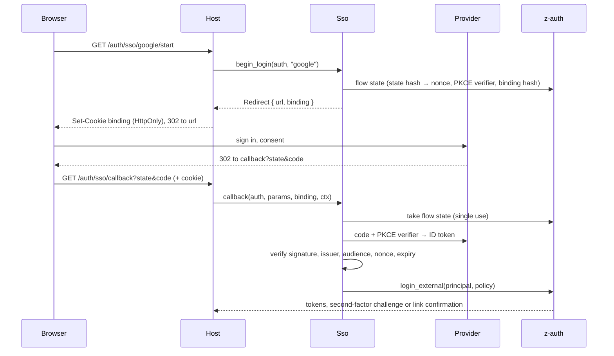

# z-auth-sso

`z-auth-sso` lets users sign in with an identity provider, such as Google, LinkedIn, Microsoft Entra ID, Okta, Auth0, Keycloak, GitHub or Facebook, and leaves the session to z-auth. The crate sends the browser to the provider, verifies what the provider sends back, and hands the verified identity to the core's `login_external`, which signs in the linked user, links the identity to an existing account or creates one, as the provider's policy allows. A signed-in user can also link a provider account to their z-auth user, so one person signs in with a password and any number of providers and always gets the same `user_id`. What the core does with an identity is described in the [external identities guide](../../docs/external-identities.md), and every setting in the [configuration guide](docs/configuration.md).

## Providers

Each provider is a mapping under `sso.providers.<name>` in the configuration file, and its `kind` picks the protocol. Adding a provider of an existing kind is a configuration change only.

| `kind` | Feature | Protocol | Typical providers |
|---|---|---|---|
| `oidc` | `oidc` (default) | OpenID Connect. Only the issuer is configured, everything else comes from its discovery document, and the signed ID token proves who signed in. | Google, LinkedIn, Microsoft Entra ID (single tenant), Okta, Auth0, Keycloak, GitLab |
| `oauth2` | none | Plain OAuth2. The access token reads a user-info endpoint, and JSON pointers say where its answer keeps the id, email and names. | Facebook, Discord, Twitch, in-house OAuth2 servers |
| `github` | `github` | The GitHub preset, an OAuth2 provider whose verified email addresses come from GitHub's own API. | GitHub, GitHub Enterprise Server (endpoints overridable) |

Providers that need behaviour beyond these, a non-standard handshake for instance, are written in the host by implementing the `IdentityProvider` trait and added with `Sso::with_provider`. Presets for Apple, multi-tenant Entra ID and a fuller Facebook integration are natural additions of that kind.

The name of a provider is recorded with every identity it links, so it should stay stable once users have linked accounts. The issuer and subject identify the account, so two configurations of the same issuer share their identities.

## Wiring

The host loads the settings, builds an `Sso` and gives z-auth its external-identity stores. `Sso` keeps no state of its own, and every call takes the `ZAuth` whose flow-state store holds the pending redirects, so any instance behind a load balancer can serve the callback.

```rust
use std::sync::Arc;

use z_auth::prelude::*;
use z_auth_postgres::{PgExternalIdentityRepository, PgFlowStateRepository, repositories};
use z_auth_sso::Sso;
use z_auth_sso::config::{SsoConfigLoader, SsoSourceLoader};

fn build(pool: sqlx::PgPool, config: AuthConfig, source: ConfigSource) -> Result<(ZAuth, Sso), AuthError> {
    let auth = ZAuth::builder(config, repositories(&pool))
        .external_identities(
            Arc::new(PgExternalIdentityRepository::new(pool.clone())),
            Arc::new(PgFlowStateRepository::new(pool.clone())),
        )
        .build()?;
    let sso = Sso::new(SsoSourceLoader::new(source).load_settings()?)?;
    Ok((auth, sso))
}
```

The tables come from z-auth-postgres's `external-identity` migration set (`setup_db --external`). `Sso::with_http_client` takes a `reqwest::Client` of the host's choosing, for a proxy for example. The default client uses rustls with the platform's certificates, a ten second timeout and no redirects.

## The flow



`begin_login` returns a `Redirect` with the provider's URL, a `binding` secret and its expiry. The host keeps the binding in an HttpOnly, `SameSite=Lax` cookie scoped to the callback path, and passes it to `callback`. A callback in a browser other than the one that started the redirect is refused, which stops an attacker from completing a sign-in of their own in the victim's browser and leaving the victim logged into the attacker's account.

`callback` returns `CallbackOutcome::Login` with the core's `ExternalLoginOutcome`. Tokens end the sign-in. `SecondFactor` continues with `complete_login` as after a password. `LinkConfirmation` means an account with the provider's email exists and the user must give its password to `confirm_link` before the accounts are joined.

`begin_link` starts the same redirect for a signed-in user, with their bearer token. The session must be recent (`AUTH_EXTERNAL_LINK_MAX_AUTH_AGE_SECS`), otherwise the call fails with `reauthentication_required` before the browser leaves. The callback then returns `CallbackOutcome::Linked` with the new identity, and the user keeps their session.

## HTTP endpoints

The `api` module offers framework-agnostic handlers in the style of the core's. They return `ApiError` from the core, so errors carry the same status codes and machine-readable codes.

| Handler | Suggested route | Returns |
|---|---|---|
| `providers` | `GET /auth/sso/providers` | The providers' names and display names, for a sign-in page. |
| `begin_login` | `GET /auth/sso/{provider}/start` | `RedirectResponse`. Set `binding` as the cookie and redirect to `url`. |
| `begin_link` | `POST /me/identities/{provider}` | The same, for the bearer token's user. |
| `callback` | `GET /auth/sso/callback` | `CallbackResponse`, tagged by `status` as `authenticated`, `second_factor_required`, `link_confirmation_required` or `linked`. |

The core's `confirm_link`, `complete_login`, `external_identities` and `unlink_external_identity` handlers finish the picture. The callback route must match the configured `callback_url` exactly, and that URL is registered with every provider as its redirect URI.

## Security

Every redirect uses the authorization code flow with PKCE (S256), a fresh random `state` and nonce, and the browser binding. The pending redirect is stored under the hash of its `state`, accepted once, and only within `sso.flow_ttl_secs`. A provider's error, such as a user declining consent, also ends it.

An ID token is accepted only when it is signed with an asymmetric algorithm (RS, PS, ES or EdDSA) by a key from the provider's JWKS whose type and algorithm fit the token, when it names the configured issuer exactly, lists this client among its audiences and as `azp` when there are several, is current within a minute of leeway, and carries the redirect's nonce. HMAC-signed tokens are refused outright, which rules out tricks with a public key used as a shared secret. The key set is cached for a day and re-read, at most once a minute, when a token names an unknown key after a rotation. The discovery document must name the configured issuer, and user info fetched to complete the profile must belong to the token's subject.

Plain OAuth2 providers have no ID token, so the identity comes from the user-info endpoint over TLS with the fresh access token. Their emails count as unverified unless a verified flag is mapped and the provider is trusted with emails. GitHub's preset takes the primary verified address from `/user/emails`, or another verified one, and never an unverified address.

Every endpoint must be `https`, with plain `http` allowed only on localhost for development. Client secrets are redacted in `Debug` output and are best kept in `AUTH_SSO_<NAME>_CLIENT_SECRET` rather than the file.

## Features

`oidc` (default) adds the `oidc` kind and depends on `jsonwebtoken` with its pure-Rust backend. `github` adds the GitHub preset. The `oauth2` kind is always available. All HTTP goes through `reqwest` with rustls.

## Testing

The tests run every flow against a mock provider built with `wiremock`, with ID tokens signed by a fixed P-256 test key, and cover the happy paths, single use and expiry of redirects, the browser binding, tampered nonce, audience, issuer, expiry and `azp`, unknown keys, HMAC-signed tokens, a mismatching discovery document, user info for another subject, explicit linking and the GitHub email rules.

```bash
cargo test -p z-auth-sso --all-features
```
