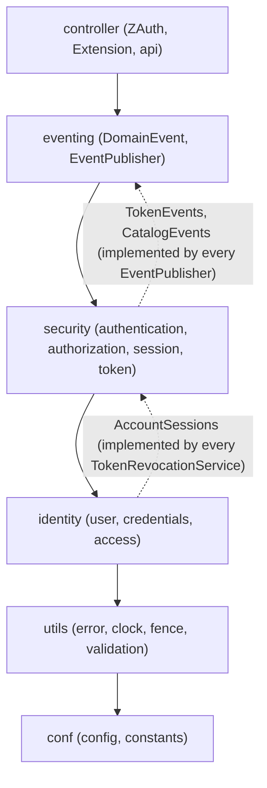
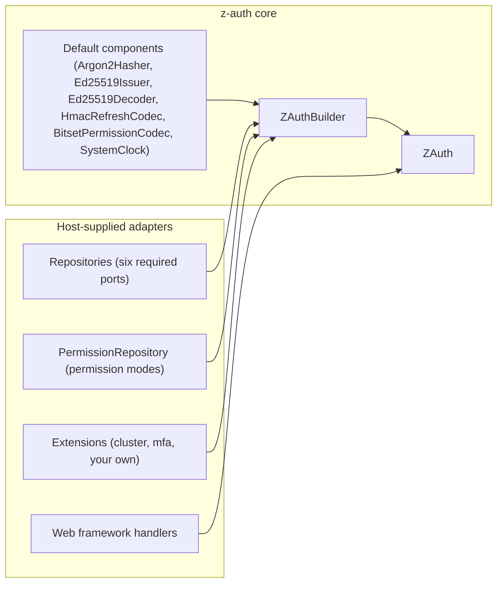
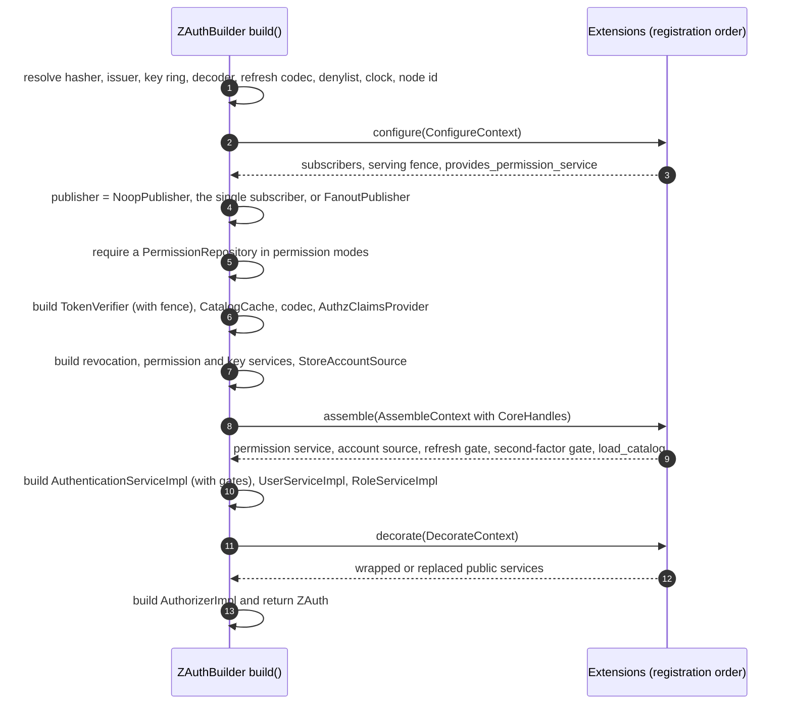
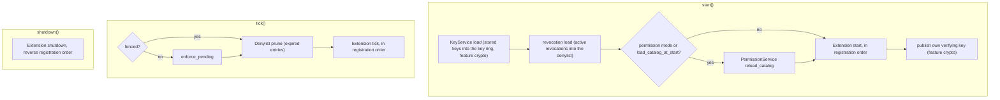

# Architecture

This guide describes how the core crate is organised and why. It covers the module layout and the file pattern every bounded context follows, the one-directional layering between module groups, the ports-and-adapters split between the core and the host, the `ZAuth` builder and the order in which it wires the services, the start, tick and shutdown lifecycle, domain events, and the Cargo features with what you have to supply when they are off.

## Module layout

The crate is split into six top-level modules. `identity` holds user accounts, password credentials and roles. `security` holds authentication (login, refresh, the second-factor and refresh gates), authorization (permissions, token claims, request-time checks), sessions and tokens. `eventing` holds the domain events and the publisher port, `conf` the configuration model, loaders and constants, `utils` the shared kernel (error type, clock, serving fence, validation), and `controller` the entry points, which are the `ZAuth` facade, the `Extension` port, the framework-agnostic API layer and the prelude.

```text
src/
├── lib.rs                      crate root, re-exports ZAuth, ZAuthBuilder, Repositories, Extension, AuthError
├── conf/
│   ├── config/
│   │   ├── loader.rs           ConfigLoader trait
│   │   ├── loaders.rs          EnvLoader, DirectLoader, RawConfig builder and validation
│   │   └── model.rs            AuthConfig, JwtConfig, SessionConfig, PasswordPolicy, AuthzMode, RetryMatch, RawConfig, ConfigError
│   └── constants.rs            every default, limit, env var name and HTTP status
├── controller/
│   ├── api/
│   │   ├── dto.rs              request and response DTOs
│   │   ├── error.rs            ApiError and the AuthError to status mapping
│   │   ├── handlers.rs         framework-agnostic endpoint handlers
│   │   └── mapping.rs          DTO and domain conversions
│   ├── extension.rs            Extension trait, build-phase contexts, CoreHandles, ExtensionReport
│   ├── facade.rs               ZAuth, ZAuthBuilder, StartReport, TickReport
│   ├── prelude.rs              use z_auth::prelude::*
│   └── repositories.rs         Repositories (the six required ports)
├── eventing.rs                 DomainEvent, EventPublisher, NoopPublisher, FanoutPublisher
├── identity/
│   ├── access/                 roles and user-role assignments (model, repository, service, service_impl)
│   ├── credentials/
│   │   ├── argon2.rs           Argon2Hasher (feature argon2)
│   │   ├── hasher.rs           PasswordHasher port
│   │   └── policy.rs           validate_password
│   └── user/                   accounts (model, repository, service, service_impl)
│       ├── sessions.rs         AccountSessions port, AccountChange
│       └── validation.rs       normalize_email, validate_email
├── security/
│   ├── authentication/
│   │   ├── account.rs          RefreshAccountSource port, StoreAccountSource
│   │   ├── gate.rs             RefreshGate port
│   │   ├── model.rs            ClientContext, Credentials, TokenPair, LoginOutcome, LoginChallenge
│   │   ├── policy.rs           the pure refresh decision function
│   │   ├── second_factor.rs    SecondFactorGate port, SecondFactorDecision, VerifiedSecondFactor
│   │   ├── service.rs          AuthenticationService
│   │   └── service_impl.rs     AuthenticationServiceImpl
│   ├── authorization/
│   │   ├── catalog.rs          CatalogCache
│   │   ├── codec.rs            PermissionCodec port, BitsetPermissionCodec
│   │   ├── events.rs           CatalogEvents port
│   │   ├── model.rs            catalog, grants, EffectivePermissions
│   │   ├── repository.rs       PermissionRepository port
│   │   ├── service.rs          PermissionService, Authorizer, AuthzClaimsProvider
│   │   ├── service_impl.rs     default implementations
│   │   └── validation.rs       permission value checks
│   ├── session/                Session, SessionGeneration, RevocationReason (model), SessionRepository
│   └── token/
│       ├── codec.rs            AccessTokenIssuer, AccessTokenDecoder, RefreshTokenCodec ports
│       ├── denylist.rs         in-memory Denylist
│       ├── events.rs           TokenEvents port
│       ├── jwt.rs              Ed25519Issuer, Ed25519Decoder, key_id (feature crypto)
│       ├── key_service.rs      KeyService, KeyServiceImpl (feature crypto)
│       ├── keyring.rs          KeyRing
│       ├── keys.rs             key generation helpers (feature crypto)
│       ├── model.rs            Claims, Revocation, RevocationScope, VerifyingKeyRecord, RevokeTarget
│       ├── refresh.rs          HmacRefreshCodec (feature crypto)
│       ├── repository.rs       RevocationRepository, KeyRepository ports
│       ├── service.rs          TokenRevocationService
│       ├── service_impl.rs     TokenRevocationServiceImpl
│       └── verifier.rs         TokenVerifier
└── utils/
    ├── clock.rs                Clock port, SystemClock
    ├── error.rs                AuthError
    ├── fence.rs                ServingFence
    ├── random.rs               OS randomness (crate-private)
    └── validation.rs           validate_code
```

## The bounded-context file pattern

Each bounded context follows the same four-file shape, so a reader always knows where to look. `model.rs` holds plain data structures and nothing else. `repository.rs` holds the persistence ports the host implements. `service.rs` holds the public service trait, and `service_impl.rs` the default implementation of it. Contexts with extra concerns add files beside these four (the refresh policy in `authentication/policy.rs`, the codec and the catalog cache in `authorization/`, the denylist and key ring in `token/`), but never fold them into the four.

The services are traits on purpose. `ZAuth` exposes `&dyn UserService`, `&dyn AuthenticationService` and so on, which lets an extension wrap or replace any of them at build time without the host noticing, and lets tests substitute their own. The default implementations are public as well (`UserServiceImpl`, `AuthenticationServiceImpl`, `TokenRevocationServiceImpl` and the rest), so a host can construct them by hand if it does not want the facade.

## Layering

The module groups depend on each other in one direction only, with no cycles. `controller` depends on `eventing`, `eventing` on `security`, `security` on `identity`, `identity` on `utils`, and `utils` on `conf`. A lower layer never names a type from a higher one.



Sometimes a lower layer has to notify a higher one, and it does so through a port of its own that the higher layer implements. The token services announce revocations and key changes through `TokenEvents`, and the permission service announces catalog changes through `CatalogEvents`. Both live in `security`, below `eventing`, because the `DomainEvent` enum carries token records and so cannot be named by them. `eventing` provides blanket implementations, so every `EventPublisher` is automatically both a `TokenEvents` and a `CatalogEvents` that wraps each call in the matching `DomainEvent`. Likewise the user service in `identity` must end a user's sessions when the password changes or the account is deactivated or deleted, but cannot name the revocation service above it. It calls its own `AccountSessions` port, and every `TokenRevocationService` implements that port through a blanket implementation that maps `AccountChange::PasswordChanged`, `Disabled` and `Deleted` to the revocation reasons `PasswordChanged`, `AccountDisabled` and `AccountDeleted`. Hosts never implement these three ports directly.

## Ports and adapters

The core defines what it needs as traits and leaves the implementations to the host. The persistence ports are `UserRepository`, `RoleRepository`, `UserRoleRepository`, `SessionRepository`, `RevocationRepository`, `KeyRepository` and the optional `PermissionRepository`, all documented in the [storage ports guide](storage-ports.md). The component ports are `PasswordHasher`, `AccessTokenIssuer`, `AccessTokenDecoder`, `RefreshTokenCodec`, `PermissionCodec` and `Clock`, each with a built-in default. The extension-facing ports are `Extension`, `EventPublisher`, `RefreshGate`, `SecondFactorGate` and `RefreshAccountSource`, covered in the [extensions guide](extensions.md).



The `Repositories` struct groups the six required repositories. Every field is required, so forgetting one is a compile error rather than a startup failure, and the struct is `Clone` so extensions can read it from the build contexts.

| Field | Port | Purpose |
|---|---|---|
| `users` | `UserRepository` | Accounts, lookups by id, email and username, activation flags |
| `roles` | `RoleRepository` | Role definitions |
| `user_roles` | `UserRoleRepository` | User to role assignments with history |
| `sessions` | `SessionRepository` | Sessions and their token generations |
| `revocations` | `RevocationRepository` | The persisted side of the denylist |
| `keys` | `KeyRepository` | Published verifying keys (unused without the `crypto` feature) |

`z_auth_postgres::repositories(&pool)` returns a filled `Repositories` for the reference adapter, and `z_auth_testkit::repositories(&db)` does the same for the in-memory store used by the tests.

## The builder

`ZAuth::builder(config, repos)` returns a `ZAuthBuilder`. Besides the two required arguments it accepts the optional parts below, each of which may be left out. There is no method for publishers or subscribers on the builder; event publishers are registered only by extensions, from their `configure` phase, through `ConfigureContext::subscribe`.

| Method | Default | Purpose |
|---|---|---|
| `.extension(Arc<dyn Extension>)` | none | Plug in an optional component. May be called repeatedly; extensions are wired and driven in registration order |
| `.permissions(Arc<dyn PermissionRepository>)` | none | Required in the `permissions` and `combined` modes, unless an extension supplies the permission service |
| `.permission_codec(Arc<dyn PermissionCodec>)` | `BitsetPermissionCodec` | How permissions are encoded into tokens |
| `.password_hasher(Arc<dyn PasswordHasher>)` | `Argon2Hasher` (feature `argon2`) | Password hashing and verification |
| `.access_issuer(Arc<dyn AccessTokenIssuer>)` | `Ed25519Issuer` from `config.jwt` (feature `crypto`) | Mints access tokens |
| `.access_decoder(Arc<dyn AccessTokenDecoder>)` | `Ed25519Decoder` over the key ring (feature `crypto`) | Verifies access tokens |
| `.refresh_codec(Arc<dyn RefreshTokenCodec>)` | `HmacRefreshCodec` from `config.session` (feature `crypto`) | Issues and checks refresh tokens |
| `.denylist(Arc<Denylist>)` | a new, empty `Denylist` | Share a denylist, for example one also fed by a message bus |
| `.clock(Arc<dyn Clock>)` | `SystemClock` | Local time for stateless checks only (access-token expiry, denylist entry expiry) |

The built-in `Argon2Hasher` uses `Argon2::default()` from the argon2 crate, which is Argon2id version 19 with m=19456 KiB, t=2 and p=1, and produces self-describing PHC strings such as `$argon2id$v=19$m=19456,t=2,p=1$...` that are stored verbatim. Hashing is synchronous and CPU-bound, so a host on an async runtime may want to wrap a custom hasher in its runtime's blocking facility.

The clock deserves a word. Every persisted timestamp, from session creation and expiry to revocation cutoffs, is assigned by the store's own clock, which is the source of truth. The core only passes durations to the repositories. The local `Clock` feeds the stateless checks that cannot involve the store, so replacing it does not change what the store records.

## What build() does

`build()` wires every service in a fixed order and returns `AuthError::Config` if a required piece is missing or an extension refuses the setup. It first resolves the components. It takes the supplied password hasher or builds the default, takes the supplied issuer or builds `Ed25519Issuer` from the signing key (remembering its verifying key as this instance's own key), builds the key ring from the configured verifying keys plus that own key, takes the supplied decoder or builds one over the key ring, takes the supplied refresh codec or builds one from the refresh secret, and settles the denylist, the clock and a fresh random node id. Then it runs the three extension phases with the core services built in between, as the sequence below shows.



The publisher is chosen after the configure phase. With no subscriber every event goes to the `NoopPublisher`, with exactly one subscriber that subscriber is used directly, and with several a `FanoutPublisher` delivers each event to all of them in registration order. The revocation entry lifetime, which is the access-token TTL plus the leeway, is computed once here and passed to the revocation service. The user service receives the core revocation service (never a decorated one) as its `AccountSessions`, and the `Authorizer` is built last over the shared catalog cache and permission codec.

## Lifecycle

A built `ZAuth` is driven by three async calls. The host calls `start` once before serving, `tick` periodically while serving, and `shutdown` once on the way out. The flowchart shows what each one does, in order.



The own verifying key is published after the extensions started, so that a cluster's peers receive the key event too. `start` returns a `StartReport` with `revocations_loaded`, `keys_loaded` and `extensions`, a list of `ExtensionReport` values. `tick` returns a `TickReport` with `enforced` (revocations this instance enforced), `pruned` (expired denylist entries dropped) and `extensions`. Both reports offer `extension::<T>()`, which returns the first extension report of type `T`, so a host can read a cluster's or the mfa extension's report without matching on names. A fenced instance enforces nothing in `tick` and only reports.

## Accessors

`ZAuth` exposes its services and shared state through the following accessors. None of them performs I/O by itself.

| Accessor | Returns | Notes |
|---|---|---|
| `config()` | `&AuthConfig` | The validated configuration |
| `users()` | `&dyn UserService` | Registration and account management |
| `roles()` | `&dyn RoleService` | Roles and assignments, in the `rbac` and `combined` modes |
| `permissions()` | `&dyn PermissionService` | Catalog and grants, in the `permissions` and `combined` modes |
| `authorizer()` | `&dyn Authorizer` | Request-time checks from verified claims |
| `authentication()` | `&dyn AuthenticationService` | Login, complete_login, refresh, logout, verification, session purge |
| `revocation()` | `&dyn TokenRevocationService` | Revoking tokens, sessions and users |
| `verifier()` | `&TokenVerifier` | Synchronous access-token verification |
| `denylist()` | `&Arc<Denylist>` | The in-memory denylist used by the verifier |
| `keyring()` | `&Arc<KeyRing>` | Accepted verifying keys and rejected key ids |
| `keys()` | `&dyn KeyService` | Verifying-key publication and signing-key revocation (feature `crypto` only) |
| `node_id()` | `Uuid` | This instance's id, also its node id in a cluster |
| `is_fenced()` | `bool` | Whether an extension fenced this instance |

## Domain events

Some changes must reach every other instance immediately because they affect tokens already in flight. The core describes them as `DomainEvent` values and hands them to the `EventPublisher` chosen at build time. With the `serde` feature the enum serializes with an adjacent `type` and `data` tag in snake case.

| Variant | Published when |
|---|---|
| `Revoked(Revocation)` | A new pending revocation was stored (logout, eviction, compromise, account change, API revocation) |
| `RevocationEnforced(Revocation)` | A covered token was presented and this instance won the enforcement |
| `VerifyingKeyPublished(VerifyingKeyRecord)` | A verifying key was published, including this instance's own key at start |
| `SigningKeyRevoked { kid }` | A signing key was revoked and its tokens must be refused everywhere |
| `CatalogChanged { version }` | The permission catalog changed through this instance |

`EventPublisher::publish` is async and infallible by design. Delivery problems are the publisher's to retry or repair, never the caller's. `NoopPublisher` drops every event and is what a single-instance deployment gets. `FanoutPublisher::new(subscribers)` delivers each event to every subscriber in order. Only extensions add subscribers, which is how z-auth-cluster pushes denylist, key and catalog changes to its peers.

## Cargo features

The crate has three features, all enabled by default. Turning one off removes the built-in component, and the builder then requires you to supply the replacement or `build()` fails with `AuthError::Config` naming the missing component and the feature that would provide it.

| Feature | Provides | Without it |
|---|---|---|
| `argon2` | `Argon2Hasher`, the default `PasswordHasher` | Supply `.password_hasher(..)` |
| `crypto` | `Ed25519Issuer`, `Ed25519Decoder`, `HmacRefreshCodec`, `KeyService`, `TokenVerifier::from_config`, the `jwt`, `refresh`, `keys` and `key_service` modules, fingerprint hashing, the `keygen` example | Supply `.access_issuer(..)`, `.access_decoder(..)` and `.refresh_codec(..)`. `ZAuth::keys()` does not exist, verifying keys are neither loaded nor published, and client fingerprints are never stored and never match |
| `serde` | `Serialize` and `Deserialize` on models, claims, events and API DTOs | No serde derives. The `crypto` feature still pulls in serde internally for the JWT wire format, but does not enable the derives |

The `KeyRepository` field of `Repositories` stays required without `crypto`, but nothing calls it. CI checks every feature of every workspace crate on its own with `cargo hack check --workspace --each-feature --no-dev-deps`, so each combination compiles. The test suites themselves require `argon2` and `crypto`, because the facade's defaults need them.
