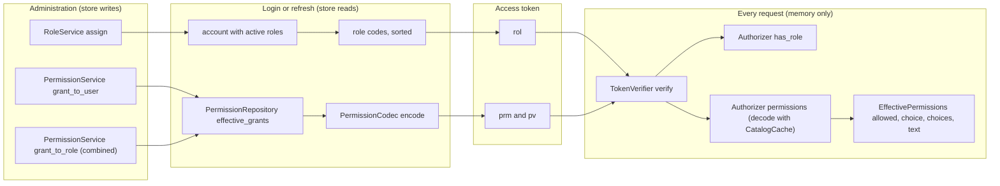
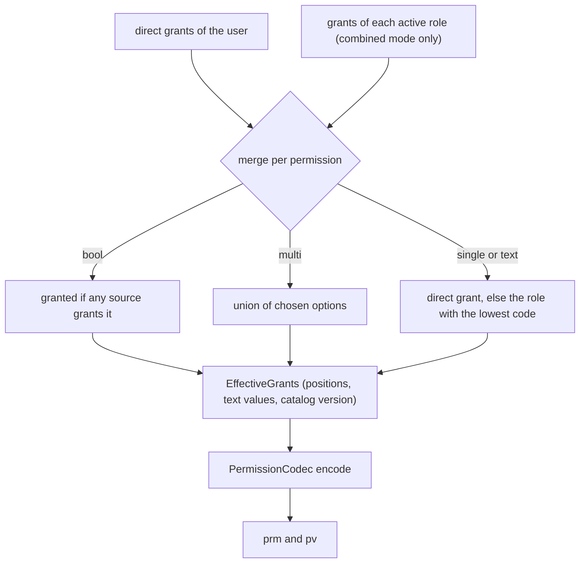

# Authorization

This guide covers what z-auth puts into access tokens for authorization and how applications check it. It explains the four authorization modes, roles and their assignments, the permission catalog with its four kinds of permission, the compact token encoding (format v1 of `BitsetPermissionCodec`), how grants from users and roles are merged, how the catalog is cached and kept current, and the request-time `Authorizer`. The encoding section is also the specification a UI follows to decode the `prm` claim on its own.

The central design decision is that authorization data travels inside the access token. Roles and permissions are read from the store only at login and refresh, encoded into the token, and decoded from memory on every request, so checks never touch storage. The price is that changes reach a user's tokens at their next refresh rather than immediately.



## Authorization modes

`AUTH_AUTHZ_MODE` selects the model, parsed into `AuthzMode`. It decides what goes into tokens and which administration services are enabled. The default is `rbac`. Three methods on `AuthzMode` express the differences, and the services consult them.

| Mode | `uses_roles()` | `uses_permissions()` | `role_grants()` | Token claims |
|---|---|---|---|---|
| `none` | false | false | false | Identity only, no `rol`, `prm` or `pv` |
| `rbac` | true | false | false | `rol` with the active role codes |
| `permissions` | false | true | false | `prm` and `pv` from the user's direct grants |
| `combined` | true | true | true | `rol`, plus `prm` and `pv` merged from direct grants and the grants of the user's active roles |

The modes that use permissions need a `PermissionRepository`, passed with `ZAuthBuilder::permissions`. Without one `build()` fails with `AuthError::Config` naming the mode, unless an extension declared that it supplies the permission service itself (z-auth-cluster does this on the non-authority services in federation mode).

Operations that belong to a model the mode does not enable are refused with `AuthError::AuthzModeDisabled`, which `ApiError` maps to HTTP 409 with the code `authz_mode_disabled`. Every `RoleService` method is refused unless the mode uses roles (the message names "role management"). Every `PermissionService` method, including `catalog()`, is refused unless the mode uses permissions and a repository is present ("permission management"). `grant_to_role`, `revoke_from_role` and `role_grants` are additionally refused outside `combined` ("granting permissions to roles"). The `Authorizer` is mode-agnostic and works in every mode, so a service that only verifies tokens can use it regardless of its own configuration.

## Roles

A role has an id, a `code`, a display `name` and an optional description. The code is the identifier carried in tokens and used in application checks, for example `billing_admin`. It is validated when the role is created and is immutable afterwards. `RoleUpdate` can only change the name and the description (with `description: Some(None)` clearing it), so tokens already issued keep meaning the same thing after a rename. Both the code and the name are unique, and a duplicate of either fails with `RoleAlreadyExists`.

Assignments link users to roles and keep their history. `RoleService::assign` creates an active assignment and returns `false` when the user already holds the role, and `revoke` stamps `revoked_at` on the active assignment and returns `false` when there was none, so neither treats a no-op as an error and the core never raises `RoleAlreadyAssigned` or `RoleNotAssigned` itself. At most one active assignment per user and role exists at any time. `list_user_assignments` returns the active ones, `list_user_assignment_history` all of them including revoked ones, and `revoke_all_for_user` revokes every active assignment. Deleting a role removes its assignments.

```rust
let role = auth
    .roles()
    .create(&NewRole {
        code: "billing_admin".into(),
        name: "Billing administrator".into(),
        description: None,
    })
    .await?;
auth.roles().assign(user.id, role.id).await?; // true: newly assigned
// The user's next refresh carries "billing_admin" in `rol`.
```

In the `rbac` and `combined` modes the token's `rol` claim holds the codes of the user's active roles, sorted. Assignment changes take effect at the user's next refresh or login, and the access token in hand keeps its old roles until it expires. If a role must stop working immediately, end the affected sessions through the revocation service as well.

## Permissions

A permission is a catalog entry defined by the application, identified by an immutable `code` such as `reports.export`. Its kind decides what a grant holds.

| Kind | `PermissionKind` | A grant holds | `PermissionValue` |
|---|---|---|---|
| bool | `Bool` | granted or not | `Allow` |
| single | `Single` | exactly one of the permission's options | `Choice(option_code)` |
| multi | `Multi` | one or more of the permission's options | `Choices(option_codes)` |
| text | `Text { max_length }` | a string of at most `max_length` characters | `Text(value)` |

`PermissionService::define` adds an entry from a `NewPermission`. `single` and `multi` permissions need at least one option code and the other kinds take none, otherwise the call fails with `InvalidPermissionValue`. `add_option` adds an option to an existing `single` or `multi` permission, and a duplicate option code fails with `InvalidCode`. `delete` removes an entry together with every grant of it.

Grants are written with `grant_to_user` and, in `combined` mode, `grant_to_role`. A grant replaces any existing grant of the same permission for that owner. The value must fit the kind, the option codes must exist, a `Choices` value must not be empty (revoke instead), and a text value must not exceed `max_length` characters, otherwise the call fails with `InvalidPermissionValue`. An unknown permission code fails with `PermissionNotFound`. `revoke_from_user` and `revoke_from_role` remove a grant and return whether one existed. `user_grants` and `role_grants` list an owner's direct grants as `GrantView` values (permission code plus value), sorted by code, without merging anything in.

```rust
let p = auth.permissions();
p.define(&NewPermission {
    code: "reports.export".into(),
    kind: PermissionKind::Multi,
    description: Some("Export formats".into()),
    options: vec!["csv".into(), "pdf".into(), "xlsx".into()],
})
.await?;
p.grant_to_user(
    user.id,
    "reports.export",
    &PermissionValue::Choices(vec!["csv".into(), "xlsx".into()]),
)
.await?;
```

With the `serde` feature `PermissionValue` serializes with a `type` tag and a `value` content field, which is convenient for admin APIs.

```json
[
  {"type": "allow"},
  {"type": "choice", "value": "us"},
  {"type": "choices", "value": ["csv", "xlsx"]},
  {"type": "text", "value": "250"}
]
```

## Code format

Role codes, permission codes and option codes share one rule, enforced by `z_auth::utils::validation::validate_code`. A code starts with a lowercase ASCII letter, continues with lowercase letters, digits, `_`, `.`, `:` or `-`, and is at most 64 characters long, which is the regular expression `^[a-z][a-z0-9_.:-]*$` plus the length cap. Anything else fails with `AuthError::InvalidCode`. The rule keeps codes safe to embed in tokens, URLs and source code, and because codes never change, application checks written against them never break.

## Positions are permanent

The store assigns every `bool` and `text` permission one position and every option of a `single` or `multi` permission one position each, all drawn from a single sequence that never reuses a number. A permission keeps its positions for life, and deleting it retires them for good. Both reference stores start the sequence at 1, so position 0 is never used. The catalog's `version` is the highest position in use (0 for an empty catalog), which grows whenever something is added.

Permanent positions are what make the token encoding stable. A token minted against an older catalog still decodes correctly against a newer one, because nothing it refers to has moved, and a position that is no longer in the catalog simply reads as not granted. Deletions never require a client to refetch the catalog. One edge case follows from the definition of `version`. Deleting the permission that holds the highest position lowers the version, so tokens minted just before the deletion carry a `pv` above the catalog's version and decode with `catalog_outdated` set until something new is added.

## The token encoding

`BitsetPermissionCodec` (format v1) turns a user's effective grants into the `prm` and `pv` claims. Every granted `bool` permission and every chosen option is one bit of a little-endian bitset, where position `p` is bit `p % 8` of byte `p / 8`. The bitset is as long as its highest set bit requires, so it never has trailing zero bytes, and it is encoded as base64url without padding into `prm.b`. Granted `text` values travel separately in `prm.t`, a map from the permission's position to the value. `pv` is the catalog version at the time the grants were read. When permissions are in use but nothing is granted, `prm` is omitted and only `pv` travels.

The worked example below uses a catalog defined in this order on a fresh store.

| Code | Kind | Positions |
|---|---|---|
| `reports.view` | bool | 1 |
| `reports.export` | multi | `csv` 2, `pdf` 3, `xlsx` 4 |
| `region` | single | `eu` 5, `us` 6 |
| `upload.max_mb` | text, max length 8 | 7 |

The catalog version is 7. Suppose the user is granted `reports.view`, the `csv` and `xlsx` exports, the `us` region and an upload limit of `250`. The set bits are 1, 2, 4 and 6, which all fall into byte 0, and the text value sits at position 7.

```text
position    7   6   5   4   3   2   1   0
bit         0   1   0   1   0   1   1   0      byte 0 = 0b0101_0110 = 0x56
                us      xlsx    csv view

bytes       [0x56]
prm.b       base64url([0x56]) without padding = "Vg"
prm.t       {"7": "250"}
pv          7
```

The token therefore carries the following claims. A later `bool` permission `audit` defined at position 9 and granted as well would set bit 1 of byte 1, giving the bytes `[0x56, 0x02]` and `prm.b = "VgI"`. Revoking it again shrinks the bitset back to a single byte.

```json
{"prm": {"b": "Vg", "t": {"7": "250"}}, "pv": 7}
```

Decoding walks the catalog, not the bitset. For each catalog entry it reads the bit of a `bool` position, the bits of a `single` or `multi` permission's options, or the `prm.t` entry at a `text` position, and records a value for every code that is granted. A `single` permission with more than one bit set decodes to the option that comes first in the catalog. Decoding fails closed throughout, so anything unknown or malformed, including bits the catalog does not know and an undecodable `prm.b`, is simply not granted. A UI can implement the same procedure in a few lines from the catalog served by `GET /permissions/catalog` (see the [HTTP API](http-api.md)), fetching it once and again only when a token's `pv` exceeds the version it holds.

A different encoding can be plugged in with `ZAuthBuilder::permission_codec`. A replacement `PermissionCodec` must keep decoding fail-closed.

## Merging grants

At login and refresh the claims provider asks the repository for the user's effective grants with `PermissionRepository::effective_grants(user_id, include_role_grants)`, where `include_role_grants` is true only in `combined` mode. The repository merges the user's direct grants with the grants of the user's active roles, per permission, following four rules. A `bool` permission is granted if any source grants it. A `multi` permission gets the union of the options chosen by all sources. For `single` and `text` permissions the direct grant wins, and otherwise the grant of the role with the lexicographically lowest code is used. The result carries the catalog version as read in the same call.



Grant changes, like role changes, reach tokens at the next refresh or login. Revoking a role in `combined` mode removes the permissions it contributed at that point too.

## The catalog cache

Every instance keeps the catalog in a `CatalogCache`, an in-memory snapshot that the `Authorizer` decodes against and that verification never touches. The cache is filled in four ways. `ZAuth::start` loads it in permission modes, and also outside them when an extension asked for it with `load_catalog_at_start`. A `define`, `add_option` or `delete` through this instance reloads it and publishes `DomainEvent::CatalogChanged` with the new version, which z-auth-cluster delivers to the other instances. A login or refresh whose effective grants report a newer catalog version than the cache holds reloads it on the spot, since it is on the store-reading path anyway. Listing grants that refer to a permission the cache does not know triggers one reload as well.

An instance whose cache is behind decodes conservatively. Permissions added since its last load read as not granted, and `EffectivePermissions::catalog_outdated` is true because the token's `pv` is newer than the cache's version. That is the signal for a verify-only service, or a UI, to refetch the catalog.

## Checking at request time

The `Authorizer`, returned by `ZAuth::authorizer()`, answers authorization questions from verified `Claims` with no I/O. It has exactly five methods.

| Method | Returns | Meaning |
|---|---|---|
| `roles(&claims)` | `&[String]` | The role codes in the token, empty if none |
| `has_role(&claims, code)` | `bool` | Whether the token carries the role code |
| `permissions(&claims)` | `EffectivePermissions` | The token's permissions decoded with the cached catalog, empty if the token has none |
| `has_amr(&claims, method)` | `bool` | Whether the session was opened with the authentication method, such as `otp` |
| `require_mfa(&claims)` | `Result<(), AuthError>` | `SecondFactorRequired` unless the session passed a second factor (its `amr` contains `mfa`) |

`EffectivePermissions` is the decoded view. `allowed(code)` is true when anything is granted for the code (a `bool` allowed, at least one option chosen, or a text value set). `choice(code)` returns the chosen option of a `single` permission, `choices(code)` the chosen options of a `multi` permission (an empty slice if none), and `text(code)` the value of a `text` permission. `values()` returns every granted permission by code, and the public field `catalog_outdated` reports whether the token was encoded against a newer catalog than the one used to decode it. Codes the token does not grant, and codes the catalog does not know, are simply absent.

```rust
let claims = auth.verifier().verify(bearer)?;
let authz = auth.authorizer();

if authz.has_role(&claims, "billing_admin") {
    authz.require_mfa(&claims)?; // sensitive: demand a second factor
}

let perms = authz.permissions(&claims);
let formats = perms.choices("reports.export"); // e.g. ["csv", "xlsx"]
let region = perms.choice("region");            // Some("us")
let limit = perms.text("upload.max_mb");        // Some("250")
if perms.catalog_outdated {
    // This instance's catalog is older than the token's; reload it.
}
```

A password-only session carries `amr = ["pwd"]` and fails `require_mfa`. Sessions opened through `complete_login` carry `mfa` and pass. The [mfa extension guide](../adapters/mfa/README.md) describes how to make the second factor mandatory at login instead of checking it per operation.
