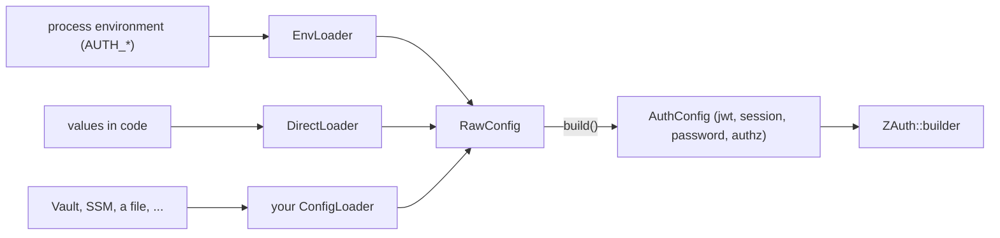

# Configuration

z-auth is configured through a single validated value, `AuthConfig`, which the host passes explicitly to `ZAuth::builder`. This guide documents every setting the core reads, the environment variables `EnvLoader` maps them from, their defaults and validation rules, the `RawConfig` builder for configuring in code, the `ConfigLoader` trait for other sources, the error type, and how secrets are kept out of logs. The core configures nothing about databases or HTTP servers, and the optional crates read their own variables, which are documented in their guides.

## How configuration flows

Every source produces a `RawConfig`, a flat snapshot in which every field is optional and keys are still base64 strings. `RawConfig::build` validates it, decodes the keys, fills in the defaults from `z_auth::conf::constants` and returns the typed `AuthConfig`. `ConfigLoader::load_config` does both steps in one call.



`AuthConfig` has four parts. `jwt` is a `JwtConfig` with the signing key, the verifying keys, the access-token TTL, the leeway and the issuer. `session` is a `SessionConfig` with the refresh secret, the idle and absolute timeouts, the history size, the refresh grace, IP binding, the retry match and the session cap. `password` is a `PasswordPolicy`, and `authz` an `AuthzConfig` holding the `AuthzMode`.

## Environment variables

`EnvLoader` reads the variables below from the process environment and nothing else. It never loads a `.env` file and never modifies the environment, so a host that wants `.env` support loads the file itself before calling it, for example with `dotenvy::dotenv()`. The `env.example` file at the repository root lists the same variables with their defaults.

| Variable | Default | Meaning |
|---|---|---|
| `AUTH_JWT_SIGNING_KEY` | none | Base64 Ed25519 signing seed, exactly 32 bytes. Auth service only. Required by the built-in issuer |
| `AUTH_JWT_VERIFYING_KEYS` | none | Comma-separated base64 Ed25519 verifying keys, 32 bytes each. When empty, the key derived from the signing key is used. List several during a key rotation |
| `AUTH_JWT_ISSUER` | `z-auth` | The `iss` claim written into and required from access tokens |
| `AUTH_JWT_ACCESS_TTL_SECS` | `300` | Access-token lifetime in seconds |
| `AUTH_JWT_LEEWAY_SECS` | `30` | Clock-skew tolerance in seconds when checking `exp` and `iat` |
| `AUTH_REFRESH_SECRET` | none | Base64 HMAC key for refresh tokens, at least 32 bytes. Auth service only. Required by the built-in refresh codec |
| `AUTH_SESSION_IDLE_TIMEOUT_SECS` | `1800` | A session ends if it is not refreshed within this many seconds |
| `AUTH_SESSION_ABSOLUTE_TIMEOUT_SECS` | `28800` | A session ends this many seconds after login, regardless of activity |
| `AUTH_SESSION_HISTORY_SIZE` | `10` | Token generations kept per session for reuse detection. Must be at least 2 |
| `AUTH_REFRESH_GRACE_SECS` | `30` | How long after a rotation the previous generation still receives the current pair |
| `AUTH_IP_BINDING` | `false` | When `true`, a refresh from an IP other than the session's creating IP ends the session as compromised |
| `AUTH_REFRESH_RETRY_MATCH` | `ip` | Comma set of `ip`, `user_agent` and `fingerprint` that must match for a repeated refresh to count as the same client retrying. At least one |
| `AUTH_MAX_SESSIONS_PER_USER` | `5` | Maximum concurrent active sessions per user. `0` means unlimited |
| `AUTH_PASSWORD_MIN_LENGTH` | `8` | Minimum password length in characters |
| `AUTH_PASSWORD_REQUIRE_UPPERCASE` | `true` | Require at least one uppercase letter |
| `AUTH_PASSWORD_REQUIRE_DIGIT` | `true` | Require at least one ASCII digit |
| `AUTH_AUTHZ_MODE` | `rbac` | Authorization model, one of `none`, `rbac`, `permissions` or `combined` |

Numbers are parsed as unsigned integers and booleans with Rust's `bool` parser, which accepts exactly `true` and `false`. A value that does not parse fails with `ConfigError::Parse` naming the variable. Surrounding whitespace is trimmed from base64 keys, from each entry of the verifying key list, from the mode and from the retry-match entries, but not from numbers or booleans. A variable that is set to an empty string counts as set, so `AUTH_JWT_SIGNING_KEY=` is rejected as a key of 0 bytes, `AUTH_REFRESH_SECRET=` as a secret that is too short and an empty numeric variable as unparseable. Remove the line instead of leaving it empty. The verifying-key list is the exception, because empty entries are dropped and an empty list falls back to the derived key.

The password policy counts characters, not bytes, and checks uppercase letters with Unicode's notion of uppercase while the digit rule requires an ASCII digit. It applies to registration and to password changes through `UserService::update`.

## Validation rules

`RawConfig::build` returns `ConfigError::Parse` for every problem it finds. The signing seed and each verifying key must be valid standard base64 that decodes to exactly 32 bytes, and the refresh secret valid base64 of at least 32 bytes. `AUTH_SESSION_HISTORY_SIZE` must be at least 2, because the history has to hold the current and the previous generation for the grace path to work. `AUTH_AUTHZ_MODE` must be one of the four modes, and `AUTH_REFRESH_RETRY_MATCH` must name at least one known criterion and nothing else.

The keys are optional at this stage. A service that only verifies tokens needs just the verifying keys, while the auth service needs the signing seed and the refresh secret, so presence is checked where a key is used rather than here. In practice that is `ZAuthBuilder::build`, which fails with `AuthError::Config` and a message such as `missing jwt_signing_key` or `missing refresh_secret` when the built-in issuer or refresh codec cannot be created, and `TokenVerifier::from_config`, which fails with `missing jwt_verifying_keys` when there is neither a verifying key nor a signing key to derive one from. A signing key and verifying keys that do not match are not detected, since the auth service also accepts its own derived key; other services would then reject its tokens.

## RawConfig in code

`RawConfig` has a builder method for every field, named after the field, which makes it convenient for tests, CLI tools and hosts that keep their settings elsewhere. `DirectLoader::new(raw)` wraps a filled `RawConfig` as a `ConfigLoader`, and calling `raw.build()` directly works just as well.

```rust
use z_auth::conf::config::{ConfigLoader, DirectLoader, RawConfig};

let config = DirectLoader::new(
    RawConfig::default()
        .jwt_signing_key(signing_key_b64)
        .jwt_verifying_keys([verifying_key_b64])
        .refresh_secret(refresh_secret_b64)
        .jwt_issuer("auth.example.com")
        .jwt_access_ttl_secs(600)
        .session_idle_timeout_secs(3600)
        .max_sessions_per_user(0) // unlimited
        .refresh_retry_match("ip,fingerprint")
        .authz_mode("combined"),
)
.load_config()?;
assert_eq!(config.jwt.issuer, "auth.example.com");
```

| `RawConfig` method | Variable |
|---|---|
| `jwt_signing_key(impl Into<String>)` | `AUTH_JWT_SIGNING_KEY` |
| `jwt_verifying_keys(impl IntoIterator)` | `AUTH_JWT_VERIFYING_KEYS` |
| `jwt_access_ttl_secs(u64)` | `AUTH_JWT_ACCESS_TTL_SECS` |
| `jwt_leeway_secs(u64)` | `AUTH_JWT_LEEWAY_SECS` |
| `jwt_issuer(impl Into<String>)` | `AUTH_JWT_ISSUER` |
| `refresh_secret(impl Into<String>)` | `AUTH_REFRESH_SECRET` |
| `session_idle_timeout_secs(u64)` | `AUTH_SESSION_IDLE_TIMEOUT_SECS` |
| `session_absolute_timeout_secs(u64)` | `AUTH_SESSION_ABSOLUTE_TIMEOUT_SECS` |
| `session_history_size(u32)` | `AUTH_SESSION_HISTORY_SIZE` |
| `refresh_grace_secs(u64)` | `AUTH_REFRESH_GRACE_SECS` |
| `ip_binding(bool)` | `AUTH_IP_BINDING` |
| `max_sessions_per_user(u32)` | `AUTH_MAX_SESSIONS_PER_USER` |
| `password_min_length(usize)` | `AUTH_PASSWORD_MIN_LENGTH` |
| `password_require_uppercase(bool)` | `AUTH_PASSWORD_REQUIRE_UPPERCASE` |
| `password_require_digit(bool)` | `AUTH_PASSWORD_REQUIRE_DIGIT` |
| `authz_mode(impl Into<String>)` | `AUTH_AUTHZ_MODE` |
| `refresh_retry_match(impl Into<String>)` | `AUTH_REFRESH_RETRY_MATCH` |

`AuthzMode` and `RetryMatch` also implement `FromStr` with the same rules, so `"combined".parse::<AuthzMode>()` and `"ip,user_agent".parse::<RetryMatch>()` work on their own. `RetryMatch::default()` is IP only.

## Custom loaders

Any type implementing `ConfigLoader` can supply the configuration. The trait has one required method, `load(&self) -> Result<RawConfig, ConfigError>`, and a provided `load_config`, which calls `load` and then `RawConfig::build`. A loader for a secret store fetches the values and fills a `RawConfig`.

```rust
use z_auth::conf::config::{ConfigError, ConfigLoader, RawConfig};

struct VaultLoader;

impl ConfigLoader for VaultLoader {
    fn load(&self) -> Result<RawConfig, ConfigError> {
        // Fetch the secrets from the store of your choice.
        Ok(RawConfig::default().refresh_secret("dmF1bHQtc2VjcmV0LXZhdWx0LXNlY3JldC12YXVsdA=="))
    }
}

let config = VaultLoader.load_config()?;
```

## Errors

`ConfigError` has two variants. `Parse { key, reason }` reports a value that is present but invalid, with `key` naming the environment variable or, for keys and secrets, the field (`jwt_signing_key`, `jwt_verifying_keys`, `refresh_secret`). `Missing(String)` reports a required value that was not set. The core's own loaders never return it, because nothing in `AuthConfig` is required at load time, but the cluster and mfa loaders use it for their mandatory settings. `ConfigError` implements `Display` and `std::error::Error`, and converts into `AuthError::Config` with `From`, so `?` works in functions returning `AuthError`.

## Secrets in logs

`JwtConfig`, `SessionConfig` and `RawConfig` implement `Debug` by hand. The signing key and the refresh secret are printed as `<redacted>` when present, and `JwtConfig` prints only the number of verifying keys. Logging the whole `AuthConfig` with `{:?}` is therefore safe. The same care extends to the domain types, whose `Debug` output redacts password hashes, session secrets, tokens, challenge tokens, codes and client fingerprints.

## Variables of the other crates

The optional crates read their own variable families, which the core ignores entirely. z-auth-cluster reads `AUTH_DEPLOYMENT_MODE`, `AUTH_CLUSTER_*`, `AUTH_AUTHORITY_SERVICE`, `AUTH_LINK_*`, `AUTH_SESSION_DISTRIBUTION`, `AUTH_FORK_*` and `AUTH_FEDERATION_*`, documented in the [cluster configuration guide](../adapters/cluster/docs/configuration.md). z-auth-mfa reads `AUTH_MFA_*`, documented in the [mfa configuration guide](../adapters/mfa/docs/configuration.md), except for the delivery variables such as `AUTH_MFA_EMAIL_PROVIDER` and `AUTH_MFA_SMS_PROVIDER`, which z-auth-mfa-sender reads and documents in its [configuration guide](../adapters/mfa/delivery/docs/configuration.md). The PostgreSQL adapter reads `DB_HOST`, `DB_PORT`, `DB_USER`, `DB_PASSWORD`, `DB_NAME`, `DB_MAX_POOL_SIZE` and `DB_CONNECT_TIMEOUT_SECS` through `PgConfig::from_env`, documented in the [PostgreSQL adapter guide](../adapters/postgres/README.md).
