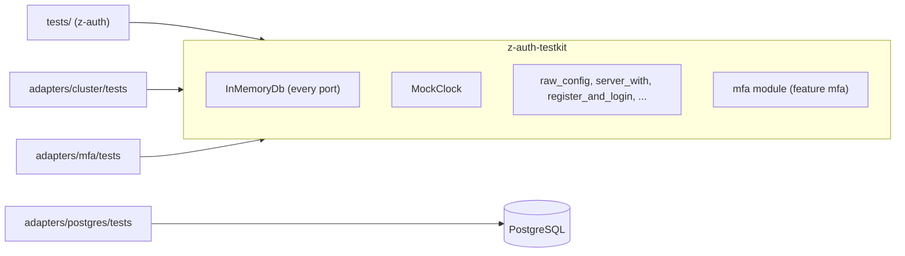
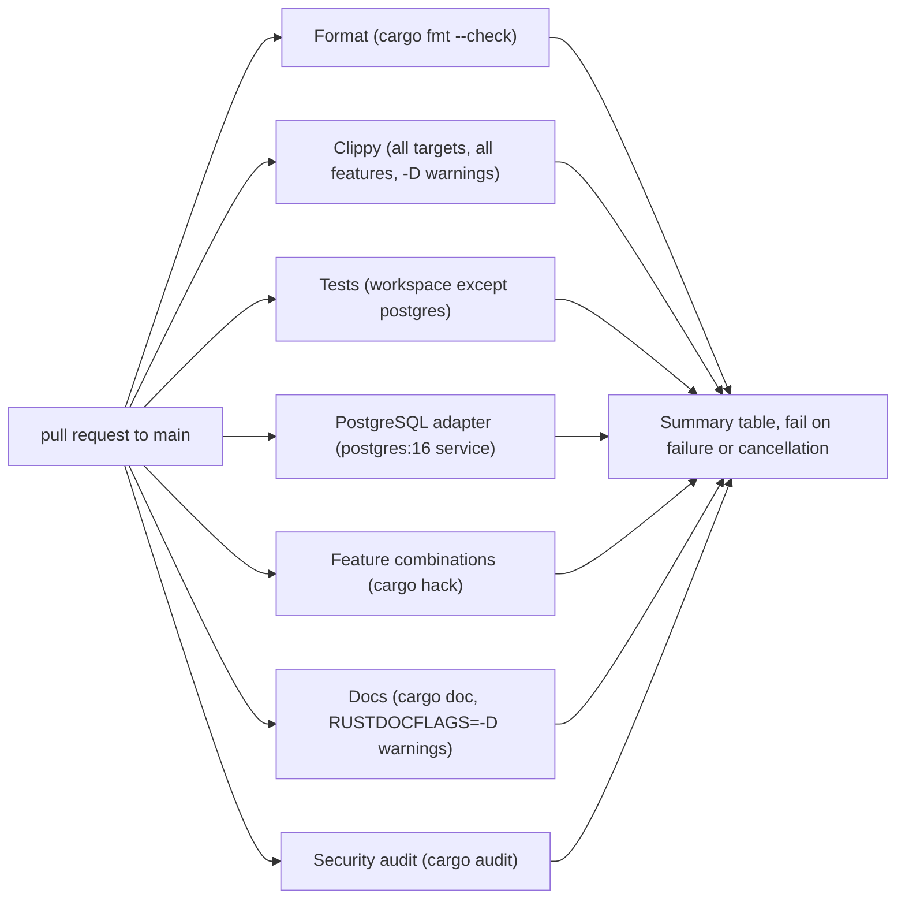

# Development

This guide is for working on z-auth itself. It describes the workspace layout, the testkit shared by the test suites, how to run the tests with and without a database, the feature-combination checks, and the CI and release workflows that guard the `main` branch.

## Workspace layout

The repository is a Cargo workspace whose root package is the core crate. The members are the three adapter crates and the testkit. The workspace has no committed `Cargo.lock`, because it is a library workspace, so CI resolves one where it needs it.

```text
z-auth/
├── Cargo.toml                    core package z-auth and the workspace definition
├── env.example                   every variable read by the core, cluster, mfa and postgres crates
├── examples/
│   └── keygen.rs                 prints AUTH_JWT_SIGNING_KEY, AUTH_REFRESH_SECRET, AUTH_JWT_VERIFYING_KEYS
├── src/                          the core crate (see architecture.md)
├── tests/                        core integration tests, all against the in-memory store
│   ├── support/mod.rs            re-exports z-auth-testkit
│   ├── api.rs                    handlers, DTO and error mapping
│   ├── authorization.rs          modes, roles in tokens, permissions, catalog, combined merging
│   ├── config_load.rs            RawConfig, defaults, validation, redaction
│   ├── register_user.rs          registration, uniqueness, validation, updates, listing
│   ├── revocation.rs             pending, enforced, bootstrap at start, expiry
│   ├── roles.rs                  role management
│   ├── second_factor.rs          two-step login through a stub SecondFactorGate
│   ├── session_flow.rs           login, refresh, grace, reuse, IP binding, eviction, logout, account changes
│   └── user_role.rs              assignments and their history
├── testkit/                      z-auth-testkit, in-memory adapters and helpers (publish = false)
├── adapters/
│   ├── cluster/                  z-auth-cluster, shared and federation mode
│   ├── mfa/                      z-auth-mfa, two-factor authentication, examples/mfa_keygen.rs
│   └── postgres/                 z-auth-postgres, sqlx repositories, migrations, setup_db
├── .cargo/audit.toml             cargo-audit configuration
└── .github/workflows/
    ├── ci.yml                    pull-request checks
    └── release.yml               tagged releases
```

## The testkit

`z-auth-testkit` lets every suite in the workspace run without a database. It depends on the core with `argon2`, `crypto` and `serde` enabled and is never published. Its centrepiece is `InMemoryDb`, a single type that implements every repository port of the core over one shared, mutex-protected state, so cross-port behaviour such as joins of users and roles or delete cascades matches a relational store. Like a real database it owns the clock, taking every timestamp from the `Clock` it was created with, so tests time-travel by advancing that clock. It also counts repository calls with `calls()`, which the suite uses to prove that verification and authorization checks make none, and exposes inspection helpers such as `generation_numbers(session_id)` and `revocations()`.

The crate root provides the helpers the suites share. `MockClock` is a controllable clock with `advance(Duration)`. `raw_config()` returns a `RawConfig` with freshly generated keys and the issuer `z-auth-test`, and `test_config()` builds it. `repositories(&db)` fills a `Repositories` from one `InMemoryDb`, `server_with(db, clock, config)` builds a `ZAuth` over them with the permission repository and the mock clock wired in and returns it as a `Server` (holding `auth`, `db` and `clock`), `server(config)` does the same over a fresh store, and `make_auth()` returns a ready `ZAuth` with the test configuration. The request helpers are `ctx(ip)`, a `ClientContext` with a test user agent, `register_request(email, username)`, `credentials(email)`, `register(&auth, email)`, `register_and_login(&auth, email, ip)` and `new_role(name)`, and the constants are `VALID_PASSWORD`, `ISSUER`, `IP_A` and `IP_B`.

Three features add the extension ports. `shared` adds the in-memory node registry for z-auth-cluster's shared mode, `federation` (which implies `shared`) adds the federation sync store, and `mfa` adds the in-memory z-auth-mfa store together with the `mfa` module, which provides fixed test keys, a `RecordingCodeSender` that records codes instead of sending them, `mfa_server(..)` and `mfa_server_with(..)` to build a server with the extension wired in, and `totp_code(..)` to compute a TOTP code at the mock clock's time.



## Running the tests

Everything except the PostgreSQL adapter runs without external services. This is the command CI runs.

```sh
cargo test --workspace --exclude z-auth-postgres --all-features
```

Most core suites are compiled only with the `argon2` and `crypto` features, because the facade's defaults need them, and each such file says so with a `cfg` attribute at the top (`user_role.rs` needs only `argon2`, and `config_load.rs` has no gate). Running `cargo test` in the root package with default features covers them all.

The PostgreSQL adapter's tests talk to a real database. Their helper reads the connection settings from the `DB_*` variables through `PgConfig::from_env`, falling back to a local default, and applies any pending migrations before each suite. Create the database once with `setup_db`, including the cluster and mfa sets, and then run the adapter's tests with all features, since several test files require the `shared`, `federation` or `mfa` feature.

```sh
export DB_HOST=localhost DB_PORT=5432 DB_USER=postgres DB_PASSWORD=postgres DB_NAME=auth
cargo run -p z-auth-postgres --features shared,mfa --bin setup_db -- --cluster --mfa
cargo test -p z-auth-postgres --all-features
```

The helpers are idempotent and safe to run in any order with several test threads.

## Feature combinations

Each crate has optional features (the core has `argon2`, `crypto` and `serde`, z-auth-cluster `shared` and `federation`, z-auth-mfa `aead`, z-auth-postgres `shared`, `federation` and `mfa`), and every combination must compile. CI checks this with cargo-hack, which builds every crate with each feature on its own as well as with no default features, without dev-dependencies. Run the same check locally before changing feature gates.

```sh
cargo install cargo-hack
cargo hack check --workspace --each-feature --no-dev-deps
```

## Continuous integration

`.github/workflows/ci.yml` runs on every pull request to `main` (when it is opened, synchronized or reopened). A newer push to the same pull request cancels the run in progress. The jobs run in parallel, and a summary job waits for all of them.



The format job runs `cargo fmt --all --check`. The clippy job runs `cargo clippy --workspace --all-targets --all-features -- -D warnings`. The test job runs the database-free suites with the command shown above. The PostgreSQL job starts a `postgres:16` service, runs `setup_db` with the `shared` and `mfa` features and the `--cluster --mfa` flags, and then runs `cargo test -p z-auth-postgres --all-features`. The features job runs the cargo-hack check. The docs job builds `cargo doc --workspace --all-features --no-deps` with rustdoc warnings denied, so broken intra-doc links fail the build. The audit job generates a lockfile and runs `cargo audit`, honouring the ignore list in `.cargo/audit.toml`, which currently ignores one advisory for the `rsa` crate that is only reachable through an sqlx MySQL dependency the workspace never enables. The summary job writes a table of the results into the run summary and fails if any job failed or was cancelled.

## Releases

`.github/workflows/release.yml` runs when a tag starting with `v` is pushed. It builds on two targets, `x86_64-unknown-linux-gnu` on Ubuntu and `aarch64-apple-darwin` on macOS, and for each it first checks that the tag matches the version of the `z-auth` package, accepting either `v<version>` or `v<version>-<suffix>`. It then runs a release build of the whole workspace with all features (`--lib --bins --examples`), packages `setup_db`, `keygen`, `mfa_keygen`, the README and `env.example` into `z-auth-<tag>-<target>.tar.gz`, and writes a SHA-256 checksum file beside it. A second job downloads both archives and creates the GitHub release with generated notes, marking it as a pre-release when the tag contains a hyphen, and lists every asset with its checksum in the run summary.

To cut a release, bump `version` in the root `Cargo.toml`, which is the version the workflow checks (the adapter crates and the testkit currently carry the same version, and keeping them in step avoids confusion), merge, then tag the merge commit and push the tag.

```sh
git tag v0.3.1
git push origin v0.3.1
```
