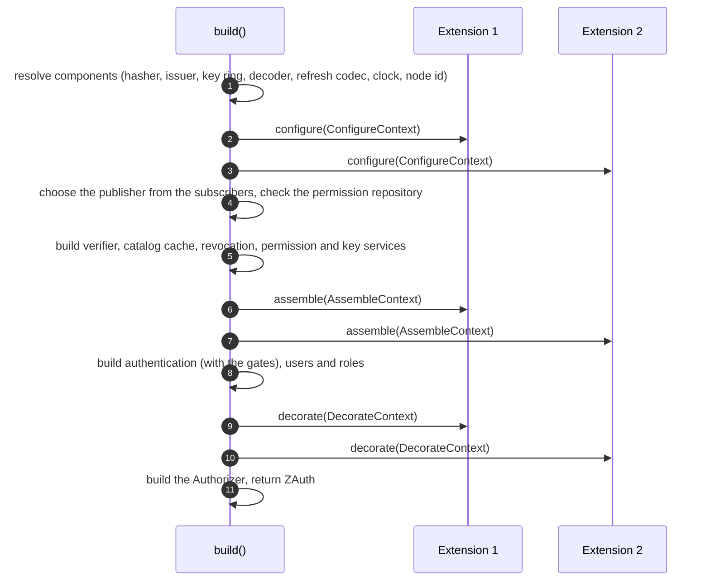

# Extensions

Optional components plug into z-auth through the `Extension` port without the core knowing them. Clustering (z-auth-cluster) and two-factor authentication (z-auth-mfa) are both built this way, and a host can write its own extensions with the same tools. This guide describes the trait, the three build phases and what each phase may touch, the hooks an extension can install (refresh gate, second-factor gate, serving fence, event subscriptions, service wrappers), how extensions are driven by the lifecycle and report back, and finishes with a complete minimal extension.

## The Extension trait

An extension is any `Send + Sync` type implementing `z_auth::Extension` (also `z_auth::controller::extension::Extension`). Only `name` is required, and every other method has a no-op default, so an extension implements just the phases and hooks it needs. The trait is declared with `async_trait`, so implementations that override the async methods use `#[async_trait]` too.

| Method | When it runs | Typical use |
|---|---|---|
| `name(&self) -> &'static str` | any time | Names the extension in reports and errors |
| `configure(&self, &mut ConfigureContext)` | `build()`, phase 1, before any service exists | Subscribe to domain events, claim the serving fence, declare that it supplies the permission service |
| `assemble(&self, &mut AssembleContext)` | `build()`, phase 2, once the shared state and the revocation, key and permission services exist | Replace the permission service or the refresh account source, install a refresh gate or a second-factor gate |
| `decorate(&self, &mut DecorateContext)` | `build()`, phase 3, once every service exists | Wrap or replace the public services |
| `start(&self)` | `ZAuth::start`, after z-auth loaded its state and before it publishes its own verifying key | Join a cluster, load state, return a start report |
| `tick(&self)` | `ZAuth::tick`, after z-auth enforced pending revocations and pruned the denylist | Heartbeats, housekeeping, return a tick report |
| `shutdown(&self)` | `ZAuth::shutdown`, in reverse registration order | Leave a cluster, flush state |

The three build phases return `Result<(), AuthError>`, and an error aborts `build()`, which is how an extension refuses an invalid setup (z-auth-mfa refuses email or SMS methods without a code sender, for example). `start` and `tick` return `Result<Option<ExtensionReport>, AuthError>`, and an error aborts the `ZAuth` call that drove it.

Extensions are registered with `ZAuthBuilder::extension(Arc<dyn Extension>)`, which may be called repeatedly. They are wired and driven in registration order, except for `shutdown`, which runs last-registered first. Keep a clone of the `Arc` if the host needs to talk to the extension directly later, as it does with a cluster's inbound endpoint or the mfa enrollment service.

## Build phases

`ZAuthBuilder::build` calls every extension three times, once per phase, with the core services built in between. The sequence below shows the order for two registered extensions.



### Phase 1, configure

`ConfigureContext` exists before any service. It exposes `config()` (the `AuthConfig`), `node_id()` (this instance's id) and `clock()`, plus three actions. `subscribe(Arc<dyn EventPublisher>)` registers a publisher that receives every domain event z-auth publishes, which are new and enforced revocations, published verifying keys, revoked signing keys and catalog changes. This is the only way publishers are added; the builder has no method for them. `serving_fence()` returns the instance's `ServingFence`, creating it on first use, so every caller shares one fence and the verifier and `tick` honour it. `provides_permission_service()` declares that the extension will supply the permission service in phase 2, so the permission modes do not require a `PermissionRepository`.

### Phase 2, assemble

`AssembleContext` exists once the shared in-memory state and the revocation, key and permission services have been built, but before authentication, users and roles. `core()` returns the `CoreHandles` described below. `permissions()` and `replace_permissions(..)` read and swap the permission service, and every service built from here on uses the replacement. `accounts()` and `replace_accounts(..)` read and swap the `RefreshAccountSource`, which is where a refresh reads whether the user may still refresh and the authorization data for the new token (the default, `StoreAccountSource`, reads the user, roles and grants from the store). `set_refresh_gate(..)` and `set_second_factor_gate(..)` install the two gates, each at most once per instance, and a second installation fails with `AuthError::Config`. `load_catalog_at_start()` makes `ZAuth::start` load the permission catalog even outside the permission modes.

`CoreHandles` is the bundle of shared state and core services available from phase 2 on. It is `Clone`, so an extension may keep a copy.

| Accessor | Returns |
|---|---|
| `config()` | `&AuthConfig` |
| `node_id()` | `Uuid` |
| `clock()` | `&Arc<dyn Clock>` |
| `entry_ttl()` | `Duration`, how long a denylist entry lives (access TTL plus leeway) |
| `denylist()` | `&Arc<Denylist>` |
| `keyring()` | `&Arc<KeyRing>` |
| `catalog()` | `&Arc<CatalogCache>` |
| `decoder()` | `&Arc<dyn AccessTokenDecoder>` |
| `verifier()` | `&Arc<TokenVerifier>` |
| `repositories()` | `&Repositories`, the repositories given to the builder |
| `permission_repository()` | `Option<&Arc<dyn PermissionRepository>>` |
| `revocation()` | `&Arc<dyn TokenRevocationService>`, the core revocation service, never the decorated one |

### Phase 3, decorate

`DecorateContext` exists once every service has been built. It exposes `core()` and `accounts()` (the refresh account source in use) for reading, and mutable access to the five public services, `users()`, `roles()`, `permissions()`, `authentication()` and `revocation()`, each returning `&mut Arc<dyn ...>`. An extension wraps a service by replacing it with a type that holds the previous one.

```rust
// Inside Extension::decorate.
let inner = ctx.authentication().clone();
*ctx.authentication() = Arc::new(AuditedAuthentication { inner });
```

Because the extensions run in registration order and each one wraps what is there, later extensions wrap outside earlier ones. A call through `ZAuth::authentication()` reaches the last registered wrapper first and travels inwards to the core implementation. The revocation service in `CoreHandles` is never wrapped, so the core's own use of it (logout, eviction, compromise, account changes) bypasses any decoration of `ZAuth::revocation()`.

## Hooks

### The refresh gate

A `RefreshGate` is consulted on every refresh. Its `check_fresh()` runs after the denylist check and may refuse when this instance's state is too old to judge a refresh, for example with `AuthError::ReplicaStale`. Its `catch_up(session_id, user_id)` is called when the account or the session has not reached this instance yet, or when the presented generation is newer than the stored one, and fetches them from elsewhere, returning whether anything arrived or changed. The refresh flow calls `catch_up` at most once per refresh and answers a second miss with the retryable `AuthError::ReplicaBehind`. With a gate installed, a generation newer than the stored one is never treated as theft. z-auth-cluster's federation mode installs this gate on its services, as the [sessions and tokens guide](sessions-and-tokens.md) explains in context.

### The second-factor gate

A `SecondFactorGate` is consulted on every login once the password matched and the account is active, before any session exists. Its `on_password_verified(&UserWithRoles, &ClientContext)` returns a `SecondFactorDecision`, either `Proceed` (open the session now) or `Challenge(LoginChallenge)` (ask the client for a second factor and open nothing), and may also refuse the login outright with an error such as `SecondFactorLocked`. The `LoginChallenge` carries an opaque single-use `challenge_token`, its `expires_at`, the `methods` the user may answer with (for example `totp`, `email`, `sms`, `recovery_code`, preferred first) and an optional `ChallengeDelivery` describing where a code was already sent, with a masked `destination_hint`.

The client answers with a `SecondFactorProof` (the challenge token, an optional method and the code) through `complete_login`. The gate's `verify(&SecondFactorProof, &ClientContext)` checks it, consumes the challenge on success and returns a `VerifiedSecondFactor` with the `user_id` the challenge was issued to and the `amr` methods the proof adds. z-auth then re-reads the account and opens the session with the gate's methods plus `pwd` and `mfa`, sorted. The RFC 8176 method names are available as constants in `z_auth::conf::constants`.

| Constant | Value | Meaning |
|---|---|---|
| `AMR_PWD` | `pwd` | Password, added by z-auth to every session |
| `AMR_OTP` | `otp` | One-time password, such as TOTP, an emailed code or a recovery code |
| `AMR_SMS` | `sms` | A code sent by SMS |
| `AMR_MFA` | `mfa` | More than one factor was used, added by z-auth after a second factor |

### The serving fence

A `ServingFence` is a shared flag an extension raises when this instance must stop serving, for example because it was evicted from its cluster or lost its quorum. The extension obtains it with `ConfigureContext::serving_fence()` and raises it with `fence()`, which returns `true` the first time. Once raised it never comes down. The token verifier then refuses every token with `AuthError::NodeFenced` (HTTP 503), `ZAuth::tick` stops enforcing revocations, `ZAuth::is_fenced()` returns `true`, and any wrapper can call `check()` to refuse in the same way. The host is expected to restart a fenced process.

### Event subscriptions

A publisher registered with `ConfigureContext::subscribe` receives every `DomainEvent`, as listed in the [architecture guide](architecture.md). `EventPublisher` has a single async method, `publish(&self, event: DomainEvent)`, which must not fail; retries and repair are the publisher's own business. Through blanket implementations every `EventPublisher` also serves as the token services' `TokenEvents` port and the permission service's `CatalogEvents` port, so a subscriber never implements those.

## Reports

`start` and `tick` may return an `ExtensionReport`, built with `ExtensionReport::new(name, data)` from any `Debug + Send + Sync + 'static` value. `ZAuth` collects them into the `extensions` field of `StartReport` and `TickReport`. The host reads them back by type with `report.extension::<T>()` on the start or tick report, which returns the first report of that type, or with `ExtensionReport::get::<T>()` on an individual one. `ExtensionReport::extension()` returns the reporting extension's name, and its `Debug` output prefixes the data with that name.

```rust
let tick = auth.tick().await?;
if let Some(mfa) = tick.extension::<z_auth_mfa::MfaTickReport>() {
    println!("z-auth-mfa purged {} expired rows", mfa.purged);
}
```

## How the bundled extensions use the port

z-auth-cluster's shared-mode `SharedCluster` subscribes a publisher in `configure` that pushes every domain event to the peers, builds its cluster service over the core denylist, key ring and catalog in `assemble`, joins the cluster in `start`, heartbeats in `tick` and leaves in `shutdown`. Its federation mode additionally claims the serving fence, may declare that it supplies the permission service, replaces the permission service and the refresh account source with snapshot-based ones on non-authority services, installs a refresh gate, and wraps the public services in `decorate` so that identity changes are produced at the authority and refused elsewhere. The [cluster guide](../adapters/cluster/README.md) and its [replication guide](../adapters/cluster/docs/replication.md) describe both modes.

z-auth-mfa's `Mfa` validates its setup in `configure`, builds its service in `assemble` and installs it as the second-factor gate unless enforcement is `off`, and purges expired challenges, enrollments and lockout rows from `tick`, reporting the count as an `MfaTickReport`. The [mfa guide](../adapters/mfa/README.md) and its [login flow guide](../adapters/mfa/docs/login-flow.md) describe enrollment and the two-step login.

## A minimal custom extension

The following extension installs a second-factor gate that challenges selected users and accepts a fixed code. It is adapted from `tests/second_factor.rs`, where it drives the two-step login tests against the in-memory store, and shows every piece a real gate needs. Besides z-auth it uses the `async-trait`, `chrono` and `uuid` crates. A production gate would store challenges durably, compare codes in constant time and limit attempts, which is what z-auth-mfa does.

```rust
use std::sync::{Arc, Mutex};

use async_trait::async_trait;
use uuid::Uuid;
use z_auth::controller::extension::AssembleContext;
use z_auth::identity::user::UserWithRoles;
use z_auth::prelude::*;

const CODE: &str = "123456";

/// Challenges every user in `challenged`; accepts `CODE` once per challenge.
#[derive(Default)]
struct StubGate {
    challenged: Mutex<Vec<Uuid>>,
    /// challenge token → user
    pending: Mutex<Vec<(String, Uuid)>>,
}

#[async_trait]
impl SecondFactorGate for StubGate {
    async fn on_password_verified(
        &self,
        account: &UserWithRoles,
        _ctx: &ClientContext,
    ) -> Result<SecondFactorDecision, AuthError> {
        if !self.challenged.lock().unwrap().contains(&account.user.id) {
            return Ok(SecondFactorDecision::Proceed);
        }
        let token = format!("ch-{}", Uuid::new_v4());
        self.pending.lock().unwrap().push((token.clone(), account.user.id));
        Ok(SecondFactorDecision::Challenge(LoginChallenge {
            challenge_token: token,
            expires_at: chrono::Utc::now() + chrono::Duration::minutes(5),
            methods: vec!["totp".into()],
            delivery: None,
        }))
    }

    async fn verify(
        &self,
        proof: &SecondFactorProof,
        _ctx: &ClientContext,
    ) -> Result<VerifiedSecondFactor, AuthError> {
        let mut pending = self.pending.lock().unwrap();
        let at = pending
            .iter()
            .position(|(t, _)| *t == proof.challenge_token)
            .ok_or(AuthError::ChallengeExpired)?;
        if proof.code != CODE {
            return Err(AuthError::InvalidSecondFactor);
        }
        let (_, user_id) = pending.remove(at);
        Ok(VerifiedSecondFactor {
            user_id,
            amr: vec!["otp".into()],
        })
    }
}

struct GateExtension(Arc<StubGate>);

impl Extension for GateExtension {
    fn name(&self) -> &'static str {
        "stub-2fa"
    }
    fn assemble(&self, ctx: &mut AssembleContext<'_>) -> Result<(), AuthError> {
        ctx.set_second_factor_gate(self.0.clone())
    }
}
```

The extension only overrides `name` and `assemble`, so it needs no `#[async_trait]` on its `Extension` impl. It is registered like any other.

```rust
let gate = Arc::new(StubGate::default());
let auth = ZAuth::builder(config, repos)
    .extension(Arc::new(GateExtension(gate.clone())))
    .build()?;
```

With it installed, a login by a challenged user returns `LoginOutcome::SecondFactor`, no session exists until `complete_login` succeeds, a wrong code yields `InvalidSecondFactor` and leaves the challenge open, the challenge cannot be used twice, and the resulting tokens carry `amr = ["mfa", "otp", "pwd"]` across refreshes. Registering a second extension that also installs a second-factor gate makes `build()` fail with `AuthError::Config`.
