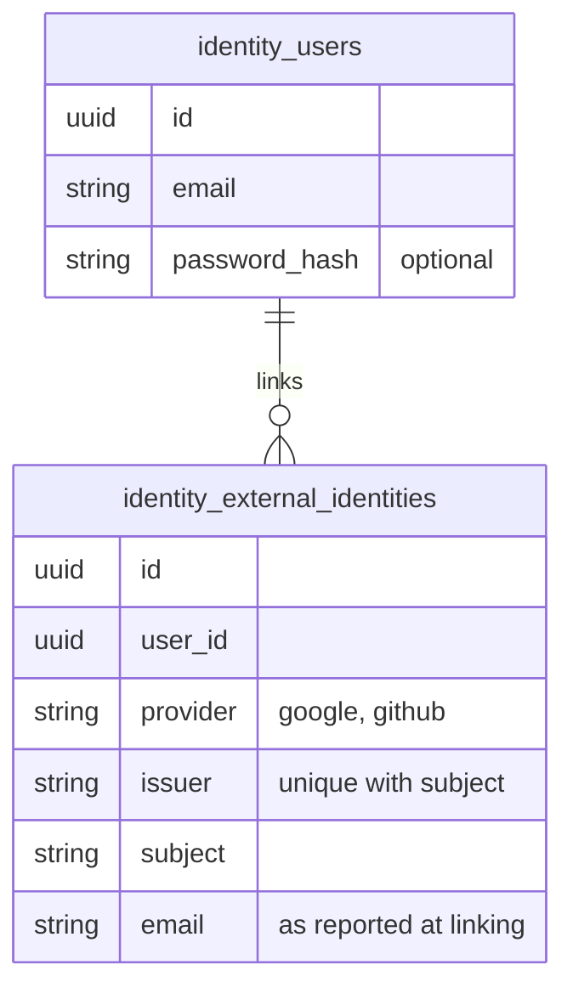
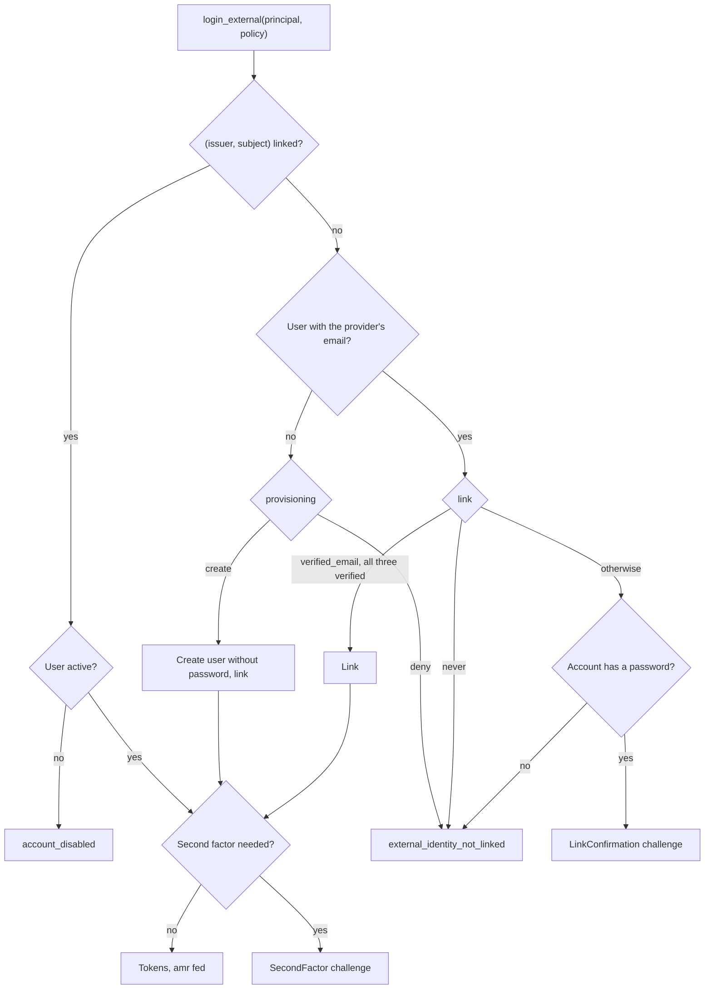

# External identities and account linking

z-auth signs users in with a password by default. This guide covers the other way in, an identity that another provider vouches for, such as a Google, Microsoft Entra ID, Okta or GitHub account. It explains what the core does with such an identity, how one user ends up with a password and several provider accounts that all lead to the same `user_id`, the policies that decide when a first sign-in may join an existing account, explicit linking from a signed-in session, and how the second factor and the `amr` claim behave. The protocols themselves (OpenID Connect, OAuth2) live in the [z-auth-sso](../adapters/sso/README.md) crate, and anything that verifies a provider's assertion can use the same core entry points.

## Principals and identities

A protocol adapter verifies the provider's answer and hands the core an `ExternalPrincipal`. It names the provider configuration (`provider`, such as `google`), the provider's `issuer` and the provider's stable id of the user (`subject`, the OIDC `sub`), and may add an email address with an `email_verified` flag, a username, a first and last name, and the authentication methods the provider reported (`amr`). The core trusts every field, so an adapter only fills in what it verified.

A linked identity is an `ExternalIdentity` row that ties an `(issuer, subject)` pair to a `user_id`. One user may have any number of them, while each pair belongs to at most one user. The row also keeps the provider name, the email the provider reported when it was linked, and the times of linking and of the last sign-in through it. The user row itself is unchanged, and `password_hash` stays optional, so a user created through a provider simply has no password.

Identities are matched by `(issuer, subject)` and never by email. Email addresses change and are reused, and some providers let users enter addresses they do not own, whereas the subject is the provider's permanent id for the account. The email only matters at the very first sign-in through an identity, as a hint that an account may already exist.



## Enabling it

External sign-in needs two stores, both optional for a deployment that does not use it. `ExternalIdentityRepository` keeps the linked identities, and `FlowStateRepository` keeps short-lived, single-use state such as a sign-in that waits for a password or a redirect to a provider. The host passes them to `ZAuthBuilder::external_identities`, and may add an `ExternalIdentityEvents` implementation with `external_identity_events` to hear about every link and unlink, for example to email the user that a new sign-in method was added.

```rust
let auth = ZAuth::builder(config, z_auth_postgres::repositories(&pool))
    .external_identities(
        Arc::new(PgExternalIdentityRepository::new(pool.clone())),
        Arc::new(PgFlowStateRepository::new(pool.clone())),
    )
    .external_identity_events(Arc::new(MailOnLink::new(mailer)))
    .build()?;
```

The PostgreSQL adapter implements both stores behind its `external-identity` feature, and the in-memory test store implements them too. Without the stores every external call fails with `AuthError::Config`. `ZAuth::tick` deletes expired flow states and reports their number in `TickReport::flows_purged`.

## Signing in

`AuthenticationService::login_external` takes the principal, the provider's `ProviderPolicy` and the `ClientContext`, and returns an `ExternalLoginOutcome`. When the identity is already linked, its user signs in, provided the account is active, and the identity's last sign-in time is recorded.

When the identity is new, the policy decides. If a user with the provider's email exists, the `link` setting applies, otherwise the `provisioning` setting does.

| `link` | A user with the provider's email exists |
|---|---|
| `never` | Refused with `external_identity_not_linked`. The user signs in with the password and links the identity explicitly. |
| `confirm_with_password` (default) | The sign-in pauses with `ExternalLoginOutcome::LinkConfirmation` until the existing account's password is given. |
| `verified_email` | Linked at once when the provider is trusted with emails (`trust_email`), reports the email as verified, and the existing account's email is verified too. Otherwise it pauses for the password like `confirm_with_password`. |

| `provisioning` | No user has the provider's email |
|---|---|
| `deny` (default) | Refused with `external_identity_not_linked`. Only existing users may sign in. |
| `create` | A user is created without a password and the identity is linked to it. The provider's email is required, and the user starts verified when the provider is trusted with emails and vouched for it. A suggested username that is taken is dropped. |

`max_links` caps how many identities of one provider a user may link, one by default, and 0 lifts the limit. A sign-in that would exceed it fails with `provider_already_linked`.



### Why an email match is not enough

Joining accounts on a matching email alone opens two well-known attacks. In account pre-hijacking, an attacker registers the victim's address with a password of their own before the victim ever signs up. When the victim later signs in through a provider and the accounts are joined, the attacker's password opens the victim's account. In the other attack a provider lets users put any address in their profile, as the "nOAuth" issue with Microsoft Entra ID showed in 2023, and an attacker who sets the victim's address is joined to the victim's account.

The default policy defeats both, because only the existing account's password can confirm the link. `verified_email` skips the password only when three facts hold together, the provider is configured as trusted with emails, it reports the address as verified, and the local account's address is verified too. A pre-registered account was never verified by its squatter, so it is never joined silently. z-auth itself has no email verification flow, so the host sets `is_verified` through its own flow or administration.

The price of `confirm_with_password` is that anyone who signs in through a provider learns whether an account with that provider's email exists, since the response asks for its password. `never` avoids that disclosure at the cost of making users link explicitly.

### Confirming with the password

A `LinkChallenge` carries an opaque `challenge_token`, its expiry (`AUTH_EXTERNAL_LINK_CHALLENGE_TTL_SECS`, five minutes by default) and the existing account's email to show the user. The client sends the token and the password to `AuthenticationService::confirm_link`, or the `confirm_link` handler at `POST /login/link`. The challenge is single use, so a wrong password ends it and the user starts over at the provider, which makes guessing as slow as the provider round trip. Someone with a provider account can still repeat that round trip, so the host should rate-limit `POST /login/link` per account and per client exactly like `POST /login`. With the right password the identity is linked and the login continues as after a password login, with tokens or a second-factor challenge.

The challenge is stored as a flow state under the SHA-256 of its token, so the store never holds a usable token.

## Explicit linking

A signed-in user can link another provider account from their settings, for example with a "Connect Google" button. `AccountLinkService`, reached through `ZAuth::account_links`, does the linking for a session.

`authorize(session_id)` checks that the session may change sign-in methods now and returns its user. The session must be active and unexpired, its user active, and the session recent, opened at most `AUTH_EXTERNAL_LINK_MAX_AUTH_AGE_SECS` ago (ten minutes by default). Refreshing a session does not make it recent, since `Session::created_at` is the time of the login. An older session gets `reauthentication_required`, and the client asks the user to log in again before trying. This keeps someone who has stolen a long-lived session from adding their own provider account as a permanent way in.

`link(session_id, principal, policy)` links the identity to the session's user after the same checks. The email plays no role here, because the user has just proven both accounts. Linking an identity the user already has returns it unchanged, an identity that belongs to another user fails with `external_identity_linked_elsewhere` and is never moved, and `max_links` applies as at sign-in. z-auth-sso calls `authorize` before it sends the browser to the provider and `link` when it comes back, so a session that ended in between, by logout for instance, links nothing.

`unlink(session_id, identity_id)` removes one of the session user's identities under the same recency rule. It refuses with `last_login_method` when the user has no password and no other identity, because the account would be left without a way in. An identity of another user is reported as `external_identity_not_found`. `list(user_id)` returns the user's identities, oldest first.

The handlers `external_identities` (`GET /me/identities`) and `unlink_external_identity` (`DELETE /me/identities/{id}`) expose listing and unlinking with a bearer token. The listing names the provider, the email at linking and the times, never the subject or any token.

A user created through a provider has no password. The host can offer a set-password flow through `UserService::update`, after which the account has both ways in.

## The second factor and amr

After an external sign-in the second-factor gate runs exactly as after a password, so a user with an enrolled factor answers a challenge and `complete_login` opens the session. Sessions opened through an identity carry `fed` in their `amr` claim. A session confirmed with the password carries `fed` and `pwd`, and one completed with a second factor adds the gate's method and `mfa`, so `require_mfa` behaves the same whichever way the user came in.

When a provider is trusted to report its own authentication methods (`trust_amr` in z-auth-sso), they are passed on, and a provider-reported `mfa` satisfies the second factor, so the local gate is skipped. Methods that are not RFC 8176-shaped tokens are dropped. Only trust providers whose multi-factor policy you rely on.

`complete_login` needs to know how a login started, because the gate's challenge only names the user. An external sign-in that is challenged therefore leaves its methods in a flow state keyed by the challenge token's hash, and `complete_login` reads them back. Without such an entry the login started with a password, as before.

## Clusters

External sign-in happens at the service that owns identity. In federation mode the session-store services refuse `login_external` and `confirm_link` with `not_authority`, like `login`, and the authority publishes the new session's account snapshot as it does for password logins. A fenced instance refuses both calls. Neither table is part of the cluster change feed.

## Configuration

| Variable | File path | Default | Meaning |
|---|---|---|---|
| `AUTH_EXTERNAL_LINK_MAX_AUTH_AGE_SECS` | `auth.external.link_max_auth_age_secs` | `600` | Linking and unlinking need a session opened at most this long ago. |
| `AUTH_EXTERNAL_LINK_CHALLENGE_TTL_SECS` | `auth.external.link_challenge_ttl_secs` | `300` | How long a sign-in waits for the existing account's password. |

The per-provider policy is configured with the provider, in z-auth-sso's [configuration guide](../adapters/sso/docs/configuration.md).

## Errors

| Code | Status | When |
|---|---|---|
| `external_identity_not_linked` | 403 | The identity is not linked and the policy neither links nor creates a user. |
| `external_identity_linked_elsewhere` | 409 | The identity belongs to another user. |
| `provider_already_linked` | 409 | The user already has `max_links` identities of this provider. |
| `external_identity_not_found` | 404 | No such identity among the user's. |
| `last_login_method` | 409 | Unlinking would leave the user no way to log in. |
| `reauthentication_required` | 401 | The session is too old to change sign-in methods. |
| `challenge_expired` | 401 | The link challenge is unknown, used or expired. |
| `external_login_failed` | 401 | A protocol adapter refused the provider's answer. |
| `external_provider_unavailable` | 503 | The provider could not be reached; retry. |
| `unknown_provider` | 404 | No provider is configured under that name. |
