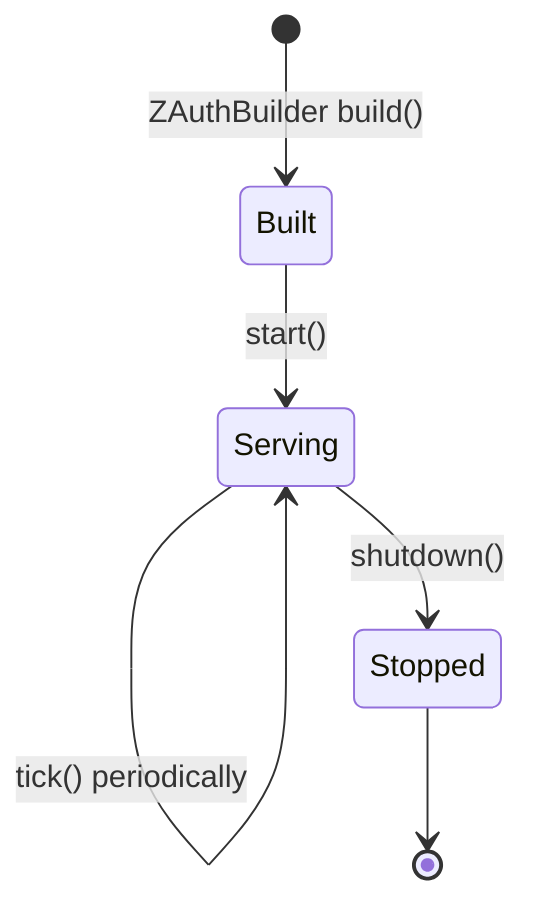
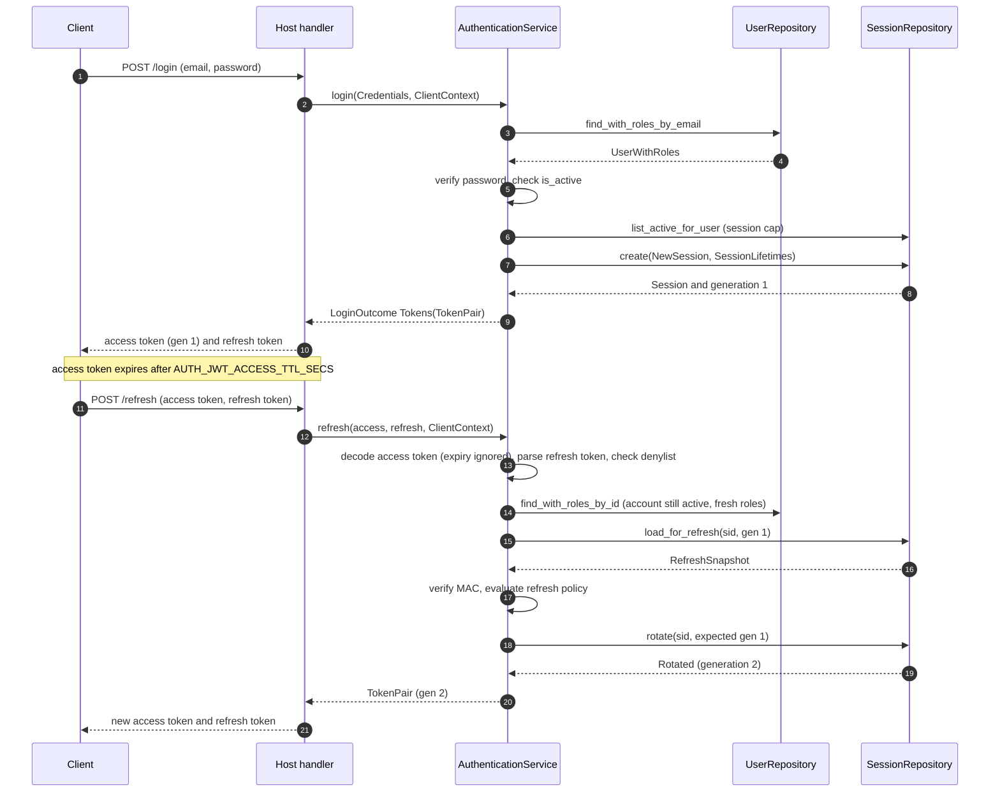

# Getting started

This guide takes a new host application from nothing to a working login. It generates the keys, prepares the environment, creates the database with the reference PostgreSQL adapter, wires `ZAuth`, runs its lifecycle, and then walks through registering a user, logging in, refreshing, verifying access tokens on requests and logging out. The examples use real z-auth types throughout. Where they lean on crates that z-auth does not depend on (tokio, dotenvy, a web framework), the surrounding text says so and the code is illustrative.

## Generate the keys

z-auth needs three secrets. The Ed25519 signing seed signs access tokens and belongs on the auth service only. The matching verifying key goes to every service that verifies access tokens. The refresh secret is the server-wide HMAC key for refresh tokens and, like the signing seed, belongs on the auth service only. The `keygen` example generates all three and prints them as a ready-to-paste block.

```sh
cargo run --example keygen
```

The output has the following shape. Every run produces fresh random values, so never copy the sample values below into a real deployment.

```env
# auth service only
AUTH_JWT_SIGNING_KEY=3n8sr/obgPLEHD0sFn8cHI2NC7/mlRb46xczhEbyLOs=
AUTH_REFRESH_SECRET=/jJ9YoLoXgSgjvCBtl+yvNC0pOPt4zt3LXiv+hG4cRY=

# every service that verifies access tokens
AUTH_JWT_VERIFYING_KEYS=FmPs417ApIQTf20Fc2Z9VWmSTmc/Mua5Tz8PNYRq9pA=
```

All three are standard base64. The signing seed and each verifying key must decode to exactly 32 bytes, and the refresh secret to at least 32 bytes, otherwise loading the configuration fails with `ConfigError::Parse`. The example is built from `z_auth::security::token::keys::generate_signing_key` and `generate_refresh_secret`, which you can call from your own tooling as well, and it requires the `crypto` feature (on by default).

## Prepare the environment

`env.example` at the repository root lists every variable read by the core, by z-auth-cluster, by z-auth-mfa, by z-auth-mfa-sender and by the PostgreSQL adapter, with the defaults as comments. Copy it to `.env`, paste the keys from `keygen`, and set the `DB_*` variables for your database.

```sh
cp env.example .env
```

The core reads configuration through `EnvLoader`, which looks at the process environment only. It deliberately never loads a `.env` file and never mutates the environment, so loading `.env` is the host's job, typically with the `dotenvy` crate at the very start of `main`. Only the `AUTH_*` variables documented in the [configuration guide](configuration.md) are read by the core. The cluster, mfa and database variables are read by their own crates and are ignored by `EnvLoader`.

A YAML file is the alternative to `.env`. `z-auth.example.yaml` at the repository root holds the same settings as `env.example`, grouped into one section per crate, and `ConfigSource::standard()` reads the file named by `AUTH_CONFIG_FILE` with the process environment layered on top. Pass that source to `SourceLoader` instead of using `EnvLoader`, and to the other crates' source loaders. A variable always wins over the file, so a common split keeps the structure in the file and the keys and passwords in the environment. The [configuration guide](configuration.md#configuration-file) covers the format and its rules.

An empty value counts as set. `AUTH_JWT_SIGNING_KEY=` with nothing after it is parsed as an empty base64 string and rejected for not being 32 bytes long, which is different from the variable being absent. A service that only verifies tokens should therefore remove the signing key and refresh secret lines from its environment rather than leave them empty. The trailing `# ...` comments in `env.example` deserve the same care. Libraries such as `dotenvy` strip them, but the small parser inside `setup_db` does not, so a line like `DB_NAME=auth  # optional` would name the database `auth  # optional`. Deleting those comments from your `.env` avoids the problem for every loader.

## Create the database

The reference adapter ships a `setup_db` binary. It reads the `DB_*` variables (loading `.env` from the current directory first, if present), creates the database if it does not exist, and applies the embedded migrations. The [PostgreSQL adapter guide](../adapters/postgres/README.md) describes the schema and the migration sets in detail.

```sh
cargo run -p z-auth-postgres --bin setup_db
```

The optional extensions keep their tables in separate migration sets. With z-auth-mfa, build `setup_db` with the `mfa` feature and pass `--mfa`. With z-auth-cluster, build it with the `shared` feature and pass `--cluster`.

```sh
cargo run -p z-auth-postgres --features mfa --bin setup_db -- --mfa
cargo run -p z-auth-postgres --features shared --bin setup_db -- --cluster
```

If you use your own store instead, implement the repository ports described in the [storage ports guide](storage-ports.md) and skip this step.

## Wire ZAuth

`ZAuth::builder` takes the validated `AuthConfig` and a `Repositories` struct with the six required repositories. `z_auth_postgres::repositories(&pool)` builds that struct on one connection pool. The permission repository is passed separately with `.permissions(..)`, because only the `permissions` and `combined` authorization modes need it. In those modes `build()` fails with `AuthError::Config` when it is missing, and in the other modes passing it is harmless. The [authorization guide](authorization.md) explains the modes.

The following `main` is illustrative in that it uses tokio and dotenvy, which you add to your own `Cargo.toml`. The z-auth and z-auth-postgres calls are exactly as in the crates.

```rust
use std::sync::Arc;
use std::time::Duration;

use z_auth::prelude::*;
use z_auth_postgres::{PgConfig, PgPermissionRepository, build_pg_pool, repositories};

#[tokio::main]
async fn main() -> Result<(), Box<dyn std::error::Error>> {
    // The host loads .env; z-auth only reads the process environment.
    dotenvy::dotenv().ok();

    let pool = build_pg_pool(&PgConfig::from_env()?).await?;
    let config = EnvLoader.load_config()?;

    let auth = ZAuth::builder(config, repositories(&pool))
        // Needed when AUTH_AUTHZ_MODE is `permissions` or `combined`.
        .permissions(Arc::new(PgPermissionRepository::new(pool.clone())))
        .build()?;
    let auth = Arc::new(auth);

    // Once, before serving: load revocations, keys and the catalog.
    let report = auth.start().await?;
    println!(
        "loaded {} revocations and {} verifying keys",
        report.revocations_loaded, report.keys_loaded
    );

    // Periodically: enforce revocations whose tokens were presented and
    // drop expired denylist entries.
    let ticker = auth.clone();
    tokio::spawn(async move {
        let mut every = tokio::time::interval(Duration::from_secs(5));
        loop {
            every.tick().await;
            if let Err(e) = ticker.tick().await {
                eprintln!("z-auth tick failed: {e}");
            }
        }
    });

    // ... serve requests with `auth` ...

    // On graceful shutdown: stop the extensions, last registered first.
    auth.shutdown().await?;
    Ok(())
}
```

`build()` checks everything that can be checked without I/O. With the default features it builds the Argon2id password hasher, the Ed25519 issuer from `AUTH_JWT_SIGNING_KEY`, the decoder and the HMAC refresh codec from `AUTH_REFRESH_SECRET`, and fails with `AuthError::Config` naming the missing key if one of them is absent. The builder also accepts replacements for each default component, which the [architecture guide](architecture.md) lists.

## Run the lifecycle

A `ZAuth` instance has a three-call lifecycle, drawn below. `start` runs once before the instance serves requests. It loads the stored verifying keys into the key ring, loads every active revocation into the in-memory denylist, loads the permission catalog in permission modes, starts the extensions and finally publishes this instance's own verifying key. Its `StartReport` says how many revocations and keys were loaded and carries one report per extension.



`tick` runs periodically for as long as the instance serves. It enforces the pending revocations whose tokens were presented since the last tick (described in [sessions and tokens](sessions-and-tokens.md)), drops expired denylist entries and ticks the extensions. Its `TickReport` carries the `enforced` and `pruned` counts. The core imposes no interval. A few seconds is a reasonable choice for a single instance, and with z-auth-cluster the cluster heartbeat (`AUTH_CLUSTER_HEARTBEAT_MS`) is the natural period. `shutdown` stops the extensions in reverse registration order, which for a cluster means leaving it.

`tick` does not purge persisted rows. Ended sessions and expired revocations stay in the store until the host calls `auth.authentication().purge_sessions(retention)` and `auth.revocation().purge_expired()`, for example from the same background task at a much lower frequency.

## Register a user

Registration goes through the user service. `RegisterUser` holds the plaintext password, which the service checks against the password policy and hashes before anything is stored. The email is trimmed and lowercased first, so `Alice@Example.com` and `alice@example.com` are the same account.

```rust
let user = auth
    .users()
    .register(RegisterUser {
        email: "alice@example.com".into(),
        password: "S3cur3P@ssw0rd!".into(),
        username: Some("alice".into()),
        first_name: Some("Alice".into()),
        last_name: None,
    })
    .await?;
assert!(user.is_active && !user.is_verified);
```

The service rejects a malformed email with `InvalidEmail`, a password that breaks the policy with `WeakPassword`, and duplicates with `EmailAlreadyTaken` or `UsernameAlreadyTaken`. Usernames are optional and have no format rules at all; the only constraint is that they are unique case-insensitively, while the stored value keeps its display case. New users are active and unverified. Be aware that nothing in the core ever checks `is_verified`. Login works for unverified accounts, and `AccountNotVerified` exists for hosts that want to enforce verification themselves. The same holds for `UserNotFound`, `RoleNotFound`, `RoleNotAssigned` and `RoleAlreadyAssigned`, which the core never raises on its own (role assignment, for example, reports a duplicate by returning `false`).

## Log in

A login needs the credentials and a `ClientContext` describing the request. The host builds the context, and it is responsible for the client IP being the real one, which behind a reverse proxy means reading it from the proxy headers you trust rather than from the socket. The user agent is optional and is truncated to 512 bytes on a character boundary before it is stored. The fingerprint is an optional stable device identifier of your choosing, such as a random id kept in an HttpOnly cookie set at login. Only its SHA-256 is stored, and only when the `crypto` feature is on; without it fingerprints are never stored and never match.

```rust
let ip: std::net::IpAddr = "203.0.113.7".parse()?;
let ctx = ClientContext::new(ip)
    .with_user_agent("Mozilla/5.0 (X11; Linux x86_64)")
    .with_fingerprint("device-7f3a9c");

let outcome = auth
    .authentication()
    .login(
        Credentials {
            email: "alice@example.com".into(),
            password: "S3cur3P@ssw0rd!".into(),
        },
        ctx.clone(),
    )
    .await?;

let pair = match outcome {
    LoginOutcome::Tokens(pair) => pair,
    LoginOutcome::SecondFactor(challenge) => {
        // Only with a second-factor gate (z-auth-mfa). Ask the user for a
        // code, then answer the challenge:
        let proof = SecondFactorProof {
            challenge_token: challenge.challenge_token,
            method: None,
            code: "123456".into(),
        };
        auth.authentication().complete_login(proof, ctx.clone()).await?
    }
};
```

A wrong email or password yields `InvalidCredentials` (the two cases are indistinguishable), and a correct password on a deactivated account yields `AccountDisabled`. Without a second-factor gate the outcome is always `Tokens`, and `LoginOutcome::into_tokens` turns it into the pair directly, returning `SecondFactorRequired` in the other case. With z-auth-mfa installed, a password alone may only earn a challenge, and in that case no session is opened and none is evicted until `complete_login` succeeds. The [mfa login flow guide](../adapters/mfa/docs/login-flow.md) covers that path.

The `TokenPair` holds the session id, the access token and its expiry, and the refresh token. Its `refresh_expires_at` is the earlier of the session's idle and absolute expiry, which is when the session ends if it is not refreshed. Each login opens a new session, and when the user already has `AUTH_MAX_SESSIONS_PER_USER` active sessions the oldest ones are ended with the reason `Evicted` to make room.

## Refresh

Access tokens are short-lived (five minutes by default). When one expires, the client sends both the expired access token and its refresh token, and receives the session's next pair. The refresh is the only regular operation that touches session storage.

```rust
let next = auth
    .authentication()
    .refresh(&pair.access_token, &pair.refresh_token, ctx.clone())
    .await?;
assert_eq!(next.session_id, pair.session_id);
```

Every refresh of the current pair rotates it. Presenting a superseded pair again outside the short grace window for concurrent refreshes is treated as token theft and ends the session as compromised, so clients must always store the newest pair. The refresh also re-reads the account, which means a deactivated user can no longer refresh and role or permission changes enter the new access token. The [sessions and tokens guide](sessions-and-tokens.md) explains the full decision procedure.

The sequence below shows the first login and the first refresh on a single instance.



## Verify access tokens on requests

Every protected request carries the access token, usually as a bearer token. Verification checks the Ed25519 signature against the key ring, the issuer, the expiry with the configured leeway and the in-memory denylist, and performs no I/O at all. `auth.verifier()` returns the `TokenVerifier`, whose `verify` is synchronous. `auth.authentication().verify_access_token` does the same through the async service trait, which matters when an extension has wrapped the authentication service.

```rust
/// `Ok(true)` if the bearer may export reports.
fn may_export(auth: &ZAuth, bearer: &str) -> Result<bool, AuthError> {
    let claims = auth.verifier().verify(bearer)?; // signature, expiry, denylist
    let authz = auth.authorizer();
    // Roles (rbac / combined) are role codes carried in the token.
    let is_admin = authz.has_role(&claims, "billing_admin");
    // Permissions (permissions / combined) are decoded with the cached catalog.
    let can_export = authz.permissions(&claims).allowed("reports.export");
    Ok(is_admin || can_export)
}
```

The `Claims` give you the user (`sub`), the session (`sid`) and the token id (`jti`). The `Authorizer` reads the role codes, decodes the permissions with the cached catalog, and checks the authentication methods with `has_amr` and `require_mfa`. Verification fails with `InvalidToken` for a malformed, forged or expired token and with `TokenRevoked` for a denylisted one, and both map to HTTP 401 through `ApiError`. A failed authorization check is the host's to report, typically as HTTP 403, because the core has no generic forbidden error of its own.

Downstream services that only verify tokens do not need a full `ZAuth`. The [sessions and tokens guide](sessions-and-tokens.md) shows how to build a standalone `TokenVerifier` from the verifying keys.

## Log out

`logout` takes the session's access token, which may already be expired but must carry a valid signature, ends that session with the reason `Logout` and returns whether it was still active. `logout_all` ends every session of a user with `LogoutAll` and returns how many it ended. It takes the user id, so the host must establish who is asking first, for example from the claims of a valid access token, which is what the `logout_all` handler in the [HTTP API](http-api.md) does.

```rust
let closed = auth.authentication().logout(&next.access_token).await?;
assert!(closed);

let ended = auth.authentication().logout_all(user.id).await?;
```

Ending a session also publishes a revocation, so its access tokens are refused immediately rather than at their natural expiry. Clients should discard their tokens after logging out. An access token presented after its session was revoked is treated as a sign of theft, and the next `tick` marks that session compromised (see [sessions and tokens](sessions-and-tokens.md)).

## Where to go next

The [architecture guide](architecture.md) explains how the pieces fit together and how to replace any default component. The [configuration guide](configuration.md) documents every setting, and the [HTTP API guide](http-api.md) shows the ready-made endpoint handlers. To run more than one instance, read the [cluster extension guide](../adapters/cluster/README.md); for two-factor authentication, the [mfa extension guide](../adapters/mfa/README.md).
