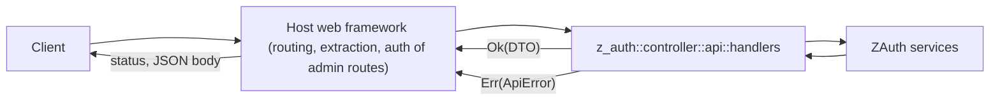

# HTTP API

z-auth contains no web server and depends on no HTTP crate, but it does ship the pieces an HTTP API needs. `z_auth::controller::api` holds framework-agnostic endpoint handlers, the request and response DTOs, the conversions between DTOs and domain types, and `ApiError`, which carries an HTTP status as a plain `u16` together with a stable machine-readable code. The host mounts the handlers in its own framework, extracts the request data, and turns `ApiError` into its framework's response type. This guide describes the handlers with suggested routes, the JSON shapes of the DTOs (with the `serde` feature), the complete error mapping, and what the host is responsible for.

## Handlers

Each handler is a plain function, async except for the catalog, that takes a service trait object from `ZAuth` plus a request DTO and returns a response DTO or an `ApiError`. The routes in the table are the ones suggested in the handlers' documentation. Nothing in z-auth depends on them, so choose your own paths if you prefer.

| Suggested route | Handler | Service argument | Request | Response |
|---|---|---|---|---|
| `POST /register` | `register` | `auth.users()` | `RegisterRequest` | `UserResponse` |
| `POST /login` | `login` | `auth.authentication()` | `LoginRequest`, `ClientContext` | `LoginResponse` |
| `POST /login/second-factor` | `complete_login` | `auth.authentication()` | `CompleteLoginRequest`, `ClientContext` | `TokenPairResponse` |
| `POST /refresh` | `refresh` | `auth.authentication()` | `RefreshRequest`, `ClientContext` | `TokenPairResponse` |
| `POST /logout` | `logout` | `auth.authentication()` | bearer access token (`&str`) | `bool`, whether a session was closed |
| `POST /logout/all` | `logout_all` | `auth.authentication()` | bearer access token (`&str`) | `u64`, the number of sessions closed |
| `POST /revocations` | `revoke` | `auth.revocation()` | `RevokeRequest` | `RevokeResponse` |
| `GET /permissions/catalog` | `permission_catalog` | `auth.permissions()` | none | `PermissionCatalogResponse` |

A few handlers do more than forward. `logout` accepts an expired access token, as long as its signature is valid, and ends its session. `logout_all` first verifies the bearer token fully (signature, expiry and denylist) and then ends every session of the token's own user, so a revoked or expired token gets `401`. `refresh` is the only endpoint that touches session storage on the hot path. `revoke` converts each target and calls `revoke_many`, which skips targets that are not valid tokens and counts the sessions it ended. `permission_catalog` is synchronous and served from memory. It fails with `authz_mode_disabled` outside the permission modes.



The revocation and catalog endpoints have different audiences. `POST /revocations` ends sessions on request and must be restricted to administrators or trusted systems by the host. `GET /permissions/catalog` is meant for UIs that decode the `prm` claim themselves (see [authorization](authorization.md)) and can be public to authenticated users.

## Mounting in a web framework

The sketch below shows two routes in axum. It is illustrative, because z-auth does not depend on axum; any framework works the same way. The host extracts the JSON body, builds the `ClientContext` from the connection and headers, calls the handler, and maps `ApiError` to a response with its status and `ErrorBody`.

```rust
use std::net::SocketAddr;
use std::sync::Arc;

use axum::extract::{ConnectInfo, State};
use axum::http::{HeaderMap, StatusCode};
use axum::response::{IntoResponse, Response};
use axum::Json;
use z_auth::controller::api::dto::{LoginRequest, LoginResponse, RefreshRequest, TokenPairResponse};
use z_auth::controller::api::{handlers, ApiError};
use z_auth::prelude::*;

struct HttpError(ApiError);

impl IntoResponse for HttpError {
    fn into_response(self) -> Response {
        let status = StatusCode::from_u16(self.0.status).unwrap_or(StatusCode::INTERNAL_SERVER_ERROR);
        (status, Json(self.0.body())).into_response()
    }
}

fn client(addr: SocketAddr, headers: &HeaderMap) -> ClientContext {
    // Behind a proxy, take the IP from the header your proxy sets instead.
    let ctx = ClientContext::new(addr.ip());
    match headers.get("user-agent").and_then(|v| v.to_str().ok()) {
        Some(ua) => ctx.with_user_agent(ua),
        None => ctx,
    }
}

async fn login(
    State(auth): State<Arc<ZAuth>>,
    ConnectInfo(addr): ConnectInfo<SocketAddr>,
    headers: HeaderMap,
    Json(req): Json<LoginRequest>,
) -> Result<Json<LoginResponse>, HttpError> {
    let ctx = client(addr, &headers);
    Ok(Json(handlers::login(auth.authentication(), req, ctx).await.map_err(HttpError)?))
}

async fn refresh(
    State(auth): State<Arc<ZAuth>>,
    ConnectInfo(addr): ConnectInfo<SocketAddr>,
    headers: HeaderMap,
    Json(req): Json<RefreshRequest>,
) -> Result<Json<TokenPairResponse>, HttpError> {
    let ctx = client(addr, &headers);
    Ok(Json(handlers::refresh(auth.authentication(), req, ctx).await.map_err(HttpError)?))
}
```

## The ClientContext is the host's job

The handlers that open or rotate sessions take a `ClientContext`, and its correctness is entirely the host's responsibility. The `ip` must be the real client IP. Behind a load balancer or reverse proxy the socket address is the proxy's, so read the client address from the header your proxy sets (and only from a proxy you trust, since clients can forge such headers). The IP is stored on every generation, compared by the default `AUTH_REFRESH_RETRY_MATCH=ip` to recognise concurrent refreshes, and compared against the session's creating IP when `AUTH_IP_BINDING=true`. Getting it wrong either breaks the grace path for legitimate retries or, with IP binding, ends sessions as compromised.

The `user_agent` is optional and is truncated to 512 bytes before it is stored. The `fingerprint` is an optional, stable device identifier of the host's choosing, such as a random id in an HttpOnly cookie set at login, and only its SHA-256 is stored (with the `crypto` feature). Set it consistently on login, second-factor completion and refresh if `AUTH_REFRESH_RETRY_MATCH` includes `fingerprint`.

## Request and response bodies

All DTOs derive `Serialize` and `Deserialize` with the `serde` feature, and their `Debug` output redacts passwords, tokens and codes. Field names are as in Rust. Optional fields are `null` when absent in responses and may be omitted in requests. Timestamps are `chrono::DateTime<Utc>` and serialize as RFC 3339 strings, with fractional seconds when the store recorded them.

`POST /register` takes a `RegisterRequest` and returns the public view of the user, which never contains the password hash.

```json
{"email": "alice@example.com", "password": "S3cur3P@ssw0rd!", "username": "alice", "first_name": "Alice", "last_name": null}
```

```json
{
  "id": "0b8c6a52-3f0e-4d7a-9a51-2c3e4f5a6b7c",
  "email": "alice@example.com",
  "username": "alice",
  "first_name": "Alice",
  "last_name": null,
  "avatar_url": null,
  "is_active": true,
  "is_verified": false,
  "created_at": "2026-10-16T09:30:12.418Z"
}
```

`POST /login` takes a `LoginRequest` with `email` and `password`. The response, `LoginResponse`, is an internally tagged enum whose `status` field is either `authenticated` or `second_factor_required`, with the variant's fields beside it.

```json
{
  "status": "authenticated",
  "session_id": "5d2f1e9a-7b3c-4e8d-a6f1-0c9b8a7d6e5f",
  "access_token": "eyJhbGciOiJFZERTQSIsInR5cCI6IkpXVCIsImtpZCI6IjNmYTFjMDliMmQ3ZTQ0NTgifQ.eyJzdWIiOi...",
  "access_expires_at": "2026-10-16T09:35:12.418Z",
  "refresh_token": "v1.5d2f1e9a7b3c4e8da6f10c9b8a7d6e5f.1.q7JzV1u0i2...",
  "refresh_expires_at": "2026-10-16T10:00:12.418Z"
}
```

```json
{
  "status": "second_factor_required",
  "challenge_token": "Zp4rX0...",
  "expires_at": "2026-10-16T09:35:12Z",
  "methods": ["totp", "recovery_code"],
  "delivery": null
}
```

When a code was already sent, `delivery` holds a `ChallengeDeliveryDto` with the `method` (`email` or `sms`), a masked `destination_hint` and the code's `expires_at`.

```json
{"method": "email", "destination_hint": "j***@example.com", "expires_at": "2026-10-16T09:35:12Z"}
```

`POST /login/second-factor` takes a `CompleteLoginRequest` and returns a `TokenPairResponse`, which has the same fields as the `authenticated` response without the `status` tag. `method` is one of `totp`, `email`, `sms` or `recovery_code`, and may be omitted to let the gate pick.

```json
{"challenge_token": "Zp4rX0...", "method": "totp", "code": "123456"}
```

`POST /refresh` takes both tokens, the possibly expired access token and its refresh token, and returns a `TokenPairResponse`.

```json
{"access_token": "eyJhbGciOiJFZERTQSIs...", "refresh_token": "v1.5d2f1e9a7b3c4e8da6f10c9b8a7d6e5f.1.q7JzV1u0i2..."}
```

`POST /revocations` takes a `RevokeRequest` with a list of targets and one reason. Each target is an adjacently tagged object with a `type` of `access_token`, `refresh_token`, `session` or `user` and the token string or UUID as `value`. The reason is a `RevocationReason` in snake case, typically `compromised` or `administrative` (the full list is in [sessions and tokens](sessions-and-tokens.md)). The response counts the sessions ended, skipping targets that were not valid tokens.

```json
{
  "targets": [
    {"type": "access_token", "value": "eyJhbGciOiJFZERTQSIs..."},
    {"type": "refresh_token", "value": "v1.5d2f1e9a7b3c4e8da6f10c9b8a7d6e5f.3.T0tA..."},
    {"type": "session", "value": "5d2f1e9a-7b3c-4e8d-a6f1-0c9b8a7d6e5f"},
    {"type": "user", "value": "0b8c6a52-3f0e-4d7a-9a51-2c3e4f5a6b7c"}
  ],
  "reason": "compromised"
}
```

```json
{"sessions_ended": 2}
```

`GET /permissions/catalog` returns the cached catalog. Each `PermissionDto` has a `kind` of `bool`, `single`, `multi` or `text`, a `position` for `bool` and `text` permissions (`null` otherwise), a `max_length` for `text` permissions, and the `options` with their positions for `single` and `multi` permissions.

```json
{
  "version": 7,
  "permissions": [
    {"code": "reports.view", "kind": "bool", "description": null, "position": 1, "max_length": null, "options": []},
    {"code": "reports.export", "kind": "multi", "description": "Export formats", "position": null, "max_length": null,
     "options": [{"code": "csv", "position": 2}, {"code": "pdf", "position": 3}, {"code": "xlsx", "position": 4}]},
    {"code": "upload.max_mb", "kind": "text", "description": null, "position": 7, "max_length": 8, "options": []}
  ]
}
```

Errors are reported with an `ErrorBody`, built from an `ApiError` with `body()`.

```json
{"code": "invalid_credentials", "message": "invalid email or password"}
```

## Errors and status codes

`ApiError` implements `From<AuthError>`, so a handler's `?` converts every domain error. It has three public fields, the `status` as a `u16`, the stable `code` as a `&'static str`, and a human-readable `message`. For client errors the message is the `AuthError`'s `Display` text. For 500 errors it is always the generic `internal server error`, so driver messages, hosts and configuration details never reach the client, and `code_delivery_failed` uses the fixed text `the code could not be delivered; retry later`. The table lists every mapping.

| `AuthError` | Status | Code |
|---|---|---|
| `EmailAlreadyTaken` | 409 | `email_already_taken` |
| `UsernameAlreadyTaken` | 409 | `username_already_taken` |
| `RoleAlreadyExists` | 409 | `role_already_exists` |
| `RoleAlreadyAssigned` | 409 | `role_already_assigned` |
| `RoleNotAssigned` | 409 | `role_not_assigned` |
| `InvalidEmail` | 422 | `invalid_email` |
| `WeakPassword` | 422 | `weak_password` |
| `AccountDisabled` | 403 | `account_disabled` |
| `AccountNotVerified` | 403 | `account_not_verified` |
| `UserNotFound` | 404 | `user_not_found` |
| `InvalidCredentials` | 401 | `invalid_credentials` |
| `InvalidToken` | 401 | `invalid_token` |
| `TokenRevoked` | 401 | `token_revoked` |
| `SessionExpired` | 401 | `session_expired` |
| `SessionCompromised` | 401 | `session_compromised` |
| `AuthzModeDisabled` | 409 | `authz_mode_disabled` |
| `RoleNotFound` | 404 | `role_not_found` |
| `PermissionNotFound` | 404 | `permission_not_found` |
| `PermissionAlreadyExists` | 409 | `permission_already_exists` |
| `InvalidCode` | 422 | `invalid_code` |
| `InvalidPermissionValue` | 422 | `invalid_permission_value` |
| `SecondFactorRequired` | 403 | `second_factor_required` |
| `InvalidSecondFactor` | 401 | `invalid_second_factor` |
| `SecondFactorLocked` | 429 | `second_factor_locked` |
| `ChallengeExpired` | 401 | `challenge_expired` |
| `SecondFactorNotEnrolled` | 403 | `second_factor_not_enrolled` |
| `SecondFactorAlreadyEnrolled` | 409 | `second_factor_already_enrolled` |
| `SecondFactorNotFound` | 404 | `second_factor_not_found` |
| `UnsupportedSecondFactor` | 422 | `unsupported_second_factor` |
| `InvalidDestination` | 422 | `invalid_destination` |
| `CodeResendTooSoon` | 429 | `code_resend_too_soon` |
| `CodeDeliveryFailed` | 503 | `code_delivery_failed`, fixed message |
| `ClusterMessageRejected` | 401 | `cluster_message_rejected` |
| `ClusterUnreachable` | 500 | `cluster_unreachable`, generic message |
| `NotAuthority` | 421 | `not_authority` |
| `ReplicaStale` | 503 | `replica_stale` |
| `ReplicaBehind` | 503 | `replica_behind` |
| `NodeFenced` | 503 | `node_fenced` |
| `HashingError` | 500 | `hashing_error`, generic message |
| `Storage` | 500 | `storage_error`, generic message |
| `Config` | 500 | `config_error`, generic message |
| `TokenCreationError` | 500 | `token_creation_error`, generic message |
| `Internal` | 500 | `internal_error`, generic message |

The 503 codes other than `code_delivery_failed` keep their descriptive messages, which contain no internal details, and signal a retryable condition. `replica_stale` and `replica_behind` come from z-auth-cluster's federation mode, `node_fenced` from an instance whose serving fence is up, and `not_authority` (421) tells the client that the operation belongs to the authority service in federation mode. Several codes are never produced by the core alone. The second-factor codes come from z-auth-mfa, the cluster codes from z-auth-cluster, and `account_not_verified`, `user_not_found`, `role_not_found`, `role_not_assigned` and `role_already_assigned` exist for hosts and adapters (the PostgreSQL adapter, for example, maps a violated active-assignment constraint to `role_already_assigned`). Log the original `AuthError` on the server before converting it if you need the details of a 500.
