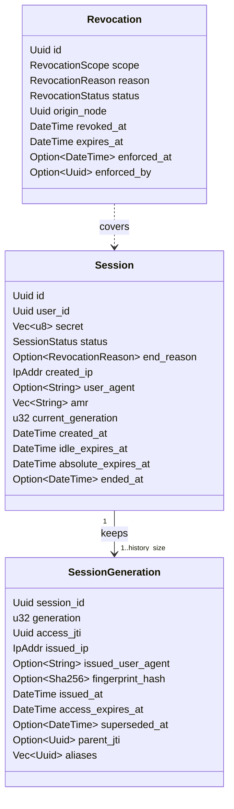
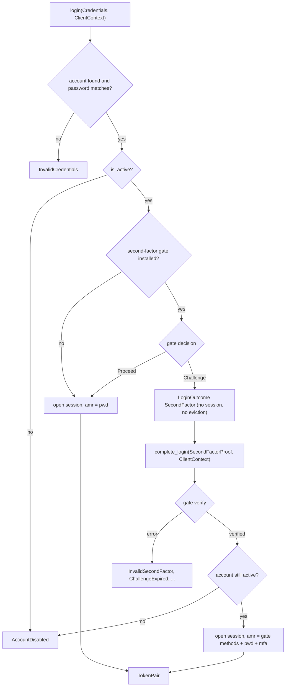
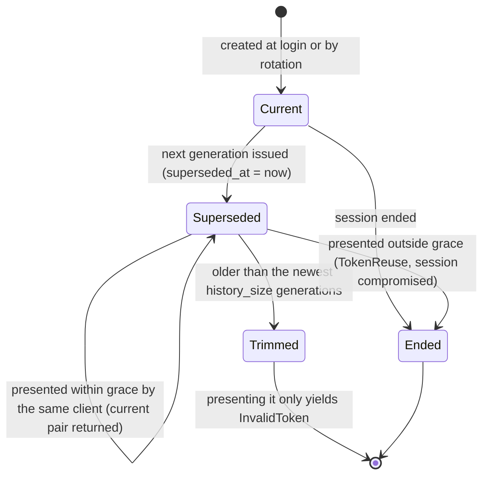
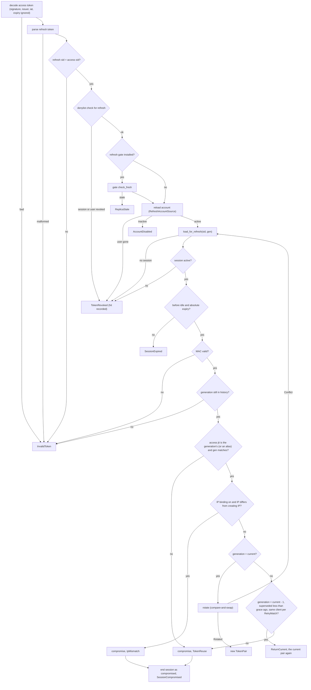
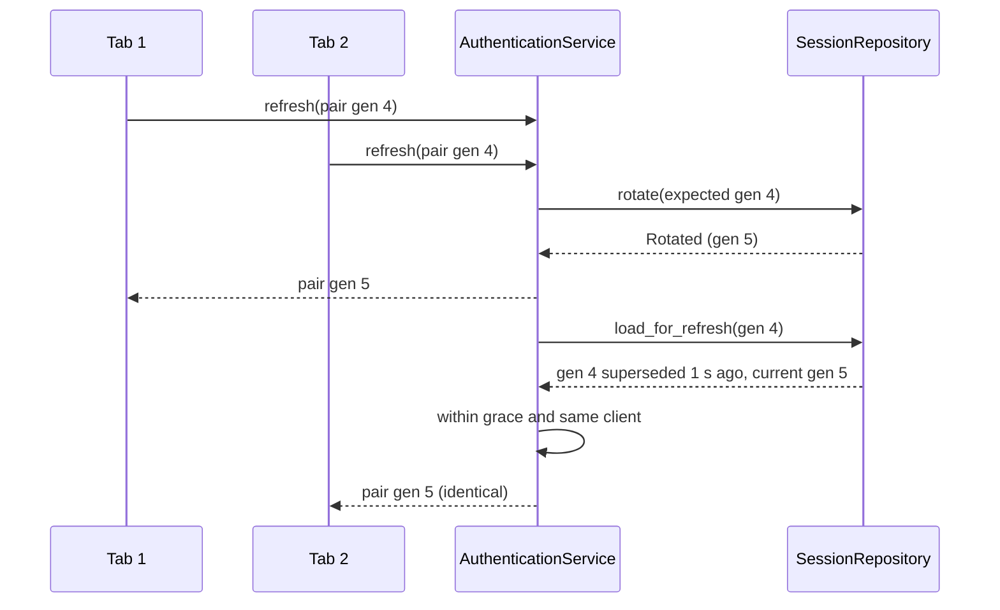
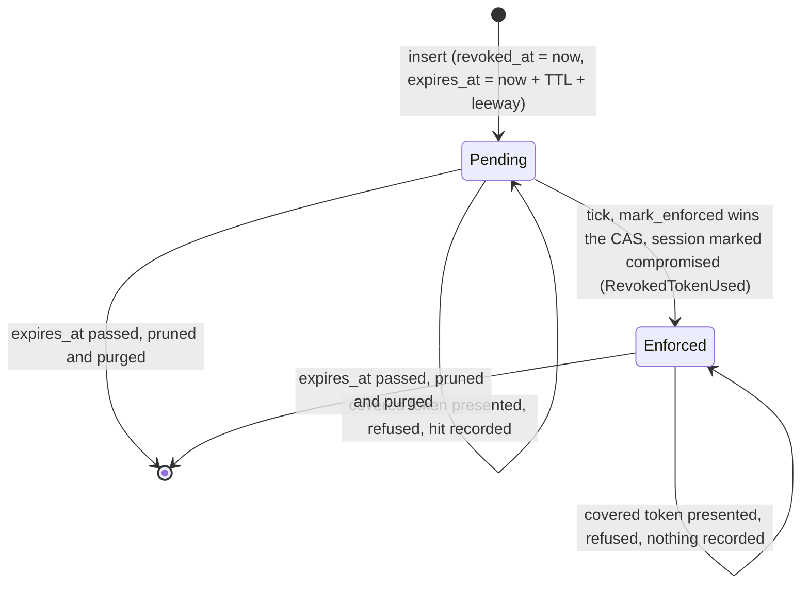
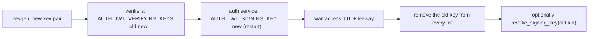

# Sessions and tokens

This guide explains how z-auth turns a successful login into a session, what the access and refresh tokens contain, how a refresh decides between rotating, repeating the current pair and declaring theft, how sessions end, how revocations reach tokens that are already in flight, and how signing keys are distributed, rotated and revoked. It is the reference for the security behaviour of the core, and every rule here is taken from the code in `src/security/`.

## The moving parts

A session is one login on one device. It owns a sequence of generations, and each generation is one access and refresh token pair. A refresh moves the session to its next generation and supersedes the previous one. Only the newest `AUTH_SESSION_HISTORY_SIZE` generations are kept, which is what makes reuse of an old refresh token detectable. Revocations live beside the sessions, in storage and in an in-memory denylist on every instance, and cover a session, every token of a user up to an instant, or a single token.



The reference PostgreSQL adapter stores these as `security_sessions`, `security_session_generations` and `security_token_revocations`, with a `security_session_fork_aliases` table for the federation-mode aliases. The [schema guide](../adapters/postgres/docs/schema.md) has the details. Any other store only has to honour the [storage port contracts](storage-ports.md).

## Login and complete_login

`login` reads the account together with its active roles in one repository call, looking the email up after trimming and lowercasing it. An unknown email, a user without a password hash and a wrong password all fail with `InvalidCredentials`, and only after the password matched does the service check `is_active` and fail with `AccountDisabled`. It never checks `is_verified`. If a second-factor gate is installed (z-auth-mfa installs one), the gate is consulted next and may return a challenge, in which case `login` returns `LoginOutcome::SecondFactor` and nothing else happens. A pending login opens no session and evicts none, so someone who knows only the password cannot push the owner's sessions out.

Otherwise the service opens the session. It builds the authorization claims for the token, ends the user's oldest sessions if the cap would be exceeded, generates a 32-byte random session secret, and asks the store to create the session and its first generation atomically. The session's `amr` (RFC 8176 authentication methods) is `["pwd"]` for a password login.

`complete_login` is the second step of a challenged login. It fails with `InvalidToken` when no second-factor gate is installed. Otherwise the gate verifies the proof and returns a `VerifiedSecondFactor` with the user id and the methods the proof adds, for example `["otp"]`. The service then re-reads the account, because it may have been disabled since the password step, and opens the session exactly as `login` would. The session's `amr` is the gate's methods plus `pwd` and `mfa`, sorted and deduplicated, so a TOTP login yields `["mfa", "otp", "pwd"]`. The `amr` is fixed for the session's lifetime and copied into every access token it issues, which is what `Authorizer::require_mfa` checks.



## Sessions and their lifetimes

A session has two expiries, and both are computed by the store from durations the core passes in `SessionLifetimes`. The idle expiry is `now + AUTH_SESSION_IDLE_TIMEOUT_SECS` (30 minutes by default) and is pushed forward on every refresh. The absolute expiry is `created_at + AUTH_SESSION_ABSOLUTE_TIMEOUT_SECS` (8 hours by default) and never moves. A refresh at or after either instant fails with `SessionExpired`. A client that refreshes every 20 minutes therefore keeps its session alive until the eight-hour absolute expiry and then has to log in again, while a client that goes quiet for half an hour loses it sooner. The `refresh_expires_at` of every `TokenPair` is the earlier of the two, which tells the client when its session ends if it does nothing.

```text
minutes            0         20   30   40   50        70   ...   480
                   |         |    |    |    |         |          |
absolute window    [======================================...======]  fixed, ends at 480 (8 h)
idle after login   [==============]  ends at 30
refresh at 20                [==============]           ends at 50
refresh at 40                          [==============]  ends at 70
```

Without another refresh after the 40-minute mark, the session drawn above ends at 70 minutes on its idle expiry, long before its absolute expiry at 8 hours.

Each generation records who it was issued to, which is the client IP, the user agent truncated to 512 bytes and the SHA-256 of the client fingerprint (only with the `crypto` feature). It also records the access token id it carries (`access_jti`), when it was issued, when its access token expires (`issued_at + AUTH_JWT_ACCESS_TTL_SECS`), when it was superseded, and the `jti` of the access token presented to obtain it (`parent_jti`, empty for generation 1). The session itself keeps the creating IP, which IP binding compares against, and the original user agent.

## The access token

The access token is a compact JWT signed with Ed25519, built by a deliberately narrow implementation in `src/security/token/jwt.rs`. It is three unpadded base64url segments, the header, the payload and a signature over the first two. The header is fixed for a given signing key.

```json
{"alg": "EdDSA", "typ": "JWT", "kid": "3fa1c09b2d7e4458"}
```

The `kid` is the lowercase hex of the first 8 bytes of the SHA-256 of the 32-byte verifying key, so it is always 16 characters. The decoder rejects any `alg` other than `EdDSA` (including `none`, `HS256` and a lowercase `eddsa`) before looking at the signature, requires a `kid`, and refuses a `kid` that is revoked or unknown to its key ring. The payload carries the claims below.

| Claim | Type | Meaning |
|---|---|---|
| `sub` | UUID string | The user id |
| `sid` | UUID string | The session id |
| `jti` | UUID string | The token id, equal to the issuing generation's `access_jti` |
| `gen` | integer | The session generation that issued the token (`Claims::generation` in Rust) |
| `iss` | string | The issuer, `AUTH_JWT_ISSUER` (default `z-auth`) |
| `iat` | integer | Issued-at, Unix seconds, the generation's `issued_at` |
| `exp` | integer | Expiry, Unix seconds, the generation's `access_expires_at` |
| `rol` | array of strings | Active role codes, sorted. Omitted when empty |
| `prm` | object | Encoded permissions, `b` (base64url bitset) and `t` (text values by position). Omitted when nothing is granted |
| `pv` | integer | Permission catalog version the bits refer to. Present whenever permissions are in use |
| `amr` | array of strings | The session's authentication methods, sorted. Omitted when empty |

A token from a password login in the `rbac` mode has a payload like the following. The [authorization guide](authorization.md) explains `rol`, `prm` and `pv`.

```json
{
  "sub": "0b8c6a52-3f0e-4d7a-9a51-2c3e4f5a6b7c",
  "sid": "5d2f1e9a-7b3c-4e8d-a6f1-0c9b8a7d6e5f",
  "jti": "a4e3d2c1-b0a9-4f8e-9d7c-6b5a4f3e2d1c",
  "gen": 1,
  "iss": "z-auth",
  "iat": 1792140000,
  "exp": 1792140300,
  "rol": ["billing_admin", "user"],
  "amr": ["pwd"]
}
```

Verification checks, in order, the header, the signature (strict Ed25519 verification), the issuer, that `iat` is not more than the leeway in the future, and, unless the caller asked to ignore expiry, that the current time is not past `exp` plus `AUTH_JWT_LEEWAY_SECS`. Minting is deterministic, so the same claims always produce the same token. The refresh flow relies on that to hand out the current pair again during the grace window.

## The refresh token

The refresh token is opaque to clients and has four dot-separated parts.

```text
v1.<session id as 32 hex digits>.<generation>.<base64url MAC>
```

The MAC is HMAC-SHA256 keyed with the server-wide `AUTH_REFRESH_SECRET`, computed over the domain prefix `auth/refresh/v1`, the 16 bytes of the session id, the generation as a 4-byte big-endian integer and the session's own secret, in that order. Nothing token-shaped is stored. The server re-derives the expected MAC from the session row, so forging a refresh token requires both the database row (for the session secret) and the server secret. The MAC is checked in constant time, and nothing about the presented generation is trusted until it verifies. `parse` only checks the structure, which lets the refresh flow find the session before it can verify the token.

## Rotation

Every successful refresh of the current generation rotates the session. The store checks that the session is still active and still at the expected generation, advances `current_generation`, pushes the idle expiry forward, stamps `superseded_at` on the old generation, inserts the new one, and deletes generations older than the newest `history_size`. The state of a single generation moves as follows.



A trimmed generation is no longer known, so presenting it is rejected with `InvalidToken` and has no side effects. With the default history of 10, a refresh token that is ten rotations old simply requires a new login, whereas one that is only a few rotations old is proof that someone kept a copy and is treated as theft.

## The refresh decision

`refresh(access_token, refresh_token, ctx)` combines I/O in `service_impl.rs` with a pure decision function, `evaluate_refresh` in `policy.rs`. The flowchart follows both, top to bottom.



The order matters in a few places. The account is reloaded before the session, so deactivating a user directly in storage (bypassing the user service, which would have ended the sessions) still stops refreshes, and role or permission changes enter the new access token. The decision itself checks the session status, the expiries, the MAC, the history, the token pairing and IP binding, in that order, before choosing between rotation, the grace path and theft. An ended or expired session is therefore rejected without side effects whatever was presented, and nothing about the presented generation is examined until the MAC has verified, so a forged refresh token can never trigger the theft path.

A mixed pair, meaning an access token whose `jti` does not belong to the generation named by the refresh token, counts as reuse. So does a superseded generation presented outside the grace window or by a different client. Reuse and IP mismatch both end the session through the revocation service with the status `Compromised`, which also denylists its access tokens everywhere, and the caller receives `SessionCompromised`. Every other device of the user is untouched.

When a refresh gate is installed (z-auth-cluster's federation mode installs one), the flow has three extra branches that the chart omits. The gate may refuse a stale instance up front with `ReplicaStale`. When the account or the session has not reached this service yet, or the presented generation is newer than the stored one, the gate is asked once to catch up and the step is retried, and a second miss yields the retryable `ReplicaBehind`. A newer generation than the one stored is never treated as theft in that case. The [federation guide](../adapters/postgres/docs/federation.md) and the [cluster guide](../adapters/cluster/docs/replication.md) describe this.

## Concurrent refreshes and the grace window

Clients often refresh twice at once, for example from two browser tabs or after a network retry. The first request rotates the session, and the second arrives with the now superseded pair. Rather than treat that as theft, z-auth hands the second request the current pair again, provided three conditions hold. The presented generation must be exactly one behind the current one, it must have been superseded less than `AUTH_REFRESH_GRACE_SECS` ago (30 seconds by default), and the request must come from the same client as the one the current generation was issued to. Because minting is deterministic, both requests then hold an identical pair.

`AUTH_REFRESH_RETRY_MATCH` defines what "the same client" means. It is a comma set of `ip`, `user_agent` and `fingerprint`, defaults to `ip`, and must name at least one. Every listed attribute of the request must equal the one recorded on the current generation, after the same truncation and hashing used when storing it. A missing fingerprint never matches when fingerprints are compared, and without the `crypto` feature fingerprints are never stored, so `fingerprint` then rejects every retry. Matching on the fingerprint instead of the IP lets the same device retry from another network (a phone moving from Wi-Fi to mobile data), while another device holding the old pair is still caught. The same setting is used by z-auth-cluster to tell benign cross-site refresh forks from theft.



Two refreshes of the current generation can also race inside the store. Rotation is a compare-and-swap on the expected generation, so exactly one wins and the other receives `RotateOutcome::Conflict`. The loser reloads the snapshot and evaluates again, which normally lands it on the grace path. The service re-evaluates up to `REFRESH_ROTATE_ATTEMPTS` (3) more times after the first attempt and then gives up with `InvalidToken` and the message `concurrent refresh conflict; retry`.

## Session cap and eviction

`AUTH_MAX_SESSIONS_PER_USER` (5 by default, 0 for unlimited) caps the active sessions per user. Before a new session is created, the service lists the user's active, unexpired sessions oldest first and ends as many as needed for the new one to fit, each with the reason `Evicted` and the status `Revoked`. The cap is applied only when a session is actually opened, so a challenged login that never completes evicts nothing. Eviction is not atomic with the creation, so two simultaneous logins of the same user can briefly exceed the cap by one.

## Logout

`logout(access_token)` decodes the token with its expiry ignored, so an expired token still works as long as its signature and issuer are valid, and ends its session with the reason `Logout`. It returns `true` if the session was still active and `false` if it had already ended. `logout_all(user_id)` ends every active session of the user with `LogoutAll` and returns how many it ended. It always publishes a user-wide revocation, even when no session was active, so access tokens issued to the user until that instant are refused. Since it takes a user id, the host has to decide who may call it. The ready-made handler accepts only a valid, unrevoked bearer token and logs out its own user.

## Revocation and the denylist

Every way of ending a session goes through the `TokenRevocationService`. Ending a session marks it in storage, persists a pending revocation, applies it to the local denylist immediately and publishes it as a `DomainEvent::Revoked`, which an installed cluster extension pushes to every other instance. The denylist is a pure in-memory index consulted on every verification, so a revoked access token is refused at once instead of at its natural expiry.

`revoke(target, reason)` accepts four kinds of `RevokeTarget`. `AccessToken` decodes the token with its expiry ignored and ends its session, `RefreshToken` verifies the token's MAC against its session and ends that session, `Session` ends a session by id, and `User` ends every session of a user. Revoking a token therefore always ends its whole session. Each call returns the number of sessions ended. `revoke_many(targets, reason)` revokes several, skips targets that are not valid tokens (anything failing with `InvalidToken`) and aborts on storage errors.

A revocation has one of three scopes, and the denylist matches each differently.

| Scope | Created by | Matches a token when |
|---|---|---|
| `Session(sid)` | ending one session (logout, eviction, compromise, `revoke` of a token or session) | its `sid` equals the session id |
| `User(user_id)` | ending all of a user's sessions (`logout_all`, password change, deactivation, deletion, `revoke` of a user) | its `sub` equals the user id and its `iat` is at or before `revoked_at` |
| `Token(jti)` | only z-auth-cluster's federation mode, for the losing pair of a benign refresh fork | its `jti` equals the token id. Refused for API calls but still allowed to refresh, and never enforced |

The user scope compares Unix seconds. A token issued in the same second as a user-wide revocation is therefore also refused, and a login immediately after a password change can produce a token that is rejected until the clock moves on. The test suite waits one second for that reason.

Each entry lives for the access-token TTL plus the leeway (`expires_at = revoked_at + ttl`), after which every token it could cover has expired on its own. `tick` drops expired entries from memory, and the host removes them from storage with `revocation().purge_expired()`. At startup, `start` loads every revocation whose `expires_at` is still in the future, so a restarted instance refuses the same tokens as before.

## Pending and enforced revocations

A new revocation is pending, which means tokens it covers may still be in flight. When such a token is presented, by an API call or a refresh, the denylist refuses it with `TokenRevoked` and records an enforcement hit, at most once per revocation. The next `tick` enforces the recorded hits. For each hit it attempts a compare-and-swap from pending to enforced in the store, and exactly one instance in the deployment wins. The winner marks the presenting session compromised with the reason `RevokedTokenUsed`, applies the enforced revocation to its denylist and publishes `RevocationEnforced`, and the other instances learn the outcome from that event.



The rule behind this is that a token whose session was revoked should never be presented again, so seeing one is evidence that someone else holds it. A well-behaved client discards its tokens after logout. A client that keeps sending its old access token after a logout will cause its (already ended) session to be marked compromised. Token-scoped entries are the exception, since their holders are expected to show up once and refresh into the winning chain, and they are never enforced. A fenced instance enforces nothing in `tick`.

## Why sessions end

`RevocationReason` records why a session ended or a revocation was issued. The revocation service derives the session status from it, with security incidents marking the session `Compromised` and everything else `Revoked`. With the `serde` feature the reasons serialize in snake case, which is also how the revocation endpoint accepts them.

| Reason | Raised by | Resulting status |
|---|---|---|
| `Logout` | `logout` | `Revoked` |
| `LogoutAll` | `logout_all` | `Revoked` |
| `Evicted` | the session cap at login | `Revoked` |
| `TokenReuse` | a refresh presenting a superseded or mismatched pair | `Compromised` |
| `IpMismatch` | a refresh from another IP with `AUTH_IP_BINDING=true` | `Compromised` |
| `Compromised` | a host reporting a stolen token through the revocation API | `Compromised` |
| `Administrative` | a host or administrator revoking for any other reason | `Revoked` |
| `PasswordChanged` | `UserService::update` with a new password | `Revoked` |
| `AccountDisabled` | `UserService::deactivate` | `Revoked` |
| `AccountDeleted` | `UserService::delete` | `Revoked` |
| `RevokedTokenUsed` | `tick` enforcing a revocation whose token was presented | `Compromised` |
| `ConcurrentRefresh` | z-auth-cluster federation mode, the losing token of a benign fork | `Revoked` |
| `SecondFactorChanged` | z-auth-mfa, when a user's factors are added, removed or reset | `Revoked` |

The account changes deserve emphasis. Changing the password through `UserService::update` first stores the new hash and then ends every session of the user, including the caller's, so every surviving session would predate the change. Deactivating ends every session as well, and deleting publishes a user-wide revocation for the access tokens already issued while the store's cascade removes the session rows. A profile update without a password change leaves sessions alone.

`purge_sessions(retention)` deletes sessions, with their generations, that ended or passed their idle or absolute expiry more than `retention` ago. The core never calls it, so schedule it in the host.

## Signing keys and the key ring

The key ring is the in-memory set of verifying keys an instance accepts, indexed by `kid`, together with the key ids it must refuse. The decoder consults it on every verification, so a key can be added or revoked without a restart. At build time it holds the keys from `AUTH_JWT_VERIFYING_KEYS`, or the key derived from `AUTH_JWT_SIGNING_KEY` when that list is empty, plus the instance's own verifying key when the built-in issuer is used.

`start` then loads every key stored in the `KeyRepository` into the ring and, after the extensions started, publishes the instance's own verifying key through `KeyService::publish_verifying_key`. Publishing stores the key (idempotently per `kid`), merges it into the local ring and announces it with `VerifyingKeyPublished`, so instances that never saw the auth service's configuration still accept its tokens. Only public keys are ever stored or sent. `ZAuth::keys().keys()` lists what the instance knows.

`KeyService::revoke_signing_key(kid)` refuses, everywhere and immediately, every token signed with that key. It marks the key revoked in storage, revokes it in the local ring (even if the ring did not know it yet, so a revocation that arrives before its key still sticks) and publishes `SigningKeyRevoked`. Revocation is terminal and wins over any later publication of the same key. An instance whose own signing key has been revoked refuses to mint with it and fails logins and refreshes with `AuthError::Config` asking you to rotate `AUTH_JWT_SIGNING_KEY`. The check happens when the tokens are minted, which for a login is after the new session has been stored, so each such failed login leaves a session row behind that simply expires unused.

## Rotating the signing key

Because verifiers accept several keys at once, the signing key can be rotated without a lockstep deploy. The procedure below keeps every token valid throughout.



Generate a new pair with `keygen`, add the new verifying key to `AUTH_JWT_VERIFYING_KEYS` on every verifying service as a comma-separated list next to the old one, then switch the auth service to the new signing key. Old tokens keep verifying with the old key until they expire, at most the access TTL plus the leeway later, and new tokens verify with the new one. Afterwards remove the old key from the lists. Instances running a full `ZAuth` also accept every key stored in the `KeyRepository`, which includes keys the auth service published at start, so removing a key from configuration does not retire it on those instances. To retire it for good, or to cut off a leaked key immediately, call `revoke_signing_key` with its `kid`.

## Verify-only services

A downstream service that only checks access tokens needs neither the signing key nor the refresh secret, and cannot build a full `ZAuth` without them. It builds a `TokenVerifier` directly from the JWT configuration and a denylist instead. `TokenVerifier::from_config` (feature `crypto`) uses the configured verifying keys, or the key derived from the signing key when none are configured, and fails with `AuthError::Config` when there is no key at all. The issuer and leeway must match the auth service's.

```rust
use std::sync::Arc;
use z_auth::prelude::*;
use z_auth::security::authorization::{AuthorizerImpl, BitsetPermissionCodec, CatalogCache};

let config = EnvLoader.load_config()?; // AUTH_JWT_VERIFYING_KEYS, AUTH_JWT_ISSUER, AUTH_JWT_LEEWAY_SECS
let denylist = Arc::new(Denylist::new());
let verifier = TokenVerifier::from_config(&config.jwt, denylist.clone())?;

// Role and amr checks need no catalog. Permission checks decode against the
// catalog in the cache, installed with CatalogCache::replace.
let authorizer = AuthorizerImpl::new(Arc::new(CatalogCache::new()), Arc::new(BitsetPermissionCodec));

let bearer = "<access token from the Authorization header>";
let claims = verifier.verify(bearer)?;
let admin = authorizer.has_role(&claims, "billing_admin");
```

Such a verifier only refuses what its own denylist contains, and nothing fills that denylist by itself. Either feed it (for example by applying the `Revocation` values carried by `DomainEvent::Revoked` from a message bus with `Denylist::apply`) or accept that revoked tokens stay valid there until they expire, which is at most the access TTL plus the leeway. Services that run a full `ZAuth` with z-auth-cluster have their denylist and key ring kept current by the cluster instead.
