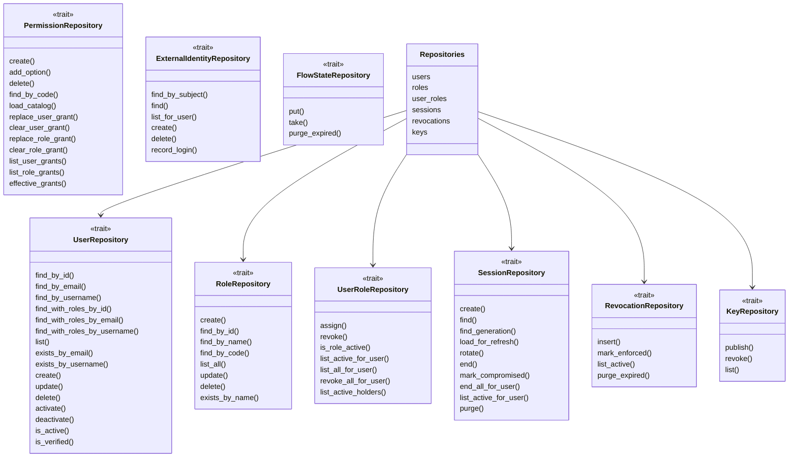
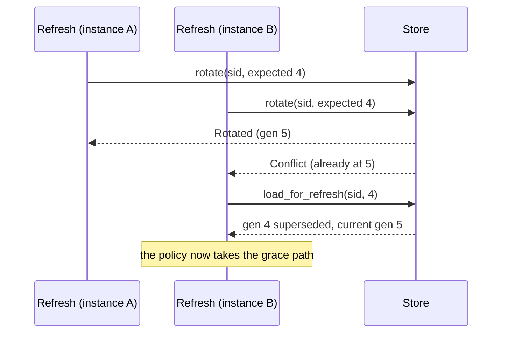

# Storage ports

z-auth ships no database code. Everything it persists goes through nine repository traits that the host implements on whatever store it uses, and this guide is the contract for writing such an adapter. It describes the ground rules that apply to every port, then each trait method by method with the guarantees the core relies on. Two complete implementations exist to copy from. `z_auth_testkit::InMemoryDb` implements every port over one mutex-protected state for the test suites, and `z-auth-postgres` is the production reference on sqlx, documented in the [PostgreSQL adapter guide](../adapters/postgres/README.md) and its [internals guide](../adapters/postgres/docs/internals.md).

## Ground rules

Every port is an `async_trait` trait with `Send + Sync` bounds, so implementations can be shared behind `Arc` across tasks. Methods return `Result<_, AuthError>`, and `Ok(None)` or `Ok(false)` mean "not found" or "nothing to do" rather than errors.

The store is the clock. Every persisted timestamp (session creation and expiry, generation issue and supersession, revocation cutoffs and expiries, enforcement, assignment and revocation of roles, key publication, the linking and last sign-in of external identities, flow-state expiry) must be taken from the store's own clock, such as `now()` in SQL. The core never sends instants for persisted data. It passes durations (`SessionLifetimes`, a revocation `ttl`, a flow-state `ttl`, a purge `retention`) and reads back what was stored, which keeps every instance consistent even when their local clocks drift. Where the contract says "now", take it once per operation, so that values written together share the same instant.

Errors are mapped at the adapter boundary so the core never depends on a driver's error type. Driver failures become `AuthError::Storage` with a message, which `ApiError` turns into a generic 500 response. Unique-constraint violations become the specific domain errors named in each contract, which are `EmailAlreadyTaken` and `UsernameAlreadyTaken` for users, `RoleAlreadyExists` for roles, `PermissionAlreadyExists` for permissions and `ExternalIdentityLinkedElsewhere` for external identities. The PostgreSQL adapter does this by constraint name in a single `map_sqlx_error` function.

Atomicity matters in four places. `SessionRepository::create` writes a session and its first generation together, `SessionRepository::rotate` is a compare-and-swap, `RevocationRepository::mark_enforced` is a compare-and-swap, and `FlowStateRepository::take` hands an entry to at most one caller. Everything else may be a plain statement.

The six ports in `Repositories` are required by every instance. `PermissionRepository` is passed separately with `ZAuthBuilder::permissions` and only needed in the `permissions` and `combined` authorization modes. `ExternalIdentityRepository` and `FlowStateRepository` are passed together with `ZAuthBuilder::external_identities` and only needed for sign-in through external identity providers and account linking. Without them `login_external`, `confirm_link` and every `AccountLinkService` call fail with `AuthError::Config`.

## UserRepository

The user port stores accounts. Emails reach it already normalized, trimmed and lowercased by `normalize_email`, so the adapter compares them verbatim. Usernames are stored with their display case, but lookups and uniqueness must be case-insensitive, so `JohnDoe` and `johndoe` are the same user. The core applies no other rule to usernames, so the adapter must accept any string.

| Method | Contract |
|---|---|
| `find_by_id`, `find_by_email`, `find_by_username` | The user, or `Ok(None)` |
| `find_with_roles_by_id`, `find_with_roles_by_email`, `find_with_roles_by_username` | The user with their active roles only (assignments without `revoked_at`), or `Ok(None)`. Login and refresh read the account this way, in one call |
| `list(&UserQuery)` | One page ordered by `created_at` descending, ties broken by id. `search`, when set, is a case-insensitive substring match on email or username. `total` counts every match, not just the page. The service has already clamped `limit` to 1..=200 and dropped a blank search |
| `exists_by_email`, `exists_by_username` | Whether a user exists, without loading it |
| `create(NewUser)` | Insert and return the hydrated user. New users are active, and `is_verified` is taken from `NewUser::is_verified`. `password_hash` is an `Option<String>`, already hashed and stored verbatim, and `None` stores a user without a password. A duplicate email or username fails with `EmailAlreadyTaken` or `UsernameAlreadyTaken` |
| `update(user_id, UserUpdate)` | Apply the fields that are `Some`, leave the rest. `Ok(None)` if the user does not exist. Duplicates fail as in `create` |
| `delete(user_id)` | Delete the user and its dependent data (sessions, role assignments and, when the store keeps them, external identities). `Ok(Some(id))` if deleted, `Ok(None)` if not found |
| `activate`, `deactivate` | Set `is_active`. `Ok(false)` if the user does not exist. Only the flag; the user service ends the sessions |
| `is_active`, `is_verified` | The flag, or `Ok(None)` if the user does not exist |

The user service checks uniqueness before writing, but two concurrent registrations can still race, so the unique constraints and their mapping are what actually guarantee it.

Registration always passes a password hash and `is_verified: false`. A user provisioned at a first external sign-in has no password hash, and starts verified when a provider trusted with emails vouched for the address, so the store must accept a missing hash and honour the flag.

## RoleRepository

| Method | Contract |
|---|---|
| `create(&NewRole)` | Insert and return the role. A duplicate code or name fails with `RoleAlreadyExists`. The service has already validated the code format |
| `find_by_id`, `find_by_name`, `find_by_code` | The role, or `Ok(None)` |
| `list_all` | Every role, ordered by name ascending |
| `update(id, &RoleUpdate)` | Change the name and/or the description (`Some(None)` clears it). The code never changes. `Ok(None)` if the role does not exist, `RoleAlreadyExists` if the new name is taken |
| `delete(id)` | Delete the role and its assignments. `Ok(Some(id))` or `Ok(None)` |
| `exists_by_name` | Whether a role with the name exists |

## UserRoleRepository

Assignments keep their full history. Revoking stamps `revoked_at` on the row instead of deleting it, and at most one active assignment per user and role may exist at any time.

| Method | Contract |
|---|---|
| `assign(user_id, role_id)` | Create an active assignment. `Ok(true)` if created, `Ok(false)` if the user already holds the role actively |
| `revoke(user_id, role_id)` | Stamp `revoked_at = now` on the active assignment. `Ok(true)` if one was revoked, `Ok(false)` if none existed |
| `is_role_active` | Whether the user currently holds the role |
| `list_active_for_user` | Active assignments, newest first |
| `list_all_for_user` | Every assignment, active and revoked, newest first |
| `revoke_all_for_user` | Revoke every active assignment of the user and return the count |
| `list_active_holders(role_id)` | Users holding the role actively. Has a default implementation that fails with `AuthError::Config` |

`list_active_holders` is only called by the authority service in z-auth-cluster's federation mode, which republishes the account snapshots of a role's holders when the role changes. Adapters that will never run there may keep the default.

## SessionRepository

The session port holds the most important contract, because all refresh security rests on it. The policy lives entirely in the core; the store only has to be atomic where stated and assign every timestamp itself.

`create(NewSession, &SessionLifetimes)` atomically inserts a new active session and its generation 1, with store-assigned ids and a single `now` for both rows. The session gets `created_at = now`, `idle_expires_at = now + idle_timeout`, `absolute_expires_at = now + absolute_timeout` and `current_generation = 1`, together with the user id, the secret, the creating IP, the user agent and the `amr` from the input. The generation gets a fresh `access_jti`, `issued_ip = created_ip`, `issued_user_agent = user_agent`, the input's `fingerprint_hash`, no `parent_jti`, `issued_at = now` and `access_expires_at = now + access_ttl`. It returns both rows as stored.

`rotate(session_id, expected_generation, &IssueContext, &SessionLifetimes)` atomically advances a session by one generation, and only if the session is still active and still at `expected_generation`. Otherwise it changes nothing and returns `RotateOutcome::Conflict`. On success it sets `current_generation = expected + 1` and `idle_expires_at = now + idle_timeout` (the absolute expiry never moves), stamps `superseded_at = now` on the expected generation, inserts the new generation with the issue context's IP, user agent, fingerprint hash and `parent_jti` and with `issued_at = now` and `access_expires_at = now + access_ttl`, deletes the generations older than the newest `history_size` together with their aliases, and returns `RotateOutcome::Rotated` with the session and generation as persisted. In SQL this is typically an `UPDATE ... WHERE id = $1 AND status = 'active' AND current_generation = $2` whose affected-row count decides between the two outcomes, inside one transaction with the inserts and deletes.

`load_for_refresh(session_id, generation)` reads, ideally in one round trip, the session, its generation `generation` if still within history, its current generation, both with their `aliases`, and the store's current time. It returns them as a `RefreshSnapshot`, or `Ok(None)` if the session does not exist. The `now` in the snapshot is what the refresh policy compares expiries and the grace window against, which is how the store's clock stays authoritative.

| Method | Contract |
|---|---|
| `find(session_id)` | The session in any status, or `Ok(None)` |
| `find_generation(session_id, generation)` | One generation with its aliases, if still within history |
| `end(session_id, status, reason)` | End an active session, setting the status, `end_reason` and `ended_at = now`. `Ok(false)` if it was missing or already ended |
| `mark_compromised(session_id, reason)` | Set the status to compromised from active or revoked, set `end_reason`, and set `ended_at = now` if it was not ended yet. `Ok(false)` only if the session is gone |
| `end_all_for_user(user_id, status, reason)` | End every active session of the user as `end` would, returning the ids ended |
| `list_active_for_user(user_id)` | Active sessions that have not passed their idle or absolute expiry, oldest first. Used for the session cap |
| `purge(retention)` | Delete sessions, with their generations, that ended or passed their idle or absolute expiry more than `retention` ago. Returns the number deleted |

The `aliases` of a generation are only ever non-empty in z-auth-cluster's federation mode. Other adapters can return an empty list, but must still delete aliases with their generations if they store them.

## RevocationRepository

This port is the persisted side of the denylist. It is written when a revocation is issued or enforced and read once at startup, and never on token verification.

| Method | Contract |
|---|---|
| `insert(&NewRevocation)` | Store a pending revocation with `revoked_at = now` and `expires_at = now + ttl`, and return it as stored with its id |
| `mark_enforced(id, by)` | Compare-and-swap from pending to enforced, setting `enforced_at = now` and `enforced_by = by`. Return the updated revocation, or `Ok(None)` if it was already enforced or is gone. Exactly one caller may win |
| `list_active` | Every revocation whose `expires_at` is still in the future |
| `purge_expired` | Delete revocations whose `expires_at` has passed and return the count |

`RevocationScope` needs to be stored with its kind (session, user or token) and its id. The user scope's `revoked_at` is the cutoff compared against token `iat` values in Unix seconds.

## KeyRepository

The key port stores published verifying keys, which are public. It is read at startup and written on key events.

| Method | Contract |
|---|---|
| `publish(&NewVerifyingKey)` | Store the key, idempotently per `kid`, and return it as stored. Publishing a key that is already stored returns the existing record, and a revoked key stays revoked |
| `revoke(kid)` | Mark the key revoked with `revoked_at = now`. `Ok(None)` if the key is unknown |
| `list` | Every stored key, active and revoked |

The field must be supplied even without the `crypto` feature, but in that configuration nothing calls it, so a stub that returns empty results is enough.

## PermissionRepository

The permission port stores the catalog and the grants. Only administration, startup, login and refresh call it.

Positions are permanent. `create` assigns one position to a `bool` or `text` permission and one per option to a `single` or `multi` permission, all from one sequence that never reuses a number, even after deletions. `add_option` takes a new position from the same sequence. The catalog's `version` is the highest position in use, or 0 for an empty catalog. The token encoding depends on these rules, as the [authorization guide](authorization.md) explains, so an adapter must never renumber.

| Method | Contract |
|---|---|
| `create(&NewPermission)` | Insert an entry with its positions and options and return it. A duplicate code fails with `PermissionAlreadyExists` |
| `add_option(permission_id, option_code)` | Add an option with a new position and return the updated entry |
| `delete(permission_id)` | Delete the entry and every grant of it. `Ok(false)` if missing |
| `find_by_code` | The entry, or `Ok(None)` |
| `load_catalog` | The whole catalog with its `version` |
| `replace_user_grant(user_id, &PermissionAssignment)`, `replace_role_grant(role_id, ..)` | Atomically replace the owner's grant of `assignment.permission_id` with the assignment's options or text |
| `clear_user_grant`, `clear_role_grant` | Remove the owner's grant of a permission. `Ok(false)` if none existed |
| `list_user_grants`, `list_role_grants` | The owner's direct grants, one assignment per permission with option ids sorted, ordered by permission id |
| `effective_grants(user_id, include_role_grants)` | The merged grants and the catalog version, described below |

`effective_grants` merges the user's direct grants with, when `include_role_grants` is true, the grants of the user's active roles. For a `bool` permission the result is granted if any source grants it. For a `multi` permission it is the union of the chosen options. For `single` and `text` permissions the direct grant wins, and otherwise the grant of the role with the lexicographically lowest code. The result is an `EffectiveGrants` whose `grants` list one `PermissionGrant` per granted `bool` position and chosen option position (with `text: None`) and per granted `text` position (with the value), and whose `catalog_version` is read in the same call, so the encoded token and its `pv` agree.

## ExternalIdentityRepository

This port stores the identities of other providers (OpenID Connect, OAuth2 and the like) that are linked to users. It is optional and only used when the host calls `ZAuthBuilder::external_identities`. An identity is keyed by the provider's `(issuer, subject)` pair, which belongs to at most one user, while a user may have many identities. The `provider` field is the host's name for the provider configuration (`google`, `github`) and `email` is what the provider reported when the identity was linked. Neither is ever used to look an identity up.

| Method | Contract |
|---|---|
| `find_by_subject(issuer, subject)` | The identity with exactly this pair, or `Ok(None)`. Compare both strings verbatim, without case folding or trimming, because they are the provider's identifiers |
| `find(id)` | The identity, or `Ok(None)` |
| `list_for_user(user_id)` | The user's identities, oldest first by `created_at` |
| `create(NewExternalIdentity)` | Insert and return the identity with a store-assigned `id`, `created_at = now` and no `last_login_at`. An `(issuer, subject)` pair that is already stored fails with `ExternalIdentityLinkedElsewhere` |
| `delete(id)` | Delete the identity. `Ok(false)` if it does not exist |
| `record_login(id)` | Set `last_login_at = now` |

Deleting a user must delete their identities too, which a foreign key with `ON DELETE CASCADE` does in SQL. The core checks for an existing link before it creates one, but two concurrent sign-ins through the same identity can still race, so the unique constraint on `(issuer, subject)` and its mapping to `ExternalIdentityLinkedElsewhere` are what keep an identity with one user. The per-provider cap of `ProviderPolicy::max_links` is enforced by the core, not by the store.

## FlowStateRepository

This port keeps the short-lived state of multi-step sign-ins as opaque strings under string keys. The core stores a sign-in that waits for the existing account's password (`confirm_link`) and, after an external sign-in, the first factor's methods while a second factor is pending. Protocol adapters such as z-auth-sso store their redirect state (OIDC `state`, nonce and PKCE verifier) through `ZAuth::flow_states()`. The port is passed together with `ExternalIdentityRepository` and is optional in the same way. Keys are built with `flow_key(kind, secret)`, which is the kind, a colon and the base64url SHA-256 of the token handed to the client (the secret itself without the `crypto` feature), so the store never holds a usable token. The adapter treats keys and values as opaque.

| Method | Contract |
|---|---|
| `put(key, value, ttl)` | Store `value` under `key` with `expires_at = now + ttl`, computed by the store. An existing entry with the same key is replaced |
| `take(key)` | Remove the entry and return its value if it has not expired, or `Ok(None)`. An expired entry is removed too but not returned. Atomic, so of concurrent calls with one key at most one gets the value |
| `purge_expired` | Delete the entries whose expiry has passed and return the count |

`take` is what makes every flow single use, so it must be one atomic operation, such as a `DELETE ... RETURNING` in SQL, rather than a read followed by a delete. `ZAuth::tick` calls `purge_expired` and reports the count as `TickReport::flows_purged`.

## Testing an adapter

The core's own test suite runs against `InMemoryDb`, and the PostgreSQL adapter has integration tests for its repositories under `adapters/postgres/tests`. A new adapter can reuse the core scenarios by wiring its repositories into the same helpers. `z_auth_testkit::server_with` shows the wiring, and the [development guide](development.md) lists what the testkit provides. Scenarios worth covering explicitly are concurrent `rotate` calls on the same generation (exactly one `Rotated`), history trimming, `mark_enforced` racing between two callers (exactly one winner), case-insensitive username uniqueness, permission positions surviving deletions, and, for the optional ports, a duplicate `(issuer, subject)` failing with `ExternalIdentityLinkedElsewhere` and a flow state that is returned by one `take` only and by none once expired.
